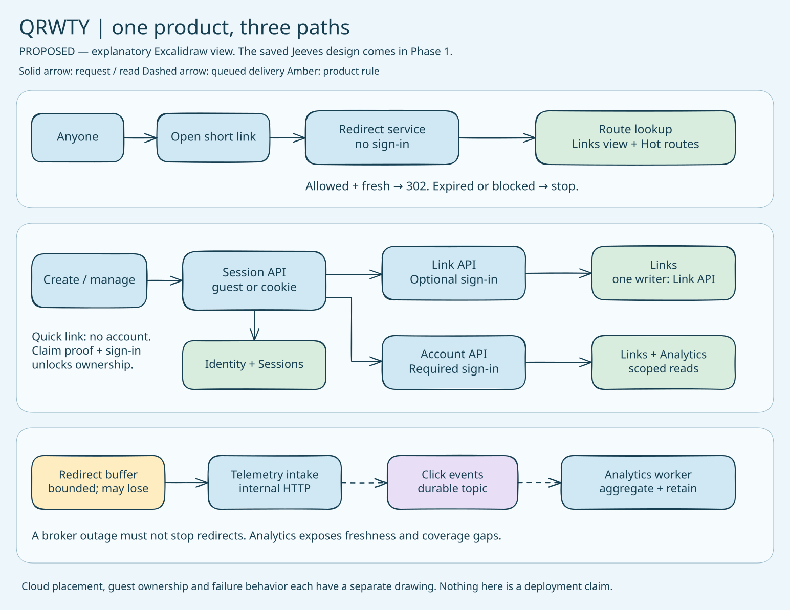

# qrwty <!-- omit from toc -->

[qrwty](https://qrwty.io) grew out of a [brainstorm about QR-code tracking](https://github.com/ashfordhill/brainstorm/blob/main/archives/QR%20Code%20Tracking/README.md), which spawned from a [local neighborhood project](https://github.com/ashfordhill/qr-code-tracking). The original niche use case involved hardware: I wanted to record where I installed QR codes using my phone's GPS while I was running around placing posters & QR codes in random spots.

- [Business value?](#business-value)
  - [What about custom hardware?](#what-about-custom-hardware)
- [Research notes](#research-notes)
- [Future moves](#future-moves)

## Business value?

Even while exploring whether QR-code tracking could become a profitable business, I was doubtful:

- The first use case—tracking engagement with posters—felt too niche. 
- As a general QR analytics use case, there are already plenty of existing solutions for that, which puts pressure on pricing for new competitors.

QR-code tracking is already offered by SaaS companies such as:

- [Uniqode](https://www.uniqode.com/)
- [QR.io](https://qr.io/)
- [Hovercode](https://hovercode.com/)

Analytics can make QR codes useful in many settings, including on physical products. 

I am uneasy about competing in a market where success may depend more on winning business deals than on building the best product. Reaching those deals often takes a sales-oriented person with the time and network to build relationships, which is not my forte.

### What about custom hardware?

One possible way for `qrwty` to stand out was custom hardware: print an outdoor-ready thermal label and record its location on the spot, as I wanted to do for the neighborhood tree-poster project. Since a smartphone and a printer can already handle this, custom hardware is not worth exploring.

## Research notes

I asked several frontier AI models to research the business idea. Their semi-slop findings were not compelling enough to change my initial doubts:

- The QR-code SaaS market is crowded.
- An [open-core](./business-analysis/ai-generated-reports-fable-5.1/README.md#g-open-core) model with enterprise hosting *might* be worth exploring.
- Custom hardware appears unnecessary and could distract from the software opportunity.
- Small, local use cases like poster tracking may take more effort to sell and support than they can justify.

## Future moves

Qrwty can still serve as a guinea pig for a software design generation project I'm working on - if a large chunk of the infrastructure can be generated well for a service like this, then great. Further exploration would (hopefully) not take as much time.

## Production build experiment

The [phased build plan](docs/plans/production-build/README.md) defines a public link/QR service
with anonymous quick links, individual free/paid accounts, management and durable click analytics,
a real cloud deployment and two comparable implementations: [with Jeeves](docs/plans/production-build/units.md) and
[without Jeeves](docs/plans/production-build/baseline-units.md).

**Status: experiment frozen (Q00, run `qrwty-r1-20261114`); local build first, then cloud work
within the GCP free-trial credit only.** The [neutral pack](docs/benchmarks/neutral-pack/v1/README.md)
holds the shared inputs both builds use. The application
has not been generated, built or deployed. The first
application phase saves the architecture in Jeeves before generating into this repository.
The drawing below is a proposed Excalidraw explanation, not a saved Jeeves diagram or runtime
verification. The actual Jeeves diagram and export will be linked here when Q01–Q02 complete.

The [local-to-cloud contract](docs/plans/production-build/local-to-cloud.md) requires production
containers, real GCP adapters, migrations and infrastructure definitions during the local build.
Later deployment should promote the same artifacts through configuration, secrets and provisioning.
Real managed-service compatibility, recovery and scale checks remain pending until cloud activation.

Start execution with the [coordinator prompt](docs/plans/production-build/coordinator-prompt.md)
and [readiness check](docs/plans/production-build/readiness.md): one fresh subagent at a time,
independent implementations, measured work and explicit review gates.

[Editable Excalidraw](docs/diagrams/system-overview.excalidraw) ·
[Guest ownership](docs/diagrams/guest-ownership.svg) ·
[Redirect failures](docs/diagrams/redirect-failure.svg) ·
[Cloud deployment](docs/diagrams/cloud-deployment.svg) ·
[Billing lifecycle](docs/diagrams/billing-lifecycle.svg) ·
[All diagram sources](docs/diagrams/README.md)

The [cloud strategy](docs/plans/production-build/cloud-strategy.md) follows the GCP preference,
with Cloudflare at the edge. [Budget options](docs/plans/production-build/budget-options.md) separate
development, regional HA launch and later recovery capacity. Every eligible GET redirect must
wait for a [durable click acknowledgment](docs/plans/production-build/durable-clicks.md); missing
or uncertain acknowledgment produces a temporary error. Anonymous links have no automatic expiry.
The [billing contract](docs/plans/production-build/billing-contract.md) covers subscriptions and
server-enforced tiers; downgrades do not break existing published links. No custom domains or teams.
The [UI brief](docs/plans/production-build/design-brief.md) calls for an original, restrained
Liquid Glass interface; both reviewed directions are built as switchable skins, with a
reviewer's default the owner may override.

### Source and effort measurement

Counts are pending, rather than estimated. Backend and UI are deliberately separate. “Template
share” measures retained generated backend source, not the percentage of the whole product or
the time saved. [Counting and comparison protocol](docs/plans/production-build/comparison.md) ·
[Machine-readable status](docs/benchmarks/status.json)

| Source measure | Jeeves-assisted QRWTY | Independent QRWTY |
| --- | ---: | ---: |
| Untouched reusable generated backend baseline LOC | Not generated | Not applicable |
| Retained generated backend LOC | Not measured | Not applicable |
| Backend LOC written after generation / independently | Not measured | Not measured |
| Removed or replaced baseline LOC | Not measured | Not applicable |
| Final backend production LOC | Not measured | Not measured |
| Template share of final backend | Not measured | Not applicable |
| UI source LOC (JS/TS, CSS and markup subtotals) | Not built | Not built |
| Product SQL / infrastructure / scripts / tests | Separate counts pending | Separate counts pending |

| Effort and outcome | Jeeves-assisted QRWTY | Independent QRWTY |
| --- | --- | --- |
| Exact models and execution settings | [Pinned](docs/benchmarks/neutral-pack/v1/frozen/decisions.md#7-execution-model-settings-and-review-policy) (Opus builders, Fable xhigh reviewers); actual IDs from transcripts | Same pinned settings |
| Model requests, prompts and tokens | [Run ledger](docs/benchmarks/runs/qrwty-r1-20261114/README.md) started; no build run | Ledger created at B00; no build run |
| Template development / application / UI effort | Separate totals pending | Independent effort pending |
| Human review time and failed attempts | To be recorded | To be recorded |
| Provider-reported / estimated model cost | Pending, distinguished | Pending, distinguished |
| Proven traffic tier / cloud cost | Not deployed | Not deployed |
| Recovery, security and maintenance-change results | Not run | Not run |

Remaining [owner choices](docs/plans/production-build/README.md#owner-steering-questions) are
spend beyond the GCP trial credit, load/failover proof, live prices and a production release;
execution settings and local fixtures are frozen in the neutral pack. GCP
preference, guest permanence, durable capture, individual free/paid accounts and the controlled
comparison are recorded. Existing research above remains background, not the release checklist.
