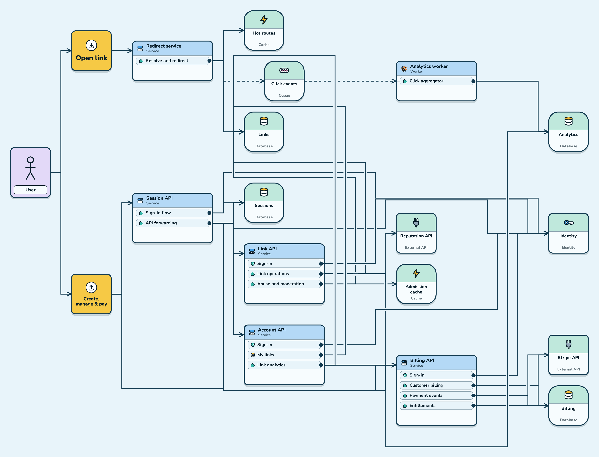

# qrwty <!-- omit from toc -->

[qrwty](https://qrwty.io) grew out of a [brainstorm about QR-code tracking](https://github.com/ashfordhill/brainstorm/blob/main/archives/QR%20Code%20Tracking/README.md), which spawned from a [local neighborhood project](https://github.com/ashfordhill/qr-code-tracking). The original niche use case involved hardware: I wanted to record where I installed QR codes using my phone's GPS while I was running around placing posters & QR codes in random spots.

- [Results after finishing A (2026-11-15)](#results-after-finishing-a-2026-11-15)
- [Results](#results)
- [Business value?](#business-value)
  - [What about custom hardware?](#what-about-custom-hardware)
- [Research notes](#research-notes)
- [Future moves](#future-moves)

## Results after finishing A (2026-11-15)

After the wind-down, A was regenerated from Jeeves `0aea8e7` (A1) and finished in A2–A7: sessions,
redirect, analytics, abuse controls, billing in Stripe test mode, and a UI. It runs at
[qrwty.io](https://qrwty.io). B is as it was at the wind-down. Backend only: the UI is excluded.

**A now vs B** (backend source lines, source-loc-v2)

| Backend area | A generated (R) | A hand-written (C) | A total | B hand-written |
| --- | ---: | ---: | ---: | ---: |
| Platform | 2,558 | 0 | 2,558 | 1,821 |
| Process entry points and wiring | 807 | 0 | 807 | 985 |
| Sessions and accounts | 51 | 1,385 | 1,436 | 1,773 |
| Links | 19 | 1,286 | 1,305 | 1,181 |
| Redirect | 18 | 324 | 342 | 719 |
| Analytics | 35 | 380 | 415 | 1,893 |
| Abuse | 15 | 494 | 509 | 476 |
| Billing | 45 | 1,129 | 1,174 | not built |
| Edge (A: the Worker, not counted) | – | – | – | 513 |
| **Total** | **3,548** | **4,998** | **8,546** | **9,361** |

- **Scope.** A has billing (1,129 lines written); B doesn't. Without it, A wrote 3,869. UI is
  excluded on both sides: A's is in `web/`, and B built none. A's edge is the Cloudflare Worker
  (`deploy/cloudflare/src`, 418 lines, 217 of them from before A2), outside `app/` and not counted.
- **Template share: 41.52%**, with all 11 stubs written. G0 3,572 = 3,495 scaffolding + 77 stub
  bodies; R 3,548, D 24.
- **Helpers and QG fixes.** For the same diagram, Jeeves `0aea8e7` generates 646 more lines than
  `4e87f97`. A used all four helpers: `declareSettings` in all 11 stubs, `defineRoutes` for 9 route
  tables, `idempotent` for owned create, claim and checkout, and `transaction` for edit and delete.
  B wrote its own: a transaction wrapper (118), idempotency (108) and a settings registry (1,752,
  outside its 9,361). Where a helper didn't fit, A wrote its own code: the guest create's sealed
  replay (AG-18), click dedup in SQL (AG-30) and per-copy admission counts (AG-31). The QG fixes
  changed the generated runtime, and A1 adapted A's IaC to QG28, QG29 and QG34; A1's only
  product-code change was QL05's settings. Lines saved weren't measured.
- **Tests · SQL · infrastructure** (not in the totals): A 5,058 · 1,497 (1,342 written) · 3,086
  (2,746 without JSON); B 11,058 · 476 · 13,193 (8,298 without JSON).
- **How it was counted.** A: the committed runner ([`tools/loc`](tools/loc/README.md),
  source-loc-v2, Jeeves `4e87f97`) up to `0647e4a`. Its pinned files are byte-identical at
  `0aea8e7`. The runner refuses `3179494` as the baseline, because Q06's code is in it. So the
  baseline is the clean `0aea8e7` export of the same input: A1's fresh export, each file matching
  `3179494`'s manifest by SHA-256, committed in a scratch clone. A's areas follow tiles and modules;
  B's are S02's (`f2fb3ce`). source-loc-v2's name rule drops A's `settings.ts` files (141
  generated, 93 written) and B's `config/` (1,752; B is 11,113 with it).
  [A8 evidence](docs/evidence/a8/checks.md).

**A v1 vs A now**

| | Jeeves commit | Generated (G0 / R) | Hand-written (C) | Total (B) | Template share | Features covered |
| --- | --- | --- | ---: | ---: | ---: | --- |
| A v1 (after Q06) | `4e87f97` | 2,926 (2,871 + 55) / 2,925 | 720 | 3,645 | 80.25% | Guest link creation only (1 of 11 stubs) |
| A now (A7, `0647e4a`) | `0aea8e7` + A1–A7 | 3,572 (3,495 + 77) / 3,548 | 4,998 | 8,546 | 41.52% | All 11 stubs: guest links, sign-in and sessions, my links, redirect with durable clicks, analytics, abuse controls, billing (Stripe test mode); a UI, not counted |

At A1 (`3179494`), before A2–A7, A was R 3,569, C 761, B 4,330: 82.42%. The share falls as stubs
are written, as the run's limitations predicted.

## Results

Run `qrwty-r1-20261114` built the same backend twice, with Jeeves (A) and without it (B), and was
wound down on 2026-11-15. Backend only: UI is excluded, and neither arm built one. What each
version looked like and could do: [qrwty.io/versions](https://qrwty.io/versions/).

| | A: with Jeeves | B: without Jeeves |
| --- | --- | --- |
| Built | Jeeves's generated backend, plus guest link creation (1 of 11 stubs); one live deploy, torn down | Platform, guest links, sessions and accounts, redirect with durable clicks, abuse controls, analytics; staging at b.qrwty.io, torn down |
| Never written | Sign-in and sessions, redirect, my links, analytics, billing, abuse moderation (10 stubs) | Billing and plans |
| Backend source LOC | Generated (G0): 2,926 = 2,871 + 55 stub bodies. After Q06: 2,925 kept (R) + 720 written (C) = 3,645 (B). At A's last commit: C 770, B 3,695 | 9,361 written (77 files): platform 1,821 · links 1,181 · abuse 476 · sessions and accounts 1,773 · redirect 719 · analytics 1,893 · edge 513 · process entry points 985 |
| Template share | 80.25% after Q06 (79.16% at the end), for the guest-link slice only | Not applicable |
| Tests · SQL · infrastructure (lines) | 1,867 · 421 (286 written) · 2,059 | 11,058 · 476 · 13,193 (8,298 without JSON data) |
| Guest link creation, like for like | 720 TypeScript + 286 SQL = 1,006 | 608 TypeScript + 59 SQL = 667, plus 398 of guest session and edge forwarding that A never wrote |
| Model requests | 5,203: 1,180 product, 201 gap audit, 3,822 Jeeves template work (QG units and reviews) | 3,064 |
| Tokens: input side (cache reads) · output | 1,260 M (98.8%) · 4.41 M | 991 M (99.0%) · 3.48 M |
| Agent time · span (UTC) | 29.5 h (7.5 product, 1.2 audit, 20.8 Jeeves) · 11-14 05:59 to 11-15 13:37 | 21.7 h · 11-14 09:18 to 11-15 12:13 |
| API-price estimate, not a bill | $453–513 (product $112–123, audit $32–40, Jeeves $309–350) | $336–371 |

- **How it was counted.** A: the committed source-loc-v2 runner ([`tools/loc`](tools/loc/README.md),
  Jeeves `4e87f97`) at Q06 and at A's last commit `a6f982b`. B: S02's counter, which uses the same
  runner's parser and eligibility rules on B's Git objects at `f2fb3ce`. SQL and infrastructure are
  nonblank lines, comments kept. source-loc-v2 also drops B's `src/platform/config/` (1,752 lines of
  settings registry and validation) because the folder is named `config`; with it, B is 11,113.
- **Like for like.** A's C (Link API's guest create, 10 files) and its SQL, below the generated
  header, against the seven `src/links/` files and the migration B03 added, counted at B03's commit.
  A's slice includes a Web Risk check (53 lines); B wrote its Web Risk client later, in B06 (139).
- **Effort.** Taken from both ledgers' request records. Agent time adds up attempt windows. Lanes
  overlapped, and Q06's window includes a usage-limit pause. Prices are list prices per million
  tokens: Opus 5.5 $4 in, $20 out; Fable 5.1 $10 in, $50 out; cache reads $0.20 and $0.25. Cache
  writes cost 1.25× to 2× input; the ledger doesn't record which, hence the range. Neither total
  includes the planning, the coordinator, the QL planner (527,714 tokens) or the owner's time. The
  shared units (Q00, N01–N06, S01, Q11: 983 requests, $90–98) count for neither arm.
- **Jeeves.** Of QG01–QG34, 30 units are done and 4 deferred (QG13–QG16). Arm A found 17 of the 30
  (QG01–QG12 from its audit, QG30–QG34 from AG-01 to AG-09); reviews found 13 (QG17–QG29). Reviews
  QGR1–QGR3 are done; QG35 is ready and QG36–QG39 wait for the owner. Only 17 landed before A's freeze
  at `4e87f97`. Jeeves's QL plan (`docs/plans/qrwty-lessons/`) estimates a QRWTY-like app's
  template share at about 35% today. Its library units would raise that to about 49%, and workload
  identity with a Browser session template to about 64%. These estimates come from B's line counts,
  not from a measurement, and none of them is built yet.
- **A's live deploy** found five more gaps (AG-13 to AG-17), none fixed yet: no workload identity
  for an External API, no ID token on calls between tiles, `/healthz` reserved by Cloud Run, no
  regional Pub/Sub endpoint, and no log line on drain.

**Limitations.** The arms' scope differs: only the like-for-like row compares the same work. The run
was wound down mid-way, with no billing, UI, load or failover work in either arm, and A's share
would fall as more stubs were written. B's code informed the QL plan, and one B-derived setting is in
A's frozen baseline: QG09's F3, the Pub/Sub reconnect bound from B's B05 review. Both arms shared one
Auth0 tenant and one GCP trial project, under separate prefixes.

Records: [versions](https://qrwty.io/versions/) ([A](https://qrwty.io/versions/a/) ·
[B](https://qrwty.io/versions/b/) · [design](https://qrwty.io/versions/design/) ·
[original page](https://qrwty.io/versions/original/)) ·
[S02 evidence and method](docs/evidence/s02/checks.md) · [Q06 LOC](docs/evidence/q06/loc/summary.json) ·
[final A LOC](docs/evidence/s02/loc/a-final/summary.json) · [B LOC](docs/evidence/s02/loc/counter/summary.json) ·
[effort per attempt](docs/evidence/s02/effort/effort.json) · [Q13 deploy](docs/evidence/q13/checks.md) ·
[A-found gaps](docs/evidence/q13/a-found-gaps.md)

## Business value?

Even while exploring whether QR-code tracking could become a profitable business, I was doubtful:

- The first use case—tracking engagement with posters—felt too niche. 
- As a general QR analytics use case, there are already plenty of existing solutions for that, which puts pressure on pricing for new competitors.

QR-code tracking is already offered by SaaS companies such as:

- [Uniqode](https://www.uniqode.com/)
- [QR.io](https://qr.io/)
- [Hovercode](https://hovercode.com/)

Analytics can make QR codes useful in many settings, including on physical products. 

I am uneasy about competing in a market where success may depend more on winning business deals than on building the best product. Reaching those deals often takes a sales-oriented person with the time and network to build relationships, which is not my forte.

### What about custom hardware?

One possible way for `qrwty` to stand out was custom hardware: print an outdoor-ready thermal label and record its location on the spot, as I wanted to do for the neighborhood tree-poster project. Since a smartphone and a printer can already handle this, custom hardware is not worth exploring.

## Research notes

I asked several frontier AI models to research the business idea. Their semi-slop findings were not compelling enough to change my initial doubts:

- The QR-code SaaS market is crowded.
- An [open-core](./business-analysis/ai-generated-reports-fable-5.1/README.md#g-open-core) model with enterprise hosting *might* be worth exploring.
- Custom hardware appears unnecessary and could distract from the software opportunity.
- Small, local use cases like poster tracking may take more effort to sell and support than they can justify.

## Future moves

Qrwty can still serve as a guinea pig for a software design generation project I'm working on - if a large chunk of the infrastructure can be generated well for a service like this, then great. Further exploration would (hopefully) not take as much time.

## Production build experiment

The [phased build plan](docs/plans/production-build/README.md) defines a public link/QR service
with anonymous quick links, individual free/paid accounts, management and durable click analytics,
a real cloud deployment and two comparable implementations: [with Jeeves](docs/plans/production-build/units.md) and
[without Jeeves](docs/plans/production-build/baseline-units.md).

**Status: A is finished and live at [qrwty.io](https://qrwty.io), with a UI; B is torn down.** Run
`qrwty-r1-20261114` was wound down on 2026-11-15 ([Results](#results)): B's staging at b.qrwty.io
and A's one live deploy were recorded, then removed. A was then regenerated from Jeeves `0aea8e7`
(A1) and finished in A2–A7 on the GCP trial credit, with Stripe in test mode only
([Results after finishing A](#results-after-finishing-a-2026-11-15)). The
[neutral pack v1.6](docs/benchmarks/neutral-pack/v1.6/README.md) holds the shared inputs both builds
used. Q05 froze the generated baseline in [`app/`](app/README.md) (commit `33d50e9`, Jeeves
revision 84, frozen generator Jeeves `4e87f97`): it builds and starts. Q06 wrote one stub body and
its product SQL, and Q13 deployed A's application once and tore it down. The saved Jeeves
diagram and its export are linked below. The Excalidraw drawing after them is a proposed
explanation, not a saved Jeeves diagram or runtime verification.

**Live sites:** [qrwty.io](https://qrwty.io) is A's app. A Cloudflare Worker (Free plan) serves the
UI from `web/` and the static [versions pages](https://qrwty.io/versions/), and forwards `/api`,
`/auth` and short links to A's services on Cloud Run. Redeploy A with `infra/gcp/scripts/redeploy.sh`
([details](infra/README.md#redeploy)), or only the Worker with `deploy/cloudflare/deploy.sh`
([details](deploy/cloudflare/README.md)). `b.qrwty.io` redirects to B's record at `/versions/b/`.

The [local-to-cloud contract](docs/plans/production-build/local-to-cloud.md) requires production
containers, real GCP adapters, migrations and infrastructure definitions during the local build.
Later deployment should promote the same artifacts through configuration, secrets and provisioning.
Real managed-service compatibility, recovery and scale checks remain pending until cloud activation.

Start execution with the [coordinator prompt](docs/plans/production-build/coordinator-prompt.md)
and [readiness check](docs/plans/production-build/readiness.md): one fresh subagent at a time,
independent implementations, measured work and explicit review gates.

### Saved Jeeves diagram

The backend as saved in Jeeves: project **QRWTY · production candidate v1**, revision 84, Detailed
view (each tile's modules shown), exported by the studio ([Q05 checks](docs/evidence/q05/checks.md)).
Revision 84 changed one setting: the Click events queue runs on **Google Cloud** Pub/Sub. A queue's
provider isn't drawn, so the image is the same as revision 83's. Jeeves generates code from this
diagram: 3 of its 14 modules come from a template (Sign-in) and 11 are stubs to write. The frozen
generator (Jeeves `4e87f97`) exported it untouched into [`app/`](app/README.md), the generated
baseline: it builds and starts healthy, and every product route still answers 501. That is the
measurement starting point, not the application.

[Simple view](docs/evidence/q05/jeeves/QRWTY-production-candidate-v1-r84.png) ·
[Saved source JSON](docs/evidence/q05/jeeves/QRWTY-production-candidate-v1-r84-source.json) ·
[Blueprint v3](docs/evidence/q05/jeeves/blueprint-v3-r84.json) ·
[Generation report](app/.jeeves/report.json) ·
[Provenance](docs/evidence/q05/jeeves/provenance.json) ·
[Baseline checks, studio comparison and LOC runner](docs/evidence/q05/checks.md)

History: [revision 83](docs/evidence/q01/jeeves/QRWTY-production-candidate-v1-r83-detailed.png)
(Q01, Click events on the default broker) ·
[its source JSON](docs/evidence/q01/jeeves/QRWTY-production-candidate-v1-r83-source.json) ·
[provenance](docs/evidence/q01/jeeves/provenance.json) ·
[as-found export ZIP](docs/evidence/q02/artifact/sha256-dcaff3aa004e3b2a04b09c2162e7b7c5295c13f4927d3ece31af9339b2a3cd14.zip) ·
[export classification and build](docs/evidence/q02/checks.md) ·
[scope inventory](docs/evidence/q02/scope-inventory.md)

### Explanatory overview (Excalidraw)

Not a Jeeves diagram; nothing is generated from it. It explains product policy and deployment
that Jeeves does not model.

[Editable Excalidraw](docs/diagrams/system-overview.excalidraw) ·
[Guest ownership](docs/diagrams/guest-ownership.svg) ·
[Redirect failures](docs/diagrams/redirect-failure.svg) ·
[Cloud deployment](docs/diagrams/cloud-deployment.svg) ·
[Billing lifecycle](docs/diagrams/billing-lifecycle.svg) ·
[All diagram sources](docs/diagrams/README.md)

The [cloud strategy](docs/plans/production-build/cloud-strategy.md) follows the GCP preference,
with Cloudflare at the edge. [Budget options](docs/plans/production-build/budget-options.md) separate
development, regional HA launch and later recovery capacity. Every eligible GET redirect must
wait for a [durable click acknowledgment](docs/plans/production-build/durable-clicks.md); missing
or uncertain acknowledgment produces a temporary error. Anonymous links have no automatic expiry.
The [billing contract](docs/plans/production-build/billing-contract.md) covers subscriptions and
server-enforced tiers; downgrades do not break existing published links. No custom domains or teams.
The [UI brief](docs/plans/production-build/design-brief.md) calls for an original, restrained
Liquid Glass interface. Q11 chose one visual direction in the owner's style, and the UI is built as
that one skin, with no second skin and no reviewer's pick (owner decisions §11).

### Source and effort measurement

Counts are measured, never estimated, with the pinned [source-count runner](tools/loc/README.md)
(source-loc-v2, backend only). Backend and UI are deliberately separate. “Template share”
measures retained generated backend source, not the percentage of the whole product or the time
saved. The baseline's share is 100% by definition; it means something only once product code is
written. [Counting and comparison protocol](docs/plans/production-build/comparison.md) ·
[Machine-readable status](docs/benchmarks/status.json) ·
[Baseline report](docs/evidence/q05/loc/summary.json) ·
[Q06 report](docs/evidence/q06/loc/summary.json) ·
[A's last commit and B (S02)](docs/evidence/s02/checks.md)

| Source measure | Jeeves-assisted QRWTY | Independent QRWTY |
| --- | ---: | ---: |
| Untouched reusable generated backend baseline LOC (G0) | 2,926 = 2,871 scaffolding + 55 stub bodies (Q05, `33d50e9`) | Not applicable |
| Retained generated backend LOC (R) | 2,925 after Q06 (2,926 at the baseline) | Not applicable |
| Backend LOC written after generation / independently (C) | 720 after Q06 (Link API's guest create); 770 at A's last commit (`a6f982b`) | 9,361 (`f2fb3ce`, S02's counter with the same parser) |
| Removed or replaced baseline LOC (D) | 1 after Q06 (a stub's `throw`) | Not applicable |
| Final backend production LOC (B) | 3,645 after Q06; 3,695 at A's last commit | 9,361 |
| Template share of final backend | 80.25% after Q06, 79.16% at A's last commit (100% at the baseline, by definition); the backend was never completed | Not applicable |
| UI source LOC (JS/TS, CSS and markup subtotals) | 0 (no `web/`) | 0 (no UI built) |
| Product SQL / infrastructure / scripts / tests | Product SQL 411 (286 written); own `infra/` 2,059; tests 1,867 | SQL 476; infrastructure 13,193; tests 11,058 |

| Effort and outcome | Jeeves-assisted QRWTY | Independent QRWTY |
| --- | --- | --- |
| Exact models and execution settings | [Pinned](docs/benchmarks/neutral-pack/v1.6/frozen/decisions.md#7-execution-model-settings-and-review-policy) (Opus builders, Fable xhigh reviewers); actual IDs from transcripts | Same pinned settings |
| Model requests, prompts and tokens | 5,203 requests; 1,260 M input-side and 4.41 M output tokens ([run ledger](docs/benchmarks/runs/qrwty-r1-20261114/README.md)) | 3,064 requests; 991 M and 3.48 M (B's ledger) |
| Template development / application / UI effort | Jeeves QG units and reviews 3,822 requests (20.8 agent-hours); gap audit 201 (1.2 h); product 1,180 (7.5 h); no UI | All product: 3,064 (21.7 h); no UI |
| Human review time and failed attempts | Owner minutes not recorded; one blocked attempt (QG01 a1) | Owner minutes not recorded; no failed attempt in the ledger |
| Provider-reported / estimated model cost | None reported; estimate $453–513 at list prices | None reported; estimate $336–371 |
| Proven traffic tier / cloud cost | One deploy, about USD 0.23 (resource lifetimes at list prices); no traffic tier proven | Staging about USD 142 a month at list prices while it ran (B-final); no traffic tier proven |
| Recovery, security and maintenance-change results | Not run | Rollback and rotation on staging (B09); no comparison run |

Remaining [owner choices](docs/plans/production-build/README.md#owner-steering-questions) are
spend beyond the GCP trial credit, load/failover proof, live prices and a production release;
execution settings and local fixtures are frozen in the neutral pack. GCP
preference, guest permanence, durable capture, individual free/paid accounts and the controlled
comparison are recorded. Existing research above remains background, not the release checklist.
