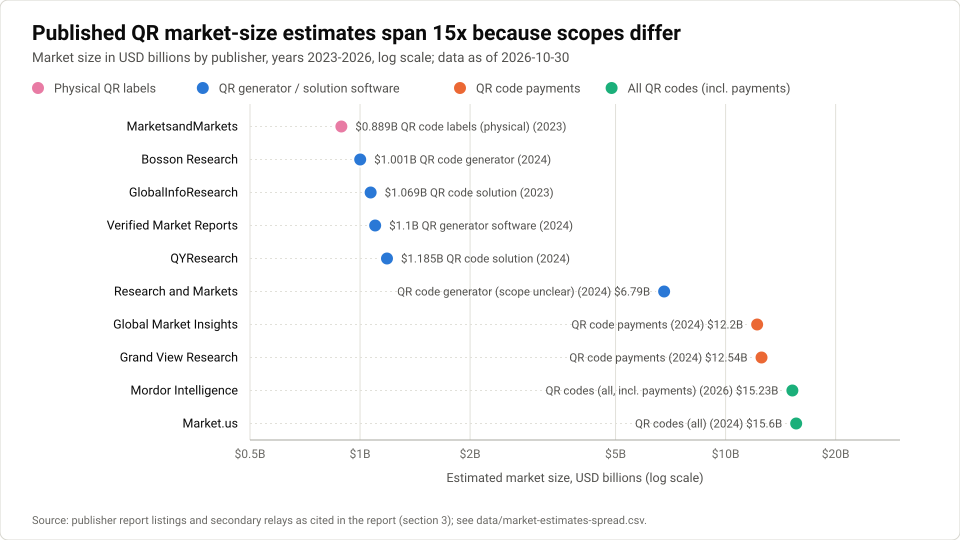
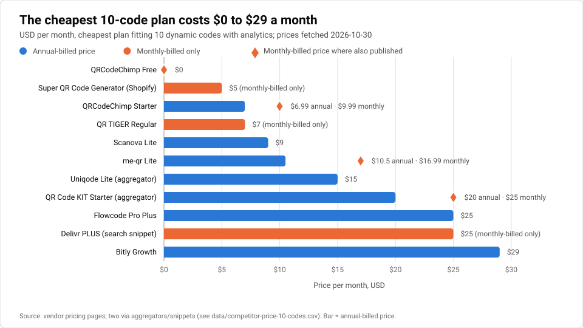
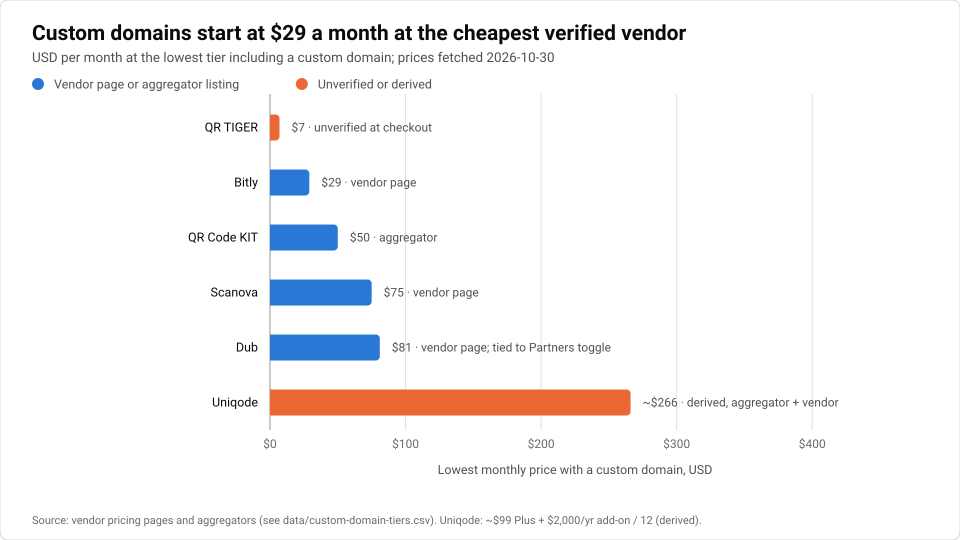
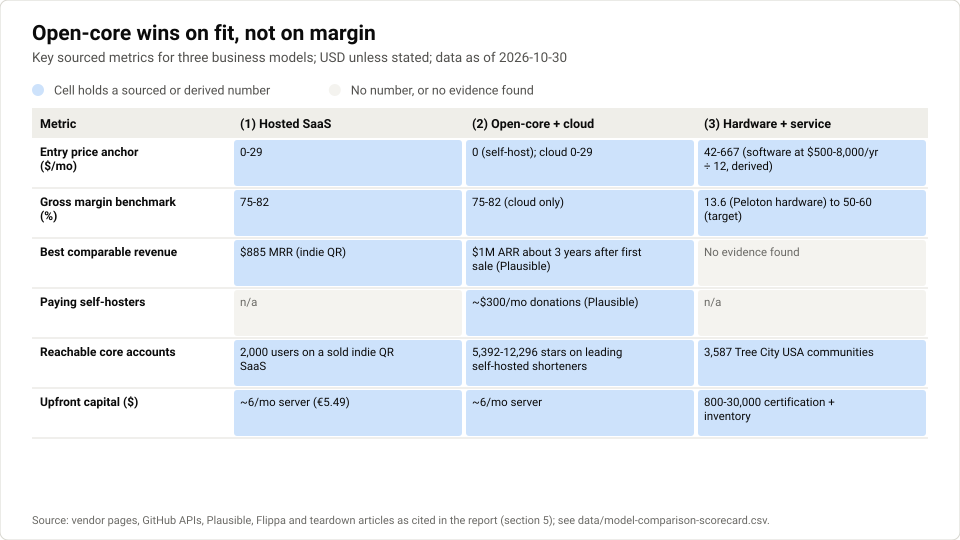
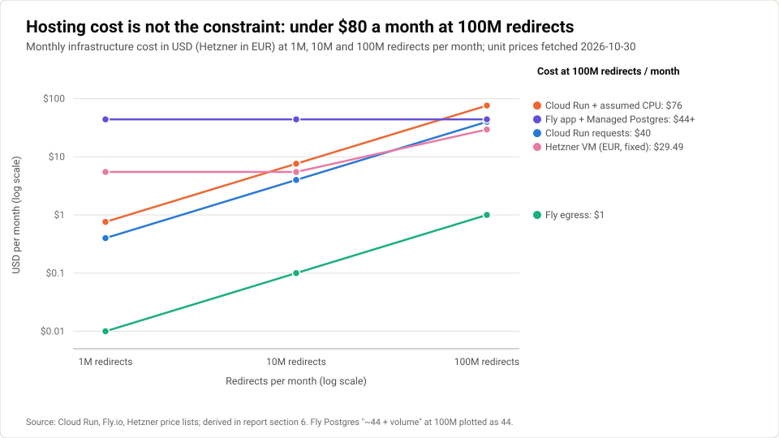
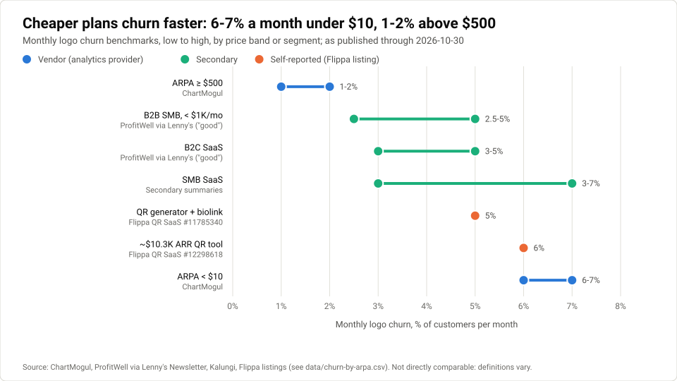
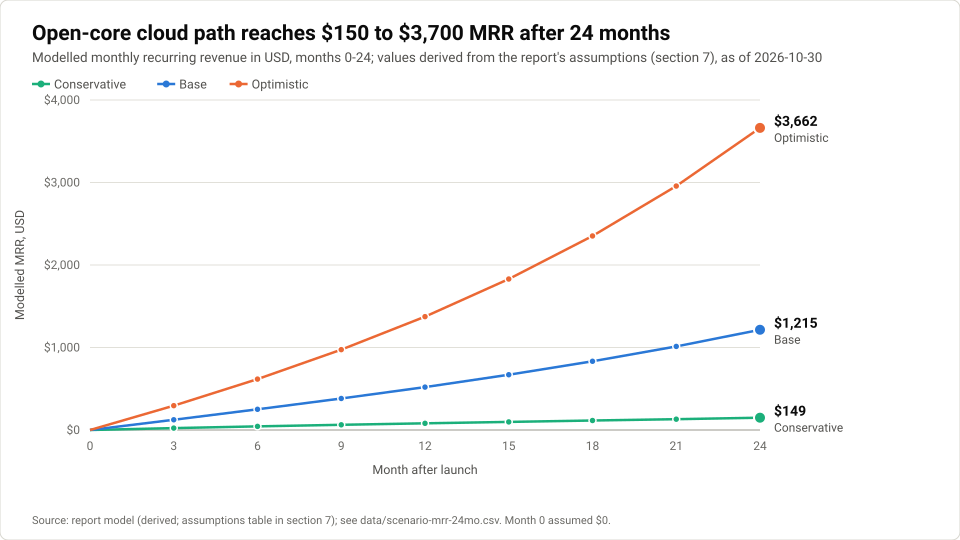

# qrwty can sell ownership, not cheaper QR codes

**Prepared 2026-10-30**

A market and business-model assessment of whether qrwty can make money by selling ownership (codes that keep working because the customer holds the domain, the data and the code) rather than cheaper QR codes, built from published evidence.

## Contents

- [Read this first: the three reports in one page](#read-this-first-the-three-reports-in-one-page)
- [Executive summary](#executive-summary)
- [1 Product and problem: printed codes break when the subscription lapses](#1-product-and-problem-printed-codes-break-when-the-subscription-lapses)
- [2 Target audiences: five segments, thin evidence on willingness to pay](#2-target-audiences-five-segments-thin-evidence-on-willingness-to-pay)
- [3 Market size and demand: estimates span about 17x because they measure different things](#3-market-size-and-demand-estimates-span-about-17x-because-they-measure-different-things)
- [4 Competitive landscape: price is already near zero; custom domains are the lock](#4-competitive-landscape-price-is-already-near-zero-custom-domains-are-the-lock)
- [5 Business-model options compared: open-core wins on fit, not on margin](#5-business-model-options-compared-open-core-wins-on-fit-not-on-margin)
- [6 Pricing and unit economics: about $280 lifetime value caps acquisition spend near $85](#6-pricing-and-unit-economics-about-280-lifetime-value-caps-acquisition-spend-near-85)
- [7 Profit scenarios: $150 to $3,700 MRR after 24 months](#7-profit-scenarios-150-to-3700-mrr-after-24-months)
- [8 Go-to-market: organic, long-tail and open-source channels only](#8-go-to-market-organic-long-tail-and-open-source-channels-only)
- [9 Risks and open questions](#9-risks-and-open-questions)
- [10 Recommendation and next 90 days](#10-recommendation-and-next-90-days)
- [Sources](#sources)
- [Glossary](#glossary)

## How this folder is organised

- `README.md`: this report, with charts embedded
- `report.pdf`: the same report as a printable PDF
- `field-device-applications.md` / `.pdf`: companion report on applications beyond tree tagging (print, signs, hunts, inventory)
- `connected-device-opportunities.md` / `.pdf`: companion report on where a connected device (display, [actuator](#g-actuator), printer) is the product rather than an add-on
- `build-pdf.cjs`: rebuilds `report.pdf` from this README (`node build-pdf.cjs`); pass an input and output path to build another report (`node build-pdf.cjs field-device-applications.md field-device-applications.pdf`)
- `charts/`: SVG charts and `render.mjs`, which regenerates them from `data/` (`node charts/render.mjs`)
- `data/`: the CSV behind each chart
- `research_notes/`: the desk-research notes the report draws on
- Each report ends with a glossary of the business and technical terms it uses

## Read this first: the three reports in one page

Added 2026-10-31 after a review of the three reports together. It replaces nothing below; it tells a reader which conclusions to act on and in what order.

**What the three reports agree on.** qrwty should not build or sell custom hardware. Its sellable difference is ownership: a [custom domain](#g-custom-domain) on the cheapest paid tier, a full export of the [redirect table](#g-redirect-table), and open code that can be [self-hosted](#g-self-hosting). The money is small in every scenario, and the evidence-backed expectation is the conservative case in section 7, not the base case.

| Report | Question it answers | Verdict | What it adds to the plan |
| --- | --- | --- | --- |
| This report | Can qrwty make money, for whom, under which model? | [Open-core](#g-open-core) with a paid cloud, sold on ownership; hardware on hold | The cloud product, the price ladder and the Agency-first go-to-market |
| [Field device applications](field-device-applications.md) | Does on-the-spot QR labelling have a market beyond tree tagging? | No application needs a device; phone-based placement capture is a software feature; hunts and trails are the best-evidenced payer | One software feature (placement capture) and three cheap pilots, all of which wait for a working cloud |
| [Connected device opportunities](connected-device-opportunities.md) | Where is a connected device intrinsic to the job? | Rotating codes and scan-to-[actuate](#g-actuator) as software on customer-owned hardware; no fleet, no ESL, no small-ticket vending | Two software features and two paid pilots, also after the cloud exists |

**What qrwty is for decides the verdict.** The reports never state the founder's goal, and the recommendation changes with it. The founder has not yet chosen; the plan below assumes the first option.

- *Income.* The conservative case (about $150 [MRR](#g-mrr) at month 24) is the expectation and the base case (about $1,200) is the target. The one experiment that moves the model most is the Agency tier: three paying Agency accounts are worth more than the whole conservative case (section 7). Run that first, and defer everything in the companion reports until the cloud has paying customers.
- *Exit.* The indicative sale values in section 7 (about $2K to $120K) say the business is not worth building for a sale on its own. Build it only if it also serves another goal.
- *Proving ground for Jeeves, the generator that built qrwty.* The business case is secondary. Ship the ownership features because they are good engineering and cheap, skip the pilots, and measure Jeeves rather than MRR.

**One plan, in order.** The three reports propose about sixteen experiments between them, with three different first customers (agencies, hunt organisers, operators of unattended assets). A solo founder can run one sequence:

| Phase | What | Waits on | Specified in |
| --- | --- | --- | --- |
| 0 | State the goal (above) and adopt the conservative case as the planning case | Nothing | This section |
| 1 | Cloud foundation: plans and billing, custom domains with automatic [TLS](#g-tls), redirect-table export, lapsed-plan state, [AGPL](#g-agpl) licence, one-command self-host deploy | Nothing. This is the product the price ladder assumes, and it does not exist yet (section 10) | This report, sections 6 and 10 |
| 2 | Agency test: ten interviews and three founding Agency accounts; six to eight [long-tail](#g-long-tail) pages; [funnel](#g-funnel) instrumentation | Phase 1 | This report, sections 8 and 10 |
| 3 | Placement capture as a cloud feature, then one trail pilot and one poster pilot | Paying customers from phase 2 | Field device report, section 9 |
| 4 | Rotating codes, then scan-to-actuate in Stripe test mode; one paid pilot each | Paying customers from phase 2; order phases 3 and 4 by whichever customer asks first | Connected device report, section 9 |
| Not on current evidence | Custom hardware, ESL, small-ticket vending, item-level inventory, tree-tagging hardware, paid ads, [lifetime deals](#g-lifetime-deal) | A buyer who pays first | All three reports |

---

**Market and business-model assessment** · prepared 30 October 2026 from desk research notes dated 2026-10-30; reviewed and revised 31 October 2026

A market and business-model assessment (also called an opportunity assessment or lean business plan) tests whether a product can make money, for whom and under which model, using published evidence; unlike an investor business plan, it does not pitch a fundraise or assume growth, and it states what is unknown as plainly as what is known.

How to read the evidence labels: **vendor** = published by the company about itself or its market; **self-reported** = a founder's or seller's own figures (for example a marketplace listing); **aggregator** = a third-party site that summarises or estimates (G2, Capterra, Sacra, Latka, Toolradar and similar); **secondary** = a blog or article relaying another party's study that this research did not read directly; **derived** = arithmetic done in this report on cited numbers; **assumption** = a modelling input with no direct source. Prices are USD per month unless stated, as fetched on 2026-10-30.

## Executive summary

qrwty is viable as a small, [bootstrapped](#g-bootstrapped) business, not as a [venture-scale](#g-venture-scale) one. The evidence supports one path: an [open-source](#g-open-source), [self-hostable](#g-self-hosting) core that earns money through a paid hosted cloud, sold on continuity (codes keep working, customers own their domain and can export their [redirect table](#g-redirect-table)) rather than on price. Hosted [dynamic-QR codes](#g-dynamic-qr) already cost **$0-29 a month** for ten codes with analytics [[4]](https://www.qrcodechimp.com/pricing)[[1]](https://Enterprise.Qrcode-Tiger.com/payment)[[3]](https://scanova.io/pricing/)[[8]](https://www.flowcode.com/pricing)[[9]](https://bitly.com/pages/pricing), free tools dominate search, and every indie QR business with verifiable revenue sits between **$0 and about $900 [MRR](#g-mrr)** [[24]](https://trustmrr.com/startup/qr-hero)[[116]](https://trustmrr.com/startup/izoukhai)[[35]](https://flippa.com/12298618-profitable-qr-code-saas-with-98-margins-10-3k-arr-2-000-users-6-churn-scalable-low-overhead-seo-strong-with-ai-search-visibility)[[136]](https://trustmrr.com/startup/crazyqrcode.md). The conservative case in this report ends at about **$150 MRR after 24 months**; the base case reaches about **$1,200 MRR and $11,400 cumulative profit before founder pay**. The base case sits above every [Stripe-verified](#g-stripe-verified) QR comparable found (the best is $885 MRR) [[116]](https://trustmrr.com/startup/izoukhai), so it is a target rather than an expectation; the conservative case is the one the comparables support. The field-label device has no demonstrated demand, a small reachable market and grant-dependent buyers.

| Model | Verdict | Main reason |
| --- | --- | --- |
| (1) Hosted [SaaS](#g-saas) only | **Viable only at micro scale; not recommended as the lead** | Price floor is $0-7 for ten codes [[4]](https://www.qrcodechimp.com/pricing)[[1]](https://Enterprise.Qrcode-Tiger.com/payment); incumbents hold search (qr-code-generator.com ~7.9M visits/month, aggregator) [[109]](https://semrush.com/website/qr-code-generator.com/overview); affordable [CAC](#g-cac) ~$50-100 (derived) versus a $700-940 self-serve benchmark (secondary) [[33]](https://www.saashero.net/strategy/maxio-cac-benchmarks-b2b-saas/) |
| (2) [Open-core](#g-open-core) with paid cloud | **Conditionally viable; recommended path** | [Custom domains](#g-custom-domain) are gated at $29-266/month elsewhere [[9]](https://bitly.com/pages/pricing)[[3]](https://scanova.io/pricing/)[[7]](https://www.uniqode.com/pricing); lock-in complaints are widespread [[13]](https://www.trustpilot.com/review/www.qr-code-generator.com)[[17]](https://northpennnow.com/news/2026/apr/02/your-qr-code-stops-working-the-moment-you-stop-paying/); no maintained QR-first self-hosted product exists [[57]](https://api.github.com/repos/shlinkio/shlink)[[75]](https://api.github.com/search/repositories?q=dynamic+qr+code+self-hosted&sort=stars). Self-hosters themselves pay almost nothing (Plausible: ~$300/month in donations) [[65]](https://ingest.plausible.io/blog/community-edition) |
| (3) Hardware device + service | **Not viable as a product business now; test as a paid pilot only** | No integrated competitor found, but also no demand evidence; ~3,587 [Tree City USA](#g-tree-city-usa) communities [[94]](https://extension.psu.edu/is-your-community-ready-to-become-a-tree-city) means 1% adoption is ~36 customers (derived); federal grant money was frozen and partly cancelled in 2025 [[98]](https://tcimag.tcia.org/advocacy-regulatory-compliance/inflation-reduction-act-funding-freeze-faces-legal-challenges/)[[99]](https://planning.org/planning/2025/sep/axed-federal-funding-leaves-urban-forests-out-on-a-limb/); hardware margins are hard to hold [[107]](https://eightx.co/blog/peloton-teardown)[[108]](https://www.wevolver.com/article/why-do-hardware-startups-fail) See the companion reports for applications beyond tree tagging and for where a connected device is intrinsic. |

Profit is small in every scenario. Over 24 months the three scenarios for the recommended path give **$149, $1,215 and $3,662 MRR in month 24** and **$362, $11,420 and $34,637 cumulative profit before founder pay** (derived, section 7). [Free-to-paid conversion](#g-free-to-paid) and signup volume move the result more than [churn](#g-churn) does over this horizon, and customer mix moves it as much: if one paying customer in five is on the Agency tier, base-case profit rises by about half (section 7). Three findings would change the verdict: a paid pilot for the field device that closes at $1,000 or more a year, self-host-to-cloud conversion above 2% of active installs, or 30 paying cloud customers inside six months.

## 1 Product and problem: printed codes break when the subscription lapses

qrwty issues stable redirect URLs, lets the owner edit where each one points, and counts scans over time. Because the URL printed in the QR code never changes, a menu, sign or label can be repointed without reprinting. It is [self-hostable](#g-self-hosting), and a prototype field device prints [GPS](#g-gnss-gps)-tagged QR labels on site.

The problem it addresses is documented. Hosted vendors tie code activity to the subscription. Scanova's [dynamic codes](#g-dynamic-qr) stop when its 14-day trial ends [[3]](https://scanova.io/pricing/). Uniqode says on its own blog that one missed renewal can deactivate every dynamic code, printed ones included (vendor) [[18]](https://www.uniqode.com/blog/qr-code-basics/qr-codes-expiry). QR TIGER's free codes deactivate at a 500-scan cap [[17]](https://northpennnow.com/news/2026/apr/02/your-qr-code-stops-working-the-moment-you-stop-paying/). QR Code Generator PRO, owned by Bitly, scores **1.3/5 on Trustpilot from 9,341 reviews**, and reviewers mainly complain of codes stopping after a trial, unexpected annual renewals and refused refunds [[13]](https://www.trustpilot.com/review/www.qr-code-generator.com). Individual complaints include a fundraiser's postcard codes deactivated pending monthly payment [[129]](https://www.trustpilot.com/review/www.qr-code-generator.com?page=9) and a charity gala programme code that hit an error page, with $120 to reactivate it (relayed by a sponsored article) [[17]](https://northpennnow.com/news/2026/apr/02/your-qr-code-stops-working-the-moment-you-stop-paying/).

Owning a domain on a vendor's plan does not fully solve this. [DNS](#g-dns) still points at the vendor's servers, so leaving means migrating the [redirect table](#g-redirect-table), and the notes found no vendor that documents a redirect-table export (no evidence found). An [open-source](#g-open-source) QR author makes the same point: dynamic codes last only as long as the domain they point at, so self-hosting helps only if the owner holds the domain before printing [[76]](https://dev.to/flob95/it-started-with-a-birthday-present-why-i-built-an-open-source-qr-code-generator-394i).

Two limits matter. "Never expires" and "one-time payment" are already common claims among micro-competitors: Hacker News shows a steady run of such launches, each with 1-6 points [[114]](https://hn.algolia.com/api/v1/search?query=dynamic%20QR%20code&tags=story&hitsPerPage=15), and the newcomers include QRever, Truly Free QR and FreeQR [[23]](https://www.indiehackers.com/post/no-monthly-fee-for-qr-codes-dynamic-hosted-pages-that-are-stuck-to-a-wall-for-years-hyK0emMYwPvTc7gblo7l). The pain is real, but continuity alone is not a unique claim. The defensible version is structural (customer-owned domain, exportable data, open code) rather than a promise.

## 2 Target audiences: five segments, thin evidence on willingness to pay

None of the notes contains segment-level purchase data, typical code counts or price-[sensitivity](#g-sensitivity) surveys (no evidence found). The segments below are inferred from price anchors, complaint patterns and adjacent markets, and should be read as hypotheses to test.

| Segment | Evidence of need | [Willingness-to-pay](#g-willingness-to-pay) signal | How to reach | Fit by model |
| --- | --- | --- | --- | --- |
| **A. Small agencies, print shops, sign makers and Etsy QR-sign sellers** (manage codes for many clients) | [Custom domain](#g-custom-domain) and [white-label](#g-white-label) sit in upper tiers almost everywhere [[3]](https://scanova.io/pricing/)[[7]](https://www.uniqode.com/pricing)[[11]](https://toolradar.com/tools/qrcodekit/pricing); "qr code" gets 2.74M monthly searches *on Etsy* (Etsy tool data) [[29]](https://www.rankhero.com/keywords/qr-code) | Tiers with domains and bulk: QR Code KIT Pro $50-65 (aggregator) [[11]](https://toolradar.com/tools/qrcodekit/pricing), Scanova Pro $75 [[3]](https://scanova.io/pricing/), Dub Business $81 (Partners toggle; Links price not captured) [[62]](https://dub.co/pricing) | Etsy and print-shop partnerships, agency [long-tail](#g-long-tail) search; partnership costs not researched | Model 2 cloud, Agency tier |
| **B. Privacy-minded and EU organisations, technical [SMBs](#g-smb) and [self-hosters](#g-self-hosting)** | Self-hosted shorteners have large followings: YOURLS 12,296 [stars](#g-github-stars), Kutt 11,183, Shlink 5,392 [[58]](https://api.github.com/repos/YOURLS/YOURLS)[[59]](https://api.github.com/repos/thedevs-network/kutt)[[57]](https://api.github.com/repos/shlinkio/shlink); scan-log IPs are likely personal data under [GDPR](#g-gdpr) (secondary) [[39]](https://www.unitag.io/blog/european-qr-code-platform-gdpr-dpp-compliance/)[[40]](https://qrplanet.com/blog/article/the-gdpr-qr-code-auditor-is-your-qr-code-provider-really-gdpr-compliant) | Self-hosters pay almost nothing: Plausible reports ~$300/month in donations (self-reported) [[65]](https://ingest.plausible.io/blog/community-edition). Hosted analytics peers charge $9-20 entry [[63]](https://umami.is/pricing)[[64]](https://plausible.io/blog/open-source-saas) | GitHub, self-hosting directories [[22]](https://www.qrstuff.com/feeds/blog/self-hosted-dynamic-qr-code); Reddit and HN willingness-to-pay threads not retrievable | Model 2: distribution, not revenue |
| **C. Local SMBs and organisers with printed material** (restaurants, salons, events, weddings, nonprofits) | 65% of US adults have used a QR menu (Ipsos, secondary) [[26]](https://www.duck-hub.com/blog/qr-code-menu-statistics); most complaint stories are printed postcards, programmes and stationery [[129]](https://www.trustpilot.com/review/www.qr-code-generator.com?page=9)[[17]](https://northpennnow.com/news/2026/apr/02/your-qr-code-stops-working-the-moment-you-stop-paying/) | Very price-sensitive: Shopify QR apps at $5-15 [[111]](https://apps.shopify.com/super-qr-codes); a reviewer objected to $29 for 10 codes [[112]](https://shoplist.co/shopify-apps/qrpro-qr-code-generator). Toast ([POS](#g-pos) vendor) found 81% of diners prefer physical menus [[25]](https://pos.toasttab.com/blog/on-the-line/qr-code-menu-insights) | Long-tail search ("qr code stopped working", "no expiry"), Shopify/WordPress apps | Model 1/2 Starter tier; high [churn](#g-churn) |
| **D. Small [CPG](#g-cpg) and food brands preparing for [GS1](#g-gs1) [Sunrise 2027](#g-sunrise-2027)** | GS1 US advises moving QR codes to [GS1 Digital Link](#g-gs1-digital-link) carrying the [GTIN](#g-gtin), with 2027 as the industry milestone; it is not a legal mandate [[27]](https://www.gs1us.org/industries-and-insights/by-topic/sunrise-2027)[[28]](https://www.videojet.com/us/homepage/resources/learn/gs1-sunrise-2027.html) | GS1's own survey: 62% of consumers would pay more for detailed product info (interested party) [[27]](https://www.gs1us.org/industries-and-insights/by-topic/sunrise-2027); no evidence on brand software budgets | GS1 content and packaging suppliers; requires a GS1 Digital Link resolver feature | Model 2, only after a feature build |
| **E. Field asset-labelling teams** (urban forestry nonprofits, parks, municipalities) | Cities tag trees with QR codes (Bromley, Tel Aviv, Hong Kong's 200,000+ trees) [[80]](https://www.bromley.gov.uk/news/article/612/a-treemendous-way-to-keep-track-of-the-borough-s-trees)[[79]](https://strich.io/industry/case-studies/wetag/)[[81]](https://www.thestandard.com.hk/news/article/168413/QR-code-tree-tags-put-up-on-200000-trees-next-year), usually from tags made in bulk in advance [[82]](https://mycoordinates.org/citizen-science-tree-inventory/); 3,587 [Tree City USA](#g-tree-city-usa) communities [[94]](https://extension.psu.edu/is-your-community-ready-to-become-a-tree-city) among 90,837 US local governments [[95]](https://www.census.gov/library/publications/2026/econ/govtorg2225.html) | Tree inventory software costs $1,500-8,000/year [[86]](https://softwarefinder.com/facility-management-software/tree-plotter-inventory)[[87]](https://davey.com/environmental-consulting-services/treekeeper-inventory-management-software); GoCodes asset tracking $500-2,500/year [[83]](https://gocodes.com/prices/) | Direct outreach, arborist associations, grant-funded projects; procurement rules not researched | Model 3 only |

Segment A is the strongest fit for qrwty's differentiator, because a reseller's own reputation depends on codes that keep working after a client stops paying. Segment C is the largest but cheapest and least loyal. Segment B brings attention, not revenue. Segment E is the only one where the device matters, and it is the least evidenced.

## 3 Market size and demand: estimates span about 17x because they measure different things

Published market sizes run from about **$1B to $16B**, and the spread comes almost entirely from scope. Narrow "QR code generator / solution" software estimates cluster at **$1.0-1.2B in 2024 with 11-15% [CAGR](#g-cagr)** [[41]](https://www.marketresearch.com/Bosson-Research-v4252/Global-Qr-Code-Generator-Research-42446065)[[42]](https://www.giiresearch.com/report/qyr1862369-qr-code-solution-global-market-share-ranking.html)[[43]](https://www.marketresearch.com/GlobalInfoResearch-v4117/Global-QR-Code-Solution-Company-38328621). One listing puts the "QR code generator market" at $6.79B with no visible scope [[44]](https://www.researchandmarkets.com/reports/6090148/qr-code-generator-market-global-forecast). Figures of $12-16B describe the whole QR ecosystem, including payments [[47]](https://scoop.market.us/qr-codes-market-news/)[[45]](https://qrcodechimp.com/qr-code-statistics). None of these could be checked against a methodology page: they come from report listings, teasers and vendor blogs quoting them. No named research firm publishes a figure for [dynamic-QR](#g-dynamic-qr) software alone (no evidence found).

Data

| Estimate | Scope | Year | USD B | Source type | Source |
| --- | --- | --- | --- | --- | --- |
| MarketsandMarkets | QR code labels (physical) | 2023 | 0.889 | secondary (via Scanova blog) | [[50]](https://scanova.io/blog/qr-code-statistics/) |
| Bosson Research | QR code generator | 2024 | 1.001 | report listing | [[41]](https://www.marketresearch.com/Bosson-Research-v4252/Global-Qr-Code-Generator-Research-42446065) |
| GlobalInfoResearch | QR code solution | 2023 | 1.069 | report listing | [[43]](https://www.marketresearch.com/GlobalInfoResearch-v4117/Global-QR-Code-Solution-Company-38328621) |
| "Verified Market Reports" | QR generator software | 2024 | 1.1 | low reliability (content-farm page) | [[56]](https://sites.google.com/view/nextlevelresearchgroup/trend-analysis/qr-code-generator-software-market) |
| QYResearch | QR code solution | 2024 | 1.185 | report listing | [[42]](https://www.giiresearch.com/report/qyr1862369-qr-code-solution-global-market-share-ranking.html) |
| Research and Markets | QR code generator (scope unclear) | 2024 | 6.79 | report teaser | [[44]](https://www.researchandmarkets.com/reports/6090148/qr-code-generator-market-global-forecast) |
| Global Market Insights | QR code payments | 2024 | 12.2 | publisher page | [[48]](https://www.gminsights.com/industry-analysis/qr-codes-payment-market) |
| Grand View Research | QR code payments | 2024 | 12.54 | report listing | [[49]](https://www.marketresearch.com/Grand-View-Research-v4060/QR-Code-Payment-Size-Share-41604195) |
| Mordor Intelligence | QR codes (all, incl. payments) | 2026 | 15.23 | secondary (via vendor blogs) | [[45]](https://qrcodechimp.com/qr-code-statistics)[[46]](https://www.qr-code-generator.com/blog/are-qr-codes-dead/) |
| Market.us | QR codes (all) | 2024 | 15.6 | aggregator | [[47]](https://scoop.market.us/qr-codes-market-news/) |

The only figure that points toward the dynamic segment is Mordor's claim, relayed by two vendor blogs, that dynamic codes were **64.92% of QR format revenue in 2025** [[45]](https://qrcodechimp.com/qr-code-statistics)[[46]](https://www.qr-code-generator.com/blog/are-qr-codes-dead/). Applying that share to the $1.0-1.2B software estimates gives **$0.65-0.78B** (derived; it mixes two firms' scopes and is illustrative only).

Market size is not the binding constraint. The base scenario in section 7 ends at about $14,600 [ARR](#g-arr), roughly 0.0015% of a $1B market (derived). What limits qrwty is how many buyers it can reach cheaply.

Demand indicators are steady rather than accelerating. eMarketer forecast 94M US QR scanner users in 2023 and 102.6M by 2026 (secondary) [[45]](https://qrcodechimp.com/qr-code-statistics). A TEAM LEWIS survey of 1,000 US adults in 2024 found 68% had used a QR code in the previous year, and 29% named security as a concern (secondary) [[45]](https://qrcodechimp.com/qr-code-statistics). Free browser extensions report 600,000 to 700,000+ users each (vendor-reported) [[53]](https://chromewebstore.google.com/publisher/uniqode-phygital-inc/uc0ffb7224ee5b8e7ac9ae756d9b18474). Per-code traffic is low: across Scanova's customers (vendor data, May 2026), a typical business code gets **8-23 lifetime scans**, the top 0.5-5% of codes take 78-95% of scans, and 15.1-28.5% of live codes are never scanned [[50]](https://scanova.io/blog/qr-code-statistics/). Low volume per code keeps hosting costs per customer tiny (section 6), but it also makes scan-count analytics a thin value proposition for most small customers.

Two catalysts are often cited. [GS1](#g-gs1) [Sunrise 2027](#g-sunrise-2027) is a retail-industry milestone for [POS](#g-pos) scanners to read 2D barcodes, not a legal mandate, and linear barcodes are not being phased out [[27]](https://www.gs1us.org/industries-and-insights/by-topic/sunrise-2027)[[28]](https://www.videojet.com/us/homepage/resources/learn/gs1-sunrise-2027.html). It helps qrwty only if qrwty supports [GS1 Digital Link](#g-gs1-digital-link) resolution. QR payments are a separate and much larger market (Juniper, via secondary press: $5.4T payment value in 2025) [[45]](https://qrcodechimp.com/qr-code-statistics); qrwty does not compete in it.

## 4 Competitive landscape: price is already near zero; custom domains are the lock

### Hosted vendors

For ten [dynamic codes](#g-dynamic-qr) with analytics, the cheapest paid hosted options cost about **$7-10 a month**, mainstream brands cost **$15-29**, and one free tier covers ten codes at $0. Most low tiers are billed annually only, and every vendor ties code activity to the subscription.

| Vendor | Cheapest plan fitting 10 dynamic codes with analytics | [Custom domain](#g-custom-domain): availability and tier | Codes on lapse | Review score |
| --- | --- | --- | --- | --- |
| QRCodeChimp | Free $0 (10 codes, 1,000 scans/mo); Starter $6.99 annual or $9.99 monthly (50 codes) [[4]](https://www.qrcodechimp.com/pricing) | Apparently top tiers only (Ultima 2x+; page unclear) [[4]](https://www.qrcodechimp.com/pricing) | No evidence found | No evidence found |
| QR TIGER | Regular $7 (12 codes, unlimited scans) [[1]](https://Enterprise.Qrcode-Tiger.com/payment) | Listed as "use your own domain (white label)" from Regular (vendor page text; unverified at checkout) [[1]](https://Enterprise.Qrcode-Tiger.com/payment) | Stop when plan expires; free codes stop at 500 scans [[2]](https://www.capterra.com/p/10041460/QR-TIGER/)[[17]](https://northpennnow.com/news/2026/apr/02/your-qr-code-stops-working-the-moment-you-stop-paying/) | No evidence found |
| Scanova | Lite $9, annual only (10 codes) [[3]](https://scanova.io/pricing/) | Pro $75 annual (1 domain); extra domains $120/year [[3]](https://scanova.io/pricing/) | Stop when trial ends [[3]](https://scanova.io/pricing/) | No evidence found |
| me-qr | Lite $10.50 annual or $16.99 monthly [[5]](https://me-qr.com/pricing) | No evidence found | Free codes carry ads [[5]](https://me-qr.com/pricing) | No evidence found |
| Uniqode | Lite ~$15 annual (50 codes) (aggregator; official tiers ambiguous) [[6]](https://www.hackceleration.com/labs/uniqode-pricing)[[7]](https://www.uniqode.com/pricing) | $2,000 per domain per year add-on on Plus (~$99/mo, aggregator) [[6]](https://www.hackceleration.com/labs/uniqode-pricing)[[7]](https://www.uniqode.com/pricing) | Deactivated at subscription end [[17]](https://northpennnow.com/news/2026/apr/02/your-qr-code-stops-working-the-moment-you-stop-paying/)[[18]](https://www.uniqode.com/blog/qr-code-basics/qr-codes-expiry) | G2 4.8 (469 reviews) [[16]](https://www.g2.com/compare/flowcode-vs-uniqode-qr) |
| QR Code KIT | Starter $20 annual or $25 monthly (100 codes) (aggregator) [[11]](https://toolradar.com/tools/qrcodekit/pricing) | Pro $50-65 (1 domain) (aggregator) [[11]](https://toolradar.com/tools/qrcodekit/pricing) | No evidence found | No evidence found |
| Flowcode | Pro Plus $25 annual (up to 50 codes) [[8]](https://www.flowcode.com/pricing) | "Custom redirect domain: 5" on comparison table; tier unclear [[8]](https://www.flowcode.com/pricing) | No evidence found | No evidence found |
| Delivr | PLUS $25 monthly (100 codes) (search snippet) [[12]](https://delivr.com/plans) | No evidence found | No evidence found | No evidence found |
| Bitly | Growth $29 annual (10 QR codes created per month) [[9]](https://bitly.com/pages/pricing) | Included from Growth $29 [[9]](https://bitly.com/pages/pricing) | No evidence found | No evidence found |
| QR Code Generator PRO (Bitly) | Advanced (50 codes); euro price not captured; reviewers cite ~$120 and $220 a year [[10]](https://www.qr-code-generator.com/pricing/)[[13]](https://www.trustpilot.com/review/www.qr-code-generator.com) | [White-labelling](#g-white-label) via sales form only [[10]](https://www.qr-code-generator.com/pricing/) | Stop after 14-day trial [[17]](https://northpennnow.com/news/2026/apr/02/your-qr-code-stops-working-the-moment-you-stop-paying/) | Trustpilot 1.3 (9,341); Capterra 2.4 (82); G2 ~2.2-2.4 [[13]](https://www.trustpilot.com/review/www.qr-code-generator.com)[[14]](https://www.capterra.com/p/177261/QR-Code-Generator-Pro/reviews/)[[15]](https://www.g2.com/products/qr-code-generator-pro) |
| Super QR Code Generator (Shopify app) | Essential $5 (unlimited dynamic, analytics) [[111]](https://apps.shopify.com/super-qr-codes) | No evidence found | No evidence found | Shopify 4.6 (55 reviews) [[111]](https://apps.shopify.com/super-qr-codes) |
| Dub | Business $81 (Partners toggle; Links prices not extracted); no free tier shown [[62]](https://dub.co/pricing) | 100 domains on Business [[62]](https://dub.co/pricing) | No evidence found | No evidence found |

Data

| Vendor | Annual-billed $/mo | Monthly-billed $/mo | Source |
| --- | --- | --- | --- |
| QRCodeChimp Free | 0 | 0 | [[4]](https://www.qrcodechimp.com/pricing) |
| Super QR Code Generator (Shopify) | n/a | 5 | [[111]](https://apps.shopify.com/super-qr-codes) |
| QRCodeChimp Starter | 6.99 | 9.99 | [[4]](https://www.qrcodechimp.com/pricing) |
| QR TIGER Regular | n/a (not shown) | 7 | [[1]](https://Enterprise.Qrcode-Tiger.com/payment) |
| Scanova Lite | 9 | n/a (annual only) | [[3]](https://scanova.io/pricing/) |
| me-qr Lite | 10.50 | 16.99 | [[5]](https://me-qr.com/pricing) |
| Uniqode Lite (aggregator) | 15 | n/a (annual only) | [[6]](https://www.hackceleration.com/labs/uniqode-pricing) |
| QR Code KIT Starter (aggregator) | 20 | 25 | [[11]](https://toolradar.com/tools/qrcodekit/pricing) |
| Flowcode Pro Plus | 25 | n/a | [[8]](https://www.flowcode.com/pricing) |
| Delivr PLUS (search snippet) | n/a | 25 | [[12]](https://delivr.com/plans) |
| Bitly Growth | 29 | n/a (annual only) | [[9]](https://bitly.com/pages/pricing) |

Data

| Vendor | Lowest $/mo with custom domain | Basis | Verification | Source |
| --- | --- | --- | --- | --- |
| QR TIGER | 7 | Regular plan | vendor page text, unverified at checkout | [[1]](https://Enterprise.Qrcode-Tiger.com/payment) |
| Bitly | 29 | Growth, annual | vendor page | [[9]](https://bitly.com/pages/pricing) |
| QR Code KIT | 50 | Pro, annual | aggregator | [[11]](https://toolradar.com/tools/qrcodekit/pricing) |
| Scanova | 75 | Pro, annual | vendor page | [[3]](https://scanova.io/pricing/) |
| Dub | 81 | Business | vendor page; price tied to Partners toggle | [[62]](https://dub.co/pricing) |
| Uniqode | ~266 | ~$99 Plus + $2,000/yr ÷ 12 = $166.67 add-on | derived from aggregator + vendor | [[6]](https://www.hackceleration.com/labs/uniqode-pricing)[[7]](https://www.uniqode.com/pricing) |

Three patterns stand out. First, price is not an opening: QRCodeChimp's free tier and QR TIGER's $7 plan sit below any price a solo founder needs to charge. Second, **custom domains are the lock-in lever**. Apart from QR TIGER's unverified claim, the cheapest included domain is Bitly's $29 tier, and Uniqode charges $2,000 per domain per year [[9]](https://bitly.com/pages/pricing)[[7]](https://www.uniqode.com/pricing). Third, lapse behaviour is the main reputational weakness. The most-reviewed product, QR Code Generator PRO, scores 1.3/5 on Trustpilot, and the complaints centre on dead codes [[13]](https://www.trustpilot.com/review/www.qr-code-generator.com). Uniqode's 4.8 on G2 [[16]](https://www.g2.com/compare/flowcode-vs-uniqode-qr) shows the category can earn good reviews; it is not inherently hated.

Incumbents have scale and money. Bitly reported 325,000 paying customers and more than $75M [ARR](#g-arr) when it bought Egoditor (qr-code-generator.com) in December 2021 (self-reported) [[19]](https://techcrunch.com/2021/12/01/bitly-makes-first-acquisition-with-qr-code-leader-egoditor/). Uniqode raised a $25M Series A in January 2023 [[20]](https://yourstory.com/2023/01/beaconstac-raises-25-mn-led-by-telescope-partners-accel). Aggregators estimate Uniqode's revenue anywhere from $7.8M to $22.9M (aggregator, conflicting) [[54]](https://www.getlatka.com/companies/beaconstac.com)[[55]](https://prospeo.io/c/uniqode-revenue). One lifetime-deal QR service, SQR, reportedly removed custom domains and then shut down, according to user reviews (user anecdotes; no primary notice) [[21]](https://appsumo.com/products/square-qr/reviews/).

### Self-hosted alternatives

Mature [open-source](#g-open-source) shorteners exist, but QR is a side feature in all of them, and the dedicated QR projects are tiny.

| Project | [Stars](#g-github-stars) (2026-10-30) | Licence | QR support | Monetisation | Source |
| --- | --- | --- | --- | --- | --- |
| YOURLS | 12,296 | [MIT](#g-mit-licence) | Community plugins only | None found | [[58]](https://api.github.com/repos/YOURLS/YOURLS) |
| Kutt | 11,183 | MIT | None in core | Donations; lost its original kutt.it domain | [[59]](https://api.github.com/repos/thedevs-network/kutt) |
| Shlink | 5,392 | MIT | Built-in QR endpoint per short URL | None found; single maintainer | [[57]](https://api.github.com/repos/shlinkio/shlink) |
| Polr | 5,092 | [GPL-2.0](#g-gpl) | n/a | Dormant since May 2024 | [[60]](https://api.github.com/repos/cydrobolt/polr) |
| Dub | 25,049 | [AGPLv3](#g-agpl) + commercial `/ee` | Custom QR codes on all Links plans | Hosted [SaaS](#g-saas), now priced from about $81 (Partners toggle; Links price not captured) | [[61]](https://api.github.com/repos/dubinc/dub)[[62]](https://dub.co/pricing) |
| QR-specific repos (QRcodly, qr-track, QrForge, Quoda and others) | 1-106 | MIT/GPL/AGPL | Dynamic QR | None at scale | [[75]](https://api.github.com/search/repositories?q=dynamic+qr+code+self-hosted&sort=stars) |
| QRForge source code | n/a | Closed source | Dynamic QR | $39.99 one-time | [[75]](https://api.github.com/search/repositories?q=dynamic+qr+code+self-hosted&sort=stars) |

The gap is a maintained, QR-first, [self-hostable](#g-self-hosting) product with a usable interface for non-technical editors, not a lack of code. Dub is the only funded [open-core](#g-open-core) competitor with QR and analytics, and its pricing has moved up-market [[62]](https://dub.co/pricing). QRStuff (a competitor, so biased) notes that for small teams self-hosting often costs more than SaaS once [DevOps](#g-devops) time is counted [[22]](https://www.qrstuff.com/feeds/blog/self-hosted-dynamic-qr-code).

### The no-product substitute

The cheapest competitor is not a product. A customer who already owns a domain can print a static QR code that points at a path on that domain and change where the path goes with a redirect rule at the registrar or CDN (Cloudflare includes redirect rules on its free plan; the notes did not price this, so treat it as an assumption) or with a self-hosted shortener such as Shlink [[57]](https://api.github.com/repos/shlinkio/shlink). That gives continuity and ownership, the two things qrwty sells, for the price of a domain and an hour of setup, with no scan analytics. It is the realistic alternative for segment B and for the technical buyer in any segment. What it lacks is an interface a non-technical editor can use, per-code scan history, and a service that someone else keeps running. qrwty's paid cloud competes on those three things, not on the redirect itself, and the price ladder in section 6 is set against this option as much as against the hosted vendors.

## 5 Business-model options compared: open-core wins on fit, not on margin

| Dimension | (1) Hosted [SaaS](#g-saas) | (2) [Open-core](#g-open-core), [self-hosted](#g-self-hosting) plus paid cloud | (3) Hardware device plus service |
| --- | --- | --- | --- |
| **Revenue mechanics** | Monthly or annual subscription tiers by codes, seats and domains | Same cloud subscriptions; self-host is free; optional commercial licence or support (no price evidence) | Device sale (one-off) plus software subscription plus label consumables |
| **[Gross margin](#g-gross-margin)** | High: SaaS benchmarks 75-82% (secondary) [[34]](https://blog.mean.ceo/b2b-saas-pricing-benchmarks/), 77% subscription for [venture-scale](#g-venture-scale) firms (KeyBanc 2022) [[122]](https://kellblog.com/2022/10/30/key-takeaways-from-the-2022-keybanc-saas-metrics-survey/); a QR seller self-reports 98% [[35]](https://flippa.com/12298618-profitable-qr-code-saas-with-98-margins-10-3k-arr-2-000-users-6-churn-scalable-low-overhead-seo-strong-with-ai-search-visibility) | Same as (1) for the cloud; self-host has no cost of goods, but its support is uncompensated | Hardware 50-60%+ is the target in post-mortems [[106]](https://ideaproof.io/failure/plastc); Peloton hardware made 13.6% in [FY](#g-fy)2025 against ~69% on subscriptions [[107]](https://eightx.co/blog/peloton-teardown) |
| **[CAC](#g-cac) reality** | Self-serve CAC benchmark $700-940 (secondary, enterprise-skewed) [[33]](https://www.saashero.net/strategy/maxio-cac-benchmarks-b2b-saas/) against an affordable ~$50-100 (derived, section 6): only organic channels work | [Open source](#g-open-source) is the acquisition channel; no company discloses a self-host-to-cloud conversion rate (no evidence found) [[65]](https://ingest.plausible.io/blog/community-edition) | Direct sales into municipalities and nonprofits; no CAC evidence found |
| **Lock-in and trust** | qrwty would be one more vendor whose printed codes depend on its survival | Strongest: code, domain and data stay with the customer; [AGPL](#g-agpl) deters resellers, as Plausible's switch shows [[64]](https://plausible.io/blog/open-source-saas) | Physical labels outlive the vendor only if redirects are self-hostable |
| **Operational burden** | Uptime for redirects printed on physical media, which is a long-lived obligation | Same plus community support; PostHog and Plausible both refuse commercial support for self-hosters [[68]](https://posthog.com/docs/self-host)[[65]](https://ingest.plausible.io/blog/community-edition) | Inventory, certification ($800-2,000 for [unintentional-radiator](#g-intentional-radiator) testing; $20,000-30,000 for intentional radiators) [[104]](https://docs.particle.io/hardware/certification/certification/), shipping, 3-5% damaged units (promotional source) [[108]](https://www.wevolver.com/article/why-do-hardware-startups-fail) |
| **Capital needed** | Low: €5.49/month server [[71]](https://privatedevops.com/news/hetzner-june-2026-cloud-price-increase-what-to-do) | Low | High: each unit consumes cash before it earns it [[108]](https://www.wevolver.com/article/why-do-hardware-startups-fail); [Raspberry Pi](#g-raspberry-pi) 5 prices rose three times in 2025-26 [[103]](https://www.tomshardware.com/raspberry-pi/component-shortages-drive-raspberry-pi-prices-up-by-up-to-23-percent-escalating-lpddr4-lpddr5-costs-trigger-the-third-price-hike-of-the-year) |
| **Evidence from comparables** | Indie QR SaaS: $548 [MRR](#g-mrr) (QR-Hero) [[24]](https://trustmrr.com/startup/qr-hero), $885 MRR (izoukhai) [[116]](https://trustmrr.com/startup/izoukhai), ~$10.3K [ARR](#g-arr) (Flippa, self-reported) [[35]](https://flippa.com/12298618-profitable-qr-code-saas-with-98-margins-10-3k-arr-2-000-users-6-churn-scalable-low-overhead-seo-strong-with-ai-search-visibility) | Plausible: $64 MRR in May 2019 to $1M ARR in June 2022 with 7,000+ subscribers (self-reported) [[64]](https://plausible.io/blog/open-source-saas); Ghost funded entirely by managed hosting [[70]](https://ghost.org/open/). Self-host donations ~$300/month [[65]](https://ingest.plausible.io/blog/community-edition) | No integrated print-at-site + [GPS](#g-gnss-gps) + analytics product found [[78]](https://techdocs.zebra.com/link-os/latest/)[[82]](https://mycoordinates.org/citizen-science-tree-inventory/); workarounds are a phone plus a $27-40 Niimbot or $307+ Zebra printer [[102]](https://slickdeals.net/f/19335714-niimbot-b1-thermal-label-printer-230-count-2-x1-18-labels-5-colors-15)[[100]](https://www.staples.com/product_IM17TT559) |

**Model 1** is a crowded commodity. Price anchors are $0-29 [[4]](https://www.qrcodechimp.com/pricing)[[9]](https://bitly.com/pages/pricing), and generator [head terms](#g-head-terms) belong to incumbents [[109]](https://semrush.com/website/qr-code-generator.com/overview). A new hosted generator without a structural difference competes on [SEO](#g-seo) against firms that publish statistics pages to win that traffic [[50]](https://scanova.io/blog/qr-code-statistics/)[[51]](https://www.qrcode-tiger.com/qr-code-trend)[[45]](https://qrcodechimp.com/qr-code-statistics).

**Model 2** is Model 1 with a different distribution channel and a credible trust story. Its weakness is well documented: the people who self-host do not pay. Plausible, the clearest small-team comparable, earns essentially all its revenue from the cloud, and its self-hosters give about $300 a month in donations [[65]](https://ingest.plausible.io/blog/community-edition). Projects in this category have also tended to tighten their licences as they grew: Plausible moved from [MIT](#g-mit-licence) to AGPL [[64]](https://plausible.io/blog/open-source-saas), Sentry introduced the [Functional Source License](#g-fsl) [[69]](https://blog.sentry.io/introducing-the-functional-source-license-freedom-without-free-riding), and Cal.com moved its commercial edition to closed source in April 2026 [[67]](https://alternativeto.net/news/2026/4/cal-com-is-going-closed-source-with-a-major-shift-in-its-license-strategy/). Choosing AGPL with a separate commercial directory from day one, as Dub does [[61]](https://api.github.com/repos/dubinc/dub), avoids a later backlash.

**Model 3** has a genuine gap in the market: no integrated product was found [[78]](https://techdocs.zebra.com/link-os/latest/)[[82]](https://mycoordinates.org/citizen-science-tree-inventory/). But a gap is not demand. The cheap workaround (phone, [Bluetooth](#g-ble) printer and a spreadsheet or [GIS](#g-gis)) means the device would sell on integration and ruggedness, not on printing [[102]](https://slickdeals.net/f/19335714-niimbot-b1-thermal-label-printer-230-count-2-x1-18-labels-5-colors-15)[[78]](https://techdocs.zebra.com/link-os/latest/). The best-funded buyers already pay $1,500-8,000 a year for tree inventory software [[86]](https://softwarefinder.com/facility-management-software/tree-plotter-inventory)[[87]](https://davey.com/environmental-consulting-services/treekeeper-inventory-management-software), and that software, not a label device, is what they budget for. Consumables offer little lock-in: a weatherproof polyester label costs about $0.03-0.22 before ribbon (derived from roll prices) [[90]](https://www.zoro.com/brady-weather-resistant-polyester-outdoor-labels-1-in-h-x-3-in-w-white-3000rl-tht-18-8591-3-wt/i/G115721743), durable anodised aluminium tags $0.87-2.98 each at 700 to 100 units [[88]](https://www.myassettag.com/custom-asset-tags), and both are sold by established suppliers.

Data

| Metric | (1) Hosted SaaS | (2) Open-core + cloud | (3) Hardware + service | Source |
| --- | --- | --- | --- | --- |
| Entry price anchor ($/mo) | 0-29 | 0 (self-host); cloud 0-29 | 42-667 (software at $500-8,000/yr ÷ 12, derived) | [[4]](https://www.qrcodechimp.com/pricing)[[9]](https://bitly.com/pages/pricing)[[83]](https://gocodes.com/prices/)[[87]](https://davey.com/environmental-consulting-services/treekeeper-inventory-management-software) |
| Gross margin benchmark (%) | 75-82 | 75-82 (cloud only) | 13.6 (Peloton hardware) to 50-60 (target) | [[34]](https://blog.mean.ceo/b2b-saas-pricing-benchmarks/)[[107]](https://eightx.co/blog/peloton-teardown)[[106]](https://ideaproof.io/failure/plastc) |
| Best comparable revenue | $885 MRR (indie QR) | $1M ARR about 3 years after first sale (Plausible) | No evidence found | [[116]](https://trustmrr.com/startup/izoukhai)[[64]](https://plausible.io/blog/open-source-saas) |
| Paying self-hosters | n/a | ~$300/mo donations (Plausible) | n/a | [[65]](https://ingest.plausible.io/blog/community-edition) |
| Reachable core accounts | 2,000 users on a sold indie QR SaaS | 5,392-12,296 [stars](#g-github-stars) on leading self-hosted shorteners | 3,587 [Tree City USA](#g-tree-city-usa) communities | [[35]](https://flippa.com/12298618-profitable-qr-code-saas-with-98-margins-10-3k-arr-2-000-users-6-churn-scalable-low-overhead-seo-strong-with-ai-search-visibility)[[57]](https://api.github.com/repos/shlinkio/shlink)[[58]](https://api.github.com/repos/YOURLS/YOURLS)[[94]](https://extension.psu.edu/is-your-community-ready-to-become-a-tree-city) |
| Upfront capital or fixed running cost ($) | ~6/mo server (€5.49) | ~6/mo server | 800-30,000 certification + inventory | [[71]](https://privatedevops.com/news/hetzner-june-2026-cloud-price-increase-what-to-do)[[104]](https://docs.particle.io/hardware/certification/certification/) |

## 6 Pricing and unit economics: about $280 lifetime value caps acquisition spend near $85

### Proposed price ladder

The ladder below matches the benchmark table on price and competes where incumbents are weakest: a [custom domain](#g-custom-domain) at the entry tier, data export on every tier, and a written [lapse policy](#g-lapse-policy). Prices are proposals (assumptions), not tested. Starter is also priced against the no-product substitute in section 4: $8 a month has to beat a free redirect rule on the customer's own domain by being usable by someone who would never set that up.

| Tier | Price (annual / monthly billing) | Includes | Benchmark it sits against |
| --- | --- | --- | --- |
| Community ([self-hosted](#g-self-hosting)) | $0, [AGPL](#g-agpl) | Unlimited codes; community support only | Shlink and YOURLS (free) [[57]](https://api.github.com/repos/shlinkio/shlink)[[58]](https://api.github.com/repos/YOURLS/YOURLS) |
| Cloud Free | $0 | 3 [dynamic codes](#g-dynamic-qr), qrwty domain, 90-day history | QR TIGER Free 3 codes [[1]](https://Enterprise.Qrcode-Tiger.com/payment); QRCodeChimp Free 10 codes [[4]](https://www.qrcodechimp.com/pricing) |
| Starter | $8 / $10 | 25 codes, **1 custom domain**, 12-month history, CSV/[redirect-table](#g-redirect-table) export | QR TIGER $7 [[1]](https://Enterprise.Qrcode-Tiger.com/payment); Scanova Lite $9 [[3]](https://scanova.io/pricing/); domains elsewhere from $29 [[9]](https://bitly.com/pages/pricing) |
| Pro | $24 / $29 | 250 codes, 3 domains, [API](#g-api), 3 seats, bulk edit | Flowcode $25 [[8]](https://www.flowcode.com/pricing); Bitly Growth $29 [[9]](https://bitly.com/pages/pricing); Uniqode Pro ~$49 (aggregator) [[6]](https://www.hackceleration.com/labs/uniqode-pricing) |
| Agency | $69 / $79 | 1,000 codes, 10 client domains, [white-label](#g-white-label), 10 seats | QR Code KIT Pro $50-65 (aggregator) [[11]](https://toolradar.com/tools/qrcodekit/pricing); Scanova Pro $75 [[3]](https://scanova.io/pricing/); Dub Business $81 (shown under its Partners toggle; the Links price was not captured) [[62]](https://dub.co/pricing) |
| Self-host commercial licence and support | Quote | [SSO](#g-sso), priority fixes | No price evidence found; peers reserve SSO and [SLAs](#g-sla) for top tiers [[63]](https://umami.is/pricing)[[62]](https://dub.co/pricing) |

**Lapse policy (proposed):** when a paid plan lapses, codes keep redirecting to their last destination for at least 12 months, editing is locked, and the owner can export everything. At Scanova's median of 8-23 lifetime scans per code [[50]](https://scanova.io/blog/qr-code-statistics/) and roughly $0.5-1 of [serverless](#g-serverless) compute per million redirects (derived, below), keeping lapsed codes alive costs close to nothing. This turns the category's main complaint [[13]](https://www.trustpilot.com/review/www.qr-code-generator.com) into a policy that customers can verify.

The policy needs a wind-down clause to be credible, because the risk customers fear most is the vendor disappearing, not a missed renewal. Proposed: if qrwty itself stops, customers get at least 12 months' notice, redirects keep running for that period, and the export plus the self-hosted release let them move the redirect table onto the domain they already control. Publishing that beside the lapse policy is the domain-continuity plan that section 9 calls for.

Annual billing is the default because secondary summaries say it cuts [churn](#g-churn) by about 40% [[31]](https://kalungi.com/blog/saas-churn-rate-benchmarks).

### Hosting cost is not the constraint

A redirect is a response of about 0.5 KB, so at the volumes in question bandwidth is negligible. Database writes for scan logs, and the founder's operations time, dominate cost [[73]](https://docs.fly.io/about/pricing)[[74]](https://cloud.google.com/run/pricing)[[72]](https://egresscost.com/hetzner).

Data

| Redirects / month | Cloud Run requests ($0.40/M) | Cloud Run requests + assumed CPU (~$0.76/M) | Fly [egress](#g-egress) at 0.5 KB ($0.02/GB) | Hetzner VM (€, fixed) | Fly app + Managed Postgres (fixed) | Source |
| --- | --- | --- | --- | --- | --- | --- |
| 1M | 0.40 (free under 2M tier) | 0.76 | 0.01 | 5.49 (CX23) | ~44 | [[74]](https://cloud.google.com/run/pricing)[[73]](https://docs.fly.io/about/pricing)[[71]](https://privatedevops.com/news/hetzner-june-2026-cloud-price-increase-what-to-do) |
| 10M | 4.00 | 7.60 | 0.10 | 5.49 (CX23) | ~44 | [[74]](https://cloud.google.com/run/pricing)[[73]](https://docs.fly.io/about/pricing)[[71]](https://privatedevops.com/news/hetzner-june-2026-cloud-price-increase-what-to-do) |
| 100M | 40.00 | 76.00 | 1.00 | 29.49 (CX53) | ~44 + volume | [[74]](https://cloud.google.com/run/pricing)[[73]](https://docs.fly.io/about/pricing)[[71]](https://privatedevops.com/news/hetzner-june-2026-cloud-price-increase-what-to-do) |

All values are derived from the cited unit prices; the CPU figure assumes 20 ms of one [vCPU](#g-vcpu) per redirect, and the 100M Hetzner row assumes batched scan writes. Hetzner raised prices by 30-37% across its range in April 2026 and repriced again in June [[71]](https://privatedevops.com/news/hetzner-june-2026-cloud-price-increase-what-to-do), so budget 30-50% headroom.

### Per-customer economics

| Metric | Conservative | Base | Optimistic | Basis |
| --- | --- | --- | --- | --- |
| Blended [ARPA](#g-arpa) ($/mo) | 10 | 14 | 16 | Assumption, set within ladder and competitor anchors [[1]](https://Enterprise.Qrcode-Tiger.com/payment)[[3]](https://scanova.io/pricing/)[[9]](https://bitly.com/pages/pricing). A $14 blend is about 90% Starter at $8 and 10% Agency at $69 (derived: 0.1 × 69 + 0.9 × 8 = 14.10); the mix rows in the section 7 [sensitivity](#g-sensitivity) table show what a larger Agency share is worth |
| Monthly logo churn | 7% | 5% | 3.5% | ChartMogul: 6-7% for <$10 ARPA [[120]](https://help.chartmogul.com/hc/en-us/articles/203359321); Lenny's/ProfitWell [B2B](#g-b2b-b2c) [SMB](#g-smb) "good" 2.5-5% [[30]](https://www.lennysnewsletter.com/p/monthly-churn-benchmarks); indie QR 5-6% (self-reported) [[35]](https://flippa.com/12298618-profitable-qr-code-saas-with-98-margins-10-3k-arr-2-000-users-6-churn-scalable-low-overhead-seo-strong-with-ai-search-visibility)[[36]](https://flippa.com/11785340-profitable-2-year-old-qr-code-generator-and-biolink-business-huge-potential); optimistic applies ~40% annual-billing reduction to base (derived) [[31]](https://kalungi.com/blog/saas-churn-rate-benchmarks). Caveat: these benchmarks come from products that gate domains and exports; qrwty's ownership features make leaving cheap by design, which should help conversion and may raise churn (no evidence either way) |
| Average lifetime (months) = 1 ÷ churn | 14.3 | 20 | 28.6 | Derived |
| Lifetime revenue = ARPA × lifetime | $143 | $280 | $457 | Derived |
| Infrastructure per customer at month 24 | ~$2.00 | ~$0.52 | ~$0.26 | Derived: hosting $30/$45/$60 ÷ month-24 customers (section 7) |
| Payment processing and tax handling | 5% | 5% | 5% | Assumption (no source in notes) |
| [Gross margin](#g-gross-margin) at month 24 | ~75% | ~91% | ~93% | Derived from section 7 model (hosting + fees) |
| [CAC](#g-cac) ceiling at 3:1 [LTV:CAC](#g-ltv-cac) | ~$36 | ~$85 | ~$142 | Derived: lifetime revenue × gross margin ÷ 3 |
| Published self-serve CAC | $700-940, [payback](#g-payback) 8-11 months | | | Secondary, enterprise-skewed [[33]](https://www.saashero.net/strategy/maxio-cac-benchmarks-b2b-saas/) |

The gap between a ~$85 CAC ceiling and a $700-940 benchmark is why paid acquisition fails here. With generator-intent clicks at $1.25-1.63 [CPC](#g-cpc) (Semrush, aggregator) [[109]](https://semrush.com/website/qr-code-generator.com/overview), a $85 CAC requires about 1.5-1.9% of all ad clicks to become paying customers (derived). With [freemium conversion](#g-free-to-paid) at 3.7% (secondary) [[32]](https://chartmogul.com/reports/saas-conversion-report/), that means 40-52% of clicks would have to sign up (derived), which is implausible.

Data

| Benchmark | Price band / segment | Monthly churn low (%) | Monthly churn high (%) | Source type | Source |
| --- | --- | --- | --- | --- | --- |
| ChartMogul | ARPA < $10 | 6 | 7 | vendor (analytics provider) | [[120]](https://help.chartmogul.com/hc/en-us/articles/203359321) |
| ChartMogul | ARPA ≥ $500 | 1 | 2 | vendor (analytics provider) | [[120]](https://help.chartmogul.com/hc/en-us/articles/203359321) |
| ProfitWell via Lenny's ("good") | B2C [SaaS](#g-saas) | 3 | 5 | secondary | [[30]](https://www.lennysnewsletter.com/p/monthly-churn-benchmarks) |
| ProfitWell via Lenny's ("good") | B2B SMB, < $1K/mo | 2.5 | 5 | secondary | [[30]](https://www.lennysnewsletter.com/p/monthly-churn-benchmarks) |
| Secondary summaries | SMB SaaS | 3 | 7 | secondary | [[31]](https://kalungi.com/blog/saas-churn-rate-benchmarks) |
| Flippa QR SaaS #12298618 | ~$10.3K [ARR](#g-arr) QR tool | 6 | 6 | self-reported | [[35]](https://flippa.com/12298618-profitable-qr-code-saas-with-98-margins-10-3k-arr-2-000-users-6-churn-scalable-low-overhead-seo-strong-with-ai-search-visibility) |
| Flippa QR SaaS #11785340 | QR generator + biolink | 5 | 5 | self-reported | [[36]](https://flippa.com/11785340-profitable-2-year-old-qr-code-generator-and-biolink-business-huge-potential) |

[Freemium](#g-freemium) conversion benchmarks spread widely and none is specific to sub-$25 products: about 5% within six months (OpenView 2022-23, via secondary summaries) [[121]](https://boldstart.vc/?p=1596)[[138]](https://www.malpaniventures.com/blog/learnings-from-open-view-s-product-benchmarks-report-2022), 3.7% for freemium (secondary relay of ChartMogul) [[32]](https://chartmogul.com/reports/saas-conversion-report/), 2-5% as a common range (secondary) [[127]](https://www.getmonetizely.com/articles/freemium-conversion-rate-the-key-metric-that-drives-saas-growth-3588c), and an 8% median for all free signups across 200 B2B products (ChartMogul, Jan 2026) [[32]](https://chartmogul.com/reports/saas-conversion-report/).

## 7 Profit scenarios: $150 to $3,700 MRR after 24 months

The scenarios model the recommended path (Model 2: [open-source](#g-open-source) core, paid cloud) for 24 months from public launch. The model is a monthly [cohort](#g-cohort-model) calculation: new paying customers = free signups × conversion, survivors = last month's customers × (1 − [churn](#g-churn)), and [MRR](#g-mrr) = customers × [ARPA](#g-arpa). Conversion is booked in the signup month, which simplifies the six-month conversion windows in the benchmarks. **Profit is before any founder salary**, and [self-host](#g-self-hosting) revenue is set to zero, consistent with Plausible's ~$300/month donations at a much larger scale [[65]](https://ingest.plausible.io/blog/community-edition).

### Assumptions

| Input | Conservative | Base | Optimistic | Status and source |
| --- | --- | --- | --- | --- |
| Cloud free signups, month 1 | 40 | 80 | 120 | **Assumption.** Calibrated against the observed indie range: QR-Hero $548 MRR [[24]](https://trustmrr.com/startup/qr-hero), izoukhai $885 [[116]](https://trustmrr.com/startup/izoukhai), T.LY >$4K (self-reported, a shortener) [[119]](https://getlatka.com/companies/tly/interviews/tly-tim-leland-2022). Only the conservative case lands inside the [Stripe-verified](#g-stripe-verified) QR range; base and optimistic land above it (see Results) |
| Monthly signup growth | 3% | 5% | 6% | **Assumption** |
| [Free-to-paid conversion](#g-free-to-paid) | 2% | 3.7% | 5% | Low end of 2-5% range [[127]](https://www.getmonetizely.com/articles/freemium-conversion-rate-the-key-metric-that-drives-saas-growth-3588c); [freemium](#g-freemium) relay 3.7% [[32]](https://chartmogul.com/reports/saas-conversion-report/); OpenView median ~5% [[121]](https://boldstart.vc/?p=1596) (all secondary) |
| Monthly logo churn | 7% | 5% | 3.5% | [[120]](https://help.chartmogul.com/hc/en-us/articles/203359321)[[30]](https://www.lennysnewsletter.com/p/monthly-churn-benchmarks)[[35]](https://flippa.com/12298618-profitable-qr-code-saas-with-98-margins-10-3k-arr-2-000-users-6-churn-scalable-low-overhead-seo-strong-with-ai-search-visibility)[[36]](https://flippa.com/11785340-profitable-2-year-old-qr-code-generator-and-biolink-business-huge-potential); optimistic derived from annual-billing effect [[31]](https://kalungi.com/blog/saas-churn-rate-benchmarks) |
| Blended ARPA | $10 | $14 | $16 | **Assumption** within ladder (section 6) |
| Hosting, months 1-12 / 13-24 | $15 / $30 | $15 / $45 | $15 / $60 | Derived from Hetzner €5.49 plus backups [[71]](https://privatedevops.com/news/hetzner-june-2026-cloud-price-increase-what-to-do) and Fly ~$44 app + Postgres [[73]](https://docs.fly.io/about/pricing); headroom for Hetzner repricing [[71]](https://privatedevops.com/news/hetzner-june-2026-cloud-price-increase-what-to-do) |
| Fixed tools (domain, email, monitoring) | $40/mo | $40/mo | $40/mo | **Assumption** |
| Payment processing and tax handling | 5% of MRR | 5% | 5% | **Assumption** |
| Paid marketing | $0 | $0 | $0 | Excluded per [CAC](#g-cac) analysis (section 6) |
| Self-host revenue | $0 | $0 | $0 | Consistent with [[65]](https://ingest.plausible.io/blog/community-edition) |

### Results

| Result (derived) | Conservative | Base | Optimistic |
| --- | --- | --- | --- |
| Free signups over 24 months | 1,377 | 3,560 | 6,098 |
| Paying customers acquired | 28 | 132 | 305 |
| Paying customers, month 24 | 15 | 87 | 229 |
| MRR, month 12 | $81 | $520 | $1,374 |
| MRR, month 24 | $149 | $1,215 | $3,662 |
| Monthly profit, month 24 | $71 | $1,070 | $3,379 |
| Cumulative revenue, 24 months | $1,960 | $13,789 | $38,418 |
| Cumulative costs, 24 months | $1,598 | $2,369 | $3,781 |
| **Cumulative profit before founder pay** | **$362** | **$11,420** | **$34,637** |
| Implied pay at an assumed 10 hours/week (1,040 hours) | ~$0.35/hour | ~$11/hour | ~$33/hour |
| Indicative sale value at [2-3x annual profit](#g-profit-multiple) [[125]](https://livmo.com/blog/micro-saas-valuation/) | ~$1.7K-2.6K | ~$26K-39K | ~$81K-122K |

Data

| Month | Conservative MRR ($) | Base MRR ($) | Optimistic MRR ($) |
| --- | --- | --- | --- |
| 3 | 23 | 124 | 295 |
| 6 | 44 | 251 | 617 |
| 9 | 63 | 382 | 974 |
| 12 | 81 | 520 | 1,374 |
| 15 | 98 | 670 | 1,830 |
| 18 | 115 | 833 | 2,352 |
| 21 | 131 | 1,013 | 2,957 |
| 24 | 149 | 1,215 | 3,662 |

All values are derived from the assumptions table. For context, the conservative case's 28 paying customers in 24 months is close to QR-Hero's 27 subscriptions in about 11 months [[24]](https://trustmrr.com/startup/qr-hero). The base case already sits above the best Stripe-verified QR comparable ($885 MRR) [[116]](https://trustmrr.com/startup/izoukhai); the optimistic case is about four times that and approaches T.LY's self-reported >$4K MRR [[119]](https://getlatka.com/companies/tly/interviews/tly-tim-leland-2022). Read the scenarios accordingly: the conservative case is what the verified comparables support, the base case assumes qrwty outperforms every verified QR business found, and the optimistic case assumes it performs like the best self-reported shortener. The sale-value row applies a secondary guide's 2-3x profit multiple for sub-$100K [ARR](#g-arr) businesses [[125]](https://livmo.com/blog/micro-saas-valuation/); the two sold Flippa QR listings showed 1.8-2.4x at listing level [[35]](https://flippa.com/12298618-profitable-qr-code-saas-with-98-margins-10-3k-arr-2-000-users-6-churn-scalable-low-overhead-seo-strong-with-ai-search-visibility)[[36]](https://flippa.com/11785340-profitable-2-year-old-qr-code-generator-and-biolink-business-huge-potential). A buyer would value the business on profit after the cost of running it, which is lower than these figures.

### Sensitivity: conversion and signups matter more than churn over 24 months

The table varies one base-case input at a time (derived).

| Change from base | Month-24 MRR | 24-month profit | Change in profit |
| --- | --- | --- | --- |
| Base | $1,215 | $11,420 | — |
| Churn 3% (from 5%) | $1,421 | $13,063 | +14% |
| Churn 7% | $1,053 | $10,055 | −12% |
| Conversion 2% (from 3.7%) | $657 | $5,401 | −53% |
| Conversion 5% | $1,643 | $16,022 | +40% |
| Signups halved (40/month start) | $608 | $4,870 | −57% |
| Signups doubled (160/month start) | $2,431 | $24,519 | +115% |
| ARPA $10 (from $14) | $868 | $7,677 | −33% |
| ARPA $18 | $1,563 | $15,162 | +33% |
| Agency share of payers 20% (ARPA ~$20.20, from ~10%) | $1,754 | $17,221 | +51% |
| Agency share of payers 30% (ARPA ~$26.30) | $2,283 | $22,929 | +101% |

The base ARPA of $14 implies that only about one paying customer in ten is on the Agency tier (section 6). Section 10 targets Agency first; if that works and one in five payers is an Agency account, 24-month profit rises by about half with no change to signups, conversion or churn. The scenarios should therefore be read as the Starter-led case, and the Agency interviews in section 10 are the experiment that tests the mix. Over 24 months, churn moves profit by only about ±13%, because the customer base is still young. Its effect grows with time: at month-24 inflow (about 9 new paying customers a month), the base settles at roughly 182 customers with 5% churn, 303 with 3% and 130 with 7% (derived [steady state](#g-steady-state) = inflow ÷ churn). Conversion and signup volume are therefore the first 24-month levers, and churn is the long-run one. Signup volume is also the least evidenced input in the model.

## 8 Go-to-market: organic, long-tail and open-source channels only

Channels are ranked by the strength of the evidence that they work for a product like this, not by their potential size.

| Rank | Channel | Evidence | Assessment |
| --- | --- | --- | --- |
| 1 | **[Long-tail](#g-long-tail) search and content on lock-in pain** ("qr code stopped working", "[dynamic qr](#g-dynamic-qr) no expiry", "[self-hosted](#g-self-hosting) dynamic qr") | Indie QR sellers credit [SEO](#g-seo) (Flippa listing, self-reported) [[35]](https://flippa.com/12298618-profitable-qr-code-saas-with-98-margins-10-3k-arr-2-000-users-6-churn-scalable-low-overhead-seo-strong-with-ai-search-visibility); complaint volume is large (9,341 Trustpilot reviews) [[13]](https://www.trustpilot.com/review/www.qr-code-generator.com); "qr code business" ~3,600 searches/month (aggregator) [[110]](https://www.rankhero.com/keywords/qr-code-business) | Best evidenced. Avoid [head terms](#g-head-terms): incumbents get millions of visits [[109]](https://semrush.com/website/qr-code-generator.com/overview). No volume data was found for "dynamic qr code" or "qr code tracking" (no evidence found) |
| 2 | **GitHub and self-hosting directories** | Self-hosted shorteners draw 5,392-12,296 [stars](#g-github-stars) [[57]](https://api.github.com/repos/shlinkio/shlink)[[58]](https://api.github.com/repos/YOURLS/YOURLS); directories compare tools on setup effort and QR support [[22]](https://www.qrstuff.com/feeds/blog/self-hosted-dynamic-qr-code) | Builds trust and attention; the share of self-hosters who move to paid cloud is unknown (no evidence found) |
| 3 | **Marketplaces (Shopify, WordPress)** | Shopify QR apps $5-15 with up to ~90 reviews [[111]](https://apps.shopify.com/super-qr-codes)[[112]](https://shoplist.co/shopify-apps/qrpro-qr-code-generator); top WordPress QR generator ~10,000 active installs [[113]](https://api.wordpress.org/plugins/info/1.2/?action=query_plugins&request[search]=qr+code&request[per_page]=12) | Modest reach; pricing is set below the proposed Starter tier |
| 4 | **Reseller partnerships (print shops, sign makers, Etsy sellers)** | Etsy "qr code" demand exists (Etsy data) [[29]](https://www.rankhero.com/keywords/qr-code); resellers need domains and [white-label](#g-white-label) [[3]](https://scanova.io/pricing/)[[11]](https://toolradar.com/tools/qrcodekit/pricing) | Plausible fit for the Agency tier; partnership costs and conversion not researched (no evidence found) |
| 5 | **Launch sites (Product Hunt, Hacker News)** | QR launches got 2-18 Product Hunt upvotes [[115]](https://webmail.hunted.space/product/qr-pocket) and 1-6 HN points [[114]](https://hn.algolia.com/api/v1/search?query=dynamic%20QR%20code&tags=story&hitsPerPage=15) | One-off awareness only |

**What to avoid.** Paid search on generator terms: at $1.25-1.63 [CPC](#g-cpc) [[109]](https://semrush.com/website/qr-code-generator.com/overview) the economics in section 6 do not work. [Lifetime deals](#g-lifetime-deal): SQR's reported end, with [custom domains](#g-custom-domain) removed and then shutdown [[21]](https://appsumo.com/products/square-qr/reviews/), is the cautionary case, and a lifetime deal creates a permanent hosting obligation with no revenue behind it. Sales-led outreach to municipalities before a paid pilot: there is no [CAC](#g-cac) evidence, and procurement thresholds were not researched. A "never expires" headline on its own: competitors already use it [[114]](https://hn.algolia.com/api/v1/search?query=dynamic%20QR%20code&tags=story&hitsPerPage=15)[[23]](https://www.indiehackers.com/post/no-monthly-fee-for-qr-codes-dynamic-hosted-pages-that-are-stuck-to-a-wall-for-years-hyK0emMYwPvTc7gblo7l).

## 9 Risks and open questions

| Risk | Evidence | Severity | Mitigation |
| --- | --- | --- | --- |
| **[Quishing](#g-quishing) and trust in redirect domains** | FTC tells consumers to check the URL before opening [[37]](https://consumer.ftc.gov/consumer-alerts/2023/12/scammers-hide-harmful-links-qr-codes-steal-your-information); FBI warns of stickers placed over genuine codes [[38]](https://www.ic3.gov/PSA/2022/PSA220118) and of QR codes in unsolicited packages [[132]](https://www.ic3.gov/PSA/2025/PSA250731); a "587% increase" in QR phishing is relayed by news, original unverified [[133]](https://www.channelnews.com.au/ftc-warns-about-increased-qr-code-scams/); 29% of US adults cite security concerns (secondary) [[45]](https://qrcodechimp.com/qr-code-statistics) | High for a shared short domain: one abuser can get the domain blocklisted for every customer | [Custom domain](#g-custom-domain) on every paid tier; abuse reporting and destination scanning; restrict free-tier destinations. No evidence that buyers pay more for branded domains (no evidence found) |
| **[GDPR](#g-gdpr) on scan logs** | [IP addresses](#g-ip-address) are personal data since [CJEU](#g-cjeu) *Breyer* (2016); [hashing](#g-hashing) is disputed; non-EU routing implies third-country transfer (vendor blogs, [EDPB](#g-edpb) guidance not checked) [[39]](https://www.unitag.io/blog/european-qr-code-platform-gdpr-dpp-compliance/)[[40]](https://qrplanet.com/blog/article/the-gdpr-qr-code-auditor-is-your-qr-code-provider-really-gdpr-compliant) | Medium; also a selling point | Store no raw IPs by default; coarse geolocation; EU hosting (Hetzner EU) [[72]](https://egresscost.com/hetzner); publish a [data processing agreement](#g-data-processing-agreement) |
| **Free-tool dominance** | QRCodeChimp free covers 10 codes [[4]](https://www.qrcodechimp.com/pricing); Shopify's own Shopcodes is free [[111]](https://apps.shopify.com/super-qr-codes); free extensions report 600K-700K+ users [[53]](https://chromewebstore.google.com/publisher/uniqode-phygital-inc/uc0ffb7224ee5b8e7ac9ae756d9b18474) | High for Model 1 | Compete on continuity and ownership, not price |
| **Hosting obligation for printed codes** | Printed codes outlive subscriptions; Kutt lost its domain and warns the old one may be phishing [[59]](https://api.github.com/repos/thedevs-network/kutt); Polr is dormant [[60]](https://api.github.com/repos/cydrobolt/polr) | High, and permanent | [Lapse policy](#g-lapse-policy) with the wind-down clause (section 6), export, documented [self-host](#g-self-hosting) migration |
| **Hardware failure modes** | [Direct-thermal](#g-thermal) labels fade in sun within about 1-3 months [[91]](https://www.hprt.com/Product/Label-Printers/do-direct-thermal-labels-fade-in-sunlight.html); [resin](#g-resin-ribbon) thermal transfer lasts 2-7 years in harsh conditions [[92]](https://labelmetrics.co.uk/blogs/news/how-long-will-thermal-labels-last-a-guide-to-durability-and-lifespan) against vendor claims of 8-12+ [[90]](https://www.zoro.com/brady-weather-resistant-polyester-outdoor-labels-1-in-h-x-3-in-w-white-3000rl-tht-18-8591-3-wt/i/G115721743); no independent QR-legibility-after-weathering data and no bark-adhesion data (no evidence found); [Raspberry Pi](#g-raspberry-pi) 5 prices rose three times in 2025-26 [[103]](https://www.tomshardware.com/raspberry-pi/component-shortages-drive-raspberry-pi-prices-up-by-up-to-23-percent-escalating-lpddr4-lpddr5-costs-trigger-the-third-price-hike-of-the-year); certification $800-30,000 [[104]](https://docs.particle.io/hardware/certification/certification/)[[105]](https://markready.pages.dev/guides/fcc-certification-cost); 3-5% damaged units (promotional source) [[108]](https://www.wevolver.com/article/why-do-hardware-startups-fail) | High | Use [OEM](#g-oem) printers through their [SDKs](#g-sdk) (Zebra [Link-OS](#g-link-os)) to avoid custom radio certification [[78]](https://techdocs.zebra.com/link-os/latest/); resin ribbon on polyester; never direct thermal outdoors |
| **Grant-funding volatility (tree and municipal niche)** | The [IRA](#g-ira) allotted up to $1.5B to urban and community forestry [[96]](https://www.oregon.gov/odf/forestbenefits/documents/odf-ucf-ira-faq.pdf) and 385 awards topping $1B in 2023 [[97]](https://www.asla.org/news-holding/land/2023/10/urban-forestry-grants-awarded-in-all-50-states); 2025 freezes, court orders and cancellations followed, and no list of cancelled awards had been published as of Sept 2025 [[98]](https://tcimag.tcia.org/advocacy-regulatory-compliance/inflation-reduction-act-funding-freeze-faces-legal-challenges/)[[99]](https://planning.org/planning/2025/sep/axed-federal-funding-leaves-urban-forests-out-on-a-limb/) | High for segment E | Price for operating budgets, not grants; small annual contracts; no hardware inventory bought ahead of orders |
| **[Open-core](#g-open-core) reseller risk and licence backlash** | AWS/OpenSearch, Valkey and OpenTofu [forks](#g-fork) [[77]](https://nordot.app/1147421556457849485); Cal.com's closed-source move drew criticism [[66]](https://sacra.com/c/cal)[[67]](https://alternativeto.net/news/2026/4/cal-com-is-going-closed-source-with-a-major-shift-in-its-license-strategy/) | Low at qrwty's scale | [AGPL](#g-agpl) plus a separate commercial directory from day one [[61]](https://api.github.com/repos/dubinc/dub) |
| **Incumbent response** | Bitly includes custom domains at $29 [[9]](https://bitly.com/pages/pricing); QR TIGER claims one at $7 [[1]](https://Enterprise.Qrcode-Tiger.com/payment) | Medium | Data export and self-hosting are hard for incumbents to copy without hurting their own retention |
| **Low switching cost by design** | The custom domain and full export that differentiate qrwty (section 4) remove the lock-in that the [churn](#g-churn) benchmarks in section 6 were measured under [[120]](https://help.chartmogul.com/hc/en-us/articles/203359321)[[30]](https://www.lennysnewsletter.com/p/monthly-churn-benchmarks); no benchmark for a low-lock-in product was found (no evidence found) | Medium now; it compounds after month 24, when churn becomes the main lever (section 7) | Make the paid product sticky through use rather than captivity (client folders, bulk edit, [API](#g-api), a custom-domain setup that works first time); track churn by tier from month 1 and re-run section 7 if it exceeds 7% |

**Open questions the notes could not answer:** the self-host-to-cloud conversion rate for any company; whether any vendor lets customers export the [redirect table](#g-redirect-table); search volumes for "[dynamic qr code](#g-dynamic-qr)" and related terms; real Reddit or HN statements of [willingness to pay](#g-willingness-to-pay); how many community tree nonprofits exist; whether grantors allow spending on labelling hardware; and ribbon cost and outdoor QR legibility for printed labels.

## 10 Recommendation and next 90 days

**Recommendation.** Pursue Model 2 as a [bootstrapped](#g-bootstrapped) side business. Publish the core under [AGPL](#g-agpl), run a paid cloud priced by the ladder in section 6, and lead with ownership: a [custom domain](#g-custom-domain) from the $8 tier, full export, and the [lapse policy](#g-lapse-policy). Target segment A (agencies, print shops, sign makers) first, with segment C as volume through [long-tail](#g-long-tail) content. Treat segment B as distribution. Put the device on hold as a product; the companion reports replace the tree-tagging pilot that an earlier draft of this section proposed with software features that wait for paying cloud customers. Plan for the conservative case (about $150 [MRR](#g-mrr) after two years) and treat the base case (about $1,200 MRR) as the target; even the target supplements income rather than replacing it. Do not raise money, buy hardware inventory or pay for ads on this evidence.

### What exists today and what the plan needs

As of 2026-10-31 the qrwty codebase has stable redirects, scan logging, a QR artwork studio with image export, owner analytics and sign-in. It does not have plans or billing, per-plan limits, custom domains (which need an automatic [TLS](#g-tls) certificate for each customer domain), an export of the [redirect table](#g-redirect-table), a lapsed-plan state, a licence file, or a documented one-command [self-host](#g-self-hosting) deploy. Every row of the price ladder in section 6 depends on those, so they come first.

### Next 90 days

Hours are the reviewer's estimates for a solo founder who knows the codebase (assumption). They total roughly 150-230 hours, or about 13-19 hours a week over twelve weeks, which is one and a half to two times the 10 hours a week used to price founder time in section 7. Either the timeline stretches to about five or six months at 10 hours a week, or the hourly figures in section 7 fall by the same ratio.

| Weeks | Action | Founder hours (assumption) | Metric that decides |
| --- | --- | --- | --- |
| 1-6 | Ship plans and billing (Free, Starter, Pro, Agency), per-plan limits, and the lapsed state with the written lapse policy and wind-down clause | 50-70 | Working signup-to-paid flow; a lapsed account keeps redirecting |
| 3-8 | Ship custom domains with automatic TLS, and CSV plus redirect-table export on every tier | 40-65 | A customer's own domain serving redirects without founder help |
| 4-8 | Add the AGPL licence and a one-command [Docker](#g-docker) deploy; publish the repository; list in self-hosting directories | 10-15 | Installs (opt-in [telemetry](#g-telemetry)) and [GitHub stars](#g-github-stars) |
| 5-10 | Publish 6-8 long-tail pages on lock-in pain, ownership and self-hosting | 25-40 | Organic signups per week |
| 6-12 | Interview 10 print shops, sign makers or agencies; offer Agency at $69 with a founding discount | 15-20 | Paid Agency accounts (target ≥ 3) |
| 8-12 | Instrument the [funnel](#g-funnel): stars, installs, cloud signups, conversion, [churn](#g-churn) by tier, Agency share of payers | 10-15 | Actual rates against the section 7 table, including the mix rows |
| 12 | Re-run the section 7 model with real numbers | 2-4 | Which scenario the data matches |

The field-labelling pilots that an earlier draft placed in weeks 4-10 are superseded by the companion reports: the field device report (section 9) specifies placement capture and its three pilots, and the connected device report (section 9) specifies rotating codes and scan-to-[actuate](#g-actuator). Both wait for paying cloud customers, as the "Read this first" section sets out.

### Evidence that would change the verdict

| Observation by day 90 | Implication |
| --- | --- |
| ≥ 30 paying cloud customers, or ≥ 300 free signups a month | Signups are tracking the optimistic case; invest more time |
| < 5 paying customers and < 40 signups a month | Conservative case; keep qrwty as a portfolio or [open-source](#g-open-source) project |
| Self-host-to-cloud conversion > 2% of active installs | Open source is a strong channel; double down on Model 2 |
| Agency customers are ≥ 20% of payers | The mix rows in section 7 apply: reprice toward Agency and [white-label](#g-white-label), and consider per-client-domain pricing |
| Churn by tier above 7% a month | The low-switching-cost risk in section 9 is real; move retention work ahead of new features |
| A crew that labels hundreds of items a day outdoors and cannot pre-print asks for on-site printing | Reopen the device question, still on [OEM](#g-oem) hardware (field device report, section 9) |
| An incumbent offers free custom domains and export | The differentiator is gone; move to the self-host commercial licence and the niches |

## Sources

The list covers every source in the research notes, deduplicated. A few are background only and are not cited inline. Labels in parentheses follow the evidence key at the top of the report.

1. Plans and pricing — QR TIGER (vendor) — n.d., accessed 2026-10-30 — https://Enterprise.Qrcode-Tiger.com/payment
2. QR TIGER reviews and pricing — Capterra (aggregator) — n.d., accessed 2026-10-30 — https://www.capterra.com/p/10041460/QR-TIGER/
3. Pricing — Scanova (vendor) — n.d., accessed 2026-10-30 — https://scanova.io/pricing/
4. Pricing — QRCodeChimp (vendor) — n.d., accessed 2026-10-30 — https://www.qrcodechimp.com/pricing
5. Pricing — ME-QR (vendor) — n.d., accessed 2026-10-30 — https://me-qr.com/pricing
6. Uniqode pricing — Hackceleration (aggregator) — n.d., accessed 2026-10-30 — https://www.hackceleration.com/labs/uniqode-pricing
7. Pricing — Uniqode (vendor) — n.d., accessed 2026-10-30 — https://www.uniqode.com/pricing
8. Pricing — Flowcode (vendor) — n.d., accessed 2026-10-30 — https://www.flowcode.com/pricing
9. Pricing — Bitly (vendor) — n.d., accessed 2026-10-30 — https://bitly.com/pages/pricing
10. Pricing — QR Code Generator PRO / Bitly (vendor) — n.d., accessed 2026-10-30 — https://www.qr-code-generator.com/pricing/
11. QR Code KIT pricing — Toolradar (aggregator) — n.d., accessed 2026-10-30 — https://toolradar.com/tools/qrcodekit/pricing
12. Plans — Delivr (vendor; search snippet) — n.d., accessed 2026-10-30 — https://delivr.com/plans
13. QR Code Generator reviews — Trustpilot — n.d., accessed 2026-10-30 — https://www.trustpilot.com/review/www.qr-code-generator.com
14. QR Code Generator Pro reviews — Capterra — n.d., accessed 2026-10-30 — https://www.capterra.com/p/177261/QR-Code-Generator-Pro/reviews/
15. QR Code Generator Pro — G2 — n.d., accessed 2026-10-30 — https://www.g2.com/products/qr-code-generator-pro
16. Flowcode vs Uniqode — G2 — n.d., accessed 2026-10-30 — https://www.g2.com/compare/flowcode-vs-uniqode-qr
17. Your QR code stops working the moment you stop paying — North Penn Now (sponsored partner content) — 2026-04-02 — https://northpennnow.com/news/2026/apr/02/your-qr-code-stops-working-the-moment-you-stop-paying/
18. QR codes expiry — Uniqode blog (vendor) — n.d. — https://www.uniqode.com/blog/qr-code-basics/qr-codes-expiry
19. Bitly makes first acquisition with QR code leader Egoditor — TechCrunch — 2021-12-01 — https://techcrunch.com/2021/12/01/bitly-makes-first-acquisition-with-qr-code-leader-egoditor/
20. Beaconstac raises $25M led by Telescope Partners, Accel — YourStory — 2023-01-17 — https://yourstory.com/2023/01/beaconstac-raises-25-mn-led-by-telescope-partners-accel
21. Square QR (SQR) reviews — AppSumo (user reviews) — n.d. — https://appsumo.com/products/square-qr/reviews/
22. Self-hosted dynamic QR code guide — QRStuff (competitor) — n.d. — https://www.qrstuff.com/feeds/blog/self-hosted-dynamic-qr-code
23. No monthly fee for QR codes: dynamic hosted pages that are stuck to a wall for years — Indie Hackers — n.d. — https://www.indiehackers.com/post/no-monthly-fee-for-qr-codes-dynamic-hosted-pages-that-are-stuck-to-a-wall-for-years-hyK0emMYwPvTc7gblo7l
24. QR-Hero — TrustMRR (Stripe-verified) — synced 2026-10-31 — https://trustmrr.com/startup/qr-hero
25. QR code menu insights — Toast (POS vendor) — 2024-09 — https://pos.toasttab.com/blog/on-the-line/qr-code-menu-insights
26. QR code menu statistics (relaying Ipsos, July 2025) — Duck Hub (secondary) — n.d. — https://www.duck-hub.com/blog/qr-code-menu-statistics
27. Sunrise 2027 — GS1 US — n.d., accessed 2026-10-30 — https://www.gs1us.org/industries-and-insights/by-topic/sunrise-2027
28. GS1 Sunrise 2027 — Videojet (vendor) — n.d. — https://www.videojet.com/us/homepage/resources/learn/gs1-sunrise-2027.html
29. "qr code" keyword (Etsy search data) — RankHero — updated 2026-09-02 — https://www.rankhero.com/keywords/qr-code
30. Monthly churn benchmarks — Lenny's Newsletter (ProfitWell data) — 2022-02 — https://www.lennysnewsletter.com/p/monthly-churn-benchmarks
31. SaaS churn rate benchmarks — Kalungi (secondary) — n.d. — https://kalungi.com/blog/saas-churn-rate-benchmarks
32. SaaS conversion report — ChartMogul with Growth Unhinged and ProductLed — 2026-01 — https://chartmogul.com/reports/saas-conversion-report/ (freemium 3.7% figure via secondary relay https://blog.mean.ceo/?p=11198)
33. Maxio CAC benchmarks for B2B SaaS — SaaS Hero (secondary) — n.d. — https://www.saashero.net/strategy/maxio-cac-benchmarks-b2b-saas/
34. B2B SaaS pricing benchmarks — Mean.ceo (secondary) — n.d. — https://blog.mean.ceo/b2b-saas-pricing-benchmarks/
35. Profitable QR code SaaS with 98% margins, $10.3K ARR, 2,000 users, 6% churn (listing 12298618, sold) — Flippa (self-reported) — n.d. — https://flippa.com/12298618-profitable-qr-code-saas-with-98-margins-10-3k-arr-2-000-users-6-churn-scalable-low-overhead-seo-strong-with-ai-search-visibility
36. Profitable 2-year-old QR code generator and biolink business (listing 11785340, sold) — Flippa (self-reported) — n.d. — https://flippa.com/11785340-profitable-2-year-old-qr-code-generator-and-biolink-business-huge-potential
37. Scammers hide harmful links in QR codes to steal your information — US Federal Trade Commission — 2023-12-06 — https://consumer.ftc.gov/consumer-alerts/2023/12/scammers-hide-harmful-links-qr-codes-steal-your-information
38. PSA220118: Cybercriminals tampering with QR codes — FBI Internet Crime Complaint Center — 2022-01-18 — https://www.ic3.gov/PSA/2022/PSA220118
39. European QR code platform: GDPR and DPP compliance — Unitag (vendor) — n.d. — https://www.unitag.io/blog/european-qr-code-platform-gdpr-dpp-compliance/
40. The GDPR QR code auditor — QRPlanet (vendor) — n.d. — https://qrplanet.com/blog/article/the-gdpr-qr-code-auditor-is-your-qr-code-provider-really-gdpr-compliant
41. Global QR code generator research (Bosson Research) — MarketResearch.com listing — 2025 — https://www.marketresearch.com/Bosson-Research-v4252/Global-Qr-Code-Generator-Research-42446065
42. QR code solution: global market share and ranking (QYResearch) — GII Research listing — n.d. — https://www.giiresearch.com/report/qyr1862369-qr-code-solution-global-market-share-ranking.html
43. Global QR code solution (GlobalInfoResearch) — MarketResearch.com listing — n.d. — https://www.marketresearch.com/GlobalInfoResearch-v4117/Global-QR-Code-Solution-Company-38328621
44. QR code generator market: global forecast — Research and Markets — n.d. — https://www.researchandmarkets.com/reports/6090148/qr-code-generator-market-global-forecast
45. QR code statistics (relaying Mordor Intelligence, eMarketer, TEAM LEWIS, Juniper, RBI) — QRCodeChimp (vendor) — n.d., accessed 2026-10-30 — https://qrcodechimp.com/qr-code-statistics
46. Are QR codes dead? — QR Code Generator PRO blog (vendor) — 2026-08-27 — https://www.qr-code-generator.com/blog/are-qr-codes-dead/
47. QR codes market news — Scoop by Market.us (aggregator) — n.d. — https://scoop.market.us/qr-codes-market-news/
48. QR codes payment market — Global Market Insights — n.d. — https://www.gminsights.com/industry-analysis/qr-codes-payment-market
49. QR code payment market size and share (Grand View Research) — MarketResearch.com listing — n.d. — https://www.marketresearch.com/Grand-View-Research-v4060/QR-Code-Payment-Size-Share-41604195
50. QR code statistics — Scanova blog (vendor) — 2026-05 — https://scanova.io/blog/qr-code-statistics/
51. QR code trend report — QR TIGER (vendor) — n.d. — https://www.qrcode-tiger.com/qr-code-trend
52. Beaconstac raises $25M in Series A funding — Uniqode newsroom (vendor) — 2023-01-17 — https://uniqode.com/newsroom/beaconstac-raises-25m-in-series-a-funding
53. Uniqode Phygital publisher page — Chrome Web Store — n.d., accessed 2026-10-30 — https://chromewebstore.google.com/publisher/uniqode-phygital-inc/uc0ffb7224ee5b8e7ac9ae756d9b18474
54. Beaconstac revenue — Latka (aggregator estimate) — n.d. — https://www.getlatka.com/companies/beaconstac.com
55. Uniqode revenue — Prospeo (aggregator estimate) — n.d. — https://prospeo.io/c/uniqode-revenue
56. QR code generator software market — Google Sites "Next Level Research Group" (low reliability) — n.d. — https://sites.google.com/view/nextlevelresearchgroup/trend-analysis/qr-code-generator-software-market
57. shlinkio/shlink repository — GitHub API — 2026-10-30 — https://api.github.com/repos/shlinkio/shlink
58. YOURLS/YOURLS repository — GitHub API — 2026-10-30 — https://api.github.com/repos/YOURLS/YOURLS
59. thedevs-network/kutt repository and README — GitHub — 2026-10-30 — https://api.github.com/repos/thedevs-network/kutt ; https://raw.githubusercontent.com/thedevs-network/kutt/main/README.md
60. cydrobolt/polr repository — GitHub API — 2026-10-30 — https://api.github.com/repos/cydrobolt/polr
61. dubinc/dub repository and licence — GitHub — 2026-10-30 — https://api.github.com/repos/dubinc/dub ; https://raw.githubusercontent.com/dubinc/dub/main/LICENSE.md
62. Pricing — Dub (vendor) — n.d., accessed 2026-10-30 — https://dub.co/pricing
63. Pricing — Umami (vendor) — n.d., accessed 2026-10-30 — https://umami.is/pricing
64. Open source SaaS — Plausible Analytics blog (self-reported) — n.d. — https://plausible.io/blog/open-source-saas
65. Plausible Community Edition — Plausible Analytics blog (self-reported) — n.d. — https://ingest.plausible.io/blog/community-edition
66. Cal.com — Sacra (aggregator estimate) — n.d. — https://sacra.com/c/cal
67. Cal.com is going closed source with a major shift in its license strategy — AlternativeTo — 2026-04 — https://alternativeto.net/news/2026/4/cal-com-is-going-closed-source-with-a-major-shift-in-its-license-strategy/
68. Self-host PostHog — PostHog docs (vendor) — n.d. — https://posthog.com/docs/self-host
69. Introducing the Functional Source License — Sentry blog — 2023-11 — https://blog.sentry.io/introducing-the-functional-source-license-freedom-without-free-riding
70. Ghost open — Ghost Foundation — n.d. — https://ghost.org/open/
71. Hetzner June 2026 cloud price increase: what to do — PrivateDevOps (summary of Hetzner price list) — 2026-06-15 — https://privatedevops.com/news/hetzner-june-2026-cloud-price-increase-what-to-do (Hetzner Cloud page: https://www.hetzner.com/cloud/)
72. Hetzner egress pricing — EgressCost — read 2026-09-30 — https://egresscost.com/hetzner
73. Pricing — Fly.io docs (vendor) — accessed 2026-10-30 — https://docs.fly.io/about/pricing
74. Cloud Run pricing — Google Cloud (vendor) — accessed 2026-10-30 — https://cloud.google.com/run/pricing
75. Repository search "dynamic qr code self-hosted" — GitHub API — 2026-10-30 — https://api.github.com/search/repositories?q=dynamic+qr+code+self-hosted&sort=stars (QRForge source code: https://selar.com/1v61112149)
76. It started with a birthday present: why I built an open source QR code generator — DEV Community (QRcodly author) — n.d. — https://dev.to/flob95/it-started-with-a-birthday-present-why-i-built-an-open-source-qr-code-generator-394i
77. Matt Asay on open-source forks — Nordot — n.d. — https://nordot.app/1147421556457849485
78. Link-OS Multiplatform SDK — Zebra TechDocs (vendor) — n.d. — https://techdocs.zebra.com/link-os/latest/
79. wetag case study — STRICH — n.d. — https://strich.io/industry/case-studies/wetag/
80. A treemendous way to keep track of the borough's trees — London Borough of Bromley — n.d. — https://www.bromley.gov.uk/news/article/612/a-treemendous-way-to-keep-track-of-the-borough-s-trees
81. QR code tree tags put up on 200,000 trees next year — The Standard (Hong Kong) — n.d. — https://www.thestandard.com.hk/news/article/168413/QR-code-tree-tags-put-up-on-200000-trees-next-year
82. Citizen-science tree inventory — MyCoordinates — n.d. — https://mycoordinates.org/citizen-science-tree-inventory/
83. Prices — GoCodes (vendor; via search summary) — n.d. — https://gocodes.com/prices/
84. Sortly pricing — CostBench (aggregator) — 2026 — https://costbench.com/software/inventory-management/sortly/
85. Asset Panda — Vendr (aggregator, 41 purchases) — n.d. — https://www.vendr.com/marketplace/asset-panda
86. TreePlotter INVENTORY — SoftwareFinder (aggregator) — n.d. — https://softwarefinder.com/facility-management-software/tree-plotter-inventory
87. TreeKeeper inventory management software — Davey (vendor) — n.d. — https://davey.com/environmental-consulting-services/treekeeper-inventory-management-software
88. Custom asset tags — MyAssetTag (vendor) — n.d. — https://www.myassettag.com/custom-asset-tags
89. Confidex on-metal NFC tags NTAG213 IP68 25x25 mm — RFID.it (vendor) — n.d. — https://rfid.it/en/confidex/5074-on-metal-nfc-tags-ntag213-ip68-25x25mm.html
90. Brady weather-resistant polyester outdoor labels B-8591 — Zoro (retailer) — n.d. — https://www.zoro.com/brady-weather-resistant-polyester-outdoor-labels-1-in-h-x-3-in-w-white-3000rl-tht-18-8591-3-wt/i/G115721743
91. Do direct thermal labels fade in sunlight? — HPRT (vendor) — n.d. — https://www.hprt.com/Product/Label-Printers/do-direct-thermal-labels-fade-in-sunlight.html
92. How long will thermal labels last? — Label Metrics (vendor) — n.d. — https://labelmetrics.co.uk/blogs/news/how-long-will-thermal-labels-last-a-guide-to-durability-and-lifespan
93. Insights — HellermannTyton (vendor) — n.d. — https://hellermanntyton.us/insights
94. Is your community ready to become a Tree City? — Penn State Extension — 2024-11 — https://extension.psu.edu/is-your-community-ready-to-become-a-tree-city
95. Government organization summary, 2022 and 2025 — US Census Bureau — 2026 — https://www.census.gov/library/publications/2026/econ/govtorg2225.html
96. Urban and community forestry IRA FAQ — Oregon Department of Forestry — n.d. — https://www.oregon.gov/odf/forestbenefits/documents/odf-ucf-ira-faq.pdf
97. Urban forestry grants awarded in all 50 states — American Society of Landscape Architects — 2023-10 — https://www.asla.org/news-holding/land/2023/10/urban-forestry-grants-awarded-in-all-50-states
98. Inflation Reduction Act funding freeze faces legal challenges — TCI Magazine (TCIA) — 2025 — https://tcimag.tcia.org/advocacy-regulatory-compliance/inflation-reduction-act-funding-freeze-faces-legal-challenges/
99. Axed federal funding leaves urban forests out on a limb — Planning Magazine (APA) — 2025-09 — https://planning.org/planning/2025/sep/axed-federal-funding-leaves-urban-forests-out-on-a-limb/
100. Zebra ZQ511 mobile printer — Staples (retailer) — accessed 2026-10-30 — https://www.staples.com/product_IM17TT559
101. Zebra ZQ511 USB/Wi-Fi/Bluetooth — Quill (retailer) — accessed 2026-10-30 — https://www.quill.com/zebra-zq511-direct-thermal-label-receipt-printer-283-wide-203dpi-usb-wi-fi-bluetooth-black/cbs/55514402.html
102. Niimbot B1 thermal label printer deal — Slickdeals — n.d. — https://slickdeals.net/f/19335714-niimbot-b1-thermal-label-printer-230-count-2-x1-18-labels-5-colors-15
103. Component shortages drive Raspberry Pi prices up by up to 23 percent — Tom's Hardware — 2026 — https://www.tomshardware.com/raspberry-pi/component-shortages-drive-raspberry-pi-prices-up-by-up-to-23-percent-escalating-lpddr4-lpddr5-costs-trigger-the-third-price-hike-of-the-year
104. Certification — Particle docs (vendor) — n.d. — https://docs.particle.io/hardware/certification/certification/
105. FCC certification cost guide — MarkReady (compliance vendor) — n.d. — https://markready.pages.dev/guides/fcc-certification-cost
106. Plastc failure analysis — IdeaProof — n.d. — https://ideaproof.io/failure/plastc
107. Peloton teardown — EightX — n.d. — https://eightx.co/blog/peloton-teardown
108. Why do hardware startups fail? — Wevolver — n.d. — https://www.wevolver.com/article/why-do-hardware-startups-fail
109. qr-code-generator.com overview and competitors — Semrush (aggregator estimate) — 2025-12-13 (overview), 2025-06 and 2025-08 (competitor pages) — https://semrush.com/website/qr-code-generator.com/overview ; https://nl.semrush.com/website/qrstuff.com/competitors
110. "qr code business" keyword — RankHero — n.d. — https://www.rankhero.com/keywords/qr-code-business
111. Super QR Code Generator; Shopcodes — Shopify App Store — accessed 2026-10-30 — https://apps.shopify.com/super-qr-codes ; https://apps.shopify.com/shopcodes
112. QRPro QR Code Generator — Shoplist (aggregator) — n.d. — https://shoplist.co/shopify-apps/qrpro-qr-code-generator
113. Plugin search "qr code" — WordPress.org Plugins API — 2026-10-30 — https://api.wordpress.org/plugins/info/1.2/?action=query_plugins&request[search]=qr+code&request[per_page]=12
114. Story search "dynamic QR code" — Hacker News (Algolia API) — 2026-10-30 — https://hn.algolia.com/api/v1/search?query=dynamic%20QR%20code&tags=story&hitsPerPage=15
115. QR Pocket and other QR launches — hunted.space (Product Hunt tracker) — n.d. — https://webmail.hunted.space/product/qr-pocket
116. izoukhai — TrustMRR (Stripe-verified) — accessed 2026-10-30 — https://trustmrr.com/startup/izoukhai
117. Smart link shortening platform with built-in analytics (listing) — Acquire.com (self-reported) — n.d. — https://app.acquire.com/public/gtior5jhtt-smart-link-shortening-platform-with-built-in-analytics-and-marketing-tools
118. How I turned a basic URL shortener into a profitable SaaS platform ($615 MRR) — Indie Hackers (self-reported) — 2022 — https://www.indiehackers.com/post/how-i-turned-a-basic-url-shortener-into-a-profitable-saas-platform-615-mrr-8aa4f37740
119. T.LY: Tim Leland interview — Latka (self-reported) — 2022-04 — https://getlatka.com/companies/tly/interviews/tly-tim-leland-2022
120. Churn and ARPA guidance — ChartMogul Help Center (vendor) — revised 2026-10-22 — https://help.chartmogul.com/hc/en-us/articles/203359321
121. OpenView 2023 product benchmarks summary — Boldstart Ventures (secondary) — n.d. — https://boldstart.vc/?p=1596
122. Key takeaways from the 2022 KeyBanc SaaS metrics survey — Kellblog (secondary) — 2022-10-30 — https://kellblog.com/2022/10/30/key-takeaways-from-the-2022-keybanc-saas-metrics-survey/
123. KeyBanc Capital Markets and Sapphire Ventures private SaaS company survey — Sapphire Ventures — 2022 — https://sapphireventures.com/press/keybanc-capital-markets-and-sapphire-ventures-private-saas-company-survey
124. SaaS retention benchmarks for private B2B companies — SaaS Capital — 2025 — https://www.saas-capital.com/research/saas-retention-benchmarks-for-private-b2b-companies/
125. Micro-SaaS valuation — Livmo (secondary) — n.d. — https://livmo.com/blog/micro-saas-valuation/
126. SaaS valuation statistics 2026 (relaying Aventis Advisors) — Fungies (secondary) — 2026 — https://fungies.io/saas-valuation-statistics-2026-4/
127. Freemium conversion rate — Monetizely (secondary) — n.d. — https://www.getmonetizely.com/articles/freemium-conversion-rate-the-key-metric-that-drives-saas-growth-3588c
128. QR Code Generator reviews (codes expire after a year) — Capterra — n.d. — https://capterra.com/p/248582/QR-Code-Generator/reviews/
129. QR Code Generator reviews, page 9 — Trustpilot — n.d. — https://www.trustpilot.com/review/www.qr-code-generator.com?page=9
130. Brother RJ-2150 — Ingram Technologies (retailer) — n.d. — https://www.ingramt.com/rj2150.html
131. Snipe-IT vs Asset Panda — InvGate (vendor blog) — n.d. — https://blog.invgate.com/snipe-it-vs-asset-panda
132. PSA250731: Unsolicited packages containing QR codes — FBI Internet Crime Complaint Center — 2025-07-31 — https://www.ic3.gov/PSA/2025/PSA250731
133. FTC warns about increased QR code scams — ChannelNews — n.d. — https://www.channelnews.com.au/ftc-warns-about-increased-qr-code-scams/
134. Inside a tiny empire: Plausible Analytics — Tiny Empires (third-party Substack) — 2026-06 — https://tinyempires.substack.com/p/inside-a-tiny-empire-plausible-analytics
135. Ghost — ChartMogul customer story — n.d. — https://chartmogul.com/stories/ghost/
136. TrustMRR: CrazyQRCode — TrustMRR — accessed 2026-10-30 — https://trustmrr.com/startup/crazyqrcode.md
137. Snipr.sh — TrustMRR — n.d. — https://trustmrr.com/startup/snipr-sh
138. Learnings from OpenView's product benchmarks report 2022 — Malpani Ventures (secondary) — 2022 — https://www.malpaniventures.com/blog/learnings-from-open-view-s-product-benchmarks-report-2022

## Glossary

Business and technical terms used in this report, in alphabetical order. Each term is linked at its first use in every section.

| Term | Meaning |
| --- | --- |
| **actuator / actuate** | A part that makes something physical happen on command, such as a relay that opens a lock or starts a machine. "Scan-to-actuate" means a scan (and usually a payment) triggers that action. |
| **AGPL** | GNU Affero General Public License version 3, an open-source licence. Anyone who modifies the software and runs it as an online service must publish their changes, which deters companies from reselling it as a closed product. |
| **API** | Application programming interface: a way for other software to use a product automatically, without a person clicking through its screens. |
| **ARPA** | Average revenue per account: monthly revenue divided by the number of paying customers. "Blended ARPA" averages customers across all price tiers. |
| **ARR** | Annual recurring revenue: MRR multiplied by 12. |
| **B2B / B2C** | Business-to-business or business-to-consumer: whether the customer is a company or an individual. |
| **BLE / Bluetooth** | Short-range wireless link between a phone and a device such as a label printer. BLE (Bluetooth Low Energy) is the low-power variant. |
| **bootstrapped** | Funded by its own revenue and the founder's time, with no outside investment. |
| **CAC** | Customer acquisition cost: marketing and sales spend divided by the number of new paying customers it produced. |
| **CAGR** | Compound annual growth rate: the steady yearly growth rate that would take a figure from its start value to its end value. |
| **churn (logo churn)** | The share of paying customers who cancel in a month. Average customer lifetime is roughly 1 divided by the monthly churn rate (5% churn gives about 20 months). |
| **CJEU** | Court of Justice of the European Union; its 2016 Breyer ruling treated IP addresses as personal data. |
| **cohort model** | A projection that tracks each month's new customers as a group and applies churn to the survivors month by month. |
| **CPC** | Cost per click: what an advertiser pays each time someone clicks a paid search ad. |
| **CPG** | Consumer packaged goods: food, drink and household products sold through retail. |
| **custom domain** | Serving a customer's QR redirects from a web address the customer owns (for example go.theirshop.com) rather than the vendor's. Because the printed code points at their domain, they can move to another provider without reprinting. |
| **data processing agreement** | A contract GDPR requires between a company and any supplier that handles personal data on its behalf. |
| **DevOps** | The work of deploying, monitoring and maintaining software servers. |
| **direct thermal / thermal transfer** | Two label-printing methods. Direct thermal heats coated paper and fades in sunlight within months; thermal transfer melts ink from a ribbon onto the label and, with a resin ribbon on polyester, lasts years outdoors. |
| **DNS** | Domain name system: the records that tell the internet which server a domain name points to. A custom domain works by changing these records. |
| **Docker** | A standard way to package software so it runs the same on any server; "one-command Docker deploy" means a self-hoster can start the whole product with a single command. |
| **dynamic QR code** | A QR code that encodes a short redirect URL on a server rather than the final destination. The owner can change where it points and count scans; it stops working if the server does. A static QR code encodes the final content directly and can never change. |
| **EDPB** | European Data Protection Board, which issues guidance on applying GDPR. |
| **egress** | Data sent out from a server to the internet; cloud providers charge for it per gigabyte. |
| **fork** | A copy of an open-source project taken by another group and developed separately, sometimes in competition with the original. |
| **free-to-paid conversion** | The share of free signups who later become paying customers. |
| **freemium** | Offering a free tier with limits, and charging for more capacity or features. |
| **Functional Source License** | A licence (used by Sentry) that publishes source code but forbids competing use for two years, after which it becomes Apache 2.0. |
| **funnel** | The sequence from first contact to paying customer (visit, signup, upgrade), measured as the share that moves through each step. |
| **FY** | Fiscal year: a company's accounting year, which may not match the calendar year. |
| **GDPR** | The EU General Data Protection Regulation, which governs how personal data (including IP addresses in scan logs) may be collected and stored. |
| **GIS** | Geographic information system: mapping software that stores records with their coordinates. |
| **GNSS / GPS** | Satellite positioning. GPS is the US system; GNSS is the general term covering GPS and the European, Russian and Chinese equivalents that phones also use. |
| **GPL** | GNU General Public License: an open-source licence requiring that modified copies which are distributed stay open; unlike AGPL it does not cover software run only as an online service. |
| **gross margin** | Revenue minus the direct cost of delivering the product (hosting, payment fees, hardware parts), as a share of revenue. Software is usually 75% or more; hardware is often far lower. |
| **GS1** | The not-for-profit body that runs the barcode standards used in retail worldwide. |
| **GS1 Digital Link** | GS1's standard for putting a product's barcode number (its GTIN) inside a web address, so one QR code can serve both the checkout scanner and a consumer's phone. |
| **GTIN** | Global Trade Item Number: the number encoded in a retail barcode. |
| **hashing** | Replacing a value such as an IP address with a scrambled fingerprint; disputed as a privacy measure because the original can sometimes be recovered. |
| **head terms** | The few high-volume generic search queries in a market (for example "qr code generator"), as opposed to the long tail. |
| **intentional / unintentional radiator** | FCC terms: an intentional radiator deliberately transmits radio (Wi-Fi, Bluetooth, LTE); an unintentional radiator is any electronic device that leaks some radio noise. The first costs far more to certify. |
| **IP address** | The number that identifies a device on the internet; recorded by servers on every request and treated as personal data under GDPR. |
| **IRA** | The US Inflation Reduction Act of 2022, which funded urban and community forestry grants. |
| **lapse policy** | A vendor's stated rule for what happens to existing QR codes when a subscription ends. |
| **lifetime deal** | A one-time payment for permanent access to a subscription product, often sold through marketplaces such as AppSumo. It raises cash once but creates a permanent cost. |
| **Link-OS** | Zebra's software development kit for driving its label printers from phone, web and desktop apps. |
| **long-tail search** | The many specific, low-volume search queries (for example "qr code stopped working after trial") that incumbents do not compete for as hard as the head terms. |
| **LTV / lifetime value** | The revenue expected from a customer over the time they stay subscribed; here ARPA multiplied by average lifetime. |
| **LTV:CAC** | The ratio of a customer's lifetime value to what it cost to acquire them. A ratio of 3:1 is the usual rule of thumb for a sustainable subscription business. |
| **MIT licence** | A permissive open-source licence allowing almost any use, including inside closed products. |
| **MRR** | Monthly recurring revenue: the subscription revenue a business books in a month. $1,000 MRR is $12,000 a year. |
| **OEM** | Original equipment manufacturer; "OEM printers" means established makers' printers (Zebra, Brother) rather than custom hardware. |
| **open source** | Software whose source code is published under a licence that lets anyone use, change and share it. |
| **open-core** | A business model where the core software is open source and free to self-host, and the company earns money from a hosted version, support or paid extras. |
| **payback period** | How many months of a customer's profit it takes to recover the cost of acquiring them. |
| **POS** | Point of sale: the checkout system in a shop or restaurant. |
| **profit multiple** | Sale price expressed as a multiple of yearly profit; very small software businesses typically sell for two to three times profit. |
| **quishing** | Phishing by QR code: a code that leads to a fraudulent site, often a sticker placed over a genuine one. |
| **Raspberry Pi** | A small, cheap single-board computer popular for prototypes; Pi Zero is the smallest and cheapest model. |
| **redirect table** | The list that maps each short code URL to its current destination. Exporting it is what lets a customer move their codes elsewhere. |
| **resin ribbon** | The most durable kind of ink ribbon for thermal-transfer printers; needed for labels that must survive years outdoors. |
| **SaaS** | Software as a service: software hosted by the vendor and sold by subscription. |
| **SDK** | Software development kit: the official code library a manufacturer provides so other apps can drive its hardware. |
| **self-hosting** | Running the software on a server the customer controls instead of using the vendor's cloud. qrwty's open-source core allows this. |
| **sensitivity analysis** | Changing one input of a model at a time to see how much the result moves, which shows which assumptions matter most. |
| **SEO** | Search engine optimisation: earning free traffic by ranking in search results. |
| **serverless** | Cloud hosting billed per request or per second of use rather than per server; cheap at low volume. |
| **SLA** | Service level agreement: a contractual promise of uptime or response time, usually reserved for top-tier plans. |
| **SMB** | Small and medium-sized business. |
| **SSO** | Single sign-on: letting staff log in with their company identity provider; a feature larger customers expect and pay for. |
| **stars (GitHub)** | A GitHub user bookmarking a project. Star counts are a rough measure of developer interest, not of use or revenue. |
| **steady state** | The customer count at which new customers each month equal those lost to churn: monthly new customers divided by the churn rate. |
| **Stripe-verified** | Revenue figures confirmed by a third party (TrustMRR) with read access to the business's Stripe account, so they are more reliable than a founder's own claim. |
| **Sunrise 2027** | GS1's industry milestone: by the end of 2027 retail checkouts should be able to scan 2D barcodes (QR and DataMatrix) as well as the familiar linear barcode. A target, not a law. |
| **telemetry** | Usage data that software sends back to its maker; "opt-in telemetry" means self-hosters choose whether to send it. |
| **TLS** | The encryption behind https. Each custom domain needs its own certificate, which the service must obtain and renew automatically. |
| **Tree City USA** | An Arbor Day Foundation recognition for US communities with a tree-care programme and budget; used here as a count of likely buyers. |
| **unit economics** | Revenue and costs per customer, as opposed to totals for the business. |
| **vCPU** | One virtual processor core on a cloud server; a unit of compute billing. |
| **venture-scale** | Large enough to interest venture-capital investors, who need outcomes in the hundreds of millions. |
| **white-label** | Letting a reseller present the product under its own brand with the vendor's name hidden. |
| **willingness to pay** | What a customer would actually pay for something, as distinct from whether they say they want it. |
