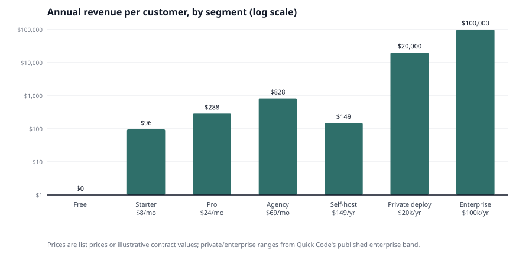
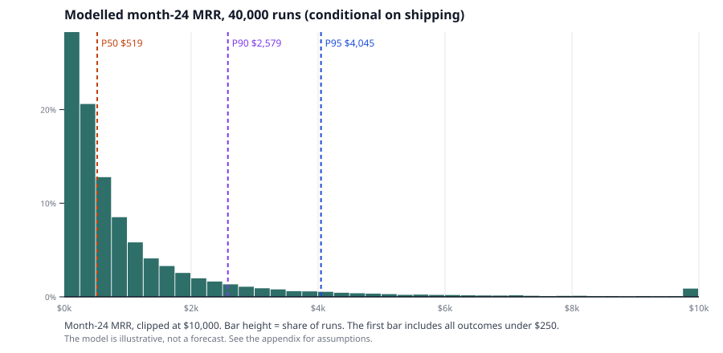

# qrwty: a small ownership product, not a horizontal QR challenger

**Prepared 2026-10-31** · Independent review of the Fable 5.1 analysis, the qrwty codebase and public site, the two source repositories, and the hosted/self-hosted QR market.

**Author:** DeepSeek V4.1 Flash 1017

*All prices are USD unless stated, as of 2026-10-31. This report is meant to be read alongside Fable's report, not instead of it. How to read this: "Read this first" is the executive summary. Sections 2-6 are the evidence. Section 7 is the recommendation. If you only have ten minutes, read "Read this first" and section 7.*

**Revision 2026-10-31.** The founder has clarified that qrwty can be assumed fully built by the software factory, that the goal is a side income with optional scale, and that there is no warm network. Under those assumptions the binding constraint is distribution, not product build. Where this report says "build," read "sell" if the software factory has already delivered the table stakes; otherwise the build gap remains. The build timelines in section 7.2 are superseded by section 7.3.

---

## Read this first

**The short answer.** Fable's main verdict is right: horizontal QR software is a crowded, price-compressed market, and qrwty is unlikely to become more than a small bootstrapped business. Custom hardware is a no-go. But Fable's conclusion is not quite the one you summarised. Fable does **not** say self-hosting is where the money is. Its emphasis is different: free self-hosters pay almost nothing, so the paid cloud is the business and open source is the distribution channel. That is true for *free community self-hosting*. It is not true for *paid private deployments*, which Fable sets to zero in the forecast, so the paid private-deployment case is never tested.

**Where I agree and where I differ.** I agree with Fable on hardware, price compression and the small-business verdict. I differ on self-hosting: it is not one market, and the forecast hides the paid private-deployment tail.

**The more useful answer.** There are three different businesses hiding inside "qrwty":

1. **A hosted QR SaaS** for small businesses, agencies and print shops. This is the market Fable models. It is real but small, and the product gap is large.
2. **A private-deployment / on-prem product** for organisations that cannot or will not use a shared cloud. This is where the absolute money is per customer: a single contract can be worth more than Fable's entire 24-month base case. But it is an enterprise sales and support business, not a self-serve licence.
3. **A true airgapped product** for disconnected networks. This is much narrower than it sounds, because a public QR code cannot work if the server is airgapped. It only works for internal codes scanned by devices on the same isolated network.

qrwty today is closest to (1), has none of the enterprise readiness for (2), and has not been designed for (3). The realistic question is not "can qrwty beat Bitly?" It is "is there one narrow buyer for whom qrwty can be the best, and can I reach them?" If the answer is no, the honest outcome is a portfolio/open-source project, not a business.

**What I would do.** Do not build a horizontal QR competitor, do not build hardware, and do not sell a $149/year "self-host licence" that is mis-priced: too high for hobbyists, too low for enterprises. Because the product can be assumed built, treat the build timelines below as context; the actual constraint is distribution. Pick one narrow path and test it with money before building:

- **Agency/print-shop cloud** if you want a small to modest, product-led income and are willing to do partnerships. Target 30-50 paying agencies at $39-$69/month as the 12-24 month milestone; the first signal is 3 paying agencies. If the product is already built, skip the build and go straight to partnerships/SEO and a paid beta. Otherwise, plan a 6-12 month build.
- **Private deployment for a regulated niche** if you want a larger income and can partner with someone who sells. Target 3-5 contracts at $15k-$30k/year ($10k is the floor) as the 12-24 month milestone; the first signal is one paid pilot. If the product is already built, the remaining work is SSO/audit/deployment/support; if that is not built, the private path is not ready. Otherwise, plan a 6-12 month build with sales in parallel.
- **Open-source portfolio** if the goal is learning, Jeeves, or reputation. Publish the built product (or build the self-host package), and measure installs rather than MRR.

**The one number that matters.** In a Monte Carlo with assumptions similar to Fable's, the median month-24 MRR is about **$520** (conditional on shipping), the 90th percentile is about **$2,600**, and the chance of exceeding **$10,000 MRR is under 1%**. One $20,000/year private deployment is worth about **208 Starter customers at $8/month** (or 139 at $12/month). The tail is the business, and the tail is sales-led.

### Your questions, answered

| Your question | Short answer |
| --- | --- |
| **Is local/on-site hosting where the money is?** | Per customer, yes: paid private deployments can be $10k-$150k/year. But it is a small, enterprise sales and support business, not a $149 self-serve licence. Free community self-hosters pay almost nothing. |
| **Can this be predicted?** | The shape, yes; the number, no. Median ~$520 MRR, P90 ~$2,600, under 1% chance of >$10k. Fable's base case is roughly P75; its conservative case is roughly P16. |
| **Is custom hardware a no-go?** | Yes. A phone plus an off-the-shelf printer covers the workflow, and your own field data shows the hardware is the weak link. |
| **Is qrwty just another QR SaaS?** | Today, yes. It has a nice studio but lacks billing, custom domains, teams, bulk/API, abuse controls and support. Without a niche, it competes with Bitly, Uniqode and Hovercode on their turf. |
| **Do control-seeking clients care?** | Yes, but about SSO, audit, data residency, SLAs and procurement, not "owning the software" as an ideology. If you cannot pass the review, the ownership story is irrelevant. |
| **What would it take to compete?** | Level 1 niche: 6-12 months, $0-$20k cash if the product is built, 30-100 customers. Level 2 segment: 18-36 months, $50k-$250k cash, a small team. Level 3 horizontal: 3-5 years, $5M+, 20+ people; not realistic solo. |
| **Is first-mover advantage decisive?** | No. The code is commoditised; distribution and trust are the moat. Big money matters in the center, not at the edge. |
| **What should I do?** | Pick one narrow path and validate it with paid customers; if you are unsure, keep the open-source project alive while you test the agency path. If neither the agency nor the private-deployment test produces a paid customer after a fixed validation period, keep qrwty as a portfolio/open-source project. |
| **What about the tree-poster project?** | Keep it as a civic project and a case study. It proves the placement-tracking pain but not willingness to pay. Use it in the agency/private pitch; don't try to turn it into the company. |

**Bottom line:** qrwty is a good product looking for a small, specific buyer. Find the buyer before you build the business.

---

## Contents

- [1 What qrwty actually is today](#1-what-qrwty-actually-is-today)
- [2 Fable's conclusions, tested](#2-fables-conclusions-tested)
- [3 The self-hosting question: where the money might be](#3-the-self-hosting-question-where-the-money-might-be)
- [4 Can qrwty compete? The scene, the moat and first-mover advantage](#4-can-qrwty-compete-the-scene-the-moat-and-first-mover-advantage)
- [5 What it would take to become a competitor](#5-what-it-would-take-to-become-a-competitor)
- [6 How predictable is this? A forecast with error bars](#6-how-predictable-is-this-a-forecast-with-error-bars)
- [7 Recommendation](#7-recommendation)
- [8 What would change this analysis](#8-what-would-change-this-analysis)
- [Sources](#sources)
- [Appendix: model assumptions and files](#appendix-model-assumptions-and-files)
- [Glossary](#glossary)

---

## 1 What qrwty actually is today

### The codebase is a good MVP, not a business

The repository is a Jeeves-generated project with a clean, small feature set. As of 2026-10-31 it has:

| Area | What exists | Evidence |
| --- | --- | --- |
| Accounts | Email/password registration, login, logout, session check, CSRF protection | `frontends/qrwty-web/src/pages/Home.tsx`, generated auth routes |
| QR links | Create, list, read, update (destination and title), owner-scoped | `contracts/qrwty.openapi.yaml`, generated CRUD |
| Redirects | Public `/q/{id}` route, 302 to the destination, scan logged | `services/qrwty/src/features/redirect/index.ts` |
| Scan counts | Per-code daily activity, owner-wide analytics, UTC bucketing | `features/activity/index.ts`, `features/owner-analytics/index.ts` |
| QR artwork | Studio settings, preview, save, PNG/SVG export | `features/studio/`, `artwork-preview/`, `artwork-save/`, `artwork-export/` |
| QR image | Download a generated QR image | `features/qr-image/index.ts` |
| Interface | React SPA with library, create, edit, analytics and studio views | `frontends/qrwty-web/src/` |

That is a credible **single-user QR link manager with a design studio**. It is not yet a multi-tenant SaaS.

### What is missing is the business, not the QR code

For even a modest hosted product, the missing pieces are substantial:

- **Billing and plans:** no Stripe/Paddle integration, no subscriptions, no quotas, no trial, no dunning, no tax handling.
- **Custom domains:** no per-customer domain, DNS verification, automatic TLS, or domain-level redirect routing. Every code points at qrwty's own origin.
- **Teams and agencies:** no organisations, roles, seats, client folders, white-label, or per-client domains.
- **Bulk and API:** no CSV import/export, no API keys, no webhooks, no bulk edit.
- **Data portability:** no redirect-table export, no account export, no documented migration path.
- **Abuse and trust:** no malware/phishing scanning of destinations, no abuse reporting, no shared-domain reputation controls. A shared QR domain is a phishing target.
- **Analytics depth:** counts and daily totals, but no unique scans, device, country/city, referrer, UTM, or scan-level export.
- **Operations:** no status page, no published uptime, no backups/DR documentation, no DPA, no security page, no support process.
- **Self-hosting:** no licence file, no one-command deploy, no offline install, no upgrade path, no SSO/LDAP, no audit log, no HA story.
- **Landing pages/forms:** competitors bundle menus, vCards, PDFs, forms and multi-link pages. qrwty only redirects.

This matters for the "what would it take" question: the core redirect and studio are the easy part. The hard part is billing, domains, teams, trust, support and distribution.

### qrwty.io is ahead of the code

The public site advertises:

- Free: static QR generation, limited dynamic trials.
- Pro SaaS: **$12/month**, dynamic redirects and analytics, theme packs, custom short domain on higher tiers.
- Self-host licence: **$149/year or $499 lifetime**, deploy on your own infrastructure, bring your own domain and data, optional support add-on.
- "Dual mode from day one: SaaS + self-hosted licence."
- An "AI Scanability Advisor" and a "MVP Dashboard (PoC)".

The repository does not contain billing, custom domains, a self-host licence, a documented one-command self-host package, or an AI advisor. The dashboard shown on the site is a PoC/mock. The site says "Qrwty PoC" in its footer, so this may be intentional marketing ahead of the product. But if you sell the $499 lifetime licence before shipping the self-host package, you create a promise you cannot keep. Fix that before any paid launch: either ship the package or remove the offer.

### The founder's own field data is the best evidence against hardware

The `qr-code-tracking` repository is unusually honest. It records:

- 89 posters installed, 257 scans total over a season, then 0-2 scans/day.
- UV damage: direct-thermal labels faded within weeks to a few months; UV spray added 6-8 weeks; a UV film was still on trial.
- A thermal receipt printer was fried; a Raspberry Pi + GPS + printer bundle weighed about 12 lbs in a backpack.
- The final workflow used a phone for GPS/hotspot and a Zebra printer, not a custom device.
- The project's value was the placement data and the civic experiment, not the printing hardware.

That is a real-world demonstration that the hardware is a solution looking for a problem. A phone plus pre-printed weatherproof labels, or a phone plus an off-the-shelf Bluetooth printer, covers the workflow. The only case for custom hardware is a crew labelling hundreds of items a day outdoors, and the evidence that anyone will pay for that is still missing. Fable's companion report reaches the same conclusion with more sources; I agree with it.

**Implication.** qrwty is a pre-billing, single-user MVP with a nice design studio and no evidence of paying customers. That is a good starting point for a niche product, but it is not a competitor to Bitly or Uniqode today. The distance is measured in product and trust, not in QR generation.

---

## 2 Fable's conclusions, tested

Fable 5.1 is a careful, well-sourced report. Most of its factual work holds up. The disagreements are about framing and about one important omission: paid private deployment.

Fable's own summary is: *"Its sellable difference is ownership: a custom domain on the cheapest paid tier, a full export of the redirect table, and open code that can be self-hosted. The money is small in every scenario."* It does **not** claim that self-hosting is the revenue. It claims that ownership is the sales pitch and that the paid cloud is the business. That is an important distinction, and it is where your summary and the report diverge.

The table below tests each major claim against supporting and contradicting evidence.

| # | Fable's claim | Supporting evidence | Contradicting evidence | My verdict |
| --- | --- | --- | --- | --- |
| 1 | **Horizontal QR SaaS is a small, commoditised business for a solo founder.** | Price floor of $0-$29 for ten dynamic codes; free tiers; Bitly and Uniqode dominate; indie QR SaaS cluster at $0-$900 MRR; typical code gets 8-23 lifetime scans; paid CAC exceeds a ~$85 ceiling. | The overall QR market is large and growing (broad estimates $13-$15B, narrow software ~$1B); Uniqode reports 50,000+ businesses and 204M+ scans; Bitly reports hundreds of thousands of paying customers. There is money at the top, but it is not reachable without a wedge. | **Mostly right.** The market is large; the accessible slice for a solo founder is small. |
| 2 | **Ownership is the sellable difference.** | Trustpilot complaints about codes dying when subscriptions lapse; Fable found no vendor that documents a redirect-table export; custom domains are gated at higher tiers; agencies' reputations depend on codes that keep working. | Ownership is becoming table stakes: Hovercode includes a custom domain at $12/month; Dub is open-source with QR; Quick Code sells a self-hosted QR platform from $250 one-time. Customers say they want ownership but often buy on price/convenience. The people who care most (self-hosters) pay least. Ownership features lower switching costs and may raise churn. | **A credible trust story, not a durable moat or a proven willingness-to-pay driver.** |
| 3 | **Custom domains are the lock-in lever.** | Bitly charges $29/month for a custom domain; Uniqode charges $2,000 per domain per year; Scanova charges $75/month for one domain; printed codes on a vendor domain are painful to move. | Hovercode includes one custom domain on its **$12/month** Pro plan (verified 2026-10-31). QR TIGER claims a domain from $7 (unverified). A customer with a domain can set a small number of redirect rules for free at a registrar or CDN. A domain is a feature, not a moat. | **Table stakes for agencies and brands, not a unique advantage.** Fable missed Hovercode's price point. |
| 4 | **Self-hosters don't pay; open-core cloud is the money.** | Plausible earns about $300/month in donations from self-hosters while running a paid cloud with 22,000 paying subscribers; Shlink and YOURLS are free; Quick Code's low-end licence is $250 one-time. | Paid private deployments exist at **$10,000-$150,000+/year** (Quick Code's published enterprise band). GitLab sells self-managed at the same per-user list price as SaaS; enterprises pay for control, support and compliance. Fable sets self-host revenue to **zero**, so its model cannot see this segment. It also conflates free community self-hosting with paid private deployment. | **Right about free self-hosters, wrong to dismiss paid private deployments.** These are different markets. |
| 5 | **No maintained, QR-first, self-hostable product with a usable interface exists.** | Shlink and YOURLS are shorteners, not QR-first; most QR self-host projects are tiny or dormant; no funded QR-first open-core competitor was found. | **Quick Code** is a maintained, QR-first, self-hosted platform with dynamic codes, analytics, white-label, SSO, audit logs, HA/Helm and airgap claims; its site claims "hundreds of businesses" and 300,000+ scans. PHP Dynamic QR Code, QRding and others also exist. Dub has QR + self-hosting. | **The gap is narrower than Fable says.** It is not "no product"; it is "no dominant, trusted product." That is both an opportunity and evidence the category is small. |
| 6 | **Custom hardware is a no-go.** | Phone + off-the-shelf printer covers the workflow; no demand evidence; hardware margins, certification, inventory and support are brutal; the founder's own field data shows UV fading, printer failures and a 12-lb pack. | No credible counter-evidence found. A rugged integrated device might be nicer for crews labelling hundreds a day, but nobody has shown they will pay for it. | **Strongly supported.** Drop it. |
| 7 | **The conservative case (~$150 MRR at month 24) is the expectation; the base case (~$1,215) is a target.** | Indie QR comparables are $0-$900 MRR; most micro-SaaS outcomes are small; Fable's assumptions are plausible. | A Monte Carlo with similar inputs puts the median near **$520 MRR**, P90 near **$2,600**, and P99 near **$9,200** (conditional on shipping). Fable's conservative is roughly P16; the base is roughly P75. The point estimates are not probabilities, and the model excludes private deployment. | **The range is plausible; the labels are reasonable but not statistically grounded.** The qualitative conclusion (small) is robust. |
| 8 | **Agency first is the best go-to-market.** | Agencies and print shops pay for white-label, multi-client management and bulk; QR Code KIT $50-$65, Scanova Pro $75, Dub Business $81, Hovercode Business $39; Etsy "qr code" demand is large. | No direct evidence that agencies will switch to qrwty; incumbents already serve them; qrwty lacks white-label, client folders, bulk, API and per-client domains. The segment is small and relationship-driven. | **A reasonable hypothesis, not a conclusion.** Test with interviews and a paid pilot. |
| 9 | **Paid acquisition doesn't work.** | CAC ceiling ~$85 vs $700-$940 self-serve benchmark; generator CPC $1.25-$1.63; freemium conversion 2-5%; LTV $143-$457. | The CAC benchmark is enterprise-skewed; content and partnerships can lower CAC. But paid search at $8-$29 ARPU is still implausible. | **Robust for paid search; organic and partnerships only.** |
| 10 | **A written lapse policy is a differentiator.** | Codes dying is the category's top complaint; a 12-month lapse policy is verifiable and cheap to honour at low scan volumes. | Hovercode keeps the first three dynamic codes active after cancellation; QRCodeChimp's free tier covers ten codes; competitors can copy a policy. A solo founder's promise is less credible than an incumbent's. Structural ownership (domain, export, self-host) is stronger. | **Useful trust signal, not a moat.** |
| 11 | **AGPL is the right licence.** | AGPL deters resellers and signals open-source trust; Plausible and Dub use it. | AGPL can be a procurement blocker for enterprises and public sector. On-prem buyers may reject it. Quick Code uses a commercial licence; GitLab uses MIT for CE + proprietary EE; Dub uses AGPL + a commercial `/ee` directory. A dual licence is the common answer. | **Fine for community, risky for paid on-prem.** Offer a commercial licence if you target enterprises. |
| 12 | **Market size is not the constraint; distribution is.** | A $1B market and a base case at 0.0015% of it; incumbents own head terms; CAC is the binding constraint. | For a specific niche, the reachable account count can bind. The $1B figure is not a TAM for qrwty; bottom-up reachable buyers matter more. | **Mostly right, but replace "market size" with "reachable accounts."** |

### What Fable gets right

- The **hardware verdict** is correct and well evidenced. The companion reports are stronger than the main report on this point.
- The **price-compression analysis** is correct: free tiers, annual-only plans, and $5-$29 entry prices make a generic hosted generator a bad business.
- The **CAC analysis** is directionally correct: paid acquisition at $8-$29 ARPU does not work. Organic, long-tail and partnerships are the only plausible channels.
- The **"small business, not venture-scale"** conclusion is robust. Even the optimistic case is a modest income, not a venture outcome.
- The **caution about lifetime deals and hardware inventory** is right.
- The **connected-device companion's "software first" conclusion** (rotating codes, scan-to-actuate on customer-owned hardware) is sensible, though neither is a near-term priority.

### What Fable gets wrong or leaves out

1. **It treats "self-host" as one thing.** Free community self-hosting and paid private deployment are different markets with different buyers, prices and support burdens. Fable's zero-revenue assumption hides the paid segment.
2. **It missed Quick Code and Hovercode's domain pricing.** Quick Code is direct evidence that a QR-first self-hosted product exists and that enterprises pay $10k-$150k/year for it. Hovercode's $12 domain plan weakens the "custom domains are the lock" thesis. Quick Code is not a household name, so this is an easy miss; it still changes the conclusion.
3. **It is too confident about the Agency path.** The agency segment is plausible, but Fable presents it as the main lever without direct evidence that agencies will switch. It is a hypothesis, not a finding. Fable's sensitivity analysis shows the mix matters — a 20% Agency share raises 24-month profit by about half — but it does not prove agencies will buy. Fable does propose ten interviews, which is the right next step; the issue is treating the outcome as likely rather than testing it.
4. **It understates the enterprise readiness gap.** SSO, audit logs, SCIM, HA, SLAs, SOC 2, pen tests and support are not optional for on-prem buyers. A one-command Docker deploy is not an enterprise product. To be fair, Fable's plan is for a small bootstrapped business, not an enterprise vendor; the point is that the paid private-deployment option it dismisses requires this work.
5. **Its AGPL-plus-commercial-licence boundary needs care.** Fable recommends AGPL for the core and a commercial licence for support, but if enterprise legal rejects AGPL, the community edition cannot be the basis for the private deployment. A dual licence or source-available licence from day one is cleaner if paid private deployment is the target.
6. **It does not distinguish airgapped from self-hosted.** Public QR codes cannot be airgapped. This is not a mistake in Fable's terms — it talks about self-hosting, not airgaps — but it matters for your question.

### What changed my mind while writing this

1. I started thinking self-hosting was a niche feature. Quick Code's published $10k-$150k/year enterprise band changed that: paid private deployment is the most interesting path, but it is a different business from a $149 licence.
2. I started thinking Fable's conservative case was the expectation. The Monte Carlo suggests the median is higher (about $520 MRR), but still small. The conclusion holds; calling the conservative case the expectation is too pessimistic.
3. I started thinking custom domains were a differentiator. Hovercode's $12/month plan makes them table stakes.
4. I started thinking the agency path was the obvious answer. It is plausible, but unproven, and the product gap is large.
5. I started thinking "airgapped" was a big market. The public-QR reachability problem makes it much smaller than it sounds.
6. I started thinking the hardware could be a differentiator. The field data and the companion reports killed it: the phone + printer workflow is good enough, and the hardware is the weak link.
7. I started thinking the civic/field path was the obvious "why you" wedge. It is a great case study, but the budgets are small and grant-dependent; it is a channel, not the business.

---

## 3 The self-hosting question: where the money might be

This is the part of your message I want to spend the most time on, because it is where the intuition is both promising and easy to overstate. Your instinct is directionally right: the self-host/on-prem angle is the most interesting part of qrwty. The mistake is treating it as a cheap licence rather than an enterprise deployment.

### 3.1 Four different things people mean by "self-host"

The word "self-host" hides four deployment models. They have different buyers, different technical requirements and different willingness to pay.

| Model | Where the software runs | Who can scan | Who buys | Typical price | qrwty fit today |
| --- | --- | --- | --- | --- | --- |
| **Managed SaaS** | qrwty's cloud | Anyone on the internet | SMBs, agencies, marketers | $8-$99/month | Core product, but missing billing/domains/teams |
| **Customer cloud / VPC** | Customer's AWS/GCP/Azure account, internet-facing | Anyone on the internet | Mid-market and enterprises with data-residency rules | $5k-$50k/year | Needs SSO, audit, deployment automation, support |
| **On-prem, internet-connected** | Customer's data centre, behind a firewall with ingress | Anyone on the internet | Government, healthcare, finance, utilities | $10k-$150k/year | Needs enterprise packaging, SSO, HA, SLA |
| **Airgapped** | Isolated network with no internet | Only devices on that network | Defence, intelligence, isolated industrial/clinical networks | $10k-$150k+/year, often services-heavy | Needs offline install, local DNS, no phone-home, internal-only use case |

The first three can serve public QR codes. The fourth cannot, unless the scanner is also inside the isolated network. That is the critical distinction.

### 3.2 The airgap contradiction

A dynamic QR code is a URL. When someone scans it, their phone resolves the URL over the internet. If the server is airgapped, the phone cannot reach it. There is no way around this: the scanner is outside the airgap.

So "airgapped hosting for public QR codes" is technically impossible. What people usually mean is one of these:

- **Self-hosted in the customer's environment, with internet ingress.** This is a normal on-prem/VPC deployment. It protects data and vendor independence; it is not airgapped.
- **Airgapped for internal codes.** The codes are printed on assets, documents or rooms and scanned by employees on the same isolated network. The redirect target is an internal wiki, asset record or file. This works, but the audience is internal, the scan volume is low, and the value is asset management/internal navigation, not marketing analytics.
- **Static QR codes in an airgapped environment.** No redirect, no analytics; just a URL or text encoded in the code. This is free and needs no server.

For qrwty, the airgap edition would be a different product: an internal asset/link registry with local DNS, offline install, no external telemetry, and probably integration with an IT asset management (ITAM) system or wiki. That is not the current product, and the buyers are not the same as marketing teams.

**Implication.** The addressable market for *true airgap* is much smaller than the addressable market for *self-hosted*. If you pitch "airgapped QR codes" to a marketing buyer, they will not understand the problem. If you pitch it to an IT/security buyer, they will ask about SSO, audit, patching, backup and support, not about QR styling.

### 3.3 Who actually pays for control

The evidence points to four distinct buyers, with very different economics.

**1. Hobbyists and tinkerers: they pay little or nothing.**
- Shlink (5,392 GitHub stars), YOURLS (12,296), Kutt (11,183) and Dub (25,049) are free/open-source.
- Plausible, the clearest comparable, earns about **$300/month in donations** from self-hosters while its paid cloud has **22,000 paying subscribers**.
- Quick Code's low-end on-prem licence is **$250 one-time**, with updates included and optional paid update/support services.
- This group is technical, price-sensitive, and self-hosts precisely to avoid a subscription. A $149/year or $499 lifetime qrwty licence is too expensive relative to free alternatives and too limited relative to Quick Code.

**2. Small businesses: they buy convenience, not control.**
- They do not have IT staff to run a server, patch Postgres, manage TLS and backups.
- They care that the code works and that the editor is easy. They will pay $9-$39/month for a hosted product.
- Self-hosting is a bug, not a feature, for most of them.
- This is the market Fable models, and it is price-compressed.

**3. Agencies, print shops and sign makers: they buy white-label and multi-client management.**
- They manage codes for many clients and care about their own reputation. A dead code is their problem.
- They pay for custom domains, bulk creation, client folders, white-label and API access. Price anchors: QR Code KIT Pro $50-$65, Scanova Pro $75, Hovercode Business $39, Dub Business $81. Etsy "qr code" demand was about 2.74M monthly searches (Etsy tool data, via Fable).
- Some may prefer to self-host so they can host client codes under their own brand and avoid per-client fees. That is a real wedge, but it requires multi-tenant features qrwty does not have.
- This is the most plausible **product-led** niche for qrwty.

**4. Regulated enterprises and public sector: they buy compliance and accountability.**
- They cannot use a shared cloud for policy, residency, security or procurement reasons. They need SSO/SAML, SCIM, RBAC, audit logs, encryption, backups, DR, a DPA, a security questionnaire, a pen test, a status page, an SLA, and someone to call. They will ask where scan logs are stored, how long they are retained, and whether IP addresses are personal data under GDPR.
- Published enterprise bands for private deployment reach $10k-$150k/year (Quick Code), but these buyers will not buy a $149 licence from a solo founder with no references, no SOC 2 and no support organisation.
- The sales cycle is 6-18 months. Procurement, legal and security review are the bottleneck. The buyer is IT/security, not marketing.
- This is where the absolute money is, and where the work is heaviest.

### 3.4 The economics of each path

| Path | Price per customer | Customers needed for $50k/year | Sales cycle | Support burden | Fit with your stated preferences |
| --- | --- | --- | --- | --- | --- |
| Free/community self-host | $0-$250 one-time | 200+ one-time licences, or donations | Self-serve | Community only | Good for reputation; no income |
| Hosted Starter | $96/year | ~520 | Days | Low per customer, but many customers | Product-led; marketing/SEO |
| Hosted Agency | $468-$828/year | ~60-107 | Weeks | Medium; white-label/multi-client | Partnerships; plausible |
| Private deployment | $15k-$30k/year | 2-3 | 6-18 months | High; SSO, audit, upgrades, SLA | Requires sales/partner; poor fit if you dislike sales |
| Enterprise/airgap | $50k-$150k/year | 1 | 9-24 months | Very high; 24/7, named technical account manager, custom work | Not realistic solo without a partner |



<details><summary>Data</summary>

| Segment | Annual revenue per customer (USD) | Basis |
| --- | --- | --- |
| Free | 0 | Free tier |
| Starter $8/mo | 96 | 8 × 12 |
| Pro $24/mo | 288 | 24 × 12 |
| Agency $69/mo | 828 | 69 × 12 |
| Self-host $149/yr | 149 | qrwty.io list price |
| Private deployment $20k/yr | 20,000 | Illustrative mid-point of Quick Code's enterprise band |
| Enterprise $100k/yr | 100,000 | Top of Quick Code's published enterprise band |

</details>

The arithmetic is brutal and clarifying:

- At **$8/month**, you need about **520 paying customers** for $50k/year.
- At **$69/month**, you need about **60**.
- At **$20k/year**, you need **2.5**.
- At **$100k/year**, you need **half a customer**.

This is why "self-host is where the money is" can be true in absolute dollars and still be the wrong business for you: the revenue per customer is high, but the sales and support per customer are also high. A $10k/year contract with 5 hours/month of support at an assumed $100/hour opportunity cost consumes $6k/year of the contract; at 10 hours/month, it consumes the whole contract. It is a consultancy-like business with software leverage, not a self-serve SaaS. That is why private deployment needs either a higher price or a partner/MSP to carry first-line support.

### 3.5 The uncanny valley of $149/year or $499 lifetime

qrwty.io's self-host price sits in an awkward middle:

- **Too expensive for hobbyists**, who can use Shlink/YOURLS/Dub for free or Quick Code for $250 one-time with more features.
- **Too cheap for enterprises**, who will read $149/year as "no support, no SLA, no compliance, not a serious vendor." Procurement and security review will often cost more than the licence itself.
- **A lifetime licence creates a permanent support/update obligation** with no recurring revenue. Fable warns about lifetime deals for cloud hosting; the same logic applies to self-host support. Quick Code charges $250 one-time but sells optional update/support services and enterprise contracts. If qrwty offers $499 lifetime, it should cap what "lifetime" includes (e.g., updates for 12 months, support extra) or it will be servicing 2019 licences forever.

The right price depends on the buyer:

- **Hobbyist/community:** free, open-source, no support. Monetise the cloud.
- **Agency:** $39-$99/month hosted, or a $500-$2,000/year white-label licence with support.
- **Private deployment:** $15k-$30k/year, including updates, support, SSO and a deployment package; $10k is the floor. Not $149.

A single price cannot serve all three. That is the core pricing mistake in the current qrwty.io page.

### 3.6 Does Fable's "self-hosters don't pay" hold?

Yes, for free community self-hosting. Plausible's $300/month donation figure is a powerful data point: even a well-loved open-source analytics product with 22,000 paying cloud subscribers earns almost nothing from self-hosters. Shlink, YOURLS and Dub are free. The people who self-host are, by selection, the people who do not want to pay a subscription.

No, for paid private deployment. Quick Code's enterprise band is $10k-$150k/year. GitLab prices self-managed at the same per-user list price as SaaS, and enterprises pay for it. They are buying control, support and compliance, not the software bits.

Fable does propose a self-host commercial licence and support tier, but it leaves the price as "quote" and sets revenue to zero in the model, so the paid private-deployment case is never tested. The commercial-licence tier is the right instinct; it just needs a price, a support model and a place in the forecast. The model sets self-host revenue to zero and then concludes self-host is not the money. That is a self-fulfilling assumption: the model cannot see the paid segment it is testing. A fair model would split:

- **Free community self-host:** $0 revenue, marketing value only.
- **Paid private deployment:** a small number of high-ACV contracts, with a sales/support cost.

If you add even one $20k/year contract to Fable's base case, it exceeds the entire month-24 cloud MRR. If you add three, it is a different business. The question is not whether the revenue exists; it is whether you can sell and support it.

### 3.7 So do those clients care?

They care, but not in the way the phrase "own the software" suggests.

- They care about **policy**: "We cannot put scan data in a US shared cloud."
- They care about **security**: "Does it support SSO, audit logs, RBAC, encryption, patching?"
- They care about **procurement**: "Can we get a DPA, a security questionnaire, a pen-test summary, an SLA, references?"
- They care about **accountability**: "Who do we call when it breaks at 2am?"
- They do **not** care about your design studio, your terminal aesthetic, or the fact that the code is open source, unless those things help them pass a review or serve their users.

In other words: "own the software" is the vendor's framing. The buyer's framing is "pass the security review and keep the data inside our perimeter." If you cannot pass the review, the ownership story is irrelevant.

If qrwty can answer those questions, the buyer will pay. If it cannot, "self-hosted" is not a magic word. The buyer will choose Quick Code, an internal Shlink deployment, or a static QR code.

**The honest conclusion:** the control-seeking buyer is real, but the product they need is an enterprise deployment, not a $149 licence. qrwty is not that product yet. Building it is possible, but it is a different company from the one the current site describes.

---

## 4 Can qrwty compete? The scene, the moat and first-mover advantage

### 4.1 The competitive landscape is segmented, not one market

A note on names: you wrote "Unicode"; I assume you meant **Uniqode**, the QR platform (not the Unicode Consortium).

| Player | Scale / signal | Entry price | Custom domain | Self-host | Teams / compliance | Threat to qrwty |
| --- | --- | --- | --- | --- | --- | --- |
| **Bitly** | Hundreds of thousands of paying customers; $75M+ ARR at acquisition (2021); 5.7M MAU cited in 2026 | Free; Core $10/mo; Growth $29/mo | Growth $29 | No | Enterprise SSO, 99.99% uptime, integrations, AI | High at the center; low in a niche |
| **Uniqode** | 50,000+ businesses; 204M+ scans; $25M Series A (2023) | $9/mo (annual); Core $49/mo | $2,000/domain/year add-on | No | SOC 2, HIPAA, ISO, SSO, 24/7 support | High for enterprise/brand |
| **Hovercode** | Indie, design-focused, transparent pricing | Free 3 dynamic; Pro $12/mo | Pro $12 (1 domain) | No | Team on Business $39; API on Business | High for price-sensitive designers/agencies |
| **QR.io** | Simple unlimited plan | $39.99/mo; $350/year | Not clear | No | 5 team members; API/bulk | Medium; price umbrella |
| **QR TIGER** | Large brand claims; $7-$89 plans | $7/mo | Claimed from $7 | No | Varies | High on price/design |
| **Scanova** | Established; $5-$75/mo; Pro includes 500 codes, 5 users, 1 domain | $5/mo | Pro $75 | No | SSO/audit/support at Enterprise | High for agencies/SMB |
| **QRCodeChimp** | Free 10 codes; paid from $6.99/mo annual | $6.99/mo | Higher tiers | No | Varies | High on price/free tier |
| **Quick Code** | "Hundreds of businesses"; 300k+ scans; on-prem/airgap | $250 one-time on-prem; $39/mo managed; $10k-$150k/yr enterprise | Managed/custom | **Yes** | SSO/SCIM, audit, HA, SLA at enterprise | **Direct competitor for the self-host/airgap niche** |
| **Shlink / YOURLS / Dub** | 5k-25k GitHub stars; free/open-source | $0 | Yes (self-host) | **Yes** | Community; Dub has commercial EE | High for technical self-hosters |
| **qrwty** | MVP; no billing/domains/teams | $12/mo planned; $149/yr or $499 lifetime self-host planned | Planned | Promised, not shipped | None yet | — |

One caveat on market size: the $13-$15B figures include QR payments, which are a different business. The narrow QR software market is closer to $1B, and qrwty's accessible slice is smaller still. Do not use the broad number as a TAM.

The market is not "one big market with big money." It is at least four markets:

1. **Free/static QR generators** (commodity, ad/SEO-driven).
2. **Hosted dynamic QR for SMBs and marketers** (price-compressed, brand/SEO-driven).
3. **Agency/white-label QR management** (relationship-driven, mid-price).
4. **Private/on-prem/airgap QR infrastructure** (enterprise sales, high ACV, compliance-driven).

qrwty's current product is trying to be (2) with a design studio. Its best chance is (3) or (4), not (2) head-on.

### 4.2 Is first-mover advantage real here?

Partly, but not in the way most people mean.

**Weak first-mover effects:**

- **QR codes are a standard.** The scanner does not care which generator made the code. There is no network effect between scanners and generators.
- **The core technology is commoditised.** QR generation is a library; redirects are a database lookup; analytics is a count. A competent developer can build the core in weeks.
- **Customers switch for price, design or a specific feature.** Hovercode, Dub and QR TIGER entered after Bitly and won share by being better at a niche or a price point.
- **Late entrants can win niches.** Quick Code built a self-host/airgap business after the hosted market was crowded. Dub built an open-source link platform after Bitly. Hovercode built a design-led QR tool after dozens of generators.

**Strong incumbent effects:**

- **SEO and brand.** Bitly, QR Code Generator and Uniqode own the head terms and have years of content, backlinks and reviews. qr-code-generator.com alone was estimated at ~7.9M visits/month (Semrush, aggregator, via Fable). A new domain will not outrank them for "qr code generator" in any reasonable time.
- **Integrations and marketplaces.** Shopify, WordPress, Canva, HubSpot, Zapier, Salesforce. Each integration is a distribution channel and a switching cost.
- **Trust and procurement.** Enterprises buy from vendors with SOC 2, references, uptime history and support. A solo founder starts at zero.
- **Printed-code switching costs.** Once a customer prints thousands of codes pointing at a vendor's domain, moving is painful. This is a real moat for incumbents, but it is also the source of the category's bad reputation. A new entrant can attack it with ownership, but ownership lowers its own switching costs too.

**The honest read:** first-mover advantage is not the main barrier. **Distribution and trust** are. The first mover's real advantage is not the code; it is the accumulated distribution and the printed-code switching costs. Both are beatable in a niche; neither is beatable head-on. You are not too late to build a QR product; you are too late to build a generic one and expect to be discovered. A niche with a specific buyer and a specific channel is still open.

### 4.3 What "competitor" means

The word "competitor" can mean three very different things. The effort and capital differ by an order of magnitude.

| Level | What it means | Time | Cash | Team | Revenue ceiling | Probability for a solo founder |
| --- | --- | --- | --- | --- | --- | --- |
| **1. Credible niche alternative** | 30-100 paying customers in one segment; known to that segment; product is reliable enough to recommend | 6-12 months | $5k-$20k | Solo + contractors | $3k-$15k MRR | Moderate, if the niche is real and reachable |
| **2. Recognised segment player** | Thousands of customers; integrations, partnerships, reviews, support; maybe a small team | 18-36 months | $50k-$250k | 3-10 people | $50k-$250k MRR | Low without funding or a strong channel |
| **3. Horizontal competitor to Bitly/Uniqode** | National/global brand; enterprise sales; SOC 2/ISO; 24/7 support; multi-region infra | 3-5 years | $5M-$20M+ | 20-100+ people | $1M-$100M ARR | Very low; not a solo project |

The levels are about hosted-product scale; private deployment is a separate axis where a handful of high-ACV contracts can be a business. If "compete in the scene" means Level 3, that is the wrong bar. Level 1 is achievable, and it is what most indie SaaS founders actually build. The Level 1 revenue ceiling ($3k-$15k MRR) is above the visible horizontal QR micro-SaaS comparables; it assumes a real niche and a working channel. Level 2 is possible with a partner or a small team. Level 3 is a venture-funded company, not a solo project.

### 4.4 The big-money question

Big money matters in the center of the market:

- Bitly can spend on brand, SEO, integrations and free tiers.
- Uniqode can spend on enterprise sales, SOC 2, HIPAA and support.
- Both can copy a feature in a quarter if it matters to their base.

Big money does **not** matter at the edge:

- A $1M-$5M niche is too small for Bitly or Uniqode to chase with a dedicated team.
- A compliance-specific deployment (e.g., a German public-sector buyer, a hospital network, a defence contractor) is service-heavy and unattractive to a venture-scale vendor.
- A workflow-specific tool (e.g., print-shop client management, long-lived heritage trails) is too small for the center and too specific for a generic tool.

The risk is not that Bitly crushes you. It is that nobody notices you. The trade-off is explicit: **the niches big money ignores are small.** If you want a venture outcome, this is the wrong market. If you want a small income or a craft business, a niche can work.

A rough bottom-up sanity check, using assumptions rather than researched counts:

- Take ~20,000 relevant print shops, sign makers and small agencies in the US. If 1% buy at $69/month, that is 200 customers and about **$14k MRR**. At 0.5%, it is 100 customers and about **$7k MRR**.
- Take ~5,000 organisations with a strict control requirement (government, healthcare, utilities, finance, defence suppliers). If 0.2% buy at $15k/year, that is 10 customers and about **$150k ARR**. At 0.1%, it is 5 customers and **$75k ARR**.

These are illustrative, not a market forecast. They show the order of magnitude: the agency path is a **$10k-$20k MRR ceiling**; the private-deployment path is a **$75k-$300k ARR ceiling** for a solo founder with a partner. Both are real businesses; neither is venture-scale.

There is a fourth option that deserves a mention because it is **your** home turf: civic and field campaigns (local governments, tree-planting nonprofits, community organisers, political canvassing). It is the strongest "why you" story and the weakest "willingness to pay" evidence. The pain is real — you lived it — but the buyers have small budgets, grant-dependent spending and slow procurement. Your `metrics.trees4berwyn.org` site is a live case study of placement-level tracking; use it in the agency/private pitch. It is a good beachhead for a case study and a bad standalone revenue plan. If you go this way, treat it as a channel into agencies or private deployment, not as the business itself.

A design-first QR studio is another possible wedge, but it is a crowded, low-price market (Canva, Adobe, QR Code Monkey and dozens of generators). Treat the studio as a differentiator inside a workflow product, not as a standalone business.

GS1 Digital Link and Sunrise 2027 are a real catalyst (though not a legal mandate), but they are a feature for CPG brands with packaging workflows and enterprise sales. They are not a near-term wedge for a solo founder.

---

## 5 What it would take to become a competitor

This section is deliberately concrete. It assumes you want to reach **Level 1** (a credible niche alternative) or **Level 2** (a recognised segment player), not Level 3.

If the product is already built by the software factory, the build effort and cash estimates in 5.3 are sunk costs. The table stakes, trust requirements and distribution analysis still apply; the remaining work is go-to-market and support.

### 5.1 Table stakes for a hosted QR product

A paying customer compares you to Hovercode, Bitly, QR.io and Uniqode. To be taken seriously, you need most of this:

**Product**
- [ ] Create static and dynamic QR codes, with a good editor and templates.
- [ ] Reliable redirects with low latency and high uptime.
- [ ] Custom domains with DNS verification and automatic TLS.
- [ ] Scan analytics: totals, unique scans, time, device, country/city, referrer, UTM.
- [ ] CSV/JSON export and import; redirect-table export.
- [ ] Bulk creation, bulk edit, API keys, webhooks.
- [ ] Teams/workspaces, roles, client folders (for agencies).
- [ ] White-label/branding and client-facing reports/exports (for agencies).
- [ ] Landing pages/forms or a clear reason not to need them.
- [ ] QR types: URL, vCard, WiFi, menu, PDF, app store, multi-link, GS1 Digital Link (if CPG).
- [ ] Accessible, mobile-friendly editor.
- [ ] Abuse prevention: destination scanning, rate limits, blocklist, reporting.
- [ ] Lapse/grace policy and a documented wind-down plan.

**Business**
- [ ] Billing, plans, quotas, trial, dunning, tax (Stripe/Paddle).
- [ ] Terms, privacy, DPA, cookie policy, acceptable-use policy.
- [ ] Status page, uptime target, incident process.
- [ ] Backups, disaster recovery and a tested restore.
- [ ] Monitoring, alerting and an on-call plan.
- [ ] Support: email/chat, response targets, docs, onboarding.
- [ ] Security page, pen-test summary, vulnerability disclosure.
- [ ] SOC 2 Type II (for enterprise), HIPAA (if healthcare), and/or ISO 27001.
- [ ] Reference customers and case studies.

**Distribution**
- [ ] 6-12 long-tail pages with real search intent, not generic "what is a QR code" content.
- [ ] 2-4 integrations that matter to the niche (Shopify, WordPress, Canva, Zapier, HubSpot, POS).
- [ ] Partnerships with print shops, sign makers, agencies or industry vendors.
- [ ] A free tool that is genuinely useful and links to the paid product.
- [ ] Reviews and listings (G2, Capterra, Shopify, WordPress, Product Hunt).
- [ ] A clear reason for the niche to choose you over a generic tool.

qrwty today has the first three product bullets (create, redirect, basic analytics) and a good studio. It has almost none of the rest. The scorecard below makes the gap concrete:

| Capability | qrwty today | Hosted competitor bar | Private-deployment bar |
| --- | --- | --- | --- |
| Auth | Yes (email/password) | Yes | Yes + SSO/SAML/OIDC |
| QR create/edit | Yes | Yes | Yes |
| Redirects | Yes | Yes | Yes |
| Scan analytics | Basic counts | Full (unique, geo, device, UTM) | Full + audit/export |
| Billing | No | Yes | Contract/invoice |
| Custom domains | No | Yes | Yes |
| Teams/roles | No | Yes | Yes + RBAC/SCIM |
| Bulk/API/webhooks | No | Yes | Yes |
| Data export | No | Yes | Yes + migration tools |
| Abuse prevention | No | Yes | Yes |
| Self-host packaging | No | Not needed | Yes |
| SSO/audit/SIEM | No | Enterprise tier | Yes |
| SOC 2/SLA | No | Enterprise tier | Yes |
| Support | No | Yes | Yes, named contact |

The biggest engineering lift is **multi-tenancy**: organisations, roles, client folders, per-client domains and scoped analytics. The redirect itself is easy; the permissions and data model are not.

One operational risk deserves its own line: **a shared short domain is a phishing target.** If an attacker creates a code that redirects to malware, the domain can be blocklisted, and every customer's printed codes stop working. The mitigation is destination scanning, rate limits, abuse reporting, and custom domains on paid tiers. This is not optional for a QR redirect business.

### 5.2 Table stakes for a private/on-prem product

This is a different list, and it is heavier:

- [ ] Docker Compose and Helm/Kubernetes deployment, with a supported matrix.
- [ ] Offline install bundle (no internet access), including dependencies, migrations and a local registry.
- [ ] Licence activation that works without phone-home, or an airgapped activation flow.
- [ ] Local DNS and internal-only routing for the airgap edition.
- [ ] No external telemetry or phone-home by default.
- [ ] SSO/SAML, OIDC, SCIM, RBAC, MFA.
- [ ] Audit logs and SIEM export.
- [ ] Backup/restore, DR runbook, upgrade/rollback procedure.
- [ ] HA/replication, health checks, observability (Prometheus/Grafana or equivalent).
- [ ] Security patches, CVE process, SBOM, signed releases.
- [ ] Incident response and breach notification process.
- [ ] Data residency, encryption at rest/in transit, key management.
- [ ] DPA, security questionnaire, pen-test summary, SOC 2/ISO (or a credible path).
- [ ] Support SLA, escalation, named contact, status page.
- [ ] Accessibility (WCAG 2.2 AA) and localisation for public-sector buyers.
- [ ] Documentation, runbooks, training.
- [ ] A demo environment, security package and sales collateral.
- [ ] Reference customers and a case study.
- [ ] A commercial licence that legal will accept (AGPL can be a blocker).

This is 3-6 months of focused work **after** the hosted product is solid, and it is never "done" because you now own a support relationship. It is also why Quick Code's enterprise band starts at $10k/year: the vendor is not charging for the QR code; it is charging for the deployment, compliance and support.

### 5.3 A realistic effort and cost estimate

These are build estimates, not quotes. They assume a solo founder who knows the codebase and works 20-30 hours/week. Cash costs exclude founder salary; a small team at Level 2 can cost more than the range shown. The private-deployment rows assume the hosted core is solid; if it is not, add the hosted build time (400-800 hours). Go-to-market effort is separate; see section 7.3.

| Path | Build effort | Cash cost | Time to first paying customer | Time to $3k-$10k MRR/ARR | Main risk |
| --- | --- | --- | --- | --- | --- |
| Agency/print-shop cloud | 400-800 hours | $5k-$20k (design, legal, tools) | 3-6 months after build | 12-24 months | Distribution; incumbents already serve agencies |
| Private deployment (mid-market) | 600-1,200 hours | $20k-$60k (security, legal, support, infra; add $20k-$80k if the buyer requires SOC 2) | 6-18 months | 18-36 months | Sales cycle; procurement; support burden |
| Enterprise/airgap | 1,200-2,500 hours | $50k-$150k+ (SOC 2, pen tests, 24/7 support, insurance) | 9-24 months | 24-48 months | Not credible solo; needs a partner/team |
| Horizontal hosted QR | 1,500-3,000 hours | $100k-$300k+ (marketing, sales, support, compliance) | 12-24 months | 24-48 months | You are competing with Bitly/Uniqode on their turf |

The cash costs are dominated by trust, not code:

- SOC 2 Type II all-in: roughly **$20k-$80k** for a small SaaS, depending on scope and automation. Audit fees alone are often $8k-$18k; the rest is readiness, tools and internal time. The observation period plus audit usually takes 6-12 months.
- A web-app/API pen test: roughly **$5k-$30k** for a small SaaS.
- Legal (terms, privacy, DPA, commercial licence): **$3k-$15k**.
- Design/brand: **$3k-$15k**.
- Infrastructure/tools: **$100-$500/month** at small scale, more for multi-region/HA.

The time cost is the bigger one: at 20 hours/week, 800 hours is about 9 months; 1,200 hours is about 14 months. That is before distribution, which is the real constraint.

### 5.4 What distribution would actually look like

Paid ads do not work at $8-$29 ARPU. The plausible channels are:

1. **Long-tail SEO.** Target "qr code stopped working", "dynamic qr code no expiry", "self-hosted qr code", "qr code for print shop", "gs1 digital link qr", "qr code for heritage trail". These are low-volume, high-intent terms. Expect 6-12 months to rank, and only if you publish consistently.
2. **Partnerships.** Print shops, sign makers, agencies, event platforms, label printers, POS vendors. A partnership gives you distribution and credibility; it also gives away margin or control. This is the most plausible channel for the agency path.
3. **Open source.** GitHub, self-hosting directories, Hacker News, Reddit. Good for trust and attention; weak for revenue. Plausible's model is the cautionary tale: 22,000 paying cloud subscribers, but only $300/month in self-host donations.
4. **Marketplaces.** Shopify, WordPress, Canva, Zapier. Each has its own review/ranking dynamics and a price ceiling. Good for SMB reach; crowded.
5. **Direct sales.** For private deployment, this is the only channel that works. It means outreach, demos, security questionnaires, pilots, procurement and references. It is a job, not a growth hack.

If you are not willing to do (2) or (5), the realistic outcome is a small open-source/portfolio project, not a business.

### 5.5 What I would not do

- **Do not build custom hardware.** The evidence is overwhelming, and your own field data shows why.
- **Do not compete on generic "QR code generator" SEO.** You will not outrank Bitly/Uniqode/QR Code Generator.
- **Do not run paid ads** at $8-$29 ARPU.
- **Do not offer a $499 lifetime licence** without capping updates/support.
- **Do not offer unlimited free dynamic codes.** It invites abuse, and a shared domain is already a phishing target. Unlimited static codes are fine because they do not touch your redirect service.
- **Do not use AGPL-only** if you want enterprises to buy a private deployment.
- **Do not promise "airgapped"** unless you have built the offline install, local DNS and internal-only use case.
- **Do not build for a segment you cannot reach.** A niche you cannot distribute to is a hobby.

**If you only do one thing:** if the product is not built, for Path A ship billing + custom domains + teams/client folders + export + basic abuse controls, and publish three long-tail pages. If it is built, the equivalent is 20 agency conversations and 3 paying agencies. For Path B, ship SSO + audit + a deployment package (or verify they exist) and get one paid pilot. Everything else can wait until you have paying customers.

Later, if a customer asks: rotating codes, scan-to-actuate and GS1 Digital Link. They are features, not the wedge.

---

## 6 How predictable is this? A forecast with error bars

### 6.1 Why Fable's point estimates are not forecasts

Fable's model is a deterministic scenario calculation. It varies a few inputs (signups, conversion, churn, ARPA) between three hand-picked cases and reports the outputs. That is useful for understanding the mechanics, but it is not a probability forecast. The report itself says the base case "sits above every Stripe-verified QR comparable found", which is a polite way of saying it is a target, not an expectation.

The uncertainty is wider than the three cases suggest:

- **Signup volume** is the least evidenced input. Fable assumes 40/80/120 free signups in month 1 and 3-6% monthly growth. Nobody knows if qrwty can get 40 signups in month 1, let alone 120.
- **Conversion** is assumed at 2-5%. That range is based on broad SaaS benchmarks, not QR-specific data. It could be 0.5% for a product with no brand.
- **Churn** is assumed at 3.5-7% monthly. For a low-lock-in product aimed at small businesses, 7-10% is plausible.
- **ARPA** is assumed at $10-$16. The mix of Starter and Agency customers is a guess.
- **The model excludes private deployment**, which is the highest-variance, highest-ACV part of the opportunity.
- **The model assumes the product ships and the channels work.** It does not include the probability of abandonment, a failed launch, or a competitor response.

A three-scenario table is not a forecast. It is a set of stories. The useful forecast is a distribution, with an explicit statement of what drives it.

### 6.2 A simple Monte Carlo

This models the product qrwty would need to become (plans, billing, a free tier), not the current MVP. The clock starts at public launch, not today; add the build time before month 1. I built a 24-month cohort model with distributions instead of point estimates. In plain terms: instead of picking one signup number and one conversion rate, I let each input vary across a plausible range, then ran the model 40,000 times and looked at the spread of outcomes. The model is deliberately simple and transparent:

- Monthly free signups in month 1: lognormal, median 60, wide (roughly 17-216 at the 10th-90th percentile).
- Monthly signup growth: normal, mean 3.5%, sd 2%, truncated to -2% to +10% (roughly 0.9-6.1% at the 10th-90th percentile).
- Free-to-paid conversion: logit-normal, median 3%, wide (roughly 1.3-6.6% at the 10th-90th percentile).
- Monthly logo churn: logit-normal, median 5.5%, roughly 3.6-8.4% at the 10th-90th percentile.
- Blended ARPA: lognormal, median $13, roughly $8.9-$19.1 at the 10th-90th percentile.
- Costs: $55/month fixed hosting/tools plus 5% payment fees.
- Self-host revenue: zero (to compare with Fable's cloud-only model).
- 40,000 runs. A second run includes a 25% chance of abandonment before launch.

Hosting is not the constraint: a redirect is cheap, and the model's $55/month fixed cost covers a small customer base. The constraints are acquisition and support. The $8/$24/$69 tiers used for comparisons are Fable's proposed ladder; qrwty.io currently lists $12/month for Pro. The full script and CSV are in `scripts/monte_carlo.py` and `data/`.



<details><summary>Results</summary>

| Metric | Conditional on shipping | Including 25% abandonment |
| --- | --- | --- |
| P10 month-24 MRR | $104 | $0 |
| P25 | $221 | $14 |
| **P50** | **$519** | **$304** |
| P75 | $1,200 | $892 |
| P90 | $2,579 | $2,091 |
| P95 | $4,045 | $3,406 |
| P99 | $9,238 | $8,123 |
| Mean | $1,113 | $841 |
| P(MRR > $1,000) | 29.8% | 22.4% |
| P(MRR > $3,000) | 8.0% | 6.1% |
| P(MRR > $10,000) | 0.8% | 0.6% |
| P(MRR < $100) | 9.5% | 32.0% |
| P(cumulative profit > $10k) | 30.9% | 23.1% |
| P(cumulative profit > $50k) | 4.1% | 3.1% |

P50 is the median; P90 means 10% of runs were above that value; P99 means 1% were above. Profit is before founder pay; it is not a salary. Even with the model's relatively generous signup assumptions, about one run in three ends below $100 MRR once you include the 25% abandonment chance.

</details>

<details><summary>Data</summary>

See [data/monte_carlo_summary.csv](data/monte_carlo_summary.csv) and [data/monte_carlo_sensitivity.csv](data/monte_carlo_sensitivity.csv). The competitor price table is in [data/competitor-pricing.csv](data/competitor-pricing.csv).

</details>

**Sensitivity.** The correlation of each input with log month-24 MRR (conditional runs):

| Input | Correlation with log MRR |
| --- | --- |
| Starting signups | **0.66** |
| Conversion | **0.46** |
| Signup growth | 0.24 |
| ARPA | 0.23 |
| Churn | -0.12 |

Signup volume and conversion dominate. Churn matters less over a 24-month horizon because the customer base is still young; it matters more after year 2. This matches Fable's sensitivity analysis, which is a point in its favour.

### 6.3 What the model says about Fable

This is an illustrative comparison, not a re-run of Fable's exact model; the inputs are similar but not identical.

| Case | Fable's number | Where it sits in the Monte Carlo | Reading |
| --- | --- | --- | --- |
| Conservative | $149 MRR | ~P16 | A plausible pessimistic case, not the median |
| Base | $1,215 MRR | ~P75 | A good target, not an expectation |
| Optimistic | $3,662 MRR | ~P94 | Possible, but requires signups and conversion near the top of the range |
| This model's median | — | ~$519 MRR | Half of runs below, half above; a modest side income, not a living |

The mapping is a useful sanity check: Fable's three cases are not arbitrary; they span a plausible range, with the base case deliberately above the median. Treat the conservative case as a stress test, the base as a target, and the optimistic as a tail. The visible QR micro-SaaS comparables — QR-Hero at $548 MRR, izoukhai at $885, CrazyQRCode at $0 — bracket the median. The sample is tiny and survivorship-biased, but it is consistent with the model. The P90 (~$2,600) is above the best visible comparable, so treat it as a tail, not a target. The **mean** ($1,113 conditional) is higher than the median because of the tail: a small number of runs do very well. This is the signature of a power-law-ish outcome distribution, and it is why "average" is misleading.

The qualitative conclusion is robust: **most outcomes are small, a few are meaningful, and the tail is rare.** The exact numbers are not robust; a different prior for signups or conversion would move the median by a factor of 2-3. That is the honest answer to "how well can this be predicted?" You can predict the shape, not the number.

### 6.4 The enterprise tail changes the shape

The Monte Carlo above is cloud-only. If you add private deployment, the distribution becomes bimodal:

- Most runs: $0-$3k MRR from cloud, no enterprise deal.
- A few runs: $0-$3k MRR from cloud **plus** one or more $10k-$50k/year contracts.

One $20k/year contract is worth about **$1,667 MRR**, which is more than Fable's entire base case. Three contracts at $20k/year are **$5,000 MRR**, which is above Fable's optimistic case. The arithmetic is simple:

| Contract value | Equivalent Starter customers ($8/mo) | Equivalent Agency customers ($69/mo) | Equivalent to Fable's base ($1,215 MRR) |
| --- | --- | --- | --- |
| $10k/year | 104 | 12 | 0.7× |
| $20k/year | 208 | 24 | 1.4× |
| $50k/year | 521 | 60 | 3.4× |
| $100k/year | 1,042 | 121 | 6.9× |

This is why the self-host/private-deployment question matters. It is not that self-host licences at $149 are a great business; it is that **a handful of enterprise contracts can dominate the entire cloud micro-SaaS**. But those contracts come with sales cycles, security reviews, support and custom work. The expected value of the enterprise path may be higher, but the variance is much higher too: most solo founders close zero, and a few close several. The model does not make them easy; it makes them the only path to a meaningful revenue outcome.

### 6.5 What would change the forecast

Leading indicators, in order of importance:

1. **Ten agency/print-shop interviews, with three willing to pay a deposit or sign a letter of intent.** If this fails, the agency path is not real.
2. **Five regulated-org conversations, with one willing to run a paid pilot at $5k+.** If this fails, the private-deployment path is not real.
3. **Free signups per week after 6-8 long-tail pages.** If you cannot get 40-80/month organically, the cloud path is not real.
4. **Free-to-paid conversion above 2%.** If it is below 1%, the product is not compelling enough.
5. **Churn below 7% monthly.** If it is above 7%, the low-lock-in design is hurting you. Track churn by tier; Agency and Starter may behave differently.
6. **Support load below 5 hours/week at 30 customers.** If it is higher, the unit economics are worse than the model.
7. **30 paying cloud customers inside 90 days** is a strong positive signal; fewer than 5 paying customers and fewer than 40 signups/month is a negative one.

These are cheaper to measure than building the product. Run them before you write more code.

---

## 7 Recommendation

### 7.1 Decide the goal first

The recommendation changes with the goal. Fable says this too, and it is the most important point in its "Read this first" section. I will make it explicit:

| Goal | Best path | Why |
| --- | --- | --- |
| **Small to modest income / craft business** | Agency/print-shop cloud, or a private-deployment niche with a partner | Low ceiling but achievable; product-led or relationship-led |
| **Learning / portfolio / Jeeves** | Open-source project with a paid cloud later | The business case is secondary; ship the ownership features and measure installs |
| **Exit / acquisition** | Not this business | Micro-SaaS exits are 1.5-3× profit; a $10k ARR QR tool sells for ~$15k-$30k |
| **Venture-scale** | Stop | The market is too fragmented and price-compressed; you would need a different product |
| **Mission / civic impact** | Keep the tree-poster project as a civic project, not a company | The field data shows impact, not revenue |

### 7.2 The three viable paths

**Default if you are unsure:** choose Path C (open-source portfolio) while you run the Path A validation. Do not start Path B without a sales partner. If the product is already built, read the build lines below as context and focus on the channel and support lines.

**Path A: Agency/print-shop cloud (product-led, partnership distribution, small to modest income).**
- Target: print shops, sign makers, Etsy QR-sign sellers, small marketing agencies.
- Product: white-label, client folders, 10-50 client domains, bulk creation, CSV export, API, templates.
- Price: $39-$99/month; maybe a $199-$499/year white-label tier.
- Channel: long-tail SEO first, then partnerships with print shops/sign makers; Etsy/Shopify; use the Berwyn tree campaign as a case study for placement-level tracking. You can start solo; partnerships accelerate distribution.
- Build: 400-800 hours; first revenue in 3-6 months after build.
- Ceiling: $3k-$15k MRR; a good side income, not a venture outcome.
- Risk: incumbents already serve agencies; you need a reason to switch (design studio, price, ownership, service).

**Path B: Private deployment for a regulated niche (sales-led, larger income).**
- Target: one vertical with a clear control requirement: e.g., US state/local government, EU public sector, healthcare, utilities, defence contractors, or a specific regulated industry. Start with state/local or commercial regulated buyers, not US federal: FedRAMP is a multi-year, high-cost process.
- Product: qrwty Private: customer VPC/on-prem, SSO/SCIM, audit, HA, backup/restore, offline install, data residency, commercial licence, support SLA.
- Price: $15k-$30k/year for 3-5 customers; $10k is the floor, not the target, because support can eat the contract. Enterprise/airgap is $50k+.
- Channel: direct sales, systems integrators, procurement frameworks, industry partners.
- Division of labour: the partner sells and handles first-line support; you build and handle escalations.
- Build: 600-1,200 hours plus security/compliance; first revenue in 6-18 months.
- Ceiling: $50k-$300k ARR for a solo founder with a partner; more with a team.
- Risk: long sales cycles, procurement, support burden; not a fit if you dislike sales.
- Important: do not call it "airgapped" unless it is actually airgapped; call it "private deployment" for internet-connected codes, and "airgap edition" for internal codes.

**Path C: Open-source portfolio (learning/reputation).**
- Product: AGPL core, one-command self-host, good docs, QR-first UX.
- Monetisation: donations, a paid cloud later, consulting.
- Channel: GitHub, self-hosting directories, Hacker News, Reddit.
- Build: 100-300 hours to make the existing MVP self-hostable.
- Optional: keep the licence boundary clean so Path C can become the community edition for a paid private deployment later.
- Ceiling: $0-$500/month in donations; reputation and learning are the return.
- Risk: low; it does not pretend to be a business. Community support can become a second job, so publish a support policy and stick to it.

### 7.3 What the goal implies, assuming the product is built

The 90-day plan is deliberately removed. If qrwty can be assumed fully built, the question is not "what to build" but "which go-to-market experiments are worth running." The build estimates in section 5 are context, not a plan.

**The market is lukewarm; the cost of trying is not.** The analysis is negative on the size of the market, not on the quality of the product. If the product is already built, the cash cost of a sales experiment is near zero; the scarce resource is your time, attention and reputation. That changes the expected value: a small side income is a reasonable outcome even if a large business is not. It does not change the ceiling. You are not being asked to bet the company; you are being asked to spend some time on distribution. The goal is a side income, so the first question is whether any channel produces a small amount of recurring revenue without consuming all your time; scale is a second question.

**The binding constraint is distribution, not product.** Your willingness to do anything is an asset, but only if it is pointed at distribution. More product work has low marginal value now; sales, partnerships and content have high marginal value. With no warm network, the realistic channels are:

- **Agency/print-shop white-label.** The shortest sales cycle and the best fit for the existing design studio. Cold outreach to print shops and sign makers, plus long-tail SEO. Target 3 paying agencies before expanding. This is the best product-led path to a side income.
- **Private deployment via a partner.** The highest revenue per customer, but cold enterprise sales with no network is slow. The shortcut is to borrow a network: an MSP, systems integrator or industry consultant who already sells to regulated buyers. Without a partner, this path is a long shot.
- **Open-source/self-host as inbound.** Publish the built product, list it in self-hosting directories, and measure installs. It is a credibility and inbound channel, not a revenue line. It can feed the agency or private-deployment paths.

With no warm network, the first sale is the hardest part. A partner who already has the relationships is worth more than a better product. Where to look: print/sign associations, local chambers, MSPs and VARs that already sell to regulated buyers, and consultants who run procurement.

**Run the cheap experiments in parallel, then double down.** Because the product is built, you do not have to choose one path before testing. Run the agency outreach, the partner search and the open-source launch concurrently for a fixed period; measure paid conversions, time to first paid customer, support hours and gross margin after support. Kill the channels that do not produce a paid customer. This is a portfolio of small bets, not a 90-day build plan.

Rough go-to-market effort if the product is built (assumption, not a plan):

| Path | Effort to first signal | First signal |
| --- | --- | --- |
| Agency/white-label | 100-300 hours | 3 paying agencies |
| Private deployment | 200-500 hours + a partner | 1 paid pilot |
| Open-source/self-host | 50-100 hours | 100+ installs |

These are the numbers that matter for a side-income goal: not build hours, but the hours you are willing to spend on distribution and support.

**What "scale" would require:**

- Agency: 100-300 agencies at $39-$99/month = **$4k-$30k MRR**; requires a partner/channel and support capacity.
- Private deployment: 10-30 contracts at $15k-$30k/year = **$150k-$900k ARR**; requires sales and a team; not a side project.
- Horizontal SaaS: not a side income; requires marketing spend and a team to compete with Bitly/Uniqode.

**The one caveat that matters:** "fully built" must include the SaaS table stakes, not just the current MVP features. If the software factory delivers billing, custom domains, teams/client folders, export, API/webhooks, abuse controls, support/docs, and (for private) SSO/audit/deployment packaging, the product is sellable. If it only reproduces the current MVP, the product gap in section 5 remains, and the first paid customer will expose it. Verify this before spending on GTM.

**The honest bottom line:** the market is small, but the bet is now cheap. If you are willing to spend time on distribution, a small side income is plausible. If you are not willing to spend time on distribution, the product being built does not help. The goal of scaling to a larger business is only plausible through the agency or private-deployment paths, and both require a channel partner or a sales effort.

### 7.4 What I would not do

- Do not build custom hardware.
- Do not launch a generic "QR code generator" and hope SEO works.
- Do not run paid ads.
- Do not sell a $499 lifetime licence without capping updates/support.
- Do not promise "airgapped" before building the offline install.
- Do not use AGPL-only if you want enterprise buyers.
- Do not quit your job or raise money on this evidence.

Your motivation is part of the unit economics; a business you dread is not sustainable. None of this makes qrwty a failure. The code and design are assets; the constraint is the market and the channel, not the product. It makes qrwty a small business at best and a strong portfolio/learning project at worst. The mistake would be to spend two years and $100k pretending it is a venture-scale market.

---

## 8 What would change this analysis

The four clarifications change the emphasis, not the market verdict. Your two statements — "not willing to commit anything" and "willing to do anything" — can both be true if the first means no more build/capital and the second means sales and marketing time. The analysis only works if the second is true. These are the remaining unknowns that would change the recommendation:

1. **Does "fully built" include the SaaS table stakes?** Billing, custom domains, teams/client folders, export, API/webhooks, abuse controls, support/docs, and for private deployment: SSO/audit/deployment packaging. If not, the product gap in section 5 remains, and the first paid customer will expose it.
2. **How much time per week are you actually willing to spend on distribution?** The product being built changes the cash cost, not the time cost. Zero time means zero expected revenue.
3. **Which channel fits your temperament?** Agency partnerships (short cycle, product-led), private deployment via a partner (high ACV, sales-led), or open-source/self-host (low revenue, high credibility).
4. **Do you have any relationship, however weak, with a print shop, agency, MSP, VAR or regulated buyer?** A single warm introduction can be worth more than a better product.
5. **What does success look like in 12 months?** $500 MRR, $3k MRR, $50k ARR, or a portfolio piece? The target determines which channel is worth testing.
6. **Are you open to a commercial licence?** If private deployment is the path, AGPL may cost deals.

If the answer to (1) is yes and (2) is "a few hours a week," the cheapest test is the agency/white-label channel; if (4) produces a partner, the private-deployment path is worth a parallel test. If (2) is zero, the honest answer is to keep qrwty as a portfolio project.

---

## Sources

Evidence labels: **vendor** = the company's own page; **self-reported** = founder/seller figures; **aggregator** = third-party estimate; **secondary** = an article relaying another source; **derived** = arithmetic in this report; **assumption** = a modelling input; **code audit** = observed in the repository.

All URLs were accessed on 2026-10-31 unless another date is stated.

### qrwty and source material

1. qrwty repository, `README`, `services/qrwty`, `frontends/qrwty-web`, `contracts/qrwty.openapi.yaml` — code audit, 2026-10-31.
2. qrwty public site — https://qrwty.io/ — vendor, accessed 2026-10-31.
3. Fable 5.1, "qrwty can sell ownership, not cheaper QR codes" — `../ai-generated-reports-fable-5.1/README.md` — 2026-10-30/31.
4. Fable 5.1, "Field device applications" — `../ai-generated-reports-fable-5.1/field-device-applications.md` — 2026-10-31.
5. Fable 5.1, "Connected device opportunities" — `../ai-generated-reports-fable-5.1/connected-device-opportunities.md` — 2026-10-31.
6. `qr-code-tracking` repository — https://github.com/ashfordhill/qr-code-tracking — self-reported field data, accessed 2026-10-31.
7. Brainstorm archive, "QR Code Tracking" — https://github.com/ashfordhill/brainstorm/blob/main/archives/QR%20Code%20Tracking/README.md — accessed 2026-10-31.

### Competitor pricing and scale

8. Bitly pricing — https://bitly.com/pages/pricing — vendor, accessed 2026-10-31.
9. Bitly 2026 profile (600k paying customers, 5.7M MAU) — https://ai.engineer/orgs/bitly — secondary, accessed 2026-10-31.
10. Bitly acquires Egoditor — TechCrunch, 2021-12-01 — https://techcrunch.com/2021/12/01/bitly-makes-first-acquisition-with-qr-code-leader-egoditor/ — secondary (325,000 paying customers and $75M+ ARR at acquisition).
11. Uniqode pricing — https://www.uniqode.com/pricing — vendor, accessed 2026-10-31.
12. Uniqode scale (50,000+ businesses, 204M+ scans) — https://www.uniqode.com/pricing — vendor, accessed 2026-10-31.
13. Hovercode pricing — https://hovercode.com/pricing/ — vendor, accessed 2026-10-31.
14. QR.io pricing — https://qr.io/pricing — vendor, accessed 2026-10-31.
15. QR TIGER pricing — https://Enterprise.Qrcode-Tiger.com/payment — vendor, cited by Fable, accessed 2026-10-30.
16. Scanova pricing — https://scanova.io/pricing/ — vendor, accessed 2026-10-31.
17. QRCodeChimp pricing — https://www.qrcodechimp.com/pricing — vendor, cited by Fable, accessed 2026-10-30.
18. Quick Code — https://quickcode.digital — vendor (on-prem $250 one-time; managed from $39/mo; enterprise $10k-$150k+/yr; "hundreds of businesses"; 300k+ scans), accessed 2026-10-31.
19. Quick Code G2 listing — https://www.g2.com/products/quick-code-air-gapped-on-premise-qr-code-digital-asset-infrastructure-for-the-privacy-first-enterprise/reviews — aggregator, accessed 2026-10-31.

### Self-hosting and open source

20. Plausible Community Edition — https://plausible.io/blog/community-edition — vendor/self-reported ($300/month donations from self-hosters), accessed 2026-10-31.
21. Plausible pricing and 22,000 paying subscribers — https://plausible.io — vendor, accessed 2026-10-31.
22. Shlink repository — https://github.com/shlinkio/shlink — code audit, 2026-10-31.
23. YOURLS repository — https://github.com/YOURLS/YOURLS — code audit, 2026-10-31.
24. Dub repository and pricing — https://github.com/dubinc/dub ; https://dub.co/pricing — code audit/vendor, accessed 2026-10-31.
25. GitLab pricing — https://about.gitlab.com/pricing — vendor, accessed 2026-10-31.
26. GitLab self-managed vs SaaS pricing — https://www.vendr.com/marketplace/gitlab — aggregator, accessed 2026-10-31.
27. WorkOS, "The hidden costs of open source SSO" — https://workos.com/blog/open-source-sso-hidden-costs — vendor blog (procurement/SSO requirements), accessed 2026-10-31.
28. Deskpro, self-hosted help desk comparison — https://www.deskpro.com/blog/self-hosted-help-desk-software — vendor blog (compliance/SLA requirements), accessed 2026-10-31.
29. Plane, on-premise enterprise requirements — https://plane.so/blog/on-premise-project-management-software-for-enterprises — vendor blog, accessed 2026-10-31.

### Market and benchmarks

30. Mordor Intelligence, QR codes market — https://www.mordorintelligence.com/industry-reports/qr-codes-market — vendor/aggregator (2026: $15.23B; dynamic 64.92% share), accessed 2026-10-31.
31. Scanova QR code statistics — https://scanova.io/blog/qr-code-statistics/ — vendor (8-23 lifetime scans per code; 15.1-28.5% never scanned), cited by Fable, 2026-05.
32. TrustMRR QR-Hero — https://trustmrr.com/startup/qr-hero — self-reported/Stripe-verified ($548 MRR), accessed 2026-10-31.
33. TrustMRR izoukhai — https://trustmrr.com/startup/izoukhai — self-reported/Stripe-verified ($885 MRR), accessed 2026-10-31.
34. TrustMRR CrazyQRCode — https://trustmrr.com/startup/crazyqrcode.md — self-reported ($0 MRR), accessed 2026-10-31.
35. Flippa QR SaaS listing 12298618 — https://flippa.com/12298618-profitable-qr-code-saas-with-98-margins-10-3k-arr-2-000-users-6-churn-scalable-low-overhead-seo-strong-with-ai-search-visibility — self-reported ($10.3K ARR; 2,000 users; 6% churn; 98% margin), cited by Fable, accessed 2026-10-30.
36. ChartMogul churn/ARPA guidance — https://help.chartmogul.com/hc/en-us/articles/203359321 — vendor benchmark, cited by Fable, accessed 2026-10-30.
37. Lenny's Newsletter churn benchmarks — https://www.lennysnewsletter.com/p/monthly-churn-benchmarks — secondary, cited by Fable, 2022-02.
38. ChartMogul SaaS conversion report — https://chartmogul.com/reports/saas-conversion-report/ — vendor benchmark, cited by Fable, 2026-01.
39. SOC 2 cost ranges — https://www.secureleap.tech/blog/soc-2-certification-cost and https://www.scytale.ai/center/soc-2/how-much-does-soc-2-compliance-cost — secondary/vendor, accessed 2026-10-31. Range used: $20k-$80k all-in for a small SaaS.
40. Penetration test cost ranges — https://www.blazeinfosec.com/post/how-much-does-penetration-testing-cost and https://codeant.ai/blogs/penetration-testing-cost — secondary/vendor, accessed 2026-10-31. Range used: $5k-$30k for a small SaaS web app/API.
41. Fable's research notes, especially `open_core_self_hosted.md`, `hosted_saas_competitors.md`, `market_size_and_demand.md`, `micro_saas_exits_benchmarks.md`, `segments_pricing_benchmarks.md` — `../ai-generated-reports-fable-5.1/research_notes/` — accessed 2026-10-31.
42. Semrush, qr-code-generator.com overview — https://semrush.com/website/qr-code-generator.com/overview — aggregator, cited by Fable, accessed 2026-10-30.
43. RankHero, "qr code" Etsy keyword — https://www.rankhero.com/keywords/qr-code — aggregator (Etsy search data), cited by Fable, updated 2026-09-02.
44. YourStory, Beaconstac raises $25M Series A, 2023-01-17 — https://yourstory.com/2023/01/beaconstac-raises-25-mn-led-by-telescope-partners-accel — secondary.
45. Toolradar, QR Code KIT pricing — https://toolradar.com/tools/qrcodekit/pricing — aggregator, cited by Fable, accessed 2026-10-30.
46. Trustpilot, QR Code Generator reviews — https://www.trustpilot.com/review/www.qr-code-generator.com — user reviews, cited by Fable, accessed 2026-10-30.
47. GS1 US, Sunrise 2027 — https://www.gs1us.org/industries-and-insights/by-topic/sunrise-2027 — industry standard body, cited by Fable, accessed 2026-10-30.

### Notes on evidence quality

- The QR market-size figures are syndicated research listings with unclear scope and no public methodology. The narrow software estimate (~$1B) and the broad ecosystem estimate (~$13-$15B, including payments) are not comparable. Treat them as directional, not as a TAM for qrwty.
- The competitor prices are list prices as of 2026-10-31. Some are annual-only, exclude tax, or change at checkout. Verify before using them in a pricing decision.
- The indie revenue figures are self-reported or Stripe-verified but still a small, survivorship-biased sample. The absence of failures from the sample is not evidence that failures are rare.
- The SOC 2 and pen-test ranges are market ranges, not quotes. Your actual cost depends on scope, auditor and automation.
- The Monte Carlo is a model, not data. Its value is in the shape and the sensitivity ranking, not in the exact percentiles.

### Limitations of this report

- I did not interview buyers, run a pricing test, or have access to qrwty's private analytics or revenue. The demand evidence is desk research plus the founder's own field data.
- Competitor prices are list prices; enterprise and private-deployment prices are often negotiated and not public. I may have missed a small vendor, as Fable missed Quick Code.
- The Monte Carlo is an illustrative model, not a forecast. It excludes private-deployment revenue and assumes independent inputs.
- The market-size figures are syndicated and not comparable across scopes. They are context, not a TAM.
- The report is written from the outside; the founder may have context (a network, a warm lead, a specific buyer) that changes the recommendation.

---

## Appendix: model assumptions and files

### Files

- [saas-table-stakes-for-jeeves.md](saas-table-stakes-for-jeeves.md) — companion implementation brief for reusable SaaS table-stakes templates.
- `scripts/monte_carlo.py` — the simulation (pure Python, standard library).
- `scripts/revenue_chart.py` — the revenue-per-customer chart.
- `data/monte_carlo_summary.csv` — percentile and probability summary.
- `data/monte_carlo_sensitivity.csv` — correlation of inputs with log MRR.
- `data/competitor-pricing.csv` — the competitor price table used in section 4.
- `charts/monte-carlo-mrr.svg` — histogram of month-24 MRR.
- `charts/revenue-per-customer.svg` — annual revenue per customer by segment.

### Model inputs

| Input | Distribution | Median / mean | 10th-90th percentile (approx.) | Basis |
| --- | --- | --- | --- | --- |
| Month-1 free signups | Lognormal | 60 | 17-216 | Assumption, wider than Fable's 40-120 |
| Monthly signup growth | Normal, truncated | 3.5% | 0.9%-6.1% | Assumption, near Fable's 3-6% |
| Free-to-paid conversion | Logit-normal | 3.0% | 1.3%-6.6% | Fable's 2-5% range, widened |
| Monthly logo churn | Logit-normal | 5.5% | 3.6%-8.4% | Fable's 3.5-7% range, widened |
| Blended ARPA | Lognormal | $13 | $8.9-$19.1 | Fable's $10-$16 range, widened |
| Fixed cost | Constant | $55/month | — | Hosting, domain, email, monitoring |
| Payment fees | Constant | 5% of revenue | — | Assumption |
| Horizon | Constant | 24 months | — | After public launch; same as Fable |
| Abandonment | Bernoulli | 25% | — | Assumption; a crude proxy for not launching or giving up |

### What the model does not include

- Private-deployment revenue.
- Hardware revenue or costs.
- Founder salary or opportunity cost.
- Paid acquisition (assumed zero, per Fable's CAC analysis).
- Taxes.
- A competitor response or a platform change.
- The probability that the product ships late or incomplete (the unconditional run includes a crude 25% abandonment proxy, not a schedule).
- Correlation between inputs. In reality, a better product raises conversion and lowers churn at the same time; the model treats them as independent, which widens the tails.

### Reproducing

```sh
cd business-analysis/ai-generated-reports-deepseek-v4.1-flash-1017
python3 scripts/monte_carlo.py
python3 scripts/revenue_chart.py
```

The random seed is fixed, so the numbers are reproducible. Change the distributions in `scripts/monte_carlo.py` to test your own assumptions.

---

## Glossary

- **ARPA** — average revenue per account, per month.
- **CAC** — customer acquisition cost.
- **Churn** — the share of paying customers who cancel in a month.
- **Gross margin** — revenue minus cost of goods sold, as a percentage of revenue.
- **Dynamic QR code** — a QR code that encodes a short URL, so the destination can be changed after printing.
- **Static QR code** — a QR code that encodes the destination directly; it cannot be changed after printing and needs no redirect server.
- **Redirect table** — the mapping from each short code to its current destination; the data a customer needs to migrate to another vendor.
- **Lapse policy** — what happens to codes when a subscription ends; the category's main trust issue.
- **LTV** — lifetime value; ARPA × average lifetime × gross margin.
- **LOI** — letter of intent; a non-binding commitment to buy, useful as demand evidence before building.
- **MRR / ARR** — monthly / annual recurring revenue.
- **MSP** — managed service provider; a partner that can host and support the software for customers.
- **VAR** — value-added reseller; a partner that resells software with services and support.
- **P50 / P90** — percentiles of a modelled distribution; P50 is the median, P90 means 10% of outcomes are above that value.
- **On-prem** — software installed and run on the customer's own infrastructure.
- **Private deployment** — a single-tenant deployment in the customer's cloud/VPC or data centre, usually internet-facing.
- **Airgapped** — an isolated network with no internet connectivity. A public QR code cannot work in a true airgap; only internal codes scanned by devices on the same network can.
- **Self-host** — the customer runs the software; can be free/community or paid/private.
- **SOC 2** — an audit report on a SaaS vendor's security controls, often required by enterprise buyers.
- **SSO / SAML / OIDC / SCIM** — identity and provisioning standards used by enterprises.
- **DPA** — data processing agreement; the contract that governs how a vendor handles a customer's personal data.
- **FedRAMP** — the US federal cloud security authorization programme; expensive and slow, and usually a poor fit for a solo founder.
- **Multi-tenancy** — one deployment serving many customers with isolated data, roles and permissions.
- **White-label** — rebranding the product as the agency's own.
- **Scan-to-actuate** — a scan triggers a physical action (a lock, relay or dispenser) rather than just a redirect.
- **Rotating code** — a code whose payload changes every few seconds or minutes, so a screenshot stops working.
- **GS1 Digital Link** — a standard URL structure for product QR codes carrying a GTIN, relevant to retail/CPG.
