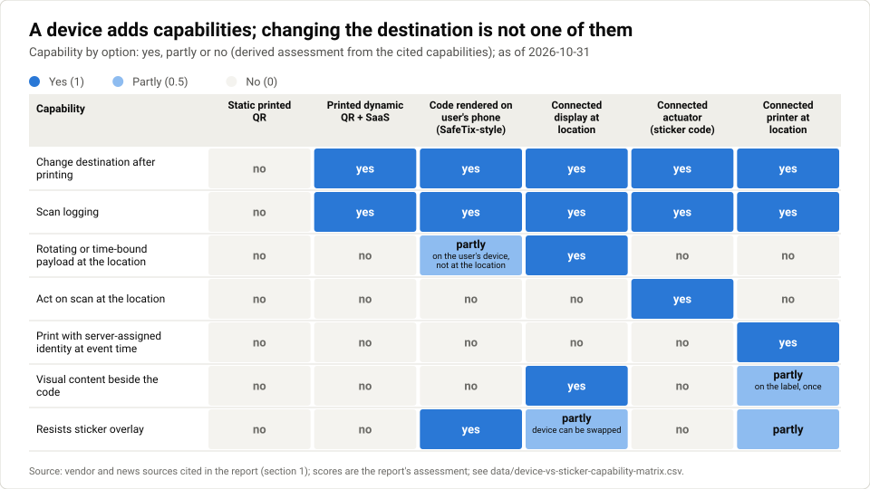
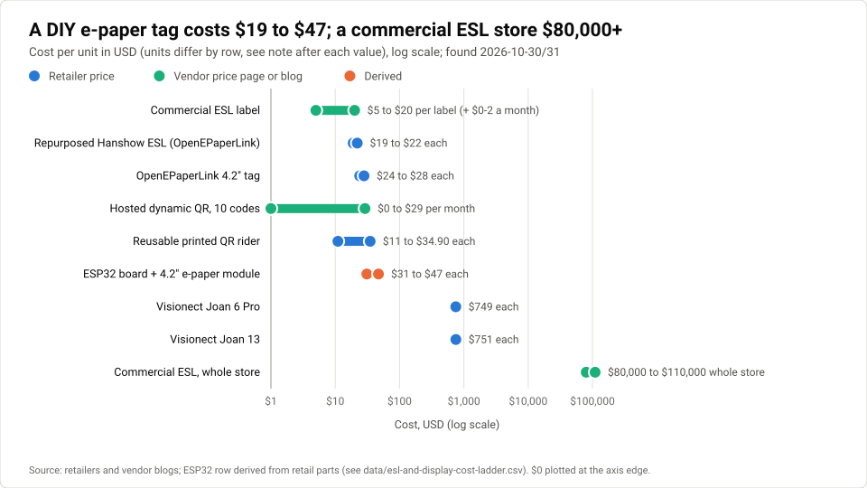
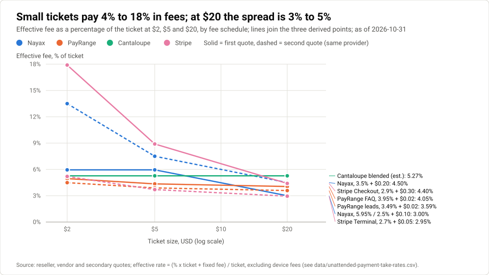
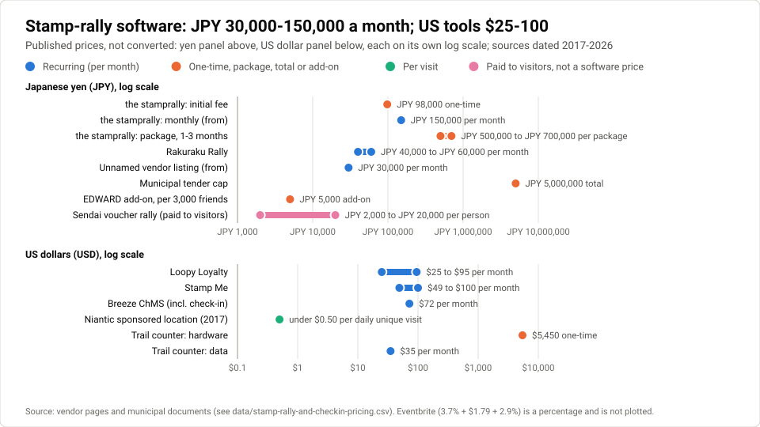
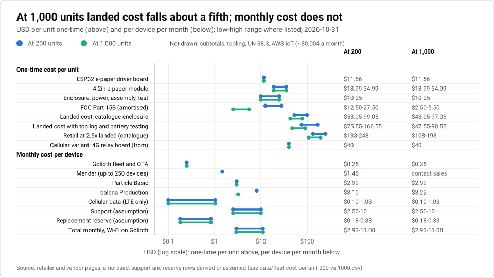

# Connected device opportunities: where the device is the product

**Prepared 2026-10-31**

A third companion report testing where a connected device built on qrwty's [dynamic-QR](#g-dynamic-qr) system (one that prints, displays, senses or [actuates](#g-actuator), is online over Wi-Fi or [LTE](#g-4g-lte), and treats every code as a live-controlled redirect with scan logging) can be a viable business, rather than a printed sticker plus any dynamic-QR [SaaS](#g-saas).

Companion to [the market and business-model assessment](README.md) and [Field device applications](field-device-applications.md). Source numbers are per document: [n] here refers to this report's Sources list, not either earlier report's.

## Contents

- [Executive summary](#executive-summary)
- [1 What a device adds that a sticker cannot](#1-what-a-device-adds-that-a-sticker-cannot-five-capabilities-and-destination-changes-is-not-one)
- [2 Changeable-QR displays and ESL](#2-changeable-qr-displays-and-esl-a-2-billion-market-where-qr-is-a-side-feature)
- [3 Scan-to-actuate for small unattended operators](#3-scan-to-actuate-for-small-unattended-operators-incumbents-take-about-4-6-not-10-15)
- [4 Event-driven on-site printing niches](#4-event-driven-on-site-printing-niches-printing-is-mandatory-the-printer-is-a-commodity)
- [5 Presence proof: stations, stamp rallies, loyalty, attendance](#5-presence-proof-stations-stamp-rallies-loyalty-attendance-buyers-pay-for-cheap-software-not-hardware)
- [6 Fleet economics: build, certify, connect, update, support](#6-fleet-economics-build-certify-connect-update-support-infrastructure-is-cents-support-is-the-cost)
- [7 Ranking and a platform view](#7-ranking-and-a-platform-view-one-station-two-angles)
- [8 Risks](#8-risks)
- [9 Recommendation and next experiments](#9-recommendation-and-next-experiments)
- [Sources](#sources)
- [Glossary](#glossary)

---

The first report in this folder found qrwty viable only as a small, [open-core](#g-open-core) business that sells continuity of printed codes, and scored a hardware device as not viable beyond a paid pilot. The second found that for posters, political signs, location hunts and inventory, codes printed in advance and bound to a place by a phone scan make a custom device unnecessary; the founder rejects that answer for a device business, because a pre-printed code plus a phone app is something any [dynamic-QR](#g-dynamic-qr) [SaaS](#g-saas) can offer. This report therefore asks only where a device at the code's location is intrinsic to the job, examines five candidate angles, and costs a small connected fleet against the alternative of selling software for hardware the customer already owns.

**The thesis under test.** The founder's view is that a QR code backed by an online device is a *control surface*: the server can change what the code does, what the device shows or prints, and can act when a scan arrives, whereas a barcode or pre-printed sticker is inert once it leaves the printer. On this view, the scan log stops being a marketing statistic and becomes an event stream that can drive a lock, a dispenser, a label or a display. This report treats that as a hypothesis, not as evidence. Each section asks two questions of it: does the device do something a printed dynamic code cannot, and does anyone already pay for that difference?

How to read the evidence labels (the same key as the earlier reports, with two additions): **vendor** = published by the company about itself or its market; **self-reported** = a founder's, seller's or forum member's own figures; **aggregator** = a third-party site that summarises or estimates (Capterra, Vendr, G2, market-research listings and similar); **secondary** = an article relaying another party's figures that this research did not read directly; **retailer** = a shop or reseller listing a product price; **testing vendor** = a certification or test lab describing its own fees; **derived** = arithmetic done in this report on cited numbers; **assumption** = an input with no direct source. Filings, laws and government documents carry no label. Many items in the notes were read only through search-engine summaries, and those are flagged. Prices are USD unless stated, as found on 2026-10-30 and 2026-10-31.

## Executive summary

A connected device beats a printed sticker in a short, specific list of jobs: showing a code that changes every few seconds, acting on a scan, printing a label whose identity the server assigns at the moment of an event, and showing content beside the code. Changing where a code points is not on the list, because printed [dynamic codes](#g-dynamic-qr) already do it for **$0-29 a month** [[1]](https://www.qrcodechimp.com/pricing)[[2]](https://bitly.com/pages/pricing). Across the five angles, the jobs where the device is intrinsic are either owned by chain-scale incumbents (electronic shelf labels, vending payments) or bought as cheap software running on commodity hardware the customer already has (event printing, [stamp rallies](#g-stamp-rally), attendance, loyalty). The two angles that fit qrwty best are **scan-to-[actuate](#g-actuator) for small unattended operators with tickets above roughly $17-27**, where plain [Stripe Checkout](#g-checkout) undercuts the platform rates found and no [self-hostable](#g-self-hosting) product turned up in the searches, and **rotating-code presence proof as software that renders on any screen**, where a server-controlled redirect and scan log are the product. Neither has operator demand evidence in the notes. A small fleet's infrastructure costs only about **$0.25-4 per device per month** on the cheaper tools (up to about $8 on balena at 200 devices); support, which no source quantified, is the real cost, and no revenue figure was found for any "bring your own hardware" software business.

| Angle | Why a device is intrinsic (or not) | Who pays today, and how much | Incumbents | Gap for a small or self-hostable entrant | Verdict |
| --- | --- | --- | --- | --- | --- |
| **1 Changeable-QR displays and [ESL](#g-esl)** | Intrinsic only for visual content beside the code and rotating payloads; destination changes need no display [[3]](https://www.qrstuff.com/feeds/service/qr-code-menu-stand)[[4]](https://lowensign.com/realestatesigns/independent/products/item/12p180qr/real%20estate%20qr%20code%20sign%20rider,%20.090%20polyethylene,%206h%20x%2024w.html) | Chains pay $5-20 per label and $80k-110k+ per store (vendor blogs) [[5]](https://shopappy.com/retail/supermarkets-grocers/electronic-shelf-labels-grocery)[[6]](https://minewtag.com/newsinfo433.html); [SMB](#g-smb) [e-paper](#g-e-paper) signs cost $749 [[7]](https://www.exertisalmo.com/productdetails/VISNET/JOAN6PRO%20GRAY) | Vusion (EUR 1,472M [FY](#g-fy)2025 revenue) [[8]](https://s203.q4cdn.com/882900163/files/doc_financials/2025/q4/Vusion_PR_FY-2025-Results_vUK.pdf), Pricer, Hanshow, SoluM; Walmart rolling out to all ~4,600 US stores [[9]](https://www.retailcustomerexperience.com/news/walmart-deploying-vusion-for-digital-shelf-strategy/) | Hobby OpenEPaperLink tags at $19-28 with no support [[10]](https://www.tindie.com/products/electronics-by-nic/42-epaper-tag-for-openepaperlink)[[11]](https://www.tindie.com/products/youtechitfromhere/openepaperlink-diy-e-ink-screen-nebular-420); no SMB demand evidence found | **Not viable as ESL.** Support OpenEPaperLink tags as a display output for angle 4 |
| **2 Scan-to-actuate** | Intrinsic: the device is the actuator (lock, [relay](#g-relay), dispenser); the code itself can stay a sticker | Vending and laundry operators pay about 3.5-6% per transaction plus $5-10 per device per month [[12]](https://www.candymachines.com/pros-and-cons-of-using-nayax)[[13]](https://shop.payrange.com/?p=4303)[[14]](https://p14capital.substack.com/p/long-ctlp-cantaloupe-inc); doors $30-80 per month (aggregator) [[15]](https://www.vendr.com/buyer-guides/kisi) | Cantaloupe (1.28M devices) [[16]](https://www.sec.gov/Archives/edgar/data/896429/000162828025041775/ctlp-20250630.htm), Nayax, PayRange, CSC, Kisi, Noke, Luxer One | No self-hostable "sticker to [Stripe](#g-stripe) to relay" product found; plain Stripe Checkout costs more than incumbents below about $17-27 tickets (derived) [[17]](https://stripe.com/pricing) | **Conditionally viable niche** for mid-ticket assets without an incumbent; test with one paid pilot |
| **3 Event-driven on-site printing** | Intrinsic: the label must be printed when the event happens, with a server-assigned identity | Kitchens about $30 a month (competitor claim) [[18]](https://bohwiz-landing.pages.dev/pricing/); asset tagging $500-1,000 a year [[19]](https://gocodes.com/prices/); [LOTO](#g-loto) software about $1,800 a year (aggregator) [[20]](https://www.capterra.com/p/193762/Brady/pricing/) | Zebra/Brother hardware plus vertical software (PMI, DateCodeGenie, Brady, [Maximo](#g-maximo) add-ons, UPS Happy Returns) [[21]](https://welcome.iape.org/wp-content/uploads/2024/02/PMI-Evidence-Tracker-Flyer.pdf)[[22]](https://ncco.helpjuice.com/en_US/getting-started-guides/getting-started-with-datecodegenie-integrated-printer-devices)[[23]](https://www.bradyid.com/product/link360startpr)[[24]](https://sharptree.freshdesk.com/support/solutions/articles/69000862533)[[25]](https://developer.happyreturns.com/guides/qr-code-returns-ups/) | Small-operator print-on-event with a server record; buyers already own $375-900 printers [[26]](https://www.walmart.com/c/kp/zebra-label-printer)[[27]](https://www.pospaper.com/collections/zebra-healthcare-mobile) | **Software, not a device.** Drive [OEM](#g-oem) printers; best niche is asset and work-order labels |
| **4 Presence proof** | Intrinsic only for rotating codes, and any screen can show one; outdoors needs a powered station | Japanese organisers pay [JPY](#g-jpy) 40,000 a month to about JPY 700,000 a campaign for QR and [GPS](#g-gnss-gps) software [[28]](https://prtimes.jp/main/html/rd/p/000000004.000181685.html)[[29]](https://www.lycbiz.com/jp/service/line-mini-app/package/the-stamprally); loyalty [SaaS](#g-saas) $25-100 a month [[30]](https://docs.loopyloyalty.com/en/articles/803301-what-are-your-pricing-plans)[[31]](https://www.stampme.com/pricing) | LY Corporation's [LINE](#g-line) mini-app, Decentral, EnjoyTokyo; Loopy, Stamp Me; Eventbrite, Cvent | No weatherproof connected QR station product found; no evidence that organisers pay for presence hardware | **Software feature first** (rotating codes on any screen); station hardware only after a buyer with cash-value incentives asks |
| **5 Fleet plus subscription, and [BYOD](#g-byod)** | Not an angle in itself: the cost structure behind 1-4 | Device-plus-subscription prices range from $3.50 per device per month (vendor) [[32]](https://pages.tenantturner.com/seros) to $2,500-3,000 per camera per year (Flock, aggregator) [[33]](https://getsafeandsound.com/blog/flock-safety-pricing/) | Toast (hardware at a loss) [[34]](https://www.sec.gov/Archives/edgar/data/1650164/000165016426000057/tost-20251231.htm), Lime, Flock, Samsara, Vusion | Infrastructure $0.25-4 per device per month on the cheaper tools [[35]](https://www.golioth.io/pricing)[[36]](https://www.particle.io/pricing/)[[37]](https://1nce.com/en-eu/support/faq/what-is-included-in-the-1nce-lifetime-fee-are-there-any-additional-costs-to-be-taken-into)[[38]](https://www.hologram.io/pricing/); BYOD software has no revenue evidence | **BYOD software first; a reference device kit second; no subsidised fleet** |

Three findings carry most of the weight. First, the brief's premise that unattended-payment platforms take 10-15% was not found: the documented rates are **about 3.5-6%**, and on a $2 sale plain Stripe Checkout at 2.9% + 30c costs **17.9%** (derived), so fee arbitrage works only on larger tickets [[12]](https://www.candymachines.com/pros-and-cons-of-using-nayax)[[13]](https://shop.payrange.com/?p=4303)[[17]](https://stripe.com/pricing). Second, in every printing and presence niche examined, the buyer pays for software and treats the hardware as a commodity Zebra, Brother, tablet or phone, which favours selling software for customer-owned hardware over building a device. Third, the cheapest credible device (an [ESP32](#g-esp32) board with a 4.2-inch e-paper panel in a catalogue box) lands at about **$53-99 a unit at 200 units and $43-77 at 1,000** before support (derived from retail parts and testing-vendor prices, with assumed enclosure costs) [[39]](https://datasheet.lcsc.com/lcsc/2303281130_Waveshare-e-Paper-ESP32-Driver-Board_C5374679.pdf)[[40]](https://www.waveshare.com/product/displays/e-paper/epaper-2.htm)[[41]](https://compliancetesting.com/fcc-certification-faqs/fcc-certification-cost/); that is cheap enough for a paid pilot, and too expensive to give away under a $5-10 subscription.

## 1 What a device adds that a sticker cannot: five capabilities, and destination changes is not one

### The five capabilities

A precise list matters because most "smart QR" pitches blur it. A printed [dynamic code](#g-dynamic-qr) already lets its owner repoint the destination, count scans and change the landing page at any time; QRStuff sells dynamic-QR menu stands on exactly that promise, updating specials and prices without reprinting cards (vendor) [[3]](https://www.qrstuff.com/feeds/service/qr-code-menu-stand), and real-estate rider vendors pitch the same code being repointed to a "sold" page (vendor) [[42]](https://bitly.com/blog/qr-codes-for-realtors/). A reusable QR rider costs **$11.00-34.90** [[4]](https://lowensign.com/realestatesigns/independent/products/item/12p180qr/real%20estate%20qr%20code%20sign%20rider,%20.090%20polyethylene,%206h%20x%2024w.html). Anything a device offers on top of that has to come from one of five capabilities.

The first is a **rotating or time-bound payload**: the code itself changes every few seconds or minutes, so a photo or screenshot of it stops working. Ticketmaster's [SafeTix](#g-safetix) barcode refreshes about every **15 seconds** so that screenshots and prints are invalid (per a 2024 teardown) [[43]](https://gigazine.net/gsc_news/en/20240710-ticketmaster-safetix-ticket)[[44]](https://techcrunch.com/2019/05/16/ticketmaster-put-an-end-to-screenshots-with-new-digital-ticket-technology/amp/). A printed code cannot do this by definition, which makes rotating codes the one capability that only a live display can supply. The second is **act-on-scan**: a scan (or a payment confirmed after it) makes something happen at the location, such as a [relay](#g-relay) opening a lock or starting a machine. Here the code can still be a sticker; the device is the [actuator](#g-actuator), not the code. The third is **print-on-event with a server-assigned identity**: a label is printed when something happens (evidence is collected, a specimen is drawn, a return is dropped off), and the server decides what the label's code means at that moment. UPS Happy Returns is the cleanest example: the customer brings a QR code, an associate scans it, and the shipping label is printed on site (vendor) [[25]](https://developer.happyreturns.com/guides/qr-code-returns-ups/). The fourth is **visual content beside the code**: a price, an availability state, a countdown or a "sold" banner that changes with the code. The fifth is **tamper evidence**: a device cannot be overlaid with a fraudulent sticker as easily as a printed code can, which matters because the FBI has documented criminals placing fake codes over real ones, including more than two dozen on parking stations in Austin [[45]](https://www.ic3.gov/PSA/2022/PSA220118).

### What a device does not add, and what it adds only partly

Destination changes, scan counts, [custom domains](#g-custom-domain) and continuity are all available without a device. So is location-of-placement capture, which the second report showed a phone can record when a pre-printed code goes up. A device also does not fully solve tampering: a whole device can be swapped or covered, and the official guidance found (FBI, 2022 and 2023) warns people not to scan codes on stickers or codes that look replaced; it does not recommend rotating display codes [[45]](https://www.ic3.gov/PSA/2022/PSA220118)[[46]](https://www.13abc.com/2023/07/14/fbi-issues-warning-malicious-qr-codes). The tamper argument is a pitch, not a standard. Finally, rotating codes stop screenshot sharing but not a person relaying a live image to a friend over a video call; stronger presence proof needs a second factor such as device binding or location, which is what a 2023 peer-reviewed attendance system combined with dynamic QR (academic) [[47]](https://research-portal.uea.ac.uk/en/publications/fraud-mitigation-in-attendance-monitoring-systems-using-dynamic-q/).

Data

| Capability | Static printed QR | Printed dynamic QR + [SaaS](#g-saas) | Code rendered on user's phone (SafeTix-style) | Connected display at location | Connected actuator (sticker code) | Connected printer at location | Source |
| --- | --- | --- | --- | --- | --- | --- | --- |
| Change destination after printing | 0 | 1 | 1 | 1 | 1 | 1 | [[3]](https://www.qrstuff.com/feeds/service/qr-code-menu-stand)[[42]](https://bitly.com/blog/qr-codes-for-realtors/) |
| Scan logging | 0 | 1 | 1 | 1 | 1 | 1 | [[1]](https://www.qrcodechimp.com/pricing)[[2]](https://bitly.com/pages/pricing) |
| Rotating or time-bound payload at the location | 0 | 0 | 0.5 (on the user's device, not at the location) | 1 | 0 | 0 | [[43]](https://gigazine.net/gsc_news/en/20240710-ticketmaster-safetix-ticket) |
| Act on scan at the location | 0 | 0 | 0 | 0 | 1 | 0 | [[16]](https://www.sec.gov/Archives/edgar/data/896429/000162828025041775/ctlp-20250630.htm)[[48]](https://www.evconnect.com/blog/ev-charging-without-app-qr-code/) |
| Print with server-assigned identity at event time | 0 | 0 | 0 | 0 | 0 | 1 | [[25]](https://developer.happyreturns.com/guides/qr-code-returns-ups/) |
| Visual content beside the code | 0 | 0 | 0 | 1 | 0 | 0.5 (on the label, once) | [[49]](https://www.hanshow.com/en/news/unlocking-the-future-of-digital-retail-with-hanshows-esls-seamless-integration-for-dpp-access) |
| Resists sticker overlay | 0 | 0 | 1 | 0.5 (device can be swapped) | 0 | 0.5 | [[45]](https://www.ic3.gov/PSA/2022/PSA220118) |

Scores: 1 = yes, 0.5 = partly, 0 = no (derived assessment from the cited capabilities).

## 2 Changeable-QR displays and ESL: a $2 billion market where QR is a side feature

### Chain-scale vendors and Walmart define the market

Electronic shelf labels are the obvious commercial form of "a display that shows a code". Analyst estimates of the 2025 market range from **$1.61B to $2.66B**, with growth rates of 11-21% a year; Global Market Insights puts 2025 at $2.2B and 335.9M units (aggregator) [[50]](https://www.expertmarketresearch.com/reports/electronic-shelf-label-market)[[51]](https://www.knowledge-sourcing.com/report/electronic-shelf-label-market)[[52]](https://www.gminsights.com/industry-analysis/electronic-shelf-label-esl-market)[[53]](https://www.rootsanalysis.com/electronic-shelf-labels-market). The figures come from syndicated listings with differing methods, so the range is the honest answer. The leader's numbers are firmer. VusionGroup reported [FY](#g-fy)2025 [IFRS](#g-ifrs) revenue of **EUR 1,472M (+54%)** and adjusted revenue of about EUR 1,527M (+51%), with adjusted [EBITDA](#g-ebitda) of EUR 277M (18.2% margin), in a press release issued while its audit was still in progress (vendor) [[8]](https://s203.q4cdn.com/882900163/files/doc_financials/2025/q4/Vusion_PR_FY-2025-Results_vUK.pdf). Pricer, a smaller listed rival, had net sales of SEK 2,147.9M, down from SEK 2,558.0M, at a **22.2% [gross margin](#g-gross-margin)**, with order intake down from SEK 2,918.4M to SEK 1,892.1M (vendor) [[54]](https://www.pricer.com/reports/year-end-report-january-december-2025-pricer-ab).

Walmart is the demand engine. It signed a first phase for 500 stores and about 60M labels in 2023, expanded to 2,300 stores by 2026 in June 2024, and in December 2024 extended the programme to all of its roughly 4,600 US stores; one report values the order at about EUR 1bn, and store counts vary by report (vendor, trade press) [[55]](https://www.vusion.com/insights/ses-imagotag-announces-vusion-platform-roll-out-contract-in-walmart-stores-in-u-s/)[[9]](https://www.retailcustomerexperience.com/news/walmart-deploying-vusion-for-digital-shelf-strategy/). Walmart Mexico is installing more than 1.7M labels with completion in 2026 [[56]](https://www.pulse.bot/retail/news/walmart-vusion-to-deploy-connected-store-platform-across-mexico-d28609b3-bf6d-4547-adcc-47489d77204c/). The Walmart figures imply about **120,000 labels per store** (derived: 60M / 500), an order of magnitude above the ~10,000-label store used in reseller cost breakdowns; the two describe different store formats rather than contradicting each other.

### Hardware dominates revenue, and per-label recurring revenue is not disclosed

Labels cost roughly **$5-20 each** (small black-and-white $5-10, colour $10-20), and a store with about 10,000 labels runs to **$80,000-110,000 or more**; one breakdown for a supermarket lists labels at $150k-450k, rails and network $15k-50k, installation $20k-60k and software $10k-40k a year, and some vendors add $0-2 per label per month in cloud fees. These are vendor and reseller blogs, some dated 2020-22 [[5]](https://shopappy.com/retail/supermarkets-grocers/electronic-shelf-labels-grocery)[[6]](https://minewtag.com/newsinfo433.html)[[57]](https://www.kiosketagscreen.com/info/electronic-shelf-labels-for-small-grocery-stor-103537605.html). Vusion's software line is growing but small: value-added services were about **EUR 211M**, roughly 14% of revenue, and recurring value-added services were **EUR 83M (+45%)**, passing EUR 100M annualised in Q4 2025 (vendor) [[8]](https://s203.q4cdn.com/882900163/files/doc_financials/2025/q4/Vusion_PR_FY-2025-Results_vUK.pdf). Recurring revenue is therefore about **5.6% of IFRS revenue** (derived: 83 / 1,472). Vusion guides to 15-20% growth in 2026, including about 40% growth in value-added services [[8]](https://s203.q4cdn.com/882900163/files/doc_financials/2025/q4/Vusion_PR_FY-2025-Results_vUK.pdf). No source disclosed revenue per label per year (no evidence found).

QR codes are a secondary feature in this market. Hanshow says its labels integrate with product-information systems and [GS1 Digital Link](#g-gs1-digital-link) for [Digital Product Passport](#g-digital-product-passport) access, and other vendors describe QR or [NFC](#g-nfc) on labels for product details or loyalty offers (vendor) [[49]](https://www.hanshow.com/en/news/unlocking-the-future-of-digital-retail-with-hanshows-esls-seamless-integration-for-dpp-access)[[58]](https://media.narmadi.com/r/esl-with-nfc-or-qr-code-features). No source confirmed Walmart using QR on its shelf labels (no evidence found). Buyers pay for price automation; a QR redirect or scan log would be an add-on to someone else's label, sold into a procurement process designed for chains.

### The SMB display gap is a price gap with no demand evidence

Below the chains, dedicated [e-paper](#g-e-paper) signage is expensive. Visionect's Joan 6 Pro lists at **$749** and the Joan 13 at $751 at one reseller; these are room-booking displays, not QR products [[7]](https://www.exertisalmo.com/productdetails/VISNET/JOAN6PRO%20GRAY)[[59]](https://www.tanotis.com/products/visionect-joan-13-13-uxga-room-scheduling-e-ink-display-slate-gray). The only "e-ink QR" table stand found was an AliExpress wiki tag with no specifications or price [[60]](https://www.aliexpress.com/s/wiki-ssr/article/qr-code-table-stand). At the other end, the [open-source](#g-open-source) OpenEPaperLink ecosystem sells preflashed 4.2-inch tags for **$24 (one or two units) or $28 (three or more)** and repurposed Hanshow labels for $19-22, as-is with no warranty; they need an [ESP32](#g-esp32) access point, and some tags need opening or drilling to flash (retailer, self-reported) [[10]](https://www.tindie.com/products/electronics-by-nic/42-epaper-tag-for-openepaperlink)[[11]](https://www.tindie.com/products/youtechitfromhere/openepaperlink-diy-e-ink-screen-nebular-420)[[61]](https://github.imc.re/nlimper/Mini-AP-v3). One seller says it no longer sources displays. Building from modules, a Waveshare ESP32 e-paper driver board costs **$12.33 at one unit and $11.56 at 100 or more**, and 4.2-inch modules cost **$18.99-34.99** (retailer, vendor) [[39]](https://datasheet.lcsc.com/lcsc/2303281130_Waveshare-e-Paper-ESP32-Driver-Board_C5374679.pdf)[[40]](https://www.waveshare.com/product/displays/e-paper/epaper-2.htm), so a bare electronics kit is about **$31-47** before case, battery or certification (derived).

That leaves a plausible gap between $30 hobby tags and $749 room signs, perhaps a hosted e-paper QR sign at $30-80. The notes found no demand for it: no [SMB](#g-smb) asking for powered changeable-QR displays, and no SMB-priced vendor selling Wi-Fi e-paper QR signs (no evidence found). The only display capability a printed [dynamic code](#g-dynamic-qr) cannot copy is the rotating payload, and that belongs to presence proof (section 5).

Data

| Option | Unit cost (USD) | Basis | Source |
| --- | --- | --- | --- |
| Hosted dynamic QR, 10 codes | 0-29 per month | vendor price pages | [[1]](https://www.qrcodechimp.com/pricing)[[2]](https://bitly.com/pages/pricing) |
| Reusable printed QR rider | 11.00-34.90 | retailer | [[4]](https://lowensign.com/realestatesigns/independent/products/item/12p180qr/real%20estate%20qr%20code%20sign%20rider,%20.090%20polyethylene,%206h%20x%2024w.html) |
| Repurposed Hanshow [ESL](#g-esl) for OpenEPaperLink | 19-22 | retailer, no warranty | [[11]](https://www.tindie.com/products/youtechitfromhere/openepaperlink-diy-e-ink-screen-nebular-420) |
| OpenEPaperLink 4.2" tag | 24-28 | retailer, access point extra | [[10]](https://www.tindie.com/products/electronics-by-nic/42-epaper-tag-for-openepaperlink) |
| ESP32 driver board + 4.2" e-paper module | 31-47 | derived from retail parts (11.56-12.33 + 18.99-34.99) | [[39]](https://datasheet.lcsc.com/lcsc/2303281130_Waveshare-e-Paper-ESP32-Driver-Board_C5374679.pdf)[[40]](https://www.waveshare.com/product/displays/e-paper/epaper-2.htm) |
| Commercial ESL label | 5-20 per label, plus 0-2 per label per month cloud fee | vendor blogs | [[5]](https://shopappy.com/retail/supermarkets-grocers/electronic-shelf-labels-grocery)[[6]](https://minewtag.com/newsinfo433.html) |
| Commercial ESL, whole store (~10,000 labels) | 80,000-110,000+ | vendor blogs | [[5]](https://shopappy.com/retail/supermarkets-grocers/electronic-shelf-labels-grocery)[[57]](https://www.kiosketagscreen.com/info/electronic-shelf-labels-for-small-grocery-stor-103537605.html) |
| Visionect Joan 6 Pro | 749 | retailer | [[7]](https://www.exertisalmo.com/productdetails/VISNET/JOAN6PRO%20GRAY) |
| Visionect Joan 13 | 751 | retailer | [[59]](https://www.tanotis.com/products/visionect-joan-13-13-uxga-room-scheduling-e-ink-display-slate-gray) |

**Verdict.** Do not enter ESL. The market is real but bought by chains from vendors with billion-euro revenue, and QR is incidental to it. The useful part for qrwty is technical: OpenEPaperLink tags are a $20-30 display that customers can buy themselves, which makes them a candidate output for rotating codes.

## 3 Scan-to-actuate for small unattended operators: incumbents take about 4-6%, not 10-15%

### The model is proven at scale, as a payments business

The pattern "scan, pay, the machine acts" is established in vending, laundry, EV charging, [micromobility](#g-micromobility) and car washes. Cantaloupe's [FY](#g-fy)2025 [10-K](#g-10-k) reports **1.28M active devices** and **34,896 active customers**; most customers pay a monthly service fee plus a blended percentage of transaction volume, equipment is sold, financed or bundled into a monthly "Cantaloupe ONE" subscription, and agreements can generally be cancelled on 30 days' notice [[16]](https://www.sec.gov/Archives/edgar/data/896429/000162828025041775/ctlp-20250630.htm). Third-party summaries put FY2025 revenue at about $303M and transaction volume at $3.4B (secondary; not verified from the filing text). That works out to about **$237 of revenue per device per year, or roughly $20 a month**, across subscription, processing and equipment (derived), and an average of about 37 devices per customer (derived). An investor newsletter estimates Cantaloupe's [take rate](#g-take-rate) at about **5.27%** in Q1 FY2025, up from 4.84% in FY2022 (secondary) [[14]](https://p14capital.substack.com/p/long-ctlp-cantaloupe-inc).

Lime shows the economics when the device itself earns money. Trade coverage of its May 2026 [S-1](#g-s-1) reports FY2025 revenue of **$886M** (one passage says $887M), adjusted [EBITDA](#g-ebitda) of $218.1M, adjusted [gross margin](#g-gross-margin) of about 53%, 325,137 vehicles, **$7.47 of revenue per vehicle per day**, and a fully landed vehicle cost of about $1,300 with about a 12-month [payback](#g-payback) (secondary) [[62]](https://micromobility.io/news/886m-230-cities-and-an-ipo-filing---inside-limes-s-1). Lime is not a small-operator model, but the arithmetic is the one a qrwty [actuator](#g-actuator) has to beat: the device must either earn transaction revenue at the location or save an operator enough to justify a subscription.

### The documented take rates are 3.5-6%

The brief assumed that small operators pay 10-15% to platforms. No source in the notes supports that for any hardware-payment incumbent. Nayax resellers quote **5.95% on sales of $5 or less and 2.5% + $0.10 above $5**, other resellers quote 3.5% + $0.20 or 3.0% + $0.20, and cashless plans cost about $7.95-9.99 per device per month with a $30 activation at some resellers; no official Nayax rate card was found (retailer) [[12]](https://www.candymachines.com/pros-and-cons-of-using-nayax)[[63]](https://vmfsusa.com/blogs/business/nayax-vending-card-reader-guide). PayRange's FAQ lists **3.95% in the US plus a $0.02 fee**, 5.25% for amusement machines, and a $79.95 BluKey; a separate PayRange leads page says 3.49% + $0.02 and $59.95 plus a $20 bundle, and the two pages conflict (vendor) [[13]](https://shop.payrange.com/?p=4303)[[64]](https://payrange.com/inbound-calls). PayRange cites an industry average of 6-7% and Crane advertising 5.4% (vendor) [[13]](https://shop.payrange.com/?p=4303). The highest figure found anywhere is that 6-7% industry claim; the 10-15% premise should be dropped. Table-ordering fees from me&u appear in customer reviews at about 1.05-1.6% (aggregator) [[65]](https://www.productreview.com.au/listings/me-u).

The comparison that matters for a [self-hosted](#g-self-hosting) entrant is against plain [Stripe](#g-stripe). Stripe's standard online price is **2.9% + 30c**, with [Checkout](#g-checkout) and Payment Links included; in-person Terminal pricing is 2.7% + 5c but needs a $59-329 reader (vendor) [[17]](https://stripe.com/pricing). The fixed 30c dominates small tickets.

Data

| Fee schedule | Quoted rate | Effective at $2 | Effective at $5 | Effective at $20 | Source |
| --- | --- | --- | --- | --- | --- |
| Nayax (reseller quote) | 5.95% at $5 or less; 2.5% + $0.10 above | 5.95% | 5.95% | 3.00% | [[12]](https://www.candymachines.com/pros-and-cons-of-using-nayax) |
| Nayax (alternative reseller quote) | 3.5% + $0.20 | 13.50% | 7.50% | 4.50% | [[12]](https://www.candymachines.com/pros-and-cons-of-using-nayax) |
| PayRange (FAQ) | 3.95% + $0.02 | 4.95% | 4.35% | 4.05% | [[13]](https://shop.payrange.com/?p=4303) |
| PayRange (leads page) | 3.49% + $0.02 | 4.49% | 3.89% | 3.59% | [[64]](https://payrange.com/inbound-calls) |
| Cantaloupe blended take rate | ~5.27% (estimate) | 5.27% | 5.27% | 5.27% | [[14]](https://p14capital.substack.com/p/long-ctlp-cantaloupe-inc) (secondary) |
| Stripe online (Checkout, Payment Links) | 2.9% + $0.30 | 17.90% | 8.90% | 4.40% | [[17]](https://stripe.com/pricing) |
| Stripe Terminal (needs $59-329 reader) | 2.7% + $0.05 | 5.20% | 3.70% | 2.95% | [[17]](https://stripe.com/pricing) |

Effective rates are derived: (percentage x ticket + fixed fee) / ticket. They exclude monthly device fees and any qrwty fee.

The break-even points are derived from the same quotes. Stripe Checkout matches PayRange's 3.95% + $0.02 at a **$26.67 ticket** and Nayax's alternative 3.5% + $0.20 quote at **$16.67**; it never beats Nayax's quoted 2.5% + $0.10 above $5. Below those levels a QR-to-Stripe design costs the operator more than the incumbent, before qrwty charges anything. Laundry machines, snack vending and scooter unlocks (about $1 plus $0.15-0.52 a minute, secondary) [[66]](https://levyelectric.com/resources/how-much-do-lime-bird-scooters-cost-complete-pricing-guide) are small-ticket. EV charging sessions, equipment and tool rental, campsite or marina amenities, and makerspace machine time plausibly sit above the line, but the notes contain no ticket-size or operator data for them (no evidence found).

### What operators complain about, and where nothing was found

Operator evidence is thin. A laundromat owner quoted in trade press says "transaction fees definitely are real, but customer convenience is king" and that app users seem to spend more; another calls card processing fees "ridiculous"; the same feature puts card processing at 1.5-3% of a sale (trade press, search summary) [[67]](https://planetlaundry.com/?p=12220). An RV park operator on a forum says laundry sales dropped sharply after switching to app payment (self-reported) [[68]](https://forum.mobilehomeuniversity.com/t/wahsing-machines-shinepay-or-other-cashless-solution/31301), and one consumer review calls a laundry app's pay step a way to save the owner card fees (aggregator) [[69]](https://justuseapp.com/en/app/1235121730/speed-queen/reviews). Beyond these two owner quotes and two anecdotes, no operator fee or lock-in complaints were found for car washes, campgrounds, marinas, tool libraries or makerspaces (no evidence found). Cantaloupe's 30-day cancellation terms suggest switching is not hard [[16]](https://www.sec.gov/Archives/edgar/data/896429/000162828025041775/ctlp-20250630.htm).

Access and lockers are monetised per door or per unit rather than per scan. Vendr estimates Kisi door access at **$30-80 per door per month** depending on size, with a median annual spend of about $5,100-5,250, figures it reports inconsistently (aggregator) [[15]](https://www.vendr.com/buyer-guides/kisi); Kisi's own blog cites $600-1,600 a year per door (vendor) [[70]](https://www.getkisi.com/blog/breakdown-of-access-control-system-installation-costs). Noke smart entry for self-storage costs "roughly $200 to $300 per smart lock", including installation and the tenant app [[71]](https://digital.modernstoragemedia.com/?p=231976), and a Janus study says operators can charge tenants $5 a month for after-hours or $15 a month for 24-hour access (vendor, search summary) [[72]](https://www.janusintl.com/hubfs/STORLOCAL-Securing%20Profits%20with%20Noke%CC%84%20Smart%20Entry%20System.pdf). A search snippet attributed $13.90 per lock and a $20 membership to the same Noke article; the fetched page showed those figures belong to a different vendor, so they are excluded [[71]](https://digital.modernstoragemedia.com/?p=231976). Tenant Turner claims its devices cost $3.50 per device per month against $5 for others (vendor) [[32]](https://pages.tenantturner.com/seros). Parcel lockers are quote-based at $6,000-20,000 plus a monthly fee [[73]](https://www.multifamilyexecutive.com/technology/luxer-one-offers-affordable-alternative-to-package-lockers_o).

### Self-hostable options exist only at the edges

The searches found open or cheap back-ends in only one category. In EV charging, OpenCPO is an [Apache 2.0](#g-apache-2), [OCPP](#g-ocpp) 1.6/2.0.1 back-end with a QR-start web app (aggregator) [[74]](https://awesome.ecosyste.ms/projects/github.com%2Fopencpo%2Fopencpo), askacharge is listed at EUR 20 a month per brand with 0% commission and app-free QR (aggregator) [[75]](https://www.capterra.com.au/software/1105333/askacharge-com), EV Connect launched app-free QR charging (vendor) [[48]](https://www.evconnect.com/blog/ev-charging-without-app-qr-code/), the Open Charge Alliance published a June 2026 whitepaper on QR payments over OCPP [[76]](https://openchargealliance.org/?p=280845), and ChargePoint announced ad hoc QR payments with Cariqa in August 2026 [[77]](https://electrive.com/2026/08/26/chargepoint-and-cariqa-partner-on-qr-code-payments). EV charging is therefore already served at the low end. Outside EV, the only self-hostable QR lock found was a hobby project that runs a camera scanner on a [Raspberry Pi](#g-raspberry-pi) with a 12 V [relay](#g-relay) (self-reported) [[78]](https://www.electromaker.io/project/view/theiotprojectkey-scanner), a different architecture in which the device reads a phone instead of a phone reading a sticker. No ready, self-hostable "scan sticker, pay through Stripe, signed [webhook](#g-webhook), relay" product was found; that is consistent with a gap but does not prove one.

The hardware for the actuator is cheap. KinCony sells [ESP32](#g-esp32) relay boards with a [4G](#g-4g-lte) modem from **$40** (two channels) to $140 (vendor) [[79]](https://shop.kincony.com/collections/kc868-ax); SIMCom [Cat-1bis](#g-cat-1bis) modules cost about $18-20 at one unit (retailer) [[80]](https://www.tme.com/us/en-us/katalog/m2m-gprs-lte-5g-modules_113195/params/b375_interface/p1535410_sim/); Hologram charges **$1 per [SIM](#g-sim) per month plus $0.03 per MB** and $3 per SIM card (vendor) [[38]](https://www.hologram.io/pricing/). A scan-and-unlock event is a few kilobytes, so data costs cents a month and the SIM fee dominates (derived). Enclosure, power supply and lock costs were not researched.

### What SAQ A does and does not mean (inference to confirm)

The architecture keeps card data away from qrwty. Stripe says low-risk integrations send payment information "directly to Stripe without it passing through your servers, reducing your [PCI](#g-pci-dss) obligations", that PCI is a shared responsibility, and that the business must still "annually attest" (vendor) [[81]](https://docs.stripe.com/security/guide). Stripe's PCI guide says Checkout and Elements host card inputs in a Stripe-domain iframe, which meets "PCI eligibility for the [SAQ A](#g-saq-a)"; it does not mention Payment Links (vendor) [[82]](https://stripe.com/guides/pci-compliance). Third-party blogs describe redirect-to-Checkout as SAQ A and Elements variously as SAQ A or SAQ A-EP (vendor) [[83]](https://cside.com/blog/can-you-use-stripe-for-pci-dss).

The inference, which the operator should confirm with its [acquirer](#g-acquirer) and against the PCI Security Standards Council's current SAQ A text (not read in this research), is that a static code leading to Stripe Checkout, with a verified webhook commanding the device, leaves the merchant in the SAQ A tier. SAQ A does not mean no obligations: the merchant still attests each year, the page that links to checkout must be served securely, and Stripe asks for webhook signature checks and [TLS](#g-tls) 1.2 or later [[81]](https://docs.stripe.com/security/guide). One vendor blog claims PCI DSS 4.0 requirements 6.4.3 and 11.6.1 (script management and change detection on payment pages) apply to hosted-checkout merchants that load scripts; that claim could not be confirmed against PCI SSC text and conflicts with the reading that SAQ A merchants host no payment page [[84]](https://cside.com/blog/does-stripe-make-you-pci-compliant-6-4-3-11-6-1). SAQ A also says nothing about the risks that matter most here, which are product design issues: replayed webhooks, double vends, payment taken but machine failed, refunds, and accessibility. One accessibility vendor says no law requires QR codes but that QR flows fall under accessibility obligations once used, and the [kiosk](#g-kiosk) industry association has a 14-point [ADA](#g-ada) checklist; no source said QR-only access is prohibited (vendor) [[85]](https://pageloot.com/blog/top-industries-using-ada-compliant-qr-codes/)[[86]](https://prnewswire.com/news-releases/kiosk-association-kma-announces-new-ada-accessibility-and-emv-initiatives-301228384.html). A keypad, staff call or card fallback is prudent (assumption, not legal advice).

**Verdict.** Conditionally viable as a niche: a self-hostable scan-to-actuate kit for operators of unattended assets with tickets above roughly $17-27 and no incumbent platform, sold on ownership and per-scan logs rather than on fees. Not viable for small-ticket vending or laundry, where incumbents are cheaper than plain Stripe. Operator demand is unproven.

## 4 Event-driven on-site printing niches: printing is mandatory, the printer is a commodity

### Nine niches compared

This angle has the strongest claim that a device at the location is intrinsic: some labels cannot exist until an event happens. The notes examined nine niches; evidence for all of them comes from search summaries without page fetches.

| Niche | Mandatory on-site printing? | Incumbents and prices | Would a dynamic redirect add value? | [SMB](#g-smb) or [self-host](#g-self-hosting) gap |
| --- | --- | --- | --- | --- |
| **Evidence (police property rooms)** | Yes: the label must exist at collection. Suffolk County, NY prints 70,000+ evidence labels and invoices a year on one Zebra (vendor) [[87]](https://www.barcodesinc.com/news/continuous-improvement-key-to-chain-of-custody-evidence-excellence) | PMI Evidence Tracker bundles software, printer, scanner, labels and a year of support, no price (vendor) [[21]](https://welcome.iape.org/wp-content/uploads/2024/02/PMI-Evidence-Tracker-Flyer.pdf); Evidence Hound prints via Teklynx (self-reported) [[88]](https://www.forensicfocus.com/forums/general/barcode-systems-for-handling-evidence/) | Low: the code must resolve to an auditable record; a static ID is safer (derived judgement) | Agency site licences; no SMB or self-hosted option found |
| **Clinical specimens** | Yes: labelled at the bedside on Zebra healthcare printers (retailer) [[89]](https://www.barcodegiant.com/zebra/qln320-hc.htm) | Zebra ZQ320 Plus about $375, QLn320 HC $570-790 (retailer) [[26]](https://www.walmart.com/c/kp/zebra-label-printer); ZQ610/620 Plus HC GBP 687-896 ex [VAT](#g-vat) (retailer) [[27]](https://www.pospaper.com/collections/zebra-healthcare-mobile) | Low, for the same audit reason | Hospital systems; no gap evidence |
| **Field service and work orders** | Often: Accuviti and Opqo print asset labels on site from [Maximo](#g-maximo) records (vendor) [[90]](https://abr.com/?p=25972)[[24]](https://sharptree.freshdesk.com/support/solutions/articles/69000862533); an IBM Ideas request suggests network printing is not native (self-reported) [[91]](https://ibm-ai-apps.ideas.ibm.com/ideas/MOBILE1-I-144) | GoCodes $500 a year for 200 assets, $1,000 Premium (vendor) [[19]](https://gocodes.com/prices/); QR labels under $0.15 each (vendor) [[92]](https://support.servicem8.com/help-center/servicem8-add-ons/asset-management/ordering-asset-management-qr-code-labels); Fiix gives each asset and work order a QR code (vendor) [[93]](https://helpdesk.fiixsoftware.com/hc/en-us/articles/210537626) | **High**: the asset's code can resolve to its current work order or status | Maximo add-ons are enterprise-only [[24]](https://sharptree.freshdesk.com/support/solutions/articles/69000862533); small maintenance teams are the clearest gap |
| **Construction and safety tags ([LOTO](#g-loto), scaffold)** | Partly: LOTO procedures sit behind QR codes printed on a Brady printer (vendor) [[23]](https://www.bradyid.com/product/link360startpr); scaffold tags are pre-made packs at C$42-48 (retailer) [[94]](https://www.fishersci.ca/shop/products/brady-scaffold-inspection-tags-2/p-3791594) | Brady LINK360 about $1,800 a year (aggregator) [[20]](https://www.capterra.com/p/193762/Brady/pricing/); Brady printers $1,500-4,000 (aggregator) [[95]](https://softwarefinder.com/facility-management-software/brady-link360) | **High** for LOTO: the code points to the current procedure | Brady is the incumbent; no SMB price found |
| **Regulated cannabis inventory ([Metrc](#g-metrc))** | Tags are state-issued, assigned in the field | Plant tags $0.46 and package tags $0.26 in Michigan from 1 October 2025 [[96]](https://www.metrc.com/wp-content/uploads/2025/10/MI_IB_0109_Metrc-Plant-and-Package-Tracking-Updates.pdf); Massachusetts the same [[97]](https://masscannabiscontrol.com/2024/12/bulletin-metrc-fee-increases-december-23-2024/); Montana $0.55 and $0.32 [[98]](https://www.metrc.com/wp-content/uploads/2024/07/MT_IB_0050_-Metrc-Tag-Prices.pdf) | Low: the official label's form is fixed by the state | A qrwty code could only be an extra sticker |
| **Kitchen date labels** | Yes: labels per batch and day | DateCodeGenie printer plus app subscription (vendor) [[22]](https://ncco.helpjuice.com/en_US/getting-started-guides/getting-started-with-datecodegenie-integrated-printer-devices); about $30 a month and up to $2,000 setup (competitor claim) [[18]](https://bohwiz-landing.pages.dev/pricing/); Lite system GBP 1,248.97 ex VAT (retailer) [[99]](https://www.smartuk.net/new-in/datecodegenie-lite-system/); $0.06 per label (retailer) [[100]](https://www.shopatdean.com/pages/datecodegenie) | Medium at best: a recall or allergen page is plausible but unevidenced | Crowded; no Toast or Square label pricing found |
| **Returns drop-off** | Yes: UPS Happy Returns prints the label at drop-off and ordinary drop boxes cannot process QR returns (vendor) [[25]](https://developer.happyreturns.com/guides/qr-code-returns-ups/)[[101]](https://www.ups.com/us/en/ups-happyreturns) | UPS and its retail network (The UPS Store, Ulta, Staples) [[101]](https://www.ups.com/us/en/ups-happyreturns) | Already a pointer to a server record | Carrier-scale; no small-entrant gap |
| **Citations and event badges** | Citations yes; badges optional, since Eventbrite says on-site printing is unnecessary when attendees pre-register (vendor) [[102]](https://www.eventbrite.com/blog/breaking-down-badges-ds0c/) | Passport uses [Bluetooth](#g-ble) Zebra printers (vendor) [[103]](https://www.passportinc.com/wp-content/uploads/2022/06/Enforcement-Made-Easy%E2%80%94-Real-time-Access-to-Insights-Data.pdf); Santa Ana bundles a Zebra ZQ511, data plan, licence and management per unit [[104]](https://publicdocs.santa-ana.org/WebLink/1/doc/548889/Page25.aspx); 2017 bid $300 per unit per year or $50 a month lease [[105]](https://publicdocs.santa-ana.org/WebLink/1/doc/92929/Page48.aspx); badges on Brother QL-820NWB (vendor) [[106]](https://help.gatsby.events/reference/day-of-event/badge-printing/); Cvent badge app costs extra (competitor claim) [[107]](https://www.vfairs.com/?p=35501) | Low for citations (legal record); medium for badges | Municipal procurement; event tools already print badges |
| **EU plant passports** | No: content and form set by Regulation 2017/2313 and can be batch-printed; records kept 3 years [[108]](https://www.legislation.gov.uk/eur/2017/2313/adopted/data.htm)[[109]](https://www.fimportal.de/api/v0/leistung-stammtexte/L100008/417037183/pvog/en/pdf); may be held digitally (UK) [[110]](https://planthealthportal.defra.gov.uk/assets/uploads/Plant-Passport-Presentation.pdf) | Authorised operators' own systems | Low: fixed regulated format | Add-on sticker only |

### Where the value sits

Two patterns run through the table. The printer is a commodity in every niche, a $375-900 Zebra or a low-cost Brother, and the value sits in the integration with a record system, which is the "sticker plus [SaaS](#g-saas)" pattern the founder wants to avoid, except that the sticker is printed at the event rather than in advance [[26]](https://www.walmart.com/c/kp/zebra-label-printer)[[27]](https://www.pospaper.com/collections/zebra-healthcare-mobile). And the dynamic redirect, qrwty's core feature, matters least where on-site printing matters most: evidence, specimens and citations need codes that resolve to a fixed, auditable record, and Metrc tags and EU passports have state-fixed content [[96]](https://www.metrc.com/wp-content/uploads/2025/10/MI_IB_0109_Metrc-Plant-and-Package-Tracking-Updates.pdf)[[108]](https://www.legislation.gov.uk/eur/2017/2313/adopted/data.htm). What qrwty can still add there is *server-assigned identity*: issuing a unique ID at print time and logging every scan, which a static barcode cannot log.

The overlap of "must print on site" and "a live redirect helps" is narrow: field assets and work orders, and LOTO procedures. Prices there are **$500-1,800 a year** for software [[19]](https://gocodes.com/prices/)[[20]](https://www.capterra.com/p/193762/Brady/pricing/), with label media under $0.15 [[92]](https://support.servicem8.com/help-center/servicem8-add-ons/asset-management/ordering-asset-management-qr-code-labels). The indicated per-device benchmark across kitchens and citation handhelds is about **$30-50 a month** (competitor claim and a 2017 bid) [[18]](https://bohwiz-landing.pages.dev/pricing/)[[105]](https://publicdocs.santa-ana.org/WebLink/1/doc/92929/Page48.aspx). Buyers already own the printers or buy them from Zebra and Brother resellers.

**Verdict.** The device is intrinsic but should not be built. A print-on-event feature that drives customer-owned Zebra and Brother printers, issues server-assigned codes and attaches scans to a work order or procedure is a software product with a clear niche (small maintenance and safety teams) and a priced benchmark. It is a better fit for qrwty than kitchens, returns or regulated labels.

## 5 Presence proof: stations, stamp rallies, loyalty, attendance (buyers pay for cheap software, not hardware)

### Japanese digital stamp rallies are cheap QR and GPS software projects

Japan has the most developed organiser-pays market for "prove you visited" campaigns, run by municipalities, tourism boards and shopping streets. Its prices are published, and they are for software. All amounts below are in yen, as stated by the source on the date given.

Data

| Product or programme | Price | Date of source | Methods | Source |
| --- | --- | --- | --- | --- |
| the stamprally (LY Corporation, [LINE](#g-line) mini app) | [JPY](#g-jpy) 98,000 initial + from JPY 150,000 per month; about JPY 500,000 (1 month, 10 spots, 1,000 people), JPY 600,000 (2 months, 30 spots, 2,000), JPY 700,000 (3 months, 50 spots, 3,000), tax incl. | undated page, fetched 2026-10-31 | QR, [GPS](#g-gnss-gps), on-screen stamp, LINE touch, riddle; [NFC](#g-nfc) not mentioned | [[29]](https://www.lycbiz.com/jp/service/line-mini-app/package/the-stamprally) |
| Rakuraku Rally (Decentral, Kyoto) | JPY 40,000 per month (31+ days); JPY 60,000 spot plan (30 days or less); no initial fee listed | 2026-05-29 | QR, GPS, keyword | [[28]](https://prtimes.jp/main/html/rd/p/000000004.000181685.html) |
| Unnamed vendor listing | JPY 0 initial, from JPY 30,000 per month | undated (attribution uncertain) | not stated | [[111]](https://www.biz.ne.jp/subject/toi_detail.html?tid=947166) |
| Municipal tender cap | JPY 5,000,000 total; GPS not required, stamps by QR | date not confirmed | QR | [[111]](https://www.biz.ne.jp/subject/toi_detail.html?tid=947166) |
| EDWARD (LINE mini app) | +JPY 5,000 ex tax per extra 3,000 friends; base fees not captured | undated (search summary) | not stated | [[112]](https://newscast.jp/smart/news/5267641) |
| Sendai "Machi-iko" voucher rally | 4 stamps earn JPY 2,000 in vouchers, up to JPY 20,000 per person; JPY 2.1bn issuance budget; 1,826 stores | 2022-10-18 | QR | [[113]](https://www.city.sendai.jp/sesakukoho/gaiyo/shichoshitsu/kaiken/2022/10/18megutoku2.html) |
| Loopy Loyalty | USD 25 / 69 / 95 per month | accessed 2026-10-31 | not stated | [[30]](https://docs.loopyloyalty.com/en/articles/803301-what-are-your-pricing-plans) |
| Stamp Me | USD 49 (limited-time) / 79 / 100 per month | accessed 2026-10-31 | single-use codes, tap tags | [[31]](https://www.stampme.com/pricing) |
| Breeze [ChMS](#g-chms) (includes check-in) | USD 72 per month | accessed 2026-10-31 | not stated | [[114]](https://www.breezechms.com/pricing) |
| Eventbrite paid tickets | 3.7% + USD 1.79 per ticket + 2.9% processing | accessed 2026-10-31 | not applicable | [[115]](https://www.eventbrite.com/organizer/pricing/) |
| Niantic sponsored location | under USD 0.50 per daily unique visit | 2017-05-31 | GPS within 40-50 m | [[116]](https://techcrunch.com/2017/05/31/pokemon-go-sponsorship-price)[[117]](https://explore.scopely.com/sponsoredlocations) |
| Trail counter (Urban Post Multi) | USD 5,450 one-time + USD 35 per month data | 2021 (search summary) | infrared counter | [[118]](https://morpc.org/wordpress/wp-content/uploads/2021/08/08-19-21-COG-Trail-Development-WG-Meeting-Packet.pdf) |

Municipal specifications confirm that QR and GPS are the norm. Yokohama's proposal materials list QR, quiz and GPS as options [[119]](https://www.city.yokohama.lg.jp/business/kigyoshien/syogyo/shotengai/corabox-shoten.files/0820attoyokohamateiann1.pdf); Kobe grants a GPS stamp within 50 m of a point (2026-08-04) [[120]](https://www.city.kobe.lg.jp/documents/85703/20260804134120.pdf); Fukuroi's 2026 specification makes QR scanning the base method with GPS at tourist facilities (search summary) [[121]](https://www.city.fukuroi.shizuoka.jp/material/files/group/46/sutanpurari-_2026_siyousyo.pdf); Kagoshima uses QR indoors and GPS for outdoor statues [[122]](https://www.pref.kagoshima.jp/ab10/shitashimitanoshimimanabu/r8stmp.html). One vendor combines GPS and QR, checking location at the scan, to prevent fraud (vendor) [[123]](https://www.enjoytokyo.jp/digitalstamprally/). None of the platforms found mentions NFC, and no presence-proof hardware appears in any specification (no evidence found).

Campaigns are small. Gifu's industrial-tourism rally had **5,303, 4,077 and 7,440 participants** in three successive years [[124]](https://www.pref.gifu.lg.jp/uploaded/life/496872_2836245_misc.pdf); a Nagano water-story rally had 121 against a target of 50 [[125]](https://www.pref.nagano.lg.jp/matsuchi/matsuchi-kikaku/documents/r5_09.pdf); Kyoto's Nishijin rally had 429 [[126]](https://www.city.kyoto.lg.jp/sogo/cmsfiles/contents/0000355/355269/kaito.pdf); Kanagawa distributed 256 NFT stamps with 30 completers [[127]](https://www.pref.kanagawa.jp/documents/6377/shiryo.pdf). Software for such a campaign costs roughly JPY 40,000 a month to JPY 700,000 in total [[28]](https://prtimes.jp/main/html/rd/p/000000004.000181685.html)[[29]](https://www.lycbiz.com/jp/service/line-mini-app/package/the-stamprally), and Shizuoka's subsidy rules list prizes, production and honoraria as eligible costs [[128]](https://www.pref.shizuoka.jp/_res/projects/default_project/_page_/001/062/850/shitsumonkaitou.pdf), so the buyer is buying a campaign, not equipment. A station-hardware add-on would have to fit inside that budget.

### Where rotating codes matter: when the stamp is worth money

Cheating with static codes matters where a stamp converts to cash. Sendai's rally paid **JPY 2,000 in vouchers per four stamps, up to JPY 20,000 per person, from a JPY 2.1bn issuance budget** across 1,826 stores [[113]](https://www.city.sendai.jp/sesakukoho/gaiyo/shichoshitsu/kaiken/2022/10/18megutoku2.html); at that value, a photographed code shared on social media is a direct cost. The largest money flow in these programmes is the incentive, not the software fee. GPS alone is defeatable: an Aalborg thesis documents Pokemon GO players spoofing location (search summary) [[129]](https://projekter.aau.dk/playing-pokemon-go-from-the-couch-why-do-people-cheat-in-location-based-games-c6a4afd4.html), a fan-site poll suggests 20-25% spoof, though the poll's own authors flag it as unreliable (self-reported) [[130]](https://pokemongohub.net/post/news/poll-confirms-20-pokemon-go-players-use-gps-spoofing/), and spoofing with software-defined radios is documented [[131]](https://www.rtl-sdr.com/cheating-at-pokemon-go-with-a-hackrf-and-gps-spoofing/). A rotating code at the venue raises the bar against screenshot sharing; combined with a location or device check it approaches the design a 2023 peer-reviewed attendance study reported as blocking the attacks it tested (academic) [[47]](https://research-portal.uea.ac.uk/en/publications/fraud-mitigation-in-attendance-monitoring-systems-using-dynamic-q/). No source showed a tourism organiser paying for rotating codes (no evidence found).

The other paying analogue is the verified visit. Niantic charged sponsors **under $0.50 per daily unique visit** in 2017, counting only players within 40-50 m as an engaged visit; the programme page is now marked temporarily suspended and US-only, with no public prices [[132]](https://gamedeveloper.com/business/-i-pokemon-go-i-dev-says-sponsored-locations-can-earn-it-nearly-0-50-per-visitor)[[116]](https://techcrunch.com/2017/05/31/pokemon-go-sponsorship-price)[[117]](https://explore.scopely.com/sponsoredlocations). That supports a price unit of cents per verified visit, but only at Niantic's scale.

### Indoors any screen works; outdoors nothing is on sale

A rotating code needs a live display, but not a custom one. Indoors, a tablet or old phone running a browser page can show a code that the server rotates; that is a software product on customer-owned hardware. Outdoors, the notes found no product sold as a weatherproof connected QR check-in station, in English or Japanese searches (no evidence found). The nearest analogues are trail counters, which public agencies do buy: an Eco-Counter with Pyro-Box at about $4,000 plus $550 per extra counter (2017, search summary, unverified) [[133]](https://onlinepubs.trb.org/onlinepubs/Conferences/2017/Parks/Smith.pdf), and an Urban Post Multi at **$5,450 plus $35 a month** for automatic data transmission (2021, search summary) [[118]](https://morpc.org/wordpress/wp-content/uploads/2021/08/08-19-21-COG-Trail-Development-WG-Meeting-Packet.pdf); current Eco-Counter units claim batteries lasting up to two years (vendor) [[134]](https://www.eco-counter.com/produits/pyro-evo-range-en/). Estimote's 2018 [LTE](#g-4g-lte) beacon cost about $129 plus about $2 a month in data (search summary) [[135]](https://appdevelopermagazine.com/estimote-lte-beacons-hit-the-market/). The vandal-resistant QR hardware found reads codes at gates rather than showing them (vendor) [[136]](https://www.evtrack.com/products/qr-code-readers/evt-qr-vandal-01). A solar, rotating-code station under about $500 would undercut counters roughly tenfold (derived from the counter prices), but counters sell traffic data to agencies that need it for grants and planning, not presence proof to visitors, and no buyer for the latter was found.

Venue loyalty and attendance follow the same pattern. Loopy Loyalty charges **$25-95 a month** [[30]](https://docs.loopyloyalty.com/en/articles/803301-what-are-your-pricing-plans) and Stamp Me **$49-100**, already offering single-use alphanumeric or QR "Onestamps" and tap tags, which is presence proof in software [[31]](https://www.stampme.com/pricing). Planning Center Check-Ins has a free tier for 10 daily check-ins [[137]](https://www.planningcenter.com/pricing), Breeze costs $72 a month with check-in included [[114]](https://www.breezechms.com/pricing), and Cvent's OnArrival is quote-only, with an annual licence plus a per-registrant fee [[138]](https://aws.amazon.com/marketplace/pp/prodview-z477xx66z42ai).

**Verdict.** The market pays for cheap QR and GPS software, not presence hardware. Rotating codes matter where a stamp, visit or check-in is worth money (voucher rallies, prize draws, paid attendance), and qrwty can serve that as a software feature: per-scan [token](#g-token) validation, a short time window, an optional location check, and a scan log that is the proof. Dedicated station hardware is justified only when an organiser with cash-value incentives needs outdoor points with no power or screen.

## 6 Fleet economics: build, certify, connect, update, support (infrastructure is cents; support is the cost)

### Cost per unit at 200 and 1,000 units

No published [bill of materials](#g-bill-of-materials) exists for a comparable product, so the table builds one from cited parts and labels every unsourced line. The reference device is the cheapest credible station: an [ESP32](#g-esp32) [e-paper](#g-e-paper) driver board and a 4.2-inch e-paper panel on Wi-Fi in a catalogue enclosure, the same core that serves a display, a rotating-code station or (with a [relay](#g-relay)) an [actuator](#g-actuator). Part prices are retail at one to 100 units because no volume quotes were found; real 1,000-unit costs would be lower by an unknown amount.

Data

| Line | At 200 units (USD per unit) | At 1,000 units (USD per unit) | Basis | Source |
| --- | --- | --- | --- | --- |
| ESP32 e-paper driver board | 11.56 | 11.56 | retailer, 100+ price | [[39]](https://datasheet.lcsc.com/lcsc/2303281130_Waveshare-e-Paper-ESP32-Driver-Board_C5374679.pdf) |
| 4.2" e-paper module | 18.99-34.99 | 18.99-34.99 | vendor, single-unit price | [[40]](https://www.waveshare.com/product/displays/e-paper/epaper-2.htm) |
| Catalogue enclosure, power, assembly, test | 10-25 | 10-25 | assumption (no [IP65](#g-ip-rating) enclosure price found) | none |
| **Parts subtotal** | **40.55-71.55** | **40.55-71.55** | derived | |
| [FCC](#g-fcc) Part 15B with pre-certified module ($2,500-5,500 per model) | 12.50-27.50 | 2.50-5.50 | testing vendor, amortised (derived) | [[41]](https://compliancetesting.com/fcc-certification-faqs/fcc-certification-cost/)[[139]](https://www.digi.com/Support/knowledge-base/fcc-modular-approval) |
| **[Landed cost](#g-landed-cost), catalogue enclosure** | **53.05-99.05** | **43.05-77.05** | derived | |
| Optional: [injection-mould tooling](#g-injection-mould-tooling) ($4,000-12,000) | 20-60 | 4-12 | vendor, amortised (derived) | [[140]](https://dev.to/china-sourcing-agents/injection-mold-tooling-costs-for-electronics-enclosures-16dl)[[141]](https://www.teamrapidtooling.com/injection-molding-cost-1000-10000-parts-a-680.html) |
| Optional: [UN 38.3](#g-un-38-3) for a lithium pack ($500-1,500) | 2.50-7.50 | 0.50-1.50 | testing vendor, amortised (derived) | [[142]](https://www.kiwa.com/en/services/testing/battery-testing/)[[143]](https://aaportablepower.com/UN383test.html) |
| **Landed cost, with tooling and battery testing** | **75.55-166.55** | **47.55-90.55** | derived | |
| Retail at 2.5x landed cost (catalogue enclosure) | 133-248 | 108-193 | derived from the rule of thumb | [[144]](https://atomic14.com/2025/07/21/crowd-funding-retro) |
| Cellular variant: ESP32 [4G](#g-4g-lte) relay board instead of driver board | from 40 | from 40 | vendor | [[79]](https://shop.kincony.com/collections/kc868-ax) |
| **Monthly, per device** | | | | |
| Fleet and [OTA](#g-ota): Golioth | 0.25 | 0.25 | vendor | [[35]](https://www.golioth.io/pricing) |
| Fleet and OTA: Mender Professional ($291 per month up to 250) | 1.46 | contact sales above 250 tier | vendor (derived per device) | [[145]](https://mender.io/pricing) |
| Fleet and OTA: Particle Basic ($299 per 100-device block) | 2.99 | 2.99 | vendor | [[36]](https://www.particle.io/pricing/) |
| Fleet and OTA: balena Production ($1,439 for 110, +$2 each) | 8.10 | 3.22 | vendor (derived per device) | [[146]](https://www.balena.io/pricing) |
| Message broker: [AWS IoT Core](#g-aws-iot-core) connectivity | ~0.004 | ~0.004 | vendor ($0.042 per device-year) | [[147]](https://aws.amazon.com/iot-core/pricing/) |
| Cellular data (LTE variant only) | 0.10-1.03 | 0.10-1.03 | vendor: 1NCE EUR 12-USD 15 per 10 years; Hologram $1 + $0.03 per MB at 1 MB | [[37]](https://1nce.com/en-eu/support/faq/what-is-included-in-the-1nce-lifetime-fee-are-there-any-additional-costs-to-be-taken-into)[[148]](https://a.storyblok.com/f/335000/x/cfc1ac4a9d/1nce_pte_ltd_price_list_en.pdf)[[38]](https://www.hologram.io/pricing/) |
| Support: 0.5-2 hours per device per year at $60 an hour | 2.50-10.00 | 2.50-10.00 | assumption (no benchmark found) | none |
| Replacement reserve: 5-10% of units a year | 0.18-0.83 | 0.18-0.83 | assumption (no [RMA](#g-rma) rate found) | none |
| **Total monthly, Wi-Fi on Golioth** | **2.93-11.08** | **2.93-11.08** | derived | |

At 200 devices, a $5-10 subscription brings in **$12,000-24,000 a year** (derived), of which Golioth infrastructure is about $600 (derived: $50 a month). Under the support assumption, the same fleet needs **100-400 hours of founder time a year**; at 1,000 devices it is 500-2,000 hours, up to a full-time job (derived from the assumption). The binding constraint is support time, which no source in the notes measured.

Certification and parts carry the main uncertainties. FCC estimates conflict: these notes give $800-2,000 for Part 15B alone and $2,500-5,500 in total for a product using a pre-certified module, $660 at an overseas lab, and $1,900 for an ESP32 sensor at a New Hampshire lab (a forum anecdote); the earlier field-device notes cite the same Compliance Testing page at $1,500-5,000, and SparkFun cites $4,000 for [Bluetooth](#g-ble) Part 15C testing (testing vendor) [[41]](https://compliancetesting.com/fcc-certification-faqs/fcc-certification-cost/)[[149]](https://www.cel.com/blog/product-level-fcc-certification-steps/)[[150]](https://news.sparkfun.com/3124). The table uses $2,500-5,500. Board prices are also moving: [Raspberry Pi](#g-raspberry-pi) raised Pi 4, Pi 5 and compute-module prices with 2 GB or more of memory in February 2026 and again later in the year, leaving 1 GB models and Zero-class boards unchanged at the first round [[151]](https://www.raspberrypi.com/news/more-memory-driven-price-rises/)[[152]](https://www.gigazine.net/gsc_news/en/20260402-raspberry-pi-price-increases)[[153]](https://www.omgubuntu.co.uk/2026/10/raspberry-pi-2gb-costs-how-much-now/amp); an ESP32 or Pi Zero design avoids the surcharge. Small runs cost more than they look: a solo founder's ESP32-S3 [crowdfunded](#g-crowdfunding) board cost **GBP 30.60 per sellable unit**, had to sell at $99, and lost about $18.76 per unit to campaign fees, with distributors asking 40-60% markup (self-reported) [[144]](https://atomic14.com/2025/07/21/crowd-funding-retro); Crowd Supply notes that small batches can cost ten times more per unit than large ones (vendor) [[154]](https://crowdsupply.com/guide/pricing-products).

### Subscription prices for comparable device businesses

The comparables split three ways: hardware subsidised by payments, device plus long contract at a high annual price, and hardware sold with a small subscription.

| Company | Structure | Price or economics | Label | Source |
| --- | --- | --- | --- | --- |
| Toast | Hardware sold at a loss; subscriptions and payments earn the margin | [FY](#g-fy)2025: subscription $936M, fintech $5,037M, hardware and professional services $180M; hardware gross profit about -$220M (third-party, unverified against the filing) | filing; aggregator | [[34]](https://www.sec.gov/Archives/edgar/data/1650164/000165016426000057/tost-20251231.htm)[[155]](https://stockanalysis.com/stocks/tost/financials/metrics/) |
| Lime | Operator-owned device earns per ride | $7.47 revenue per vehicle per day; ~$1,300 landed vehicle; ~12-month [payback](#g-payback) | secondary | [[62]](https://micromobility.io/news/886m-230-cities-and-an-ipo-filing---inside-limes-s-1) |
| Flock Safety | Camera as a service, multi-year | $2,500-3,000 per camera per year plus $250-350 install; a county contract cites a $3,000 standard rate | aggregator; government contract | [[33]](https://getsafeandsound.com/blog/flock-safety-pricing/)[[156]](https://media.rivcocob.org/proceeds/2023/p2023_10_31_files/03.36001.pdf)[[157]](https://southlebanonohio.org/download/legislation/2023_resolutions/2023-52-Flock-Camera-5-Year-Agreement-with-Flock-Group-Inc.pdf) |
| Samsara | Hardware plus 3-5 year licence | $27-45 per vehicle per month; hardware $99-148 | aggregator; competitor claim | [[158]](https://tech.co/fleet-management/samsara-fleet-management-review)[[159]](https://airpinpoint.com/compare/samsara-pricing) |
| Vusion | Hardware sale plus growing [SaaS](#g-saas) | Recurring services EUR 83M of EUR 1,472M (5.6%, derived); possible $0-2 per label per month cloud fee (vendor blog) | vendor | [[8]](https://s203.q4cdn.com/882900163/files/doc_financials/2025/q4/Vusion_PR_FY-2025-Results_vUK.pdf)[[5]](https://shopappy.com/retail/supermarkets-grocers/electronic-shelf-labels-grocery) |
| Cantaloupe | Monthly fee plus blended % plus equipment sold, financed or bundled | ~$20 revenue per device per month (derived from secondary revenue) | filing; secondary | [[16]](https://www.sec.gov/Archives/edgar/data/896429/000162828025041775/ctlp-20250630.htm) |
| PayRange | Hardware plus % | BluKey $79.95; BluKey Connect $299.95 + $4.95 per location per month; 3.95% + $0.02 | vendor | [[13]](https://shop.payrange.com/?p=4303) |
| Nayax (resellers) | Device fee plus % | $7.95-9.99 per device per month; $30 activation | retailer | [[12]](https://www.candymachines.com/pros-and-cons-of-using-nayax) |
| Tenant Turner | Device plus subscription | $3.50 per device per month | vendor | [[32]](https://pages.tenantturner.com/seros) |
| Trail counter data | Hardware plus data service | $35 per month per counter | search summary | [[118]](https://morpc.org/wordpress/wp-content/uploads/2021/08/08-19-21-COG-Trail-Development-WG-Meeting-Packet.pdf) |

The lesson is about where value pays. Device-at-location businesses with high recurring prices either sit on transaction revenue (Toast, Cantaloupe, Lime) or sell to buyers for whom the data is worth thousands a year (Flock, Samsara). A $5-10 a month subscription on a $50-100 device is at the bottom of this range, and only clears its costs if support stays near the low end of the assumption.

### The customer-brings-the-hardware alternative

Selling software for hardware the customer already owns removes inventory, certification and returns. The best-known example is Nabu Casa, which says it "is profitable, has no external investors, and our only funding comes from people subscribing to Home Assistant Cloud and buying Home Assistant hardware" (vendor) [[160]](https://nabucasa.com/about/). Home Assistant Cloud started at $5 a month in 2018, and third-party listings put it from $6.50 (vendor) [[161]](https://git.sebastienjean.net/jeans/home-assistant.io/src/commit/76f11cf79c31fc338fc016dd8d4e2d45c56f8e2a/source/_posts/2018-09-17-thinking-big.markdown)[[162]](https://www.home-assistant.io/cloud/); press reports it was renamed Home Assistant Link on 2 October 2026 [[163]](https://www.tink.de/blog/nabu-casa-home-assistant-cloud-wird-link/). Home Assistant reports more than two million households, a user count rather than a subscriber count, and the same post gives staff as 39 or 56 in different places (vendor) [[164]](https://community.home-assistant.io/t/2-million-homes-strong-state-of-the-open-home-2025/878546). OctoEverywhere, which sells remote access to customer-owned 3D printers, calls itself "100% community funded" and raised its monthly price by $1 in May 2024 because of processor and service costs (vendor) [[165]](https://octoeverywhere.com/supporter)[[166]](https://blog.octoeverywhere.com/service-pricing-changes/); competitor Obico charges $6.99 a month on annual billing (vendor) [[167]](https://www.obico.io/de-DE/blog/is-obico-free-pricing-guide/). WLED's creator offers [GitHub Sponsors](#g-github-sponsors) tiers of $2-120 a month with no sponsor count found (self-reported) [[168]](https://www.github.com/sponsors/Aircoookie), and OpenEPaperLink has about 1,363 [GitHub stars](#g-github-stars) (aggregator) [[169]](https://awesome.ecosyste.ms/projects/github.com%2FOpenEPaperLink%2FOpenEPaperLink). Plausible, a [self-hostable](#g-self-hosting) analytics tool cited in the first report, received about $300 a month in donations from self-hosters (self-reported) [[170]](https://ingest.plausible.io/blog/community-edition).

No subscriber count or revenue figure was found for Nabu Casa, OctoEverywhere, WLED or OpenEPaperLink (no evidence found), and no small Pi or ESP32 device-plus-subscription business with disclosed sales was found; the only hardware maker with figures, Pimoroni, reported GBP 2.75M turnover in its fourth year, probably around 2016, from hardware alone (self-reported) [[171]](https://pimoroni.com/invest). [BYOD](#g-byod) software at $4-7 a month demonstrably survives, but on top of very large free user bases. For qrwty, BYOD is the cheaper experiment and the weaker revenue evidence at the same time.

## 7 Ranking and a platform view: one station, two angles

### Ranking against qrwty's existing software

qrwty already issues stable redirect URLs, lets the owner change what each one does, logs each scan and runs [self-hosted](#g-self-hosting). The angles rank by how much of that they use, whether the device is intrinsic, and whether someone already pays.

| Rank | Angle | Uses qrwty's redirect and scan log | Device intrinsic | Paying buyer evidence | Main obstacle |
| --- | --- | --- | --- | --- | --- |
| 1 | **Rotating-code presence proof** (software, any screen; station later) | Fully: each scan validates a short-lived [token](#g-token) and the log is the proof | Yes, but any screen will do indoors | Organisers pay [JPY](#g-jpy) 40,000-700,000 per campaign and venues $25-100 a month for software [[28]](https://prtimes.jp/main/html/rd/p/000000004.000181685.html)[[29]](https://www.lycbiz.com/jp/service/line-mini-app/package/the-stamprally)[[30]](https://docs.loopyloyalty.com/en/articles/803301-what-are-your-pricing-plans)[[31]](https://www.stampme.com/pricing); no one found paying for rotation | Price ceiling set by cheap QR/[GPS](#g-gnss-gps) tools |
| 2 | **Scan-to-[actuate](#g-actuator) for mid-ticket unattended assets** | Fully: scan, [Stripe Checkout](#g-checkout), [webhook](#g-webhook), command, log | Yes: the actuator | Operators pay 3.5-6% plus device fees in vending and laundry [[12]](https://www.candymachines.com/pros-and-cons-of-using-nayax)[[13]](https://shop.payrange.com/?p=4303); no operator evidence for the mid-ticket categories | Support, failure handling, and no demand evidence |
| 3 | Print-on-event for maintenance and safety teams | Partly: server-assigned IDs and scans; redirect helps for work orders | Yes, but the printer is the customer's | $500-1,800 a year software [[19]](https://gocodes.com/prices/)[[20]](https://www.capterra.com/p/193762/Brady/pricing/) | Integration with record systems; incumbents in each vertical |
| 4 | Changeable-QR displays | Partly | Only for content beside the code | No [SMB](#g-smb) demand found | [ESL](#g-esl) incumbents; $749 devices; hobby tags |
| 5 | ESL proper | Marginally | No (QR is incidental) | Chains | Walmart-scale vendors |

Presence proof ranks first because it uses qrwty's software most completely and costs least to test: the rotating code is a feature of the redirect server, and the display can be a tablet, an old phone or a $24 OpenEPaperLink tag the customer buys. Scan-to-actuate ranks second because the device is unambiguously intrinsic and the money flow is proven, but only below incumbents' prices on larger tickets, and with failure modes (paid but not dispensed) that create support work.

### One device that serves several angles

If a device is built, one design serves angles 1, 2 and 4: an [ESP32](#g-esp32) with an [e-paper](#g-e-paper) panel and a [relay](#g-relay) output, on Wi-Fi with an [LTE](#g-4g-lte) option. Its firmware does four things: pull "what to show" from the server (a rotating code, a price, a status), render it, accept signed "act" commands (pulse the relay), and report health. The server side is mostly what qrwty has or would need anyway: the redirect, a per-scan token check, the scan log, a [Stripe](#g-stripe) webhook handler and a command queue. A networked label printer would be driven from the server instead of from the device, which keeps printing in the [BYOD](#g-byod) column.

| Component | Presence proof | Scan-to-actuate | Changeable display | Print-on-event |
| --- | --- | --- | --- | --- |
| Redirect with per-scan token validation | yes | yes (prevents replay) | optional | no |
| Scan log as an auditable event stream | yes (the proof) | yes (reconcile payments with actuations) | yes | yes |
| Server-pushed display content | yes (rotating code) | optional (status, price) | yes | no |
| Signed command to device | no | yes | no | yes (print job to [OEM](#g-oem) printer) |
| Payment webhook | optional (paid entries) | yes | no | no |
| Runs on customer-owned hardware | yes (tablet, phone, OpenEPaperLink tag) | partly (relay kit needed) | yes (OpenEPaperLink) | yes (Zebra, Brother) |

### What a first pilot proves

A first pilot should test the riskier of the two top angles on real hardware and the cheaper one in software. For scan-to-actuate, one operator with an unattended asset, a ticket above $20 and no incumbent platform runs 5-20 relay kits for 60-90 days. The pilot proves four things or fails: that customers complete the scan-to-pay-to-act loop at an acceptable rate, that paid-but-failed actuations stay rare and recoverable, that support stays under the assumed 2 hours per device per year, and that the operator pays a monthly fee at the end. For presence proof, one organiser with a cash-value incentive (a voucher rally, a prize draw, a paid attendance programme) uses rotating codes on its own screens and reports whether shared-photo cheating fell compared with a static-code baseline. If neither pilot produces a payment, the device thesis has no buyer.

## 8 Risks

| Risk | Evidence | Angles most affected | Severity | Mitigation |
| --- | --- | --- | --- | --- |
| **Device swap and tamper** | Fake stickers placed over genuine codes on Austin parking stations [[45]](https://www.ic3.gov/PSA/2022/PSA220118); a whole device can be swapped or covered, and no official guidance recommends display codes [[46]](https://www.13abc.com/2023/07/14/fbi-issues-warning-malicious-qr-codes) | [Actuate](#g-actuator), displays, stations | Medium | Signed device identity; rotating codes so a photographed or replaced code fails; scan anomalies flagged from the log |
| **[Quishing](#g-quishing) and user trust** | Fake QR stickers on parking meters in New York (2025) and Christchurch (2026) [[172]](https://ny1.com/nyc/all-boroughs/news/2025/06/09/nyc-parking-meter-scam-fake-qr-codes)[[173]](https://www.1news.co.nz/2026/07/14/fake-qr-code-payment-stickers-found-on-christchurch-parking-meters/); the FTC tells consumers to check URLs before opening [[174]](https://consumer.ftc.gov/consumer-alerts/2023/12/scammers-hide-harmful-links-qr-codes-steal-your-information); 29% of US adults in a 2024 survey named security as a QR concern (secondary) [[175]](https://qrcodechimp.com/qr-code-statistics) | Actuate (payment surfaces) | High | Customer-owned [custom domains](#g-custom-domain), branded checkout, visible device identity, abuse reporting |
| **[PCI](#g-pci-dss) scope** | [Stripe Checkout](#g-checkout) supports [SAQ A](#g-saq-a) eligibility, but the merchant still attests annually [[82]](https://stripe.com/guides/pci-compliance)[[81]](https://docs.stripe.com/security/guide); the 6.4.3/11.6.1 claim is unverified [[84]](https://cside.com/blog/does-stripe-make-you-pci-compliant-6-4-3-11-6-1); Payment Links not addressed [[82]](https://stripe.com/guides/pci-compliance) | Actuate | Medium | Use hosted Checkout only; never handle card data; confirm SAQ type with the [acquirer](#g-acquirer) before launch |
| **Paid but not actuated** | [Webhook](#g-webhook)-to-actuation brings replay, double-vend and refund risks (derived from the architecture); laundry operators report sales drops after going app-only (self-reported) [[68]](https://forum.mobilehomeuniversity.com/t/wahsing-machines-shinepay-or-other-cashless-solution/31301) | Actuate | High | [Idempotent](#g-idempotent) commands, device acknowledgement before capture, automatic refunds, a non-app fallback |
| **Outdoor power and connectivity** | No solar or battery power costs were researched; trail counters claim up to 2-year batteries (vendor) [[134]](https://www.eco-counter.com/produits/pyro-evo-range-en/); Estimote's [LTE](#g-4g-lte) beacon needed a data plan [[135]](https://appdevelopermagazine.com/estimote-lte-beacons-hit-the-market/) | Stations, outdoor actuators | High | Start indoors or on mains power; [e-paper](#g-e-paper) holds an image with no power |
| **[Pi](#g-raspberry-pi) [SD-card](#g-sd-card) failure** | Pi filesystems corrupt on power loss, boot read-only and stop silently [[176]](https://dev.to/ranaweerasupun/deploying-production-systems-on-raspberry-pi-lessons-from-the-field-1i4k)[[177]](https://community.openhab.org/t/corrupt-filesystems-every-2-3-month/13057/20) | Any Pi-based device | Medium | Prefer [ESP32](#g-esp32); if Pi, use [read-only root](#g-read-only-root), [eMMC](#g-emmc) or USB boot, a [watchdog](#g-watchdog) and [A/B updates](#g-ab-updates) |
| **Support burden** | No support-hours or [RMA](#g-rma) benchmark found; hardware startups fail mainly from cash tied up in units (secondary) [[178]](https://www.hackster.io/news/13-reasons-why-hardware-startups-fail-and-how-to-make-sure-yours-doesn-t-2594afe97d3a)[[179]](https://www.loot-drop.io/deep-dive/hardware)[[180]](https://www.wevolver.com/article/why-do-hardware-startups-fail) | Any fleet | High | [BYOD](#g-byod) first; small paid pilots; price support explicitly |
| **Hardware margins** | Peloton hardware made 13.6% [gross margin](#g-gross-margin) in [FY](#g-fy)2025 (secondary) [[181]](https://eightx.co/blog/peloton-teardown); Toast hardware ran at a gross loss (aggregator) [[155]](https://stockanalysis.com/stocks/tost/financials/metrics/) | Any fleet | High | Price hardware at 2.5x [landed cost](#g-landed-cost) or leave it to the customer |
| **Walmart-scale incumbents** | Vusion EUR 1,472M revenue [[8]](https://s203.q4cdn.com/882900163/files/doc_financials/2025/q4/Vusion_PR_FY-2025-Results_vUK.pdf); Cantaloupe 1.28M devices [[16]](https://www.sec.gov/Archives/edgar/data/896429/000162828025041775/ctlp-20250630.htm); LY Corporation runs a stamp-rally product on [LINE](#g-line) [[29]](https://www.lycbiz.com/jp/service/line-mini-app/package/the-stamprally) | [ESL](#g-esl), vending, Japanese rallies | High where they operate | Stay in segments they do not price for: mid-ticket independent operators, [self-hosters](#g-self-hosting) |
| **Japanese-market access** | Rallies are bought through municipal proposal calls and specifications in Japanese [[119]](https://www.city.yokohama.lg.jp/business/kigyoshien/syogyo/shotengai/corabox-shoten.files/0820attoyokohamateiann1.pdf)[[121]](https://www.city.fukuroi.shizuoka.jp/material/files/group/46/sutanpurari-_2026_siyousyo.pdf); leading products run as LINE mini apps [[29]](https://www.lycbiz.com/jp/service/line-mini-app/package/the-stamprally)[[112]](https://newscast.jp/smart/news/5267641); no evidence on foreign vendors winning tenders | Presence proof | High for a solo non-Japanese founder | Treat Japan as price evidence, not a first market; partner with a local vendor if pursued |

### Evidence conflicts to resolve before relying on a number

| Item | Conflict | Treatment in this report |
| --- | --- | --- |
| [FCC](#g-fcc) cost with a pre-certified module | $800-2,000 (15B only) and $2,500-5,500 (total) in these notes, $1,500-5,000 for the same Compliance Testing page in the earlier notes, $660 overseas, $1,900 anecdote, $4,000 for 15C [[41]](https://compliancetesting.com/fcc-certification-faqs/fcc-certification-cost/)[[150]](https://news.sparkfun.com/3124) | Used $2,500-5,500 |
| Golioth tiers | A Teams tier at $299 a month (aggregator) [[182]](https://toolradar.com/tools/golioth/pricing) is not on the official page, which lists $0.25 per active device per month with no tiers [[35]](https://www.golioth.io/pricing) | Used the official page |
| PCI 6.4.3 and 11.6.1 | One vendor says they apply to hosted-checkout merchants [[84]](https://cside.com/blog/does-stripe-make-you-pci-compliant-6-4-3-11-6-1); [Stripe](#g-stripe)'s guide does not mention them [[82]](https://stripe.com/guides/pci-compliance) | Flagged as unconfirmed |
| PayRange rates | 3.95% + $0.02 and $79.95 BluKey on the FAQ; 3.49% + $0.02 and $59.95 + $20 on another page [[13]](https://shop.payrange.com/?p=4303)[[64]](https://payrange.com/inbound-calls) | Both shown |
| Noke pricing | A search snippet gave $13.90 per lock; the fetched page attributes that to another vendor [[71]](https://digital.modernstoragemedia.com/?p=231976) | Excluded |
| Hologram data | $0.03 per MB on the live page; $0.10 per MB on a 2023-24 page [[38]](https://www.hologram.io/pricing/)[[183]](https://docs.hologram.io/guides/troubleshooting/2023-sim-and-data-pricing) | Used the live page |
| balena | Aggregators reported $2-3 per device [[184]](https://www.g2.com/products/balena/pricing); the official page shows $159-1,439 a month plans [[146]](https://www.balena.io/pricing) | Used the official page |
| Toast hardware gross profit | About -$220M from a third-party data site, not verified against the [10-K](#g-10-k) [[155]](https://stockanalysis.com/stocks/tost/financials/metrics/)[[34]](https://www.sec.gov/Archives/edgar/data/1650164/000165016426000057/tost-20251231.htm) | Labelled aggregator |
| Stamp-rally listing | The [JPY](#g-jpy) 30,000 a month price and the JPY 5,000,000 tender cap come from one listing with uncertain attribution [[111]](https://www.biz.ne.jp/subject/toi_detail.html?tid=947166) | Labelled uncertain |
| Home Assistant staff | 30+, 39 and 56 in different sources and within one post [[164]](https://community.home-assistant.io/t/2-million-homes-strong-state-of-the-open-home-2025/878546) | Not used |

## 9 Recommendation and next experiments

**Sequencing note (added 2026-10-31).** The "Read this first" section of [the main report](README.md#read-this-first-the-three-reports-in-one-page) places the work in this section after the paid cloud exists and has paying customers. The experiments below are specified here; their place in the overall order is decided there.

**Recommendation.** Do not build a fleet business yet, and do not enter [ESL](#g-esl), regulated labelling or small-ticket vending. Build two capabilities into qrwty as software that runs on customer-owned hardware: **rotating, short-lived codes** with per-scan [token](#g-token) validation and an optional location check, rendered on any browser screen or OpenEPaperLink tag; and a **scan-to-[actuate](#g-actuator) flow** (static or rotating code, [Stripe Checkout](#g-checkout), verified [webhook](#g-webhook), signed command, acknowledgement, scan log) that drives an off-the-shelf [ESP32](#g-esp32) [relay](#g-relay) board. Add print-on-event for Zebra and Brother printers only when a maintenance or safety team asks for it. Build a qrwty reference station (ESP32, [e-paper](#g-e-paper), relay) only after a pilot customer pays for the software, and price any hardware at 2.5x [landed cost](#g-landed-cost) rather than subsidising it.

**Objective for the next 90 days.** Find one operator and one organiser who will pay for what only a connected device can do (act on a scan, or show a code that cannot be shared), spending under $1,000 on hardware (assumption: 10-20 relay boards at $40 [[79]](https://shop.kincony.com/collections/kc868-ax) plus [SIMs](#g-sim) at $3 [[38]](https://www.hologram.io/pricing/), or customer-owned screens).

| Weeks | Experiment | Cost | Metric that decides |
| --- | --- | --- | --- |
| 1-4 | Ship rotating codes in qrwty: token per scan, 15-60 second window, optional [geofence](#g-geofence), a [kiosk](#g-kiosk) page for any browser, and an OpenEPaperLink output | Founder time | Works on a tablet and a $24 tag; screenshot older than the window fails |
| 1-6 | Ship scan-to-actuate with Stripe Checkout in test mode on a KinCony relay board, including [idempotent](#g-idempotent) commands and refund on failed acknowledgement | Under $100 hardware [[79]](https://shop.kincony.com/collections/kc868-ax)[[80]](https://www.tme.com/us/en-us/katalog/m2m-gprs-lte-5g-modules_113195/params/b375_interface/p1535410_sim/) | 1,000 simulated scans with zero double actuations and every failure refunded |
| 3-8 | Interview 10 operators of unattended assets with tickets above $20 (equipment rental, makerspace, campground amenities, EV, car wash) about current payment and access tools | Time | At least 3 have no platform or dislike theirs, and name a price |
| 4-10 | Pilot rotating codes with one organiser whose stamps or check-ins carry value (voucher, prize, paid attendance) | Time; customer screens | Organiser reports fewer invalid claims than a static baseline and asks to keep it |
| 6-12 | Paid actuation pilot: 5-20 kits at one operator for 60 days | Under $1,000 (assumption) | Operator pays a monthly fee; support under 2 hours per device per year; paid-but-failed rate under 1% (assumption) |

### Evidence that would change each verdict

| Angle | Current verdict | Evidence that would change it |
| --- | --- | --- |
| Changeable-QR displays and ESL | Not viable as ESL; display output only | [SMBs](#g-smb) paying $30-80 for hosted e-paper QR signs, or an ESL vendor asking for a QR redirect and scan-log integration |
| Scan-to-actuate | Conditionally viable niche | Positive: a paid pilot plus three operators naming a price. Negative: operators unwilling to move off cash or incumbents, or support above 2 hours per device per year |
| Event-driven printing | Software for [OEM](#g-oem) printers | A team that cannot buy a Zebra or Brother printer (outdoor, unpowered, high volume), or a vertical where no integration exists and buyers pay over $500 a year |
| Presence proof | Software feature first | An organiser with cash-value incentives paying for rotating codes; or one buying outdoor stations, which would justify the reference device |
| Fleet and [BYOD](#g-byod) | BYOD first; no subsidised fleet | A measured support rate under 0.5 hours per device per year in pilots, or any published revenue figure for BYOD device software |

The founder's control-surface thesis survives in a narrower form than it was posed. The scan log as an event stream that opens, starts and proves is real and is already worth billions in vending and ticketing; the device that turns a scan into an action or a time-bound proof is the part a printed code cannot copy. What the notes do not show is a small buyer paying for that difference today, which is why the next step is two paid pilots rather than a production run.

## Sources

Numbered in order of first citation and deduplicated. Labels in parentheses follow the evidence key at the top of the report; "n.d." means the page carries no date. Several sources were read only through search summaries in the research notes, as flagged in the text.

1. Pricing — QRCodeChimp (vendor) — accessed 2026-10-30 — https://www.qrcodechimp.com/pricing
2. Pricing — Bitly (vendor) — accessed 2026-10-30 — https://bitly.com/pages/pricing
3. QR code menu stand — QRStuff (vendor) — n.d. — https://www.qrstuff.com/feeds/service/qr-code-menu-stand
4. Real estate QR code sign rider, .090 polyethylene, 6 x 24 in — Lowen Sign (retailer) — accessed 2026-10-31 — https://lowensign.com/realestatesigns/independent/products/item/12p180qr/real%20estate%20qr%20code%20sign%20rider,%20.090%20polyethylene,%206h%20x%2024w.html
5. Electronic shelf labels for grocery — Shopappy (vendor blog) — n.d. — https://shopappy.com/retail/supermarkets-grocers/electronic-shelf-labels-grocery
6. ESL cost article — Minew (vendor) — n.d. — https://minewtag.com/newsinfo433.html
7. Visionect Joan 6 Pro listing — Exertis Almo (retailer) — accessed 2026-10-31 — https://www.exertisalmo.com/productdetails/VISNET/JOAN6PRO%20GRAY
8. FY2025 results press release — VusionGroup (vendor) — 2026-02-26 — https://s203.q4cdn.com/882900163/files/doc_financials/2025/q4/Vusion_PR_FY-2025-Results_vUK.pdf
9. Walmart deploying Vusion for digital shelf strategy — Retail Customer Experience — 2024 — https://www.retailcustomerexperience.com/news/walmart-deploying-vusion-for-digital-shelf-strategy/
10. 4.2" ePaper tag for OpenEPaperLink — Tindie (retailer) — 2023-24 — https://www.tindie.com/products/electronics-by-nic/42-epaper-tag-for-openepaperlink
11. OpenEPaperLink DIY e-ink screen Nebular 420 — Tindie (retailer) — 2023-24 — https://www.tindie.com/products/youtechitfromhere/openepaperlink-diy-e-ink-screen-nebular-420
12. Pros and cons of using Nayax — CandyMachines.com (retailer) — n.d. — https://www.candymachines.com/pros-and-cons-of-using-nayax
13. PayRange FAQ — PayRange (vendor) — n.d. — https://shop.payrange.com/?p=4303
14. Long CTLP: Cantaloupe Inc. — P14 Capital Substack (secondary) — n.d. — https://p14capital.substack.com/p/long-ctlp-cantaloupe-inc
15. Kisi buyer guide — Vendr (aggregator) — n.d. — https://www.vendr.com/buyer-guides/kisi
16. Cantaloupe, Inc. Form 10-K for fiscal year ended 30 June 2025 — US SEC EDGAR — 2025 — https://www.sec.gov/Archives/edgar/data/896429/000162828025041775/ctlp-20250630.htm
17. Pricing — Stripe (vendor) — accessed 2026-10-31 — https://stripe.com/pricing
18. Pricing (comparison with DateCodeGenie) — BOH Wiz (vendor; competitor claim) — n.d. — https://bohwiz-landing.pages.dev/pricing/
19. Prices — GoCodes (vendor) — accessed 2026-10-31 — https://gocodes.com/prices/
20. Brady LINK360 pricing — Capterra (aggregator) — n.d. — https://www.capterra.com/p/193762/Brady/pricing/
21. PMI Evidence Tracker flyer — PMI, hosted by IAPE (vendor) — 2024-02 — https://welcome.iape.org/wp-content/uploads/2024/02/PMI-Evidence-Tracker-Flyer.pdf
22. Getting started with DateCodeGenie integrated printer devices — NCCO (vendor) — n.d. — https://ncco.helpjuice.com/en_US/getting-started-guides/getting-started-with-datecodegenie-integrated-printer-devices
23. LINK360 starter package — Brady (vendor) — n.d. — https://www.bradyid.com/product/link360startpr
24. Opqo label printing — Sharptree (vendor) — n.d. — https://sharptree.freshdesk.com/support/solutions/articles/69000862533
25. QR code returns with UPS — Happy Returns developer guide (vendor) — n.d. — https://developer.happyreturns.com/guides/qr-code-returns-ups/
26. Zebra label printers — Walmart (retailer) — accessed 2026-10-31 — https://www.walmart.com/c/kp/zebra-label-printer
27. Zebra healthcare mobile printers — POSPaper (retailer) — accessed 2026-10-31 — https://www.pospaper.com/collections/zebra-healthcare-mobile
28. Rakuraku Rally launch press release — Decentral Inc. via PR TIMES (vendor) — 2026-05-29 — https://prtimes.jp/main/html/rd/p/000000004.000181685.html
29. the stamprally (LINE mini app package) — LY Corporation, LYC Biz (vendor) — n.d., fetched 2026-10-31 — https://www.lycbiz.com/jp/service/line-mini-app/package/the-stamprally
30. What are your pricing plans? — Loopy Loyalty docs (vendor) — accessed 2026-10-31 — https://docs.loopyloyalty.com/en/articles/803301-what-are-your-pricing-plans
31. Pricing — Stamp Me (vendor) — accessed 2026-10-31 — https://www.stampme.com/pricing
32. Seros devices — Tenant Turner (vendor; search summary) — n.d. — https://pages.tenantturner.com/seros
33. Flock Safety pricing — Safe & Sound (aggregator) — n.d. — https://getsafeandsound.com/blog/flock-safety-pricing/
34. Toast, Inc. Form 10-K FY2025 — US SEC EDGAR — 2026 — https://www.sec.gov/Archives/edgar/data/1650164/000165016426000057/tost-20251231.htm
35. Pricing — Golioth (vendor) — accessed 2026-10-31 — https://www.golioth.io/pricing
36. Pricing — Particle (vendor) — accessed 2026-10-31 — https://www.particle.io/pricing/
37. What is included in the 1NCE lifetime fee? — 1NCE (vendor) — n.d. — https://1nce.com/en-eu/support/faq/what-is-included-in-the-1nce-lifetime-fee-are-there-any-additional-costs-to-be-taken-into
38. Pricing — Hologram (vendor) — accessed 2026-10-31 — https://www.hologram.io/pricing/
39. Waveshare e-Paper ESP32 Driver Board datasheet and price — LCSC (retailer) — 2023 — https://datasheet.lcsc.com/lcsc/2303281130_Waveshare-e-Paper-ESP32-Driver-Board_C5374679.pdf
40. E-paper display modules — Waveshare (vendor) — accessed 2026-10-31 — https://www.waveshare.com/product/displays/e-paper/epaper-2.htm
41. FCC certification cost — Compliance Testing LLC (testing vendor) — n.d. — https://compliancetesting.com/fcc-certification-faqs/fcc-certification-cost/
42. QR codes for realtors — Bitly (vendor) — n.d. — https://bitly.com/blog/qr-codes-for-realtors/
43. Ticketmaster SafeTix ticket analysis — Gigazine — 2024-07-10 — https://gigazine.net/gsc_news/en/20240710-ticketmaster-safetix-ticket
44. Ticketmaster put an end to screenshots with new digital ticket technology — TechCrunch — 2019-05-16 — https://techcrunch.com/2019/05/16/ticketmaster-put-an-end-to-screenshots-with-new-digital-ticket-technology/amp/
45. PSA220118: Cybercriminals tampering with QR codes to steal victim funds — FBI Internet Crime Complaint Center — 2022-01-18 — https://www.ic3.gov/PSA/2022/PSA220118
46. FBI issues warning about malicious QR codes — 13abc — 2023-07-14 — https://www.13abc.com/2023/07/14/fbi-issues-warning-malicious-qr-codes
47. Fraud mitigation in attendance monitoring systems using dynamic QR codes — University of East Anglia research portal (IJACSA) — 2023 — https://research-portal.uea.ac.uk/en/publications/fraud-mitigation-in-attendance-monitoring-systems-using-dynamic-q/
48. EV charging without an app: QR code — EV Connect (vendor) — n.d. — https://www.evconnect.com/blog/ev-charging-without-app-qr-code/
49. Unlocking the future of digital retail with Hanshow's ESLs: integration for DPP access — Hanshow (vendor) — n.d. — https://www.hanshow.com/en/news/unlocking-the-future-of-digital-retail-with-hanshows-esls-seamless-integration-for-dpp-access
50. Electronic shelf label market report — Expert Market Research (aggregator) — n.d. — https://www.expertmarketresearch.com/reports/electronic-shelf-label-market
51. Electronic shelf label market — Knowledge Sourcing Intelligence (aggregator) — n.d. — https://www.knowledge-sourcing.com/report/electronic-shelf-label-market
52. Electronic shelf label (ESL) market — Global Market Insights (aggregator) — n.d. — https://www.gminsights.com/industry-analysis/electronic-shelf-label-esl-market
53. Electronic shelf labels market — Roots Analysis (aggregator) — n.d. — https://www.rootsanalysis.com/electronic-shelf-labels-market
54. Year-end report January-December 2025 — Pricer AB (vendor) — 2026 — https://www.pricer.com/reports/year-end-report-january-december-2025-pricer-ab
55. SES-imagotag announces VUSION platform roll-out contract in Walmart stores in U.S. — Vusion (vendor) — 2023 — https://www.vusion.com/insights/ses-imagotag-announces-vusion-platform-roll-out-contract-in-walmart-stores-in-u-s/
56. Walmart, Vusion to deploy connected store platform across Mexico — Pulse — n.d. — https://www.pulse.bot/retail/news/walmart-vusion-to-deploy-connected-store-platform-across-mexico-d28609b3-bf6d-4547-adcc-47489d77204c/
57. Electronic shelf labels for small grocery stores — Kiosketag (vendor) — n.d. — https://www.kiosketagscreen.com/info/electronic-shelf-labels-for-small-grocery-stor-103537605.html
58. ESL with NFC or QR code features — Narmadi (vendor blog) — n.d. — https://media.narmadi.com/r/esl-with-nfc-or-qr-code-features
59. Visionect Joan 13 room scheduling display — Tanotis (retailer) — accessed 2026-10-31 — https://www.tanotis.com/products/visionect-joan-13-13-uxga-room-scheduling-e-ink-display-slate-gray
60. QR code table stand (wiki listing) — AliExpress (retailer) — n.d. — https://www.aliexpress.com/s/wiki-ssr/article/qr-code-table-stand
61. Mini-AP v3 (OpenEPaperLink access point) — GitHub mirror (self-reported) — n.d. — https://github.imc.re/nlimper/Mini-AP-v3
62. $886M, 230 cities and an IPO filing: inside Lime's S-1 — Micromobility.io (secondary) — 2026-05 — https://micromobility.io/news/886m-230-cities-and-an-ipo-filing---inside-limes-s-1
63. Nayax vending card reader guide — VMFS USA (retailer) — n.d. — https://vmfsusa.com/blogs/business/nayax-vending-card-reader-guide
64. Inbound calls / pricing page — PayRange (vendor) — n.d. — https://payrange.com/inbound-calls
65. me&u reviews — ProductReview.com.au (aggregator) — n.d. — https://www.productreview.com.au/listings/me-u
66. How much do Lime and Bird scooters cost? — Levy Electric (secondary) — n.d. — https://levyelectric.com/resources/how-much-do-lime-bird-scooters-cost-complete-pricing-guide
67. Laundromat owners on app payments — Planet Laundry (trade press; search summary) — n.d. — https://planetlaundry.com/?p=12220
68. Washing machines: ShinePay or other cashless solution — Mobile Home University forum (self-reported) — n.d. — https://forum.mobilehomeuniversity.com/t/wahsing-machines-shinepay-or-other-cashless-solution/31301
69. Speed Queen app reviews — JustUseApp (aggregator) — n.d. — https://justuseapp.com/en/app/1235121730/speed-queen/reviews
70. Breakdown of access control system installation costs — Kisi (vendor) — n.d. — https://www.getkisi.com/blog/breakdown-of-access-control-system-installation-costs
71. Noke Smart Entry feature — Modern Storage Media — 2025-09 — https://digital.modernstoragemedia.com/?p=231976
72. STORLOCAL: securing profits with Noke Smart Entry — Janus International (vendor; search summary) — n.d. — https://www.janusintl.com/hubfs/STORLOCAL-Securing%20Profits%20with%20Noke%CC%84%20Smart%20Entry%20System.pdf
73. Luxer One offers affordable alternative to package lockers — Multifamily Executive — n.d. — https://www.multifamilyexecutive.com/technology/luxer-one-offers-affordable-alternative-to-package-lockers_o
74. OpenCPO project listing — ecosyste.ms (aggregator) — n.d. — https://awesome.ecosyste.ms/projects/github.com%2Fopencpo%2Fopencpo
75. askacharge.com listing — Capterra (aggregator) — n.d. — https://www.capterra.com.au/software/1105333/askacharge-com
76. QR code payments via OCPP 2.0.1/2.1 whitepaper — Open Charge Alliance — 2026-06 — https://openchargealliance.org/?p=280845
77. ChargePoint and Cariqa partner on QR code payments — electrive — 2026-08-26 — https://electrive.com/2026/08/26/chargepoint-and-cariqa-partner-on-qr-code-payments
78. TheIoTProject key scanner — Electromaker (self-reported) — n.d. — https://www.electromaker.io/project/view/theiotprojectkey-scanner
79. KC868-Ax ESP32 relay boards — KinCony (vendor) — accessed 2026-10-31 — https://shop.kincony.com/collections/kc868-ax
80. SIMCom LTE modules — TME (retailer) — accessed 2026-10-31 — https://www.tme.com/us/en-us/katalog/m2m-gprs-lte-5g-modules_113195/params/b375_interface/p1535410_sim/
81. Integration security guide — Stripe (vendor) — accessed 2026-10-31 — https://docs.stripe.com/security/guide
82. A guide to PCI compliance — Stripe (vendor) — accessed 2026-10-31 — https://stripe.com/guides/pci-compliance
83. Can you use Stripe for PCI DSS? — cside (vendor) — n.d. — https://cside.com/blog/can-you-use-stripe-for-pci-dss
84. Does Stripe make you PCI compliant? 6.4.3 and 11.6.1 — cside (vendor) — n.d. — https://cside.com/blog/does-stripe-make-you-pci-compliant-6-4-3-11-6-1
85. Top industries using ADA-compliant QR codes — PageLoot (vendor) — n.d. — https://pageloot.com/blog/top-industries-using-ada-compliant-qr-codes/
86. Kiosk Association announces new ADA accessibility and EMV initiatives — PR Newswire (vendor) — n.d. — https://prnewswire.com/news-releases/kiosk-association-kma-announces-new-ada-accessibility-and-emv-initiatives-301228384.html
87. Continuous improvement key to chain-of-custody evidence excellence — Barcodes Inc. (vendor) — n.d. — https://www.barcodesinc.com/news/continuous-improvement-key-to-chain-of-custody-evidence-excellence
88. Barcode systems for handling evidence — Forensic Focus forum (self-reported) — n.d. — https://www.forensicfocus.com/forums/general/barcode-systems-for-handling-evidence/
89. Zebra QLn320 HC — BarcodeGiant (retailer) — n.d. — https://www.barcodegiant.com/zebra/qln320-hc.htm
90. Accuviti mobile asset labelling — AB&R (vendor) — n.d. — https://abr.com/?p=25972
91. Maximo Mobile receiving: print to network Zebra printer — IBM Ideas portal (self-reported) — n.d. — https://ibm-ai-apps.ideas.ibm.com/ideas/MOBILE1-I-144
92. Ordering asset management QR code labels — ServiceM8 (vendor) — n.d. — https://support.servicem8.com/help-center/servicem8-add-ons/asset-management/ordering-asset-management-qr-code-labels
93. Asset and work order QR codes — Fiix (vendor) — n.d. — https://helpdesk.fiixsoftware.com/hc/en-us/articles/210537626
94. Brady scaffold inspection tags — Fisher Scientific Canada (retailer) — accessed 2026-10-31 — https://www.fishersci.ca/shop/products/brady-scaffold-inspection-tags-2/p-3791594
95. Brady LINK360 — SoftwareFinder (aggregator) — n.d. — https://softwarefinder.com/facility-management-software/brady-link360
96. Michigan bulletin: Metrc plant and package tracking updates — Metrc — 2025-10 — https://www.metrc.com/wp-content/uploads/2025/10/MI_IB_0109_Metrc-Plant-and-Package-Tracking-Updates.pdf
97. Bulletin: Metrc fee increases — Massachusetts Cannabis Control Commission — 2024-12-23 — https://masscannabiscontrol.com/2024/12/bulletin-metrc-fee-increases-december-23-2024/
98. Montana bulletin: Metrc tag prices — Metrc — 2024-07 — https://www.metrc.com/wp-content/uploads/2024/07/MT_IB_0050_-Metrc-Tag-Prices.pdf
99. DateCodeGenie Lite system — SmartUK (retailer) — accessed 2026-10-31 — https://www.smartuk.net/new-in/datecodegenie-lite-system/
100. DateCodeGenie — Shop at Dean (retailer) — n.d. — https://www.shopatdean.com/pages/datecodegenie
101. UPS Happy Returns — UPS (vendor) — n.d. — https://www.ups.com/us/en/ups-happyreturns
102. Breaking down badges — Eventbrite blog (vendor) — n.d. — https://www.eventbrite.com/blog/breaking-down-badges-ds0c/
103. Enforcement made easy: real-time access to insights data — Passport (vendor) — 2022-06 — https://www.passportinc.com/wp-content/uploads/2022/06/Enforcement-Made-Easy%E2%80%94-Real-time-Access-to-Insights-Data.pdf
104. Parking citation handheld agreement (per-unit bundle) — City of Santa Ana — 2026 — https://publicdocs.santa-ana.org/WebLink/1/doc/548889/Page25.aspx
105. Data Ticket bid — City of Santa Ana — 2017 — https://publicdocs.santa-ana.org/WebLink/1/doc/92929/Page48.aspx
106. Badge printing — Gatsby help centre (vendor) — n.d. — https://help.gatsby.events/reference/day-of-event/badge-printing/
107. vFairs vs Cvent comparison — vFairs (vendor; competitor claim) — n.d. — https://www.vfairs.com/?p=35501
108. Commission Implementing Regulation (EU) 2017/2313 on plant passports — legislation.gov.uk — 2017 — https://www.legislation.gov.uk/eur/2017/2313/adopted/data.htm
109. Plant passport issuing authorisation — German plant-protection portal via FIMPortal — n.d. — https://www.fimportal.de/api/v0/leistung-stammtexte/L100008/417037183/pvog/en/pdf
110. Plant passport presentation — UK DEFRA Plant Health Portal — n.d. — https://planthealthportal.defra.gov.uk/assets/uploads/Plant-Passport-Presentation.pdf
111. Digital stamp rally listing and tender (attribution uncertain; search summary) — biz.ne.jp (aggregator) — n.d. — https://www.biz.ne.jp/subject/toi_detail.html?tid=947166
112. EDWARD LINE mini app stamp-rally function — newscast.jp (vendor; search summary) — n.d. — https://newscast.jp/smart/news/5267641
113. Sendai Machi-iko stamp and voucher campaign announcement — Sendai City — 2022-10-18 — https://www.city.sendai.jp/sesakukoho/gaiyo/shichoshitsu/kaiken/2022/10/18megutoku2.html
114. Pricing — Breeze ChMS (vendor) — accessed 2026-10-31 — https://www.breezechms.com/pricing
115. Organizer pricing — Eventbrite (vendor) — accessed 2026-10-31 — https://www.eventbrite.com/organizer/pricing/
116. Pokemon Go sponsorship price — TechCrunch — 2017-05-31 — https://techcrunch.com/2017/05/31/pokemon-go-sponsorship-price
117. Sponsored locations — Niantic / Scopely (vendor) — accessed 2026-10-31 — https://explore.scopely.com/sponsoredlocations
118. Central Ohio Trail Development Working Group packet — MORPC (search summary) — 2021-08-19 — https://morpc.org/wordpress/wp-content/uploads/2021/08/08-19-21-COG-Trail-Development-WG-Meeting-Packet.pdf
119. Shopping-street digital stamp rally proposal — Yokohama City — n.d. — https://www.city.yokohama.lg.jp/business/kigyoshien/syogyo/shotengai/corabox-shoten.files/0820attoyokohamateiann1.pdf
120. Digital stamp rally notice — Kobe City — 2026-08-04 — https://www.city.kobe.lg.jp/documents/85703/20260804134120.pdf
121. Stamp rally 2026 specification — Fukuroi City (search summary) — 2026 — https://www.city.fukuroi.shizuoka.jp/material/files/group/46/sutanpurari-_2026_siyousyo.pdf
122. R8 stamp rally — Kagoshima Prefecture — 2026 — https://www.pref.kagoshima.jp/ab10/shitashimitanoshimimanabu/r8stmp.html
123. Digital stamp rally service — EnjoyTokyo (vendor) — n.d. — https://www.enjoytokyo.jp/digitalstamprally/
124. Mi-Trip industrial tourism rally results — Gifu Prefecture — 2025 — https://www.pref.gifu.lg.jp/uploaded/life/496872_2836245_misc.pdf
125. Matsumoto region R5 project report — Nagano Prefecture — 2024 — https://www.pref.nagano.lg.jp/matsuchi/matsuchi-kikaku/documents/r5_09.pdf
126. Nishijin stamp rally response — Kyoto City — n.d. — https://www.city.kyoto.lg.jp/sogo/cmsfiles/contents/0000355/355269/kaito.pdf
127. R6 NFT digital stamp materials — Kanagawa Prefecture — 2025 — https://www.pref.kanagawa.jp/documents/6377/shiryo.pdf
128. Subsidy Q&A for stamp-rally projects — Shizuoka Prefecture — n.d. — https://www.pref.shizuoka.jp/_res/projects/default_project/_page_/001/062/850/shitsumonkaitou.pdf
129. Playing Pokemon GO from the couch: why do people cheat in location-based games? — Aalborg University master's thesis (search summary) — 2017 — https://projekter.aau.dk/playing-pokemon-go-from-the-couch-why-do-people-cheat-in-location-based-games-c6a4afd4.html
130. Poll: 20% of Pokemon Go players use GPS spoofing — PokemonGoHub (self-reported poll) — n.d. — https://pokemongohub.net/post/news/poll-confirms-20-pokemon-go-players-use-gps-spoofing/
131. Cheating at Pokemon Go with a HackRF and GPS spoofing — rtl-sdr.com — n.d. — https://www.rtl-sdr.com/cheating-at-pokemon-go-with-a-hackrf-and-gps-spoofing/
132. Pokemon Go dev says sponsored locations can earn it nearly $0.50 per visitor — Game Developer — 2017 — https://gamedeveloper.com/business/-i-pokemon-go-i-dev-says-sponsored-locations-can-earn-it-nearly-0-50-per-visitor
133. Parks and trail counting presentation (Smith) — Transportation Research Board (search summary) — 2017 — https://onlinepubs.trb.org/onlinepubs/Conferences/2017/Parks/Smith.pdf
134. Pyro-Box Evo range — Eco-Counter (vendor; search summary) — n.d. — https://www.eco-counter.com/produits/pyro-evo-range-en/
135. Estimote LTE Beacons hit the market — App Developer Magazine (search summary) — 2018 — https://appdevelopermagazine.com/estimote-lte-beacons-hit-the-market/
136. EVT-QR-Vandal-01 QR reader — EvTrack (vendor; search summary) — n.d. — https://www.evtrack.com/products/qr-code-readers/evt-qr-vandal-01
137. Pricing — Planning Center (vendor) — accessed 2026-10-31 — https://www.planningcenter.com/pricing
138. Cvent OnArrival — AWS Marketplace (vendor listing) — n.d. — https://aws.amazon.com/marketplace/pp/prodview-z477xx66z42ai
139. FCC modular approval — Digi International (vendor) — n.d. — https://www.digi.com/Support/knowledge-base/fcc-modular-approval
140. Injection mold tooling costs for electronics enclosures — DEV Community (vendor) — n.d. — https://dev.to/china-sourcing-agents/injection-mold-tooling-costs-for-electronics-enclosures-16dl
141. Injection molding cost for 1,000-10,000 parts — Team Rapid Tooling (vendor) — n.d. — https://www.teamrapidtooling.com/injection-molding-cost-1000-10000-parts-a-680.html
142. Battery testing — Kiwa (testing vendor) — n.d. — https://www.kiwa.com/en/services/testing/battery-testing/
143. UN 38.3 testing — AA Portable Power (vendor) — n.d. — https://aaportablepower.com/UN383test.html
144. Crowd funding retro (ESP32-S3 Rainbow) — atomic14 blog (self-reported) — 2025-07-21 — https://atomic14.com/2025/07/21/crowd-funding-retro
145. Pricing — Mender (vendor) — accessed 2026-10-31 — https://mender.io/pricing
146. Pricing — balena (vendor) — accessed 2026-10-31 — https://www.balena.io/pricing
147. AWS IoT Core pricing — Amazon Web Services (vendor) — accessed 2026-10-31 — https://aws.amazon.com/iot-core/pricing/
148. 1NCE Pte Ltd price list — 1NCE (vendor) — n.d. — https://a.storyblok.com/f/335000/x/cfc1ac4a9d/1nce_pte_ltd_price_list_en.pdf
149. Product-level FCC certification steps — CEL (testing vendor) — n.d. — https://www.cel.com/blog/product-level-fcc-certification-steps/
150. FCC certification costs — SparkFun News — n.d. — https://news.sparkfun.com/3124
151. More memory-driven price rises — Raspberry Pi (vendor) — 2026-02-02 — https://www.raspberrypi.com/news/more-memory-driven-price-rises/
152. Raspberry Pi price increases — Gigazine — 2026-04-02 — https://www.gigazine.net/gsc_news/en/20260402-raspberry-pi-price-increases
153. Raspberry Pi 2GB: how much does it cost now? — OMG! Ubuntu — 2026-10 — https://www.omgubuntu.co.uk/2026/10/raspberry-pi-2gb-costs-how-much-now/amp
154. Pricing products — Crowd Supply guide (vendor) — n.d. — https://crowdsupply.com/guide/pricing-products
155. Toast financial metrics — StockAnalysis (aggregator) — n.d. — https://stockanalysis.com/stocks/tost/financials/metrics/
156. Flock Safety agreement, Board of Supervisors — Riverside County — 2023-10-31 — https://media.rivcocob.org/proceeds/2023/p2023_10_31_files/03.36001.pdf
157. Flock camera five-year agreement — Village of South Lebanon, OH — 2023 — https://southlebanonohio.org/download/legislation/2023_resolutions/2023-52-Flock-Camera-5-Year-Agreement-with-Flock-Group-Inc.pdf
158. Samsara fleet management review — Tech.co (aggregator) — n.d. — https://tech.co/fleet-management/samsara-fleet-management-review
159. Samsara pricing comparison — Airpinpoint (vendor; competitor claim) — n.d. — https://airpinpoint.com/compare/samsara-pricing
160. About Nabu Casa — Nabu Casa (vendor) — n.d. — https://nabucasa.com/about/
161. Thinking big (Nabu Casa announcement, mirror) — Home Assistant blog (vendor) — 2018-09-17 — https://git.sebastienjean.net/jeans/home-assistant.io/src/commit/76f11cf79c31fc338fc016dd8d4e2d45c56f8e2a/source/_posts/2018-09-17-thinking-big.markdown
162. Home Assistant Cloud — Home Assistant (vendor) — n.d. — https://www.home-assistant.io/cloud/
163. Nabu Casa: Home Assistant Cloud wird Link — tink.de — 2026-10 — https://www.tink.de/blog/nabu-casa-home-assistant-cloud-wird-link/
164. 2 million homes strong: State of the Open Home 2025 — Home Assistant community (vendor) — 2025 — https://community.home-assistant.io/t/2-million-homes-strong-state-of-the-open-home-2025/878546
165. Supporter perks — OctoEverywhere (vendor) — accessed 2026-10-31 — https://octoeverywhere.com/supporter
166. Service pricing changes — OctoEverywhere blog (vendor) — 2024-05 — https://blog.octoeverywhere.com/service-pricing-changes/
167. Is Obico free? Pricing guide — Obico (vendor) — n.d. — https://www.obico.io/de-DE/blog/is-obico-free-pricing-guide/
168. GitHub Sponsors: Aircoookie (WLED) — GitHub (self-reported) — n.d. — https://www.github.com/sponsors/Aircoookie
169. OpenEPaperLink project listing — ecosyste.ms (aggregator) — 2025 — https://awesome.ecosyste.ms/projects/github.com%2FOpenEPaperLink%2FOpenEPaperLink
170. Plausible Community Edition — Plausible Analytics blog (self-reported) — n.d. — https://ingest.plausible.io/blog/community-edition
171. Invest in Pimoroni — Pimoroni (self-reported) — n.d. — https://pimoroni.com/invest
172. NYC parking meter scam: fake QR codes — NY1 — 2025-06-09 — https://ny1.com/nyc/all-boroughs/news/2025/06/09/nyc-parking-meter-scam-fake-qr-codes
173. Fake QR code payment stickers found on Christchurch parking meters — 1News (NZ) — 2026-07-14 — https://www.1news.co.nz/2026/07/14/fake-qr-code-payment-stickers-found-on-christchurch-parking-meters/
174. Scammers hide harmful links in QR codes to steal your information — US Federal Trade Commission — 2023-12-06 — https://consumer.ftc.gov/consumer-alerts/2023/12/scammers-hide-harmful-links-qr-codes-steal-your-information
175. QR code statistics (relaying TEAM LEWIS survey) — QRCodeChimp (vendor; secondary) — n.d. — https://qrcodechimp.com/qr-code-statistics
176. Deploying production systems on Raspberry Pi: lessons from the field — DEV Community — n.d. — https://dev.to/ranaweerasupun/deploying-production-systems-on-raspberry-pi-lessons-from-the-field-1i4k
177. Corrupt filesystems every 2-3 months — openHAB community forum (self-reported) — n.d. — https://community.openhab.org/t/corrupt-filesystems-every-2-3-month/13057/20
178. 13 reasons why hardware startups fail — Hackster.io — n.d. — https://www.hackster.io/news/13-reasons-why-hardware-startups-fail-and-how-to-make-sure-yours-doesn-t-2594afe97d3a
179. Hardware startup failures deep dive — Loot-Drop (aggregator) — n.d. — https://www.loot-drop.io/deep-dive/hardware
180. Why do hardware startups fail? — Wevolver — n.d. — https://www.wevolver.com/article/why-do-hardware-startups-fail
181. Peloton teardown — EightX (secondary) — n.d. — https://eightx.co/blog/peloton-teardown
182. Golioth pricing — Toolradar (aggregator) — 2026 — https://toolradar.com/tools/golioth/pricing
183. 2023 SIM and data pricing — Hologram docs (vendor) — 2023 — https://docs.hologram.io/guides/troubleshooting/2023-sim-and-data-pricing
184. balena pricing — G2 (aggregator) — n.d. — https://www.g2.com/products/balena/pricing

## Glossary

Business and technical terms used in this report, in alphabetical order. Each term is linked at its first use in every section.

| Term | Meaning |
| --- | --- |
| **10-K** | The annual report a US-listed company files with the SEC (Securities and Exchange Commission); audited and more reliable than press coverage. |
| **4G / LTE** | Mobile data networks; a device with a 4G or LTE modem can be online without Wi-Fi, for a monthly SIM fee. |
| **A/B updates** | Keeping two copies of a device's software so an update that fails can fall back to the previous working copy. |
| **acquirer** | The bank or payment company that processes card payments for a merchant and decides which PCI self-assessment form the merchant must file. |
| **actuator / actuate** | A part that makes something physical happen on command, such as a relay that opens a lock or starts a machine. "Scan-to-actuate" means a scan (and usually a payment) triggers that action. |
| **ADA** | Americans with Disabilities Act, the US accessibility law; relevant where a QR code is the only way to pay or enter. |
| **Apache 2.0** | A permissive open-source licence that allows use in closed products, unlike AGPL. |
| **AWS IoT Core** | Amazon's hosted message broker for connected devices; devices send and receive small messages through it. |
| **bill of materials** | The list and cost of every part in a hardware product. |
| **BLE / Bluetooth** | Short-range wireless link between a phone and a device such as a label printer. BLE (Bluetooth Low Energy) is the low-power variant. |
| **BYOD** | Bring your own device: the customer supplies the hardware (a phone, tablet, printer or hobby board) and buys only software. |
| **Cat-1bis** | A low-cost, low-speed class of LTE modem meant for connected devices rather than phones. |
| **ChMS** | Church management software; the products cited bundle attendance check-in. |
| **crowdfunding** | Pre-selling a product to many backers (for example on Crowd Supply) to pay for its first production run. |
| **custom domain** | Serving a customer's QR redirects from a web address the customer owns (for example go.theirshop.com) rather than the vendor's. Because the printed code points at their domain, they can move to another provider without reprinting. |
| **DPP** | Digital Product Passport: an EU scheme under which products carry a scannable code linking to their origin, materials and repair data. |
| **dynamic QR code** | A QR code that encodes a short redirect URL on a server rather than the final destination. The owner can change where it points and count scans; it stops working if the server does. A static QR code encodes the final content directly and can never change. |
| **e-paper / e-ink** | A display that holds its image with no power and uses energy only when the image changes; used in shelf labels and e-readers. |
| **EBITDA** | Earnings before interest, tax, depreciation and amortisation: a company's operating profit before financing and accounting charges. |
| **eMMC** | Soldered flash storage, more robust than a removable SD card. |
| **ESL** | Electronic shelf label: a small battery-powered e-paper price tag on a shop shelf, updated over a radio link. |
| **ESP32** | A cheap Wi-Fi and Bluetooth microcontroller chip (a few dollars) used in many hobby and commercial connected devices. |
| **FCC** | US Federal Communications Commission. Any device that emits radio signals must be tested and certified before sale; Part 15B covers unintentional emissions from electronics, Part 15C intentional radios such as Bluetooth. |
| **FY** | Fiscal year: a company's accounting year, which may not match the calendar year. |
| **geofence** | A virtual boundary around a place; software can refuse or accept an action depending on whether the phone is inside it. |
| **GitHub Sponsors** | GitHub's scheme for users to make recurring donations to open-source developers. |
| **GNSS / GPS** | Satellite positioning. GPS is the US system; GNSS is the general term covering GPS and the European, Russian and Chinese equivalents that phones also use. |
| **gross margin** | Revenue minus the direct cost of delivering the product (hosting, payment fees, hardware parts), as a share of revenue. Software is usually 75% or more; hardware is often far lower. |
| **GS1 Digital Link** | GS1's standard for putting a product's barcode number (its GTIN) inside a web address, so one QR code can serve both the checkout scanner and a consumer's phone. |
| **idempotent** | A command that has the same effect whether it is received once or several times, so a repeated message cannot, for example, open a lock twice or charge twice. |
| **IFRS** | International Financial Reporting Standards, the accounting rules used by listed European companies; "IFRS revenue" is the audited figure. |
| **IP rating (IP65, IP68)** | Ingress protection rating for an enclosure: IP65 means dust-tight and resistant to water jets; IP68 means it survives immersion. |
| **JPY** | Japanese yen. |
| **kiosk** | A self-service machine with a screen, such as a ticket or ordering terminal. |
| **landed cost** | The full cost of one unit delivered to the seller: parts, assembly, testing, shipping and duties, and a share of one-off costs such as certification. |
| **LINE** | Japan's dominant messaging app. "Mini apps" run inside it, so Japanese campaigns reach users without a separate download. |
| **LOTO** | Lockout/tagout: the safety procedure of locking machinery off and tagging it before maintenance. |
| **Maximo** | IBM's enterprise asset-management software, used by large maintenance organisations. |
| **Metrc** | The seed-to-sale tracking system that many US states require licensed cannabis businesses to use, with state-issued tags. |
| **micromobility** | Shared e-scooters and e-bikes rented by the minute. |
| **NFC** | Near-field communication: the tap-to-read chip technology used in contactless cards and some tags; works at a few centimetres. |
| **OCPP** | Open Charge Point Protocol: the standard by which EV chargers talk to the back-end that controls and bills them. |
| **OEM** | Original equipment manufacturer; "OEM printers" means established makers' printers (Zebra, Brother) rather than custom hardware. |
| **open source** | Software whose source code is published under a licence that lets anyone use, change and share it. |
| **open-core** | A business model where the core software is open source and free to self-host, and the company earns money from a hosted version, support or paid extras. |
| **OTA** | Over-the-air update: sending new software to devices in the field remotely. |
| **payback period** | How many months of a customer's profit it takes to recover the cost of acquiring them. |
| **PCI DSS** | Payment Card Industry Data Security Standard: the rules any business taking card payments must follow. Using a hosted checkout keeps card numbers away from the business and reduces its obligations. |
| **quishing** | Phishing by QR code: a code that leads to a fraudulent site, often a sticker placed over a genuine one. |
| **Raspberry Pi** | A small, cheap single-board computer popular for prototypes; Pi Zero is the smallest and cheapest model. |
| **read-only root** | Running a device's operating system from storage it cannot write to, so a sudden power loss cannot corrupt it. |
| **relay** | An electrically controlled switch; a relay board lets software turn a lock, motor or light on and off. |
| **RMA** | Return merchandise authorisation: a product returned under warranty; the RMA rate is the share of units that come back. |
| **S-1** | The registration document a company files with the SEC before listing its shares in the US; the first full public disclosure of its finances. |
| **SaaS** | Software as a service: software hosted by the vendor and sold by subscription. |
| **SafeTix** | Ticketmaster's mobile ticket whose barcode changes every few seconds so screenshots cannot be reused. |
| **SAQ A** | The shortest PCI DSS self-assessment questionnaire, for merchants whose payment pages are fully hosted by a provider such as Stripe. SAQ A-EP applies when the merchant's own page handles part of the payment and carries more obligations. |
| **SD card** | Removable flash memory card; the usual storage on a Raspberry Pi and a common point of failure. |
| **self-hosting** | Running the software on a server the customer controls instead of using the vendor's cloud. qrwty's open-source core allows this. |
| **SIM** | The chip or card that connects a device to a mobile network; IoT SIM providers charge a small monthly fee plus data. |
| **SMB** | Small and medium-sized business. |
| **stamp rally** | A Japanese promotion in which visitors collect a stamp at each of several locations to earn a reward; now usually done with QR codes or GPS in an app. |
| **stars (GitHub)** | A GitHub user bookmarking a project. Star counts are a rough measure of developer interest, not of use or revenue. |
| **Stripe** | A widely used online payment processor. |
| **Stripe Checkout / Payment Links / Terminal** | Stripe products: Checkout is a hosted payment page, a Payment Link is a shareable URL to one, and Terminal is Stripe's in-person card-reader service. |
| **take rate** | The percentage of each transaction a payment or marketplace platform keeps. |
| **TLS** | The encryption behind https. Each custom domain needs its own certificate, which the service must obtain and renew automatically. |
| **token (per-scan)** | A one-time or short-lived code embedded in a QR payload so that a screenshot or a replayed message is rejected. |
| **tooling** | The steel moulds needed to mass-produce a plastic enclosure; a one-off cost of thousands of dollars that only pays off over large runs. |
| **UN 38.3** | The safety test required before lithium batteries can be shipped. |
| **VAT** | Value-added tax; "ex VAT" prices exclude it. |
| **watchdog** | A hardware timer that reboots a device automatically if its software stops responding. |
| **webhook** | An automatic message one service sends to another when something happens (for example Stripe telling qrwty that a payment succeeded). A "signed" webhook carries proof that it really came from the sender. |
