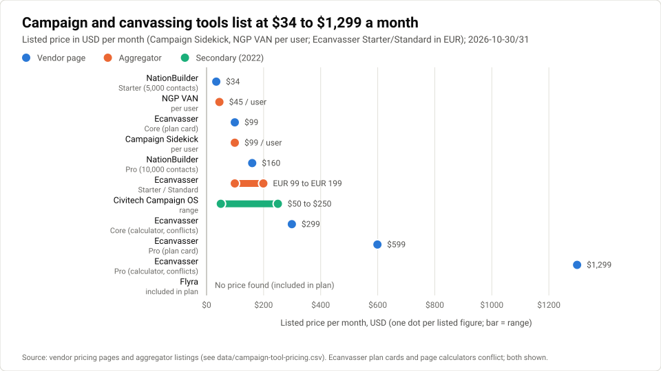
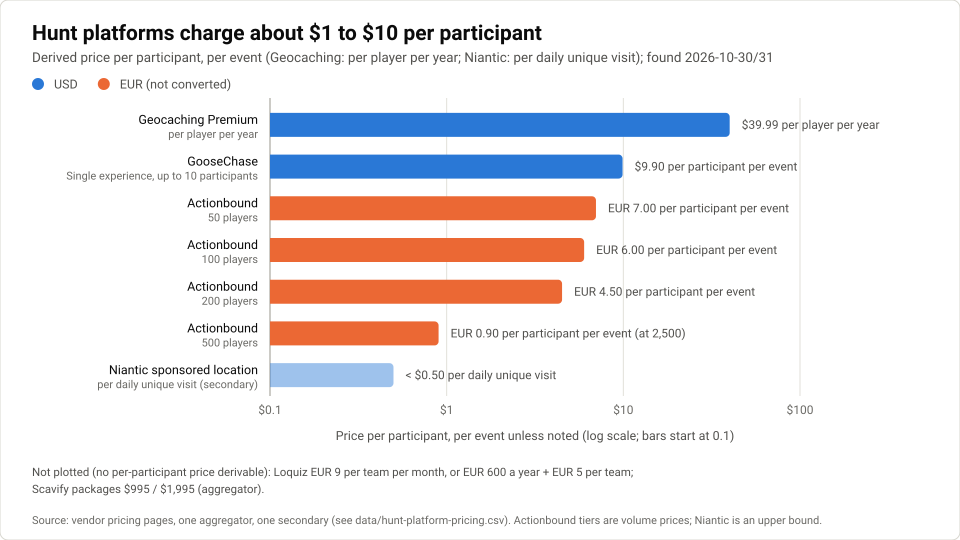
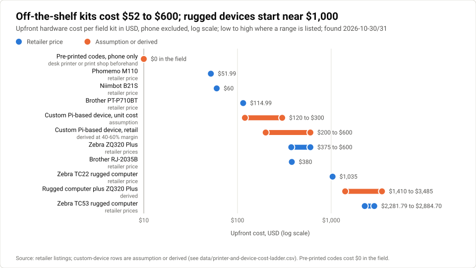
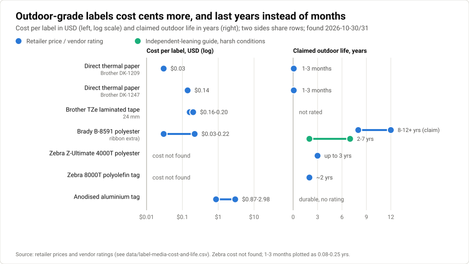
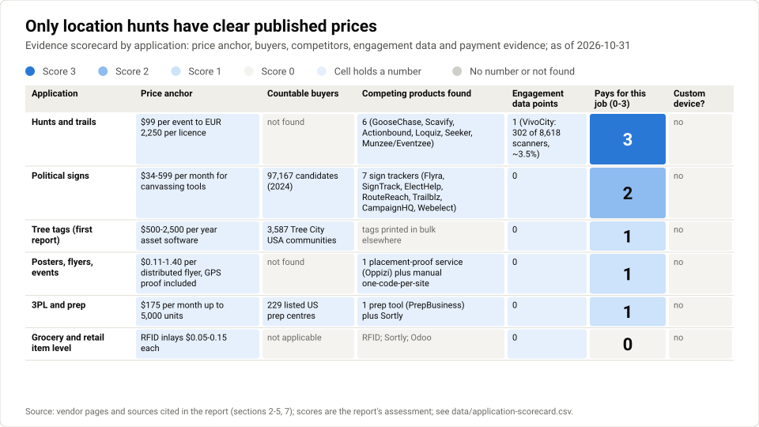

# Field device applications: where on-the-spot QR labelling has a market

**Prepared 2026-10-31**

A companion report testing whether on-the-spot QR labelling, or a field device built around it, has a market beyond urban-forestry tree tagging, across political signs, posters and events, location hunts and item-level inventory.

Companion to [the market and business-model assessment](README.md). Source numbers are per document: [n] here refers to this report's Sources list, not the first report's.

## Contents

- [Executive summary](#executive-summary)
- [1 The core capability and what it is worth](#1-the-core-capability-and-what-it-is-worth)
- [2 Political signs and canvassing](#2-political-signs-and-canvassing)
- [3 Posters, flyers, local advertising and events](#3-posters-flyers-local-advertising-and-events)
- [4 Location games and scavenger hunts](#4-location-games-and-scavenger-hunts)
- [5 Item-level inventory](#5-item-level-inventory)
- [6 Device: build vs buy](#6-device-build-vs-buy)
- [7 Cross-application platform view](#7-cross-application-platform-view)
- [8 Risks](#8-risks)
- [9 Recommendation and the cheapest next experiments](#9-recommendation-and-the-cheapest-next-experiments)
- [Sources](#sources)
- [Glossary](#glossary)

---

The first report scored a qrwty field device (print a unique, [GPS](#g-gnss-gps)-tagged QR label on the spot, backed by qrwty's redirect and scan analytics) as not viable as a product now and worth only a paid pilot, but it judged that on one niche: urban-forestry tree tagging. This report tests four further applications (political signs and [canvassing](#g-canvassing), posters and local events, location games and scavenger hunts, and item-level inventory) against the same evidence standard. It also asks a prior question the first report left open: whether any of these applications needs custom hardware at all, rather than a phone app plus an off-the-shelf [Bluetooth](#g-ble) label printer.

How to read the evidence labels (the same key as the first report): **vendor** = published by the company about itself or its market; **self-reported** = a founder's or seller's own figures; **aggregator** = a third-party site that summarises or estimates (Capterra, GetApp, PitchBook and similar); **secondary** = an article relaying another party's study that this research did not read directly; **derived** = arithmetic done in this report on cited numbers; **assumption** = an input with no direct source. Prices are USD unless stated, as found on 2026-10-30 and 2026-10-31.

**The hypothesis under test.** The idea comes from the founder's own experience, and it is treated here as a hypothesis, not as evidence. Walking a neighbourhood to put up laminated tree-planting posters gave no feedback on which spots worked. Tools such as Bitly report where a scan happened only at city level from the scanner's [IP address](#g-ip-address), which says nothing about which pole or noticeboard drew the scan. A device that stamps each label with its placement location when it is printed would close that loop, and the same mechanism could support "scan all three colours" promotions and routes. Each section below asks whether anyone outside that experience has shown they need this, and whether they pay for it.

## Executive summary

None of the four applications needs a custom device. A phone already records placement location to within several metres [[1]](https://insidegnss.com/?p=181674), printing works through [Bluetooth](#g-ble) printers that cost about $52-600, with official [SDKs](#g-sdk) on the dearer models [[2]](https://frontdeskreview.com/product/label-makers/phomemo-m110/)[[3]](https://www.staples.com/brother-p-touch-pt-p710bt-cube-desktop-label-maker-plus-bluetooth/product_24358260)[[4]](https://www.barcodediscount.com/catalog/zebra/zq320-plus.htm)[[5]](https://www.cdw.com/product/zebra-zq320-plus-dt-printer/7230947)[[6]](https://techdocs.zebra.com/link-os/latest/), and in three of the four applications the codes can be printed in advance and bound to their location when they are put up, which removes the printer from the field entirely. The capability worth testing is software: a **[placement registry](#g-placement-registry)** that records where, when and by whom each unique code was placed, and then attaches scans to that placement. Demand evidence is uneven. Location hunts have the clearest paying market, with published prices from $99 per event [[7]](https://www.goosechase.com/pricing) to €2,250 per licence [[8]](https://en.actionbound.com/license/business/1), but they are crowded. Political sign tracking already exists in at least seven small apps, one of which (Flyra) ties a QR code to a placement pin [[9]](https://helpdesk.flyra.io/articles/9963328-qr-code-tracking-for-signs-and-flyers), so the earlier finding that nobody does this was wrong. Posters and flyers are where the idea started and have the weakest evidence that anyone pays. Item-level inventory is not a fit: retail item-level tracking runs on [RFID](#g-rfid) [[10]](https://htmlscript.auburn.edu/under-development/rfid/_assets/pdf/WM_RFID_GM_Playbook.pdf), grocery traceability is lot-level by rule [[11]](https://www.fda.gov/food/food-safety-modernization-act-fsma/fsma-final-rule-requirements-additional-traceability-records-certain-foods)[[12]](https://www.fda.gov/food/food-safety-modernization-act-fsma/traceability-lot-code), and placement [GPS](#g-gnss-gps) adds nothing in a warehouse.

| Application | Demand evidence | Who pays | Closest existing product | Device needed? | Verdict |
| --- | --- | --- | --- | --- | --- |
| **1 Political signs and [canvassing](#g-canvassing)** | Lawn signs raise [vote share](#g-vote-share) in [randomized trials](#g-randomized-experiment) (about 1-1.7 points, figures conflict) [[13]](https://alexandercoppock.com/green_etal_2016.html)[[14]](https://journalistsresource.org/?p=49072)[[15]](https://www.nhpr.org/post/traditional-lawn-sign-may-still-matter-even-crowded-nh-primary); seven sign-tracking apps exist [[16]](https://apps.apple.com/us/app/signtrack-app/id982585645)[[17]](https://www.trailblz.com/kb/images/kb0383/KB_383%20-%20Tracking%20Lawn%20Signs%20with%20the%20Mobile%20Canvassing%20App.pdf)[[18]](https://v5.webelect.net/pub/docs/show/sign-delivery-module)[[9]](https://helpdesk.flyra.io/articles/9963328-qr-code-tracking-for-signs-and-flyers); no QR scan-rate data and no evidence that campaigns pay for sign attribution (no evidence found) | Local and state-legislative candidates (97,167 candidates of all kinds in 2024, aggregator relay) [[19]](https://ballotpedia.org/Ballotpedia's_2024_Candidate_Connection_report); canvassing tools sell at $34-599 a month [[20]](https://nationbuilder.com/pricing)[[21]](https://www.ecanvasser.com/pricing) | Flyra: placement pin plus per-sign QR, included in plan, price not found [[9]](https://helpdesk.flyra.io/articles/9963328-qr-code-tracking-for-signs-and-flyers); Trailblz, SignTrack, Webelect [[17]](https://www.trailblz.com/kb/images/kb0383/KB_383%20-%20Tracking%20Lawn%20Signs%20with%20the%20Mobile%20Canvassing%20App.pdf)[[16]](https://apps.apple.com/us/app/signtrack-app/id982585645)[[18]](https://v5.webelect.net/pub/docs/show/sign-delivery-module) | No: a phone pin at placement is enough | **Feature, not product.** Test a sign placement-and-retrieval log in a 2027 municipal cycle |
| **2 Posters, flyers, local advertising, events** | Scan location from vendors is the scanner's IP city [[22]](http://docs.uniqode.com/en/articles/4824948-why-do-i-see-scans-from-places-where-my-qr-code-hasn-t-been-placed)[[23]](https://support.bitly.com/hc/en-us/articles/360038058691); no scan-per-impression study and no [willingness-to-pay](#g-willingness-to-pay) evidence for per-placement data (no evidence found) | Unclear. Flyer distributors include GPS proof of delivery in their price [[24]](https://oppizi.com/us/en/flyer/how-much-does-a-flyer-campaign-cost-in-the-usa-and-canada/); nonprofits and organisers have small budgets (assumption) | Oppizi GPS-tracked distribution [[24]](https://oppizi.com/us/en/flyer/how-much-does-a-flyer-campaign-cost-in-the-usa-and-canada/); one [dynamic code](#g-dynamic-qr) per placement, labelled by hand [[25]](https://bitly.com/blog/qr-code-poster/) | No | **Weakest.** Offer as a free or Starter feature of qrwty cloud and as its origin story, not as a paid line |
| **3 Location games and scavenger hunts** | Paid market with public prices: GooseChase $99 for 10 participants [[7]](https://www.goosechase.com/pricing), Actionbound €350-2,250 [[8]](https://en.actionbound.com/license/business/1), Loquiz €5-9 per team [[26]](https://www.loquiz.com/pricing/); Munzee's parent earned about $1.98M in [FY](#g-fy)2024 across all apps (aggregator) [[27]](https://pitchbook.com/profiles/company/51151-06) | Corporate team-building, schools, tourism and destination bodies [[28]](https://www.scavify.com/pricing)[[29]](https://seeker.io/blog/qr-codes-for-destination-marketing) | GooseChase, Scavify, Actionbound, Loquiz, Seeker, Munzee/Eventzee | No: hunt codes are printed in advance | **Best-evidenced payer, crowded.** Viable niche: long-lived printable trails where codes must keep working |
| **4a Item-level inventory, grocery and retail** | Walmart's item-level programme is RFID [[10]](https://htmlscript.auburn.edu/under-development/rfid/_assets/pdf/WM_RFID_GM_Playbook.pdf); RFID trials report accuracy up from 63% to 95% (secondary) [[30]](https://www.retaildive.com/news/RFID-100-accurate-ROI-Auburn/539468); [FSMA 204](#g-fsma-204) is lot-level [[11]](https://www.fda.gov/food/food-safety-modernization-act-fsma/fsma-final-rule-requirements-additional-traceability-records-certain-foods) | Retailers, through RFID and brand-applied 2D barcodes | RFID; Sortly already issues unique QR per item [[31]](https://help.sortly.com/hc/en-us/articles/40417268344347) | No | **Not viable** |
| **4b Small [3PLs](#g-3pl) and Amazon-[prep centres](#g-prep-centre)** | Amazon ended US prep services on 1 January 2026 (secondary) [[32]](https://www.freightfigures.com/articles/amazon-fba-prep-services-ended-2026); a vendor directory lists 229 US prep centres [[33]](https://www.sellerassistant.app/prep-centers/us/) | Prep centres, paying about $175 a month for prep software [[34]](https://www.prepbusiness.com/pricing) | PrepBusiness [[34]](https://www.prepbusiness.com/pricing); $170-500 desktop label printers already in use [[35]](https://www.walmart.com/c/kp/usp-label-printer)[[36]](https://www.bestbuy.com/product/zebra-zd421-direct-thermal-203dpi-4-inch-desktop-label-printer-wired-usb-ethernet-10-100-connectivity-6-ips-zpl-epl-gray/C9YRGSQT7G) | No | **Niche at best**; no evidence that anyone wants unique per-unit IDs |
| *Reference: tree tagging (first report)* | No demand evidence; 3,587 [Tree City USA](#g-tree-city-usa) communities [[37]](https://extension.psu.edu/is-your-community-ready-to-become-a-tree-city) | Grant-funded municipalities and nonprofits | Tags printed in bulk in advance [[38]](https://mycoordinates.org/citizen-science-tree-inventory/) | No | Paid pilot only |

Three findings matter most for a decision. First, the first report's hardware verdict stands and widens: no application in this set rewards custom hardware, and hardware margins work against a solo founder (Peloton's hardware made 13.6% [gross margin](#g-gross-margin) in FY2025 against about 69% on subscriptions, secondary) [[39]](https://eightx.co/blog/peloton-teardown). Second, the distinctive data (placement-time location) can be captured by a phone scanning a pre-printed code, which is how Flyra and the tree-tagging examples already work [[9]](https://helpdesk.flyra.io/articles/9963328-qr-code-tracking-for-signs-and-flyers)[[38]](https://mycoordinates.org/citizen-science-tree-inventory/). Third, nothing in the notes shows that anyone pays specifically for per-placement scan data, so the next step is a cheap experiment, not a build.

## 1 The core capability and what it is worth

### Placement-level truth versus scanner-side location

The capability under test produces a different fact from what QR vendors sell. A vendor knows where the *scanner* was; a [placement registry](#g-placement-registry) knows where the *code* is. Uniqode's documentation says its scan location comes from the [IP address](#g-ip-address) of the scanner's network via a third-party provider, that accuracy "varies by city and country", and that VPNs, bots, direct URL visits and photos of a code republished online all distort it (vendor) [[22]](http://docs.uniqode.com/en/articles/4824948-why-do-i-see-scans-from-places-where-my-qr-code-hasn-t-been-placed). One vendor claims IP lookup is right at city level only 50-70% of the time in the US (vendor, unverified) [[40]](https://linkbreakers.com/help/article/does-a-qr-code-show-location-accuracy-limits-and-examples). Inside one town, city-level location is useless: every placement reports the same city.

The vendors that go further than IP add *scanner* [GPS](#g-gnss-gps), and they all need the scanner's consent. Bitly reports clicks and scans by country and city, shows unresolved scans as "No city data", and exposes the same breakdown through its [API](#g-api) (vendor) [[23]](https://support.bitly.com/hc/en-us/articles/360038058691). Flowcode offers "general" and "advanced GPS-level" location on its Growth and Enterprise plans, collecting precise location only after an [interstitial](#g-interstitial) asks the scanner to click "Allow" (vendor) [[41]](https://www.flowcode.com/blog/what-is-geo-data-for-qr-codes-and-what-can-it-unlock-for-your-brand)[[42]](https://intercom.help/flowcode/en/articles/7061686); Growth is $250 a month, billed annually [[43]](https://www.flowcode.com/pricing). QR TIGER sends scanners to a permission page before reading device GPS, and also offers a [geofence](#g-geofence) that restricts where a code can be scanned, which is a check at scan time, not a record of placement (vendor) [[44]](https://qrtiger.helpscoutdocs.com/article/135-set-up-gps-tracking-and-restrict-location)[[45]](https://www.qrcode-tiger.com/gps-qr-code). Uniqode's GPS analytics, on its Pro, Plus and Business+ plans, records the scanner's coordinates with a "Location Source" column in exports (vendor) [[46]](https://docs.uniqode.com/en/articles/3800555-how-to-enable-and-view-gps-analytics-for-qr-codes); Pro is about $49 a month (aggregator) [[47]](https://www.hackceleration.com/labs/uniqode-pricing). A March 2026 competitor blog says Uniqode is city-level only, which contradicts Uniqode's own documentation; this report prefers the documentation [[48]](https://all-blogs-8rl.pages.dev/QRMax.Blog/comparisons--qr-code-analytics-platforms-compared)[[46]](https://docs.uniqode.com/en/articles/3800555-how-to-enable-and-view-gps-analytics-for-qr-codes). Hovercode, another vendor, warns that people scanning a poster probably will not share their location and may drop off at the prompt (vendor) [[49]](https://help.hovercode.com/article/14-gps-tracking).

Practitioners work around this by hand: Bitly's own poster guide recommends a separate code per site, tagged so sites can be compared (vendor) [[25]](https://bitly.com/blog/qr-code-poster/). That leaves the record of where each code went in someone's memory or spreadsheet. Placement-time capture removes that step and avoids the consent prompt, because the person sharing a location is the one placing the code.

### The capability already exists in pieces

The earlier notes concluded that no product tied a scan to the physical placement recorded at creation time [[22]](http://docs.uniqode.com/en/articles/4824948-why-do-i-see-scans-from-places-where-my-qr-code-hasn-t-been-placed). The gap-fill research overturned this. Flyra's help centre says that when a rep drops a "Yard Sign" pin, "that placement is recorded against a location", later QR scans trace to that address, and QR tracking is "included with your plan" (vendor) [[9]](https://helpdesk.flyra.io/articles/9963328-qr-code-tracking-for-signs-and-flyers). The page does not say whether the location comes from GPS or is typed in, and gives no price. Separately, flyer distributor Oppizi records GPS location and time for every flyer handed out, with photo or video proof, as part of its price (vendor) [[24]](https://oppizi.com/us/en/flyer/how-much-does-a-flyer-campaign-cost-in-the-usa-and-canada/). Neither combines on-the-spot printing with placement capture, but both show that the valuable part, a location bound to a code at placement, can be done without new hardware.

### What per-placement data is worth: thin counts, no price evidence

Per-placement analytics assumes each placement gets enough scans to compare. The best available distribution says most do not. Across Scanova's customer codes (vendor data, May 2026), a typical business code gets **8-23 lifetime scans**, 15.1-28.5% of live codes are never scanned, and the top 0.5-5% of codes take 78-95% of all scans [[50]](https://scanova.io/blog/qr-code-statistics/). Split a campaign's scans across dozens of placements and most placements will show zero to a handful, so the useful signal is which few placements work, not a fine ranking of all of them (derived inference).

The notes found no study of [scans per impression](#g-scan-rate) for street posters, flyers or community boards, and no measurement of what an organiser would pay for per-placement data (no evidence found). Vendor scan-rate claims conflict: one vendor blog says posters and outdoor ads average "10-18%" with no method, which is implausible as scans per passer-by [[51]](https://u2l.ai/blog/qr-code-offline-marketing.md); another gives 1-4% for magazine and newspaper print ads, 3-8% for in-store signage and nothing for outdoor (vendor) [[52]](https://linkbreakers.com/help/article/qr-code-scan-rate-benchmarks-by-industry). The only consumer-reach figure is a 2012 survey in which 13% of Europeans said they had scanned a QR code on an outdoor ad (secondary, dated) [[53]](https://econsultancy.com/11-of-europeans-have-scanned-a-qr-enabled-outdoor-ad/).

The professional measurement market gives a sense of scale. US out-of-home advertising earned about **$9.46B in 2025** (OAAA data via MediaPost) [[54]](https://www.mediapost.com/publications/article/413543/), yet [Geopath](#g-geopath) and related [OOH](#g-ooh) measurement operate on less than 0.05% of OOH spend (snippet-level source) [[55]](https://oohtoday.com/ooh-measurement-is-infrastructure-not-a-feature), which caps the measurement layer at roughly $4.6M on 2024 revenue of about $9.1B (derived). The money that does flow goes to lift and footfall studies for large advertisers, such as a StreetMetrics study with PMG across five NYC media operators (vendor press release) [[56]](https://businesswire.com/news/home/20241205222950/en/StreetMetrics-Launches-First-Ever-Multi-Format-Measurement-and-Attribution-Study-for-the-Out-of-Home-OOH-Industry) and Vistar's test-and-control studies [[57]](https://www.advanced-television.com/2026/02/18/vistar-media-happydemics-partner-to-enhance-dooh-brand-measurement), not to scan counts for individual small posters.

## 2 Political signs and canvassing

### Signs matter; QR codes on them are an old, unmeasured idea

Political signs are one of the few placement-heavy media with experimental evidence. Green, Krasno, Coppock and co-authors ran four [randomized field experiments](#g-randomized-experiment) with a congressional candidate, a mayoral candidate, an independent-expenditure campaign and a county-commissioner candidate; signs placed in randomly chosen [precincts](#g-precinct) raised the advertised candidate's [vote share](#g-vote-share), with some spillover to neighbouring precincts [[13]](https://alexandercoppock.com/green_etal_2016.html). The size of the effect is reported inconsistently: a journalist's summary says slightly over 1 percentage point across 376 precincts in New York, Pennsylvania and Virginia, while Krasno is quoted elsewhere as saying 1.7 points (both secondary; the paper itself could not be read) [[14]](https://journalistsresource.org/?p=49072)[[15]](https://www.nhpr.org/post/traditional-lawn-sign-may-still-matter-even-crowded-nh-primary). Those experiments measured votes per precinct; scans would measure engagement, which is a different thing.

QR codes on campaign signs go back at least to Toronto's 2011 election [[58]](https://media.blogto.com/tech/2011/04/qr_codes_make_an_appearance_on_election_signs), and a Salina, Kansas candidate ran a sign carrying only a QR code (date not confirmed) [[59]](https://news.yahoo.com/reach-voters-one-candidate-salina-090126725.html?fr=sycsrp_catchall). The most specific advice, in Campaigns & Elections, is from 2012 and from an operative who sells yard signs: QR codes add clutter, suit walkable and tech-friendly districts, should be tried first on flyers and mail with scan tracking, and should not just link to a homepage (secondary) [[60]](https://campaignsandelections.com/campaigntech/time-for-qr-codes-on-campaign-signs). Everything newer is vendor content recommending QR codes for volunteer sign-ups or "request a yard sign" (vendor) [[61]](https://www.uniqode.com/blog/trending-use-cases/qr-codes-for-election-campaigns)[[62]](https://thecampaignworkshop.com/blog/advocacy-campaigns/qr-codes). The notes found no published scan-rate, conversion or case-study data for political QR codes on signs, [door hangers](#g-door-hanger) or mailers (no evidence found).

### The market is many small, price-sensitive buyers

The buyer base is wide and shallow. Ballotpedia counted **97,167 candidates** across all offices in 2024 (relayed by a search summary) [[19]](https://ballotpedia.org/Ballotpedia's_2024_Candidate_Connection_report), including 1,800 major-party US House candidates, 226 for the Senate and 9,685 for state houses [[63]](https://news.ballotpedia.org/2024/09/16/16-35-fewer-major-party-candidates-ran-for-u-s-congress-in-2024-than-in-the-previous-election-year/), and there are more than 500,000 local elected officials [[64]](https://news.ballotpedia.org/2025/07/10/ballotpedia-has-covered-at-least-one-election-every-week-through-the-first-half-of-2025/). Sign spending per campaign runs from tens of signs to thousands: one printer said a state representative might need thousands of signs and a city council candidate 25 [[65]](https://thevisualcommunicationguy.com/2026/01/09/the-hidden-costs-behind-the-signs-you-see-on-lawns/), small orders cost about $200-1,000 and larger campaigns $2,000-6,000 or more [[66]](https://ocnjdaily.com/news/2026/jan/16/how-campaigns-approach-yard-sign-budgeting), and signs cost about $3-15 each [[65]](https://thevisualcommunicationguy.com/2026/01/09/the-hidden-costs-behind-the-signs-you-see-on-lawns/)[[67]](https://www.easysigns.com/news/details/how-much-do-political-yard-signs-cost). Washington State disclosure records show individual campaigns spending $767-12,800 on sign printing and $145-15,200 on literature (single-campaign snapshots, race level unverified) [[68]](https://www.pdc.wa.gov/political-disclosure-reporting-data/browse-search-data/candidates/689531/expenditures). No source gives signs and literature as a share of campaign budgets or as a national total (no evidence found).

A weatherproof label at $0.03-0.22 (derived from roll prices) [[69]](https://www.zoro.com/brady-weather-resistant-polyester-outdoor-labels-1-in-h-x-3-in-w-white-3000rl-tht-18-8591-3-wt/i/G115721743) would add about 0.2-7% to the cost of a $3-15 sign (derived). Cost per sticker is therefore not the obstacle; the obstacle is whether a campaign will do anything with the data.

Data

| Tool | Tier or basis | Listed price (USD/month unless noted) | Evidence | Source |
| --- | --- | --- | --- | --- |
| NationBuilder | Starter (5,000 contacts) | 34 | vendor page | [[20]](https://nationbuilder.com/pricing) |
| NationBuilder | Pro (10,000 contacts) | 160 | vendor page | [[20]](https://nationbuilder.com/pricing) |
| Ecanvasser | Core (plan card) | 99 | vendor page | [[21]](https://www.ecanvasser.com/pricing) |
| Ecanvasser | Core (page calculator) | 299 | vendor page, conflicts with plan card | [[21]](https://www.ecanvasser.com/pricing) |
| Ecanvasser | Pro (plan card) | 599 | vendor page | [[21]](https://www.ecanvasser.com/pricing) |
| Ecanvasser | Pro (page calculator) | 1,299 | vendor page, conflicts with plan card | [[21]](https://www.ecanvasser.com/pricing) |
| Ecanvasser | Starter / Standard | EUR 99 / EUR 199 | aggregator, older | [[70]](https://www.capterra.com/p/156872/Ecanvasser/pricing/) |
| Campaign Sidekick | per user | ~99 | aggregator | [[71]](https://www.getapp.com/government-social-services-software/a/campaignsidekick) |
| NGP VAN | per user | 45 | aggregator, unverified | [[72]](https://www.getapp.com/government-social-services-software/a/ngp-van/alternatives) |
| Civitech Campaign OS | range | 50-250 | secondary, 2022 | [[73]](https://highergroundlabs.com/?p=1849) |
| Flyra (sign pin + QR) | included in plan | not found | vendor page, no price | [[9]](https://helpdesk.flyra.io/articles/9963328-qr-code-tracking-for-signs-and-flyers) |

### Sign tracking is already a product category, if a small one

The first pass of research found no product dedicated to tracking sign placement; the gap-fill found several, so that finding was wrong and this report replaces it. SignTrack (for team members), ElectHelp (free, iPhone, tracks signs handed to volunteers and their retrieval), RouteReach (map-based assignment of yard signs and door hangers), Trailblz (lawn-sign requests and installs inside its [canvassing](#g-canvassing) app), CampaignHQ (requests, deliveries and historical locations) and Webelect's "Sign Delivery Module" all exist (vendor listings, not opened individually) [[16]](https://apps.apple.com/us/app/signtrack-app/id982585645)[[17]](https://www.trailblz.com/kb/images/kb0383/KB_383%20-%20Tracking%20Lawn%20Signs%20with%20the%20Mobile%20Canvassing%20App.pdf)[[18]](https://v5.webelect.net/pub/docs/show/sign-delivery-module). Flyra adds per-sign QR attribution [[9]](https://helpdesk.flyra.io/articles/9963328-qr-code-tracking-for-signs-and-flyers). Their existence is the best demand signal in this application: campaigns have a recurring operational job (who has which sign, where it went, whether it came back) that people have built software for.

That operational job may be worth more than scan analytics. Sign ordinances set removal deadlines after an election that range from 5 days in La Mesa, California to 7 in Omaha, 10 in Littleton and Santa Clarita, 15 in Las Vegas and 30 on Nevada state highways, and some (Omaha) make the person who placed the sign responsible [[74]](https://www.fox5vegas.com/2024/11/18/when-do-political-signs-come-down-after-election-day/)[[75]](https://www.littletonco.gov/files/sharedassets/public/v/2/city-clerk/elections/2024-election/political-sign-policy-rev-2024.pdf). A [GPS](#g-gnss-gps) log of every placement gives a retrieval crew a route and a checklist (derived inference). Yard signs need a "paid for by" disclaimer under federal rules; the small-item exemption covers bumper stickers, pins, buttons and pens [[76]](https://www.fec.gov/updates/dont-forget-your-disclaimers-2026/), so a small QR sticker might fall under it, but state rules were not researched and this needs legal advice.

### Pricing, seasonality and verdict

Canvassing tools price by database size or user. Ecanvasser's own pricing page is internally inconsistent: plan cards show Core at $99 and Pro at $599 a month, a label reads "$234 billed monthly", and the page calculator shows Core at $299 and Pro at $1,299 [[21]](https://www.ecanvasser.com/pricing); an older aggregator listing gives €99 and €199 for differently named tiers [[70]](https://www.capterra.com/p/156872/Ecanvasser/pricing/). NationBuilder is clearer at $34 (Starter) and $160 (Pro) [[20]](https://nationbuilder.com/pricing). A sign-placement feature sits inside these tools or beside them as a cheap add-on; the notes contain no evidence of a standalone price for it.

Demand is seasonal but not confined to even years. Ballotpedia covered at least one election every week in the first half of 2025, 47 election dates in all, 96% of them including a local office [[64]](https://news.ballotpedia.org/2025/07/10/ballotpedia-has-covered-at-least-one-election-every-week-through-the-first-half-of-2025/). Most campaigns are still busiest in the months before a November general election (assumption). With the 2026 general election days away and removal deadlines running into November, campaigns are doing sign retrieval now, which makes this a good moment to interview them and a poor moment to sell to them. The verdict: political signs are a credible use for the [placement registry](#g-placement-registry), mainly for placement and retrieval, but they are a feature inside an existing category. They do not justify a device.

## 3 Posters, flyers, local advertising and events

### The origin use case has the thinnest evidence of payment

This is where the idea started: a volunteer or organiser puts up posters and wants to know which spots worked. The evidence for the need is indirect. Bitly's guide to tagging each poster site separately [[25]](https://bitly.com/blog/qr-code-poster/) and Uniqode's documented list of reasons why scan locations mislead [[22]](http://docs.uniqode.com/en/articles/4824948-why-do-i-see-scans-from-places-where-my-qr-code-hasn-t-been-placed) show that marketers want placement-level comparison and that the standard tools do not provide it. The evidence for payment is close to nil. No source in the notes measures [scans per impression](#g-scan-rate) for street posters, community boards, churches or farmers' markets, and none shows an event organiser or nonprofit paying for per-placement data (no evidence found).

Print is cheap, which bounds what analytics can charge. One shop quotes about $738 for 100 full-colour 18x24-inch posters and $860 for 1,000 (vendor) [[77]](https://conquestgraphics.com/bestsellers/18x24-posters-500-quantity); another quotes $3-12 per 18x24 sheet [[78]](https://www.printkeg.com/blogs/tips/poster-printing-cost). When a poster costs a few dollars, the decision per-placement data informs (where to put the next batch) is worth little in money, so the data must be close to free (derived inference).

### Distributors already bundle placement proof

The nearest commercial analogue is flyer distribution, and it sells placement proof rather than scan data. Oppizi prices US and Canadian flyer campaigns at $0.23-1.40 per flyer under 10,000, $0.13-0.40 for 10,000-50,000 and $0.11-0.25 above 50,000, with a 1,000-flyer example at $760-1,300; the price includes [GPS](#g-gnss-gps) tracking of when and where flyers were handed out, photo or video proof and live updates (vendor) [[24]](https://oppizi.com/us/en/flyer/how-much-does-a-flyer-campaign-cost-in-the-usa-and-canada/). Oppizi also offers a free QR generator and can pay ambassadors per conversion, QR scans included (vendor, snippet level) [[79]](https://oppizi.com/us/en/flyer/flyer-distribution-cost-effective/). Clients value location proof, but it is bundled into a delivery price, it serves the distributor-to-client audit, and nobody in the notes sells it separately.

Engagement-based pricing exists only for digital screens. Blip, a self-serve digital billboard marketplace with about 1,300 screens in the US and Canada, sells displays from around $10-20 a day and claims about $0.01 per display, varying by location, time and demand; it recommends QR codes or vanity URLs for measurement but does not bill on scans (vendor) [[80]](https://www.blipbillboards.com/blog/ultimate-guide-to-billboard-ads-under-dollar100/)[[81]](https://help.blipbillboards.com/benefits-of-blip). No marketplace in the notes prices small physical posters or community boards on measured engagement.

### Verdict: a feature and a story, not a line of business

For qrwty, posters and flyers are best treated as the feature that explains the product: create a batch of unique codes, record each placement with a phone, and show scans per placement on a map. That fits the first report's segment C (local organisers, very price-sensitive) as a Free or Starter feature, and gives qrwty a demonstrable difference from Bitly's city-level reports [[23]](https://support.bitly.com/hc/en-us/articles/360038058691). It does not need a printer in the field, because the codes can be printed beforehand on a home or office printer and attached to the poster before it goes up. A distributor or print shop reselling per-placement reports would fit the first report's segment A, but the notes contain no evidence that any wants to.

## 4 Location games and scavenger hunts

### A real, priced market, sold on game mechanics

Location hunts are the only application here with a clearly paying market and public prices. GooseChase offers a free tier (up to 3 participants, 24 hours) and a single experience for **$99** (up to 10 participants, 30 days); subscription, educator and nonprofit plans are quote-only (vendor) [[7]](https://www.goosechase.com/pricing). Older aggregator listings show $299-749 tiers for 40-175 participants and a $9,999 department plan, inconsistently across sources [[82]](https://www.softwaresuggest.com/goosechase/pricing). Actionbound bills professional licences per player: **€350 for 50 players, €600 for 100, €900 for 200, €1,500 for 500**, and €2,250 for an enterprise flat licence of up to 2,500 players at one location (vendor) [[8]](https://en.actionbound.com/license/business/1). Loquiz charges €9 per team per month for 1-100 teams a year, or €600 a year plus €5 per team for 101-1,000 teams, excluding [VAT](#g-vat) (vendor) [[26]](https://www.loquiz.com/pricing/); this replaces an older review's figure of €50 a team. Scavify publishes no prices ("Get Pricing") [[28]](https://www.scavify.com/pricing); aggregators cite $995 and $1,995 packages and $3,500-5,000 for 500 attendees (aggregator) [[83]](https://us.fitgap.com/products/scavify). Consumer games charge players instead: Geocaching Premium is $39.99 a year or $6.99 a month [[84]](https://payments.geocaching.com/), and Munzee's only published price ($29.99 a year) is undated, with its Eventzee event product returning in 2026 as a $50 add-on (vendor blog) [[85]](https://munzeeblog.com/?p=46071).

Data

| Platform | Unit | Price | Price per participant (derived) | Source |
| --- | --- | --- | --- | --- |
| GooseChase | Single experience, up to 10 participants | $99 | $9.90 | [[7]](https://www.goosechase.com/pricing) |
| Actionbound | 50 players | EUR 350 | EUR 7.00 | [[8]](https://en.actionbound.com/license/business/1) |
| Actionbound | 100 players | EUR 600 | EUR 6.00 | [[8]](https://en.actionbound.com/license/business/1) |
| Actionbound | 200 players | EUR 900 | EUR 4.50 | [[8]](https://en.actionbound.com/license/business/1) |
| Actionbound | 500 players | EUR 1,500 | EUR 3.00 | [[8]](https://en.actionbound.com/license/business/1) |
| Actionbound | Enterprise flat, up to 2,500 players | EUR 2,250 | EUR 0.90 (at 2,500) | [[8]](https://en.actionbound.com/license/business/1) |
| Loquiz | per team per month (1-100 teams/yr) | EUR 9 | not derivable (team size unknown) | [[26]](https://www.loquiz.com/pricing/) |
| Loquiz | yearly (101-1,000 teams) | EUR 600 + EUR 5/team | not derivable | [[26]](https://www.loquiz.com/pricing/) |
| Scavify | packages (aggregator) | $995 / $1,995 | not derivable | [[83]](https://us.fitgap.com/products/scavify) |
| Geocaching Premium | per player per year | $39.99 | $39.99 | [[84]](https://payments.geocaching.com/) |
| Niantic sponsored location | per daily unique visit (secondary) | < $0.50 | < $0.50 per visit | [[86]](https://vip-develop.siliconera.com/niantic-shares-details-revenue-generated-sponsorship-partners-pokmon-go) |

These products sell the game (missions, photo challenges, [GPS](#g-gnss-gps) check-ins, leaderboards). Their buyers are corporate team-building, universities, conferences and tourist destinations, which are Scavify's own segment pages [[28]](https://www.scavify.com/pricing), plus schools for Actionbound [[8]](https://en.actionbound.com/license/business/1) and destination marketers such as Seeker's clients; Scottsdale's 75th-anniversary hunt had 87 stops (vendor) [[29]](https://seeker.io/blog/qr-codes-for-destination-marketing). Per-event [willingness to pay](#g-willingness-to-pay) for self-serve tools clusters around $100-750 and managed corporate events reach thousands [[7]](https://www.goosechase.com/pricing)[[82]](https://www.softwaresuggest.com/goosechase/pricing)[[83]](https://us.fitgap.com/products/scavify). None of these products leads with physical QR codes placed and tracked one by one, which leaves a narrow opening for printable code kits, but at modest price points.

### The ceilings: Munzee and Pokémon Go

The QR-first, physical-placement game has been tried for over a decade. Munzee merged into Freeze Tag in an all-stock deal announced in 2017, when it had almost 5 million locations and "hundreds of thousands" of players (company release) [[87]](https://www.globenewswire.com/press-release/freeze-tag-and-munzee-announce-merger-agreement-otc-pink-frzt-2228286.htm). Freeze Tag's total revenue across all its apps was about **$2.12M in [FY](#g-fy)2023, $1.98M in FY2024 and $1.74M** for the twelve months to September 2025 (aggregator) [[27]](https://pitchbook.com/profiles/company/51151-06), with Q1 2025 down 15.8% (aggregator) [[88]](https://stockanalysis.com/quote/otc/FRZT/revenue). Its FY2024 [10-K](#g-10-k) calls Munzee "our flagship product" (search snippet), but no Munzee-only revenue was found (no evidence found) [[89]](https://www.sec.gov/Archives/edgar/data/1485074/000147793225002250/frzt_10k.htm). A consumer QR placement game, then, has supported a business of about $2M a year at best.

Pokémon Go shows the other end: about $7.9B gross from player spending in eight years (AppMagic via PocketGamer.biz) [[90]](https://www.pocketgamer.biz/pokmon-go-catches-nearly-8-billion-in-eight-years), and a $3.5B sale of Niantic's games business to Scopely in 2025 [[91]](https://techcrunch.com/?p=2979111). Sponsored locations cost partners under $0.50 per daily unique visit (secondary) [[86]](https://vip-develop.siliconera.com/niantic-shares-details-revenue-generated-sponsorship-partners-pokmon-go); total sponsorship revenue was never disclosed (no evidence found). That price rested on a huge audience, and licensed clones without one failed: Harry Potter: Wizards Unite had about 739,000 installs in the first ten months of 2021, down 57%, and closed in January 2022 (Sensor Tower via TechCrunch) [[92]](https://techcrunch.com/?p=2228050). An organiser's own codes cannot borrow that traffic.

### Retail, mall and civic hunts: the "scan all three" mechanic exists

The founder's "scan all three colours" idea has a close precedent. Mayfair Mall in Wisconsin hid QR codes that gave 1, 5 and 10 [sweepstakes](#g-sweepstakes) entries for the first, second and third scan (no results published) [[93]](https://biztimes.com/bubbler-news-6). Singapore's VivoCity ran a QR-mascot campaign in 2014 that drew 8,618 scanners, of whom 302, about 3.5%, collected vouchers [[94]](https://www.campaignasia.com/video/case-study-how-vivocity-brought-qr-codes-to-life/363752). Tyler, Texas parks run a 12-clue QR hunt (no numbers) [[95]](https://digital-release.ketk.com/news/outdoors/tyler-parks-and-recreation-updates-their-scavenger-hunt-program/amp/). Vendors say their dashboards show completion and pull per venue, but publish no benchmarks (vendor) [[29]](https://seeker.io/blog/qr-codes-for-destination-marketing)[[96]](https://scavify.com/qr-code-scavenger-hunt). The notes found no [business improvement district](#g-business-improvement-district) case study, no independent completion rates and no evidence that organisers pay for per-code placement analytics as distinct from the game (no evidence found).

Two legal constraints shape any product. Promotions with a prize, chance and a purchase are lotteries; sweepstakes need a free alternative entry, and some states restrict purchase requirements or require registration and bonding above prize thresholds (law-firm and vendor guides) [[97]](https://www.venable.com/files/Publication/bb8de679-e39c-4023-b100-944bb7c80747/Presentation/PublicationAttachment/b4d781c5-7bb4-423f-9d85-018c7817c9df/1320.pdf)[[98]](https://gleam.io/guides/no-purchase-necessary). Placement on public property can break sticker and postering bans (section 8). Hunts on property the organiser controls, such as a mall, a campus or a shop trail, avoid the second problem (derived inference).

### Verdict: a crowded market, with one gap that suits qrwty

The hunt market is real but taken, and its price points are modest. The gap that suits qrwty is not the game itself but **long-lived printed trails**: destination passports, park and heritage trails, campus tours, where codes stay on walls for years and must keep working after a subscription lapses. That is the first report's continuity argument applied to a buyer that already pays. A device adds nothing here: trail codes are designed and printed in advance, often as signs, and placement capture is a phone task.

## 5 Item-level inventory

### Grocery and retail: RFID, SKUs and lot codes leave QR-per-unit a niche

Item-level tracking in retail already has a dominant technology, and it is not the QR code. Walmart's general-merchandise [RFID](#g-rfid) playbook (revised October 2024) brings every item in in-scope departments into scope with no minimum price, and requires tags approved through Auburn University's RFID Lab [[10]](https://htmlscript.auburn.edu/under-development/rfid/_assets/pdf/WM_RFID_GM_Playbook.pdf). RFID's advantage is bulk reading without line of sight. The best-known evidence, Auburn RFID Lab and [GS1](#g-gs1) US's "Project Zipper", reports inventory accuracy rising from 63% to 95%, out-of-stocks falling by up to 50% and cycle-count time cut by 96%, across more than a million items, five retailers and eight brands (secondary, partly vendor-sponsored, mostly apparel and general merchandise) [[30]](https://www.retaildive.com/news/RFID-100-accurate-ROI-Auburn/539468). A QR code needs one line-of-sight scan per unit, so QR gives up exactly the bulk reads behind that 96% cut (derived inference). The notes found no QR-specific accuracy or [shrink](#g-shrink) study (no evidence found).

Grocery stays at [SKU](#g-sku) and lot level because of margins. Passive UHF inlays cost about $0.05-0.15 each at high volume (vendor guide, 2026) [[99]](https://cpcongroup.com/rfid-chip-cost/), with older RFID Journal figures of 5-8 cents at very large volumes (snippet level) [[100]](https://www.rfidjournal.com/question/what-is-the-price-of-rfid-inlays). Even so, a 2012 analysis said item-level RFID paid off only for items worth $15 or more (dated) [[101]](https://www.eweek.com/news/rfid-the-cost-of-being-smart/), Supply Chain Digest judged even 3-cent tags too dear for grocery (dated) [[102]](https://www.scdigest.com/assets/On_Target/10-07-21-3.php?cid=3595), and RFID Journal notes that manufacturers do not tag low-priced goods because a 10-cent tag sharply cuts their profit [[103]](https://www.rfidjournal.com/question/which-consumer-goods-retailers-have-deployed-rfid). A store-applied QR label costs a few cents of media plus a person's time per unit; no labour-per-label figure was found (no evidence found). Retail shrink, the problem item tracking addresses, was 1.6% of sales in [FY](#g-fy)2022 ($112.1B) in NRF's last published survey [[104]](https://nrf.com/media-center/press-releases/shrink-accounted-over-112-billion-industry-losses-2022-according-nrf).

Regulation does not create demand for store-applied unit labels either. [FSMA 204](#g-fsma-204), the FDA food traceability rule, ties records to [Traceability Lot Codes](#g-lot-code), lot by lot, and its compliance date moved from 20 January 2026 to **20 July 2028** [[11]](https://www.fda.gov/food/food-safety-modernization-act-fsma/fsma-final-rule-requirements-additional-traceability-records-certain-foods). Retail food establishments and restaurants do not assign lot codes; they keep the ones suppliers send [[12]](https://www.fda.gov/food/food-safety-modernization-act-fsma/traceability-lot-code), and those with average annual food sales of $250,000 or less are exempt [[105]](https://www.ecfr.gov/api/renderer/v1/content/enhanced/current/title-21?part=1&section=1.1305). Two contradictions should be noted. FDA's own rule page gives 20 July 2028 but its "Getting Started" text still says 20 January 2026 [[11]](https://www.fda.gov/food/food-safety-modernization-act-fsma/fsma-final-rule-requirements-additional-traceability-records-certain-foods), and sources disagree on whether the delay came from an FDA extension or from Congress barring enforcement before 2028 (secondary) [[106]](https://www.foodlogistics.com/safety-security/food-safety/article/22955634/midcom-data-technologies-what-fsma-204s-extended-deadline-means-for-food-traceability). Pharmaceutical [DSCSA](#g-dscsa) rules do require package-level [serialization](#g-serialization), but manufacturers apply those labels, and the small-dispenser exemption now runs to November 2027 (vendor commentary) [[107]](https://www.lspedia.com/blog/the-fda-just-extended-the-small-dispenser-dscsa-exemption-heres-what-you-still-need-to-do). GS1's [Sunrise 2027](#g-sunrise-2027) asks retailers to be able to scan 2D barcodes at checkout by the end of 2027; it does not retire linear barcodes and the codes are printed by brands on packaging, not by stores [[108]](https://convenience.org/stay-current/news/2026/october/5/setting-up-for-sunrise-2027).

The software for unique per-item QR codes is also cheap and already exists. Sortly documents how to track individual items with unique QR codes [[31]](https://help.sortly.com/hc/en-us/articles/40417268344347) and starts free for 100 items, with Advanced at about $49 a month on monthly billing (vendor) [[109]](https://help.sortly.com/hc/en-us/articles/31329803827867-Current-Sortly-Plans); Odoo offers lot and serial tracking as a setting [[110]](https://www.odoo.com/documentation/18.0/applications/inventory_and_mrp/inventory/product_management/product_tracking/lots.html) from $24.90 per user a month (promotional rate) [[111]](https://www.odoo.com/pricing). Lightspeed Retail ($89-289 a month) and Shopify [POS](#g-pos) Pro ($89 per location a month) bundle inventory into POS, though neither page confirmed per-unit serials [[112]](https://www.lightspeedhq.com/pos/retail/pricing/)[[113]](https://www.shopify.com/pos/pricing). In a shop or warehouse the qrwty field device's distinctive feature, the placement [GPS](#g-gnss-gps) stamp, is irrelevant: shelf versus backroom is a bin location, not a coordinate. **Grocery and retail item-level tracking is not a market for this device.**

### Small 3PLs and Amazon-prep centres: assessed separately

The prep niche is better defined but small. Amazon discontinued its US prep and labelling services on 1 January 2026, announced in July 2025 (secondary and vendor blogs) [[32]](https://www.freightfigures.com/articles/amazon-fba-prep-services-ended-2026), which pushed per-unit labelling onto sellers and [prep centres](#g-prep-centre). Prep centres charge about $1.00-1.50 a unit below 500 units a month, $0.75-1.25 for 500-2,500 and $0.40-0.75 above 2,500 (secondary) [[32]](https://www.freightfigures.com/articles/amazon-fba-prep-services-ended-2026), consistent with Phase V's $1.00 and $0.80 tiers (vendor) [[114]](https://support.phasev.com/fba-prep-services/) and Ecom Circles' $1.00 base [[115]](https://ecomcircles.com/services/warehouse/fba-prep/). A vendor-run directory lists **229 US prep centres**, 83 of them integrated with its platform [[33]](https://www.sellerassistant.app/prep-centers/us/); AMZ Prep alone claims 50-plus locations in 23 states (vendor) [[116]](https://amzprep.com/fba-prep-center/). No authoritative count was found (no evidence found).

The work is already unit-level, but the identifier is not unique per unit: Amazon's [FNSKU](#g-fnsku) label identifies a seller's SKU, so every unit of a product carries the same code [[32]](https://www.freightfigures.com/articles/amazon-fba-prep-services-ended-2026). Prep software prices by volume: PrepBusiness charges $175 a month for up to 5,000 units a month and prints FNSKU and shipping labels "straight to your printer", with no location or bin feature mentioned (vendor) [[34]](https://www.prepbusiness.com/pricing), which works out at about $0.035 per unit at full use (derived). The printers are cheap desktop models: a Rollo wireless 4x6 at about $279.99, Brother QL-810W at $169.99 and Zebra ZD421 at about $370-500 (retailers) [[35]](https://www.walmart.com/c/kp/usp-label-printer)[[36]](https://www.bestbuy.com/product/zebra-zd421-direct-thermal-203dpi-4-inch-desktop-label-printer-wired-usb-ethernet-10-100-connectivity-6-ips-zpl-epl-gray/C9YRGSQT7G).

A unique per-unit code could in principle help a prep centre track returns, inspections or high-value items, but the notes contain no evidence that prep centres want this (no evidence found), and it would compete with software that already prints labels. Geolocation adds nothing indoors. The verdict is **niche at best**: a possible software integration for qrwty's redirect and scan log, not a hardware market.

## 6 Device: build vs buy

### A phone plus a Bluetooth printer does everything the prototype does

The prototype's three functions (find a location, generate a code, print a label) are all available off the shelf. Smartphone [GNSS](#g-gnss-gps) is typically accurate to several metres, and [dual-frequency](#g-dual-frequency) phones made since 2018 can reach sub-metre accuracy in good conditions [[1]](https://insidegnss.com/?p=181674); centimetre-level [RTK](#g-rtk) needs corrections and extra hardware, such as a $259.95 ZED-F9P board [[117]](https://www.sparkfun.com/sparkfun-gps-rtk-sma-breakout-zed-f9p-qwiic.html), which is far more than a label location needs (derived inference). Printing has two tiers. Consumer printers cost little: Niimbot B1 at €46.49 and B21S at €64.49-71.99 in the EU (about $60 in the US) [[118]](https://aio.lv/en/product--niimbot-b1-grey--11251584.md)[[119]](https://aio.lv/en/product--niimbot-b21s-black--11381131.md), Phomemo M110 at $51.99 [[2]](https://frontdeskreview.com/product/label-makers/phomemo-m110/), and Brother's PT-P710BT at $114.99 with up to 24 mm laminated tape [[3]](https://www.staples.com/brother-p-touch-pt-p710bt-cube-desktop-label-maker-plus-bluetooth/product_24358260)[[120]](https://www.ptouchdirect.com/ptouch/new-ptp710bt.html). Professional mobile printers cost more and come with official [SDKs](#g-sdk): Brother's RJ-2035B at $380 [[121]](https://www.barcodesinc.com/brother/part-rj2035b.htm), covered by Brother's Mobile SDK with [Bluetooth Low Energy](#g-ble) [[122]](https://support.brother.com/g/s/es/dev/en/mobilesdk/release/index.html), and Zebra's ZQ320 Plus at about $375-600 [[4]](https://www.barcodediscount.com/catalog/zebra/zq320-plus.htm)[[5]](https://www.cdw.com/product/zebra-zq320-plus-dt-printer/7230947), covered by Zebra's [Link-OS](#g-link-os) SDK for Android, iOS and the web [[6]](https://techdocs.zebra.com/link-os/latest/).

Three practical constraints shape the software. Niimbot and Phomemo have no official developer SDK in the notes; the [open-source](#g-open-source) Niimbot libraries describe themselves as unaffiliated and educational [[123]](https://unpkg.com/@mmote/niimbluelib@0.0.1-alpha.38/README.md), so a firmware update could break them. Safari on iOS does not support [Web Bluetooth](#g-web-bluetooth) [[124]](https://www.beaconzone.co.uk/blog/browser-support-for-web-bluetooth/), and the community Niimbot web app runs only in [Chromium](#g-chromium) browsers [[125]](https://printers.niim.blue/interfacing/connecting/), so a web-only qrwty app cannot print from an iPhone; a thin native or [Capacitor](#g-capacitor) wrapper, or a vendor SDK, is required. Brother's SDK support for the PT-P710BT could not be confirmed; its support pages point to Brother's consumer apps [[122]](https://support.brother.com/g/s/es/dev/en/mobilesdk/release/index.html).

### What a custom device would cost, and what it would add

The notes allow only an estimate. [Raspberry Pi](#g-raspberry-pi) raised Pi 4 and Pi 5 prices in rounds through 2026 because of memory costs, while saying Zero-class boards would not change [[126]](https://www.raspberrypi.com/news/more-memory-driven-price-rises/)[[127]](https://www.omgubuntu.co.uk/2026/10/raspberry-pi-2gb-costs-how-much-now/amp). A Pi Zero-class device with GNSS, a thermal print module, battery, display and an [IP-rated](#g-ip-rating) enclosure is estimated at **$85-220 in parts**, and **$120-300 a unit all-in** at 500 units once certification, assembly, test, shipping and warranty are spread across the run (assumption, built from component guesses; only the compute-board pricing is sourced) [[126]](https://www.raspberrypi.com/news/more-memory-driven-price-rises/). [FCC](#g-fcc) testing alone is about $1,500-5,000 for a host product using a pre-certified radio module and $8,000-20,000 or more for custom radio work (testing vendor) [[128]](https://compliancetesting.com/fcc-certification-faqs/fcc-certification-cost/), and one SparkFun post cites $4,000 for Bluetooth Part 15C testing [[129]](https://news.sparkfun.com/3124). At an assumed 40-60% [gross margin](#g-gross-margin) (post-mortems cited in the first report set the target at 50-60% or more), that implies a **$200-600 retail price** (derived), which overlaps the $52-600 off-the-shelf range without the distribution of an app store.

Data

| Option | Price (USD) | Basis | Source |
| --- | --- | --- | --- |
| Pre-printed codes, phone only | 0 in the field | desk printer or print shop beforehand | derived |
| Phomemo M110 | 51.99 | retailer price | [[2]](https://frontdeskreview.com/product/label-makers/phomemo-m110/) |
| Niimbot B21S | ~60 | retailer price (US listing) | [[119]](https://aio.lv/en/product--niimbot-b21s-black--11381131.md) |
| Brother PT-P710BT | 114.99 ([MSRP](#g-msrp) 159.95) | retailer price | [[3]](https://www.staples.com/brother-p-touch-pt-p710bt-cube-desktop-label-maker-plus-bluetooth/product_24358260)[[120]](https://www.ptouchdirect.com/ptouch/new-ptp710bt.html) |
| Brother RJ-2035B | 380 | retailer price | [[121]](https://www.barcodesinc.com/brother/part-rj2035b.htm) |
| Zebra ZQ320 Plus | 375-600 | retailer prices | [[4]](https://www.barcodediscount.com/catalog/zebra/zq320-plus.htm)[[5]](https://www.cdw.com/product/zebra-zq320-plus-dt-printer/7230947) |
| Custom Pi-based device, unit cost | 120-300 | assumption (500-unit run) | [[126]](https://www.raspberrypi.com/news/more-memory-driven-price-rises/)[[128]](https://compliancetesting.com/fcc-certification-faqs/fcc-certification-cost/) |
| Custom Pi-based device, retail | 200-600 | derived at 40-60% margin | derived |
| Zebra TC22 rugged computer | 1,035 | retailer price | [[130]](https://rfid4ustore.com/zebra-mobile-computer/?page=2) |
| Zebra TC53 rugged computer | 2,281.79-2,884.70 | retailer prices | [[131]](https://www.cdw.com/product/zebra-tc53-se55-imager/7039906) |
| Rugged computer plus ZQ320 Plus | 1,410-3,485 | derived (TC22 low + printer low; TC53 high + printer high) | derived |

Rugged enterprise devices answer a different need. Zebra's TC22 costs about $1,035 and the TC53 about $2,282-2,885 at US resellers [[130]](https://rfid4ustore.com/zebra-mobile-computer/?page=2)[[131]](https://www.cdw.com/product/zebra-tc53-se55-imager/7039906); buyers pay for durability, enterprise device management and built-in scanners, and still buy a printer separately. A sub-$400 qrwty device would undercut them on price but not compete on those features (derived inference).

Going without custom hardware gives up four things: one-button printing, working without a phone, use in gloves or rain, and a fixed, bundled media workflow (all assumptions; no user research in the notes). Each matters most to crews labelling hundreds of items a day outdoors, which describes tree crews more than any application here. Buying off the shelf avoids certification, inventory and the margin problem. Toast, which subsidises hardware to win payment revenue, ran strongly negative gross profit on hardware and professional services in [FY](#g-fy)2025 against about 72% on subscriptions (secondary figures from its [10-K](#g-10-k); columns in the source were jumbled) [[132]](https://www.sec.gov/Archives/edgar/data/1650164/000165016426000057/tost-20251231.htm). qrwty has no payment revenue to subsidise hardware with. GoCodes shows the alternative: flat annual software plans from $500 a year with QR tags included from its Premium tier (vendor) [[133]](https://gocodes.com/prices/).

### Label media decides outdoor life more than the printer does

Outdoor durability is the one place where on-site printing runs into a hard limit. [Direct thermal](#g-thermal) labels, the kind consumer printers and most mobile printers use, fade in direct sun within about 1-3 months (vendor) [[134]](https://www.hprt.com/Product/Label-Printers/do-direct-thermal-labels-fade-in-sunlight.html); the Zebra ZQ320 Plus is listed as a direct thermal printer [[5]](https://www.cdw.com/product/zebra-zq320-plus-dt-printer/7230947). Outdoor life requires thermal transfer with a [resin](#g-resin-ribbon) ribbon on polyester or vinyl: Zebra rates its Z-Ultimate 4000T polyester at up to 3 years outdoors [[135]](https://deploydepot.ca/products/zebra-z-ultimate-4000t-multipurpose-label-10023059) and its 8000T polyolefin tag at about 2 years [[136]](https://www.barcodeplanet.com/zebra/8000t-tuff-7-0-mil.htm), Brady claims 8-12 years or more for B-8591 polyester (vendor) [[69]](https://www.zoro.com/brady-weather-resistant-polyester-outdoor-labels-1-in-h-x-3-in-w-white-3000rl-tht-18-8591-3-wt/i/G115721743), and an independent-leaning guide gives 2-7 years in harsh conditions (vendor) [[137]](https://labelmetrics.co.uk/blogs/news/how-long-will-thermal-labels-last-a-guide-to-durability-and-lifespan). The notes did not identify a battery-powered mobile printer confirmed to run those outdoor media (no evidence found). Brother's laminated TZe tape is sold as water and chemical resistant but has no outdoor-life rating in the notes [[138]](https://www.staples.com/brother-p-touch-laminated-label-tape-1-x-26-2-black-on-white-tze251/product_24629111).

Data

| Media | Cost per label (USD) | Outdoor life | Evidence | Source |
| --- | --- | --- | --- | --- |
| Direct thermal paper, Brother DK-1209 | ~0.03 (25.98 / 800, derived) | fades in sun in ~1-3 months | retailer price; vendor durability | [[139]](https://www.bluedogink.com/brother-labels.html?page=6)[[134]](https://www.hprt.com/Product/Label-Printers/do-direct-thermal-labels-fade-in-sunlight.html) |
| Direct thermal paper, Brother DK-1247 | ~0.14 (25.48 / 180, derived) | as above | retailer price; vendor durability | [[139]](https://www.bluedogink.com/brother-labels.html?page=6)[[134]](https://www.hprt.com/Product/Label-Printers/do-direct-thermal-labels-fade-in-sunlight.html) |
| Brother TZe laminated tape, 24 mm | ~0.16-0.20 per 50 mm label (derived from 25.99-28.99 per 8 m) | not rated | retailer price | [[138]](https://www.staples.com/brother-p-touch-laminated-label-tape-1-x-26-2-black-on-white-tze251/product_24629111) |
| Brady B-8591 polyester (thermal transfer, ribbon extra) | 0.03-0.22 (derived from roll prices) | 8-12+ years (vendor claim); 2-7 years harsh (vendor guide) | retailer price; vendor claims | [[69]](https://www.zoro.com/brady-weather-resistant-polyester-outdoor-labels-1-in-h-x-3-in-w-white-3000rl-tht-18-8591-3-wt/i/G115721743)[[137]](https://labelmetrics.co.uk/blogs/news/how-long-will-thermal-labels-last-a-guide-to-durability-and-lifespan) |
| Zebra Z-Ultimate 4000T polyester | not found | up to 3 years | vendor rating | [[135]](https://deploydepot.ca/products/zebra-z-ultimate-4000t-multipurpose-label-10023059) |
| Zebra 8000T polyolefin tag | not found | up to ~2 years | vendor rating | [[136]](https://www.barcodeplanet.com/zebra/8000t-tuff-7-0-mil.htm) |
| Anodised aluminium tag | 0.87-2.98 (700 to 100 units) | durable (no rating in notes) | vendor price | [[140]](https://www.myassettag.com/custom-asset-tags) |

For posters, signs and hunts the practical answer is to print weatherproof codes in advance on a desktop thermal-transfer printer, or order them from a label supplier, and bind each code to its placement with a phone scan when it goes up. That gives outdoor-grade media without carrying a ribbon printer into the field (derived inference). On-site printing is worth having only when codes cannot be prepared beforehand, and direct-thermal on-site labels belong indoors.

## 7 Cross-application platform view

### One registry serves four of the five uses

The applications share most of their software. Each needs a batch of unique codes, a way to record a placement (location, time, photo, who placed it), a status over time (placed, moved, removed, retrieved), scans attached to the placement, and an editable destination. They differ in what sits on top: game rules for hunts, retrieval routes for signs, bins rather than coordinates for inventory.

| Component | Political signs | Posters and events | Hunts and trails | [3PL](#g-3pl) / prep | Tree tags |
| --- | --- | --- | --- | --- | --- |
| Batch of unique codes, pre-printable | yes | yes | yes | yes | yes |
| Placement capture with phone [GPS](#g-gnss-gps) and photo | yes | yes | yes (at setup) | no (bin or shelf instead) | yes |
| Status lifecycle (placed, removed, retrieved) | yes, retrieval deadlines [[74]](https://www.fox5vegas.com/2024/11/18/when-do-political-signs-come-down-after-election-day/) | partly | partly | yes (received, shipped, returned) | yes |
| Scans per placement on a map | yes | yes (core of the idea) | yes (pull per stop) | no | partly |
| Game logic (sets, order, "scan all three") | no | optional | yes [[93]](https://biztimes.com/bubbler-news-6) | no | no |
| On-site printing actually needed | no | no | no | no (desk printers) | sometimes |

Ranked by evidence of a paying buyer and by fit with qrwty's continuity argument, the order is: **(1) long-lived trails and location hunts**, because buyers already pay $99-2,250 for hunt tools [[7]](https://www.goosechase.com/pricing)[[8]](https://en.actionbound.com/license/business/1) and long-lived printed codes need exactly the continuity qrwty sells; **(2) political sign placement and retrieval**, because an operational job and several small products exist [[16]](https://apps.apple.com/us/app/signtrack-app/id982585645)[[9]](https://helpdesk.flyra.io/articles/9963328-qr-code-tracking-for-signs-and-flyers)[[74]](https://www.fox5vegas.com/2024/11/18/when-do-political-signs-come-down-after-election-day/), though budgets are small and seasonal; **(3) posters, flyers and events**, because the need is plausible and demonstrable but no one in the notes pays for it; **(4) tree and asset tags**, which the first report left at pilot stage; and **(5) 3PL and prep**, where geolocation adds nothing and incumbents print labels already. Grocery and retail item-level tracking does not make the list.

Data

| Application | Price anchor | Countable buyers | Competing products found in notes | Quantified engagement data points | Evidence that someone pays for this job (0-3, assessment) | Custom device needed | Source |
| --- | --- | --- | --- | --- | --- | --- | --- |
| Hunts and trails | $99 per event to EUR 2,250 per licence | not found | 6 (GooseChase, Scavify, Actionbound, Loquiz, Seeker, Munzee/Eventzee) | 1 (VivoCity: 302 of 8,618 scanners, ~3.5%) | 3 | no | [[7]](https://www.goosechase.com/pricing)[[8]](https://en.actionbound.com/license/business/1)[[28]](https://www.scavify.com/pricing)[[26]](https://www.loquiz.com/pricing/)[[29]](https://seeker.io/blog/qr-codes-for-destination-marketing)[[85]](https://munzeeblog.com/?p=46071)[[94]](https://www.campaignasia.com/video/case-study-how-vivocity-brought-qr-codes-to-life/363752) |
| Political signs | $34-599 per month for [canvassing](#g-canvassing) tools | 97,167 candidates (2024) | 7 sign trackers (Flyra, SignTrack, ElectHelp, RouteReach, Trailblz, CampaignHQ, Webelect) | 0 | 2 | no | [[20]](https://nationbuilder.com/pricing)[[21]](https://www.ecanvasser.com/pricing)[[19]](https://ballotpedia.org/Ballotpedia's_2024_Candidate_Connection_report)[[16]](https://apps.apple.com/us/app/signtrack-app/id982585645)[[17]](https://www.trailblz.com/kb/images/kb0383/KB_383%20-%20Tracking%20Lawn%20Signs%20with%20the%20Mobile%20Canvassing%20App.pdf)[[18]](https://v5.webelect.net/pub/docs/show/sign-delivery-module)[[9]](https://helpdesk.flyra.io/articles/9963328-qr-code-tracking-for-signs-and-flyers) |
| Tree tags (first report) | $500-2,500 per year asset software | 3,587 [Tree City USA](#g-tree-city-usa) communities | tags printed in bulk elsewhere | 0 | 1 | no | [[133]](https://gocodes.com/prices/)[[37]](https://extension.psu.edu/is-your-community-ready-to-become-a-tree-city)[[38]](https://mycoordinates.org/citizen-science-tree-inventory/) |
| Posters, flyers, events | $0.11-1.40 per distributed flyer, GPS proof included | not found | 1 placement-proof service (Oppizi) plus manual one-code-per-site | 0 | 1 | no | [[24]](https://oppizi.com/us/en/flyer/how-much-does-a-flyer-campaign-cost-in-the-usa-and-canada/)[[25]](https://bitly.com/blog/qr-code-poster/) |
| 3PL and prep | $175 per month up to 5,000 units | 229 listed US [prep centres](#g-prep-centre) | 1 prep tool (PrepBusiness) plus Sortly | 0 | 1 | no | [[34]](https://www.prepbusiness.com/pricing)[[33]](https://www.sellerassistant.app/prep-centers/us/)[[31]](https://help.sortly.com/hc/en-us/articles/40417268344347) |
| Grocery and retail item level | [RFID](#g-rfid) inlays $0.05-0.15 each | not applicable | RFID; Sortly; Odoo | 0 | 0 | no | [[99]](https://cpcongroup.com/rfid-chip-cost/)[[10]](https://htmlscript.auburn.edu/under-development/rfid/_assets/pdf/WM_RFID_GM_Playbook.pdf)[[31]](https://help.sortly.com/hc/en-us/articles/40417268344347)[[110]](https://www.odoo.com/documentation/18.0/applications/inventory_and_mrp/inventory/product_management/product_tracking/lots.html) |

Scores are this report's assessment of sections 2-5 (3 = published prices for the job; 2 = paid tools exist with the job as a feature; 1 = buyers pay for adjacent work; 0 = no evidence).

### What one pilot would prove

Because the software is shared, one pilot design tests the top three uses. The question it must answer is not whether people will scan codes, but whether the person who placed them makes a different decision because of per-placement data, such as moving signs, dropping dead spots or reprinting a trail stop, and whether they will pay for that. Scanova's spread of 8-23 lifetime scans per code [[50]](https://scanova.io/blog/qr-code-statistics/) means a pilot needs enough placements, perhaps 30-100, to show a few clear winners and losers (assumption). If organisers act on the map and ask to keep it, the registry is worth building into qrwty cloud; if they look once and stop, the idea is a demo, not a product.

## 8 Risks

| Risk | Evidence | Applications most affected | Severity | Mitigation |
| --- | --- | --- | --- | --- |
| **Sticker and postering law on public property** | NYC treats stickers and flyers on poles, bins and lampposts as unlawful and a December 2025 directive covers affixing them to public or private property [[141]](https://www.nyc.gov/assets/bic/downloads/pdf/commission-directive-unlawful-placement-of-advertisements-on-property-12-17-25.pdf); a 2015 report cites a $75 first-offence fine, possibly outdated [[142]](https://www.amny.com/news/hes-stuck-on-removing-illegal-fliers-and-stickers); other cities proposed $200-1,000 per sticker per day [[143]](https://www.inkl.com/news/aldermen-crack-down-on-sticker-mania-branding-it-guerrilla-marketing); San Antonio considered treating stickers as graffiti [[144]](https://www.ksat.com/news/2013/08/29/san-antonio-city-council-moves-to-treat-stickers-same-as-graffiti) | Posters, hunts, guerrilla promotions | High | Place only with permission; build a permission field into each placement record; favour property the organiser controls |
| **[Quishing](#g-quishing) and trust** | Fake QR stickers on parking meters in New York (2025) and Christchurch (2026) lead cities to remove unknown QR stickers and warn people not to scan them [[145]](https://ny1.com/nyc/all-boroughs/news/2025/06/09/nyc-parking-meter-scam-fake-qr-codes)[[146]](https://www.1news.co.nz/2026/07/14/fake-qr-code-payment-stickers-found-on-christchurch-parking-meters/); the FBI warns about stickers placed over genuine codes [[147]](https://www.ic3.gov/PSA/2022/PSA220118); the FTC tells consumers to check URLs before opening [[148]](https://consumer.ftc.gov/consumer-alerts/2023/12/scammers-hide-harmful-links-qr-codes-steal-your-information) | All outdoor uses | High | [Custom domains](#g-custom-domain) for each customer, visible branding around the code, abuse reporting; never place codes on payment surfaces |
| **Privacy of scan logs** | QR logs commonly hold code ID, coordinates, time and [user agent](#g-user-agent), and vendors advise a privacy policy (vendor) [[149]](https://pageloot.com/blog/qr-code-privacy-laws-key-regulations/); [IP addresses](#g-ip-address) are likely personal data under [GDPR](#g-gdpr) (vendor) [[150]](https://www.unitag.io/blog/european-qr-code-platform-gdpr-dpp-compliance/); a 2019 report found no federal law governing political organisations' use of voter data [[151]](https://www.technologyreview.com/f/614048/a-new-bill-aims-to-protect-us-voters-from-the-next-cambridge-analytica/) | Political (voter data), hunts (prize entries) | Medium | Aggregate scans per placement, store no raw IPs by default, never link scans to voter files without legal review; placement [GPS](#g-gnss-gps) describes the code, not the scanner |
| **Election seasonality** | Elections happen every week but cluster in cycles [[64]](https://news.ballotpedia.org/2025/07/10/ballotpedia-has-covered-at-least-one-election-every-week-through-the-first-half-of-2025/); removal deadlines of 5-30 days end the sign season abruptly [[74]](https://www.fox5vegas.com/2024/11/18/when-do-political-signs-come-down-after-election-day/) | Political | Medium | Sell as a feature of qrwty cloud, not a seasonal product; price per cycle; target odd-year municipal races too |
| **Grant volatility** | [IRA](#g-ira) urban-forestry money was frozen, litigated and partly cancelled in 2025, with no list of cancelled awards published by September 2025 [[152]](https://tcimag.tcia.org/advocacy-regulatory-compliance/inflation-reduction-act-funding-freeze-faces-legal-challenges/)[[153]](https://planning.org/planning/2025/sep/axed-federal-funding-leaves-urban-forests-out-on-a-limb/) | Tree tags; nonprofit poster users | High for those buyers | Price for operating budgets; avoid hardware sold against grants |
| **Hardware margins and supply** | Peloton hardware made 13.6% [gross margin](#g-gross-margin) in [FY](#g-fy)2025 (secondary) [[39]](https://eightx.co/blog/peloton-teardown); Toast ran negative hardware gross profit (secondary) [[132]](https://www.sec.gov/Archives/edgar/data/1650164/000165016426000057/tost-20251231.htm); [Pi](#g-raspberry-pi) prices rose repeatedly in 2026 [[127]](https://www.omgubuntu.co.uk/2026/10/raspberry-pi-2gb-costs-how-much-now/amp); [FCC](#g-fcc) testing $1,500-20,000+ [[128]](https://compliancetesting.com/fcc-certification-faqs/fcc-certification-cost/); hardware startups fail mainly on cash tied up in units [[154]](https://www.wevolver.com/article/why-do-hardware-startups-fail) | Any custom device | High | Do not build custom hardware; support [OEM](#g-oem) printers through their [SDKs](#g-sdk) [[6]](https://techdocs.zebra.com/link-os/latest/)[[122]](https://support.brother.com/g/s/es/dev/en/mobilesdk/release/index.html) |
| **Unofficial printer protocols** | Niimbot libraries are unaffiliated reverse-engineering projects [[123]](https://unpkg.com/@mmote/niimbluelib@0.0.1-alpha.38/README.md) | Low-cost kits | Medium | Treat Niimbot and Phomemo as best-effort; list Brother and Zebra as supported |
| **Promotion law for hunts with prizes** | Prize plus chance plus purchase is a [lottery](#g-sweepstakes); sweepstakes need free entry; some states require registration or bonding (law-firm guide) [[97]](https://www.venable.com/files/Publication/bb8de679-e39c-4023-b100-944bb7c80747/Presentation/PublicationAttachment/b4d781c5-7bb4-423f-9d85-018c7817c9df/1320.pdf) | Hunts, "scan all three" | Medium | Ship a [no-purchase-necessary](#g-no-purchase-necessary) template; leave prize mechanics to organisers |

## 9 Recommendation and the cheapest next experiments

**Sequencing note (added 2026-10-31).** The "Read this first" section of [the main report](README.md#read-this-first-the-three-reports-in-one-page) places the work in this section after the paid cloud exists and has paying customers. The experiments below are specified here; their place in the overall order is decided there.

**Recommendation.** Do not build or sell a custom field device. Build the [placement registry](#g-placement-registry) as a feature of qrwty cloud and the [self-hosted](#g-self-hosting) core: batches of unique pre-printable codes, phone-based placement capture ([GPS](#g-gnss-gps), time, photo, placer, permission), a status lifecycle, and scans per placement on a map. Support on-site printing only through Brother and Zebra [SDKs](#g-sdk), with Niimbot as best-effort, and recommend pre-printed [thermal-transfer](#g-thermal) polyester for anything outdoors. Lead with long-lived trails and hunts, where buyers already pay and continuity is the selling point; use political signs and posters as the second and third tests of the same software. Leave item-level grocery and retail inventory alone, and treat [3PL](#g-3pl) prep as an integration only if a [prep centre](#g-prep-centre) asks.

**Objective for the next 90 days.** Find out whether anyone outside the founder's own experience acts on per-placement data and will pay for it, spending under $500 on hardware and media (assumption: one Brother or Zebra printer and label stock, using the prices above) [[121]](https://www.barcodesinc.com/brother/part-rj2035b.htm)[[69]](https://www.zoro.com/brady-weather-resistant-polyester-outdoor-labels-1-in-h-x-3-in-w-white-3000rl-tht-18-8591-3-wt/i/G115721743).

| Weeks | Experiment | Cost | Metric that decides |
| --- | --- | --- | --- |
| 1-4 | Ship a placement-capture page in qrwty (scan a pre-printed code, store GPS, photo and time; show scans per placement on a map) | Founder time; no hardware | Working flow on iOS and Android browsers without [Bluetooth](#g-ble) |
| 2-6 | Interview 10 campaigns about sign retrieval while the 2026 removal deadlines are running [[74]](https://www.fox5vegas.com/2024/11/18/when-do-political-signs-come-down-after-election-day/); ask what they use (spreadsheet, Flyra, Trailblz) and what they paid | Time | At least 3 describe a retrieval or placement problem they would pay to solve |
| 3-10 | Run one free pilot with a tourism body, park, campus or business district on a 10-30 stop printed trail | Labels under $50 (derived from [[69]](https://www.zoro.com/brady-weather-resistant-polyester-outdoor-labels-1-in-h-x-3-in-w-white-3000rl-tht-18-8591-3-wt/i/G115721743)) | Organiser changes a stop or a reprint because of the map, and asks to keep it |
| 4-10 | Run one poster pilot with a local nonprofit or event (30-100 placements, pre-printed codes) | Labels and stickers under $50 | Share of placements with at least one scan; whether the organiser moves posters next time |
| 6-12 | Put a price on it: offer a paid trail or campaign plan at the GooseChase-Actionbound anchor ($99-350 per event or season) [[7]](https://www.goosechase.com/pricing)[[8]](https://en.actionbound.com/license/business/1) | None | At least 2 paid commitments |

### Evidence that would change each verdict

| Application | Current verdict | Evidence that would change it |
| --- | --- | --- |
| Political signs | Feature, not product | Campaigns paying $50 or more per cycle for placement and retrieval logs; or a sign printer agreeing to bundle per-sign codes with orders |
| Posters, flyers, events | Weakest; free feature | Any organiser or distributor paying for per-placement reports; or a pilot showing organisers move posters because of the data |
| Hunts and trails | Best-evidenced payer, crowded | Two paid trail or hunt customers in 90 days would make this the lead segment; no takers at $99 would mean the incumbents already cover the need |
| Grocery and retail item level | Not viable | A store or brand asking for store-applied unique unit codes for a regulated or high-value category |
| 3PL and prep | Niche at best | A prep centre asking for per-unit codes for returns or inspection, with volume above about 5,000 units a month [[34]](https://www.prepbusiness.com/pricing) |
| Custom device (all uses) | Do not build | Repeated requests from crews labelling hundreds of items a day outdoors who cannot pre-print, plus a confirmed mobile thermal-transfer printer gap; even then, start from an [OEM](#g-oem) printer |

The first report's tree verdict also gains context. Every application examined here can be served without custom hardware, so the device question reduces to whether a small group of high-volume outdoor crews exists that cannot pre-print. The notes contain no evidence of such a group (no evidence found).

## Sources

Numbered in order of first citation and deduplicated. Labels in parentheses follow the evidence key at the top of the report; "n.d." means the page carries no date. Several sources were read only through search summaries in the research notes, as flagged.

1. Smartphone GNSS accuracy — Inside GNSS — n.d. — https://insidegnss.com/?p=181674
2. Phomemo M110 (price tracker) — FrontDesk Review (aggregator) — 2026-06 — https://frontdeskreview.com/product/label-makers/phomemo-m110/
3. Brother P-touch PT-P710BT — Staples (retailer) — accessed 2026-10-31 — https://www.staples.com/brother-p-touch-pt-p710bt-cube-desktop-label-maker-plus-bluetooth/product_24358260
4. Zebra ZQ320 Plus — Barcode Discount (retailer) — accessed 2026-10-31 — https://www.barcodediscount.com/catalog/zebra/zq320-plus.htm
5. Zebra ZQ320 Plus direct thermal printer — CDW (retailer) — accessed 2026-10-31 — https://www.cdw.com/product/zebra-zq320-plus-dt-printer/7230947
6. Link-OS Multiplatform SDK — Zebra TechDocs (vendor) — n.d. — https://techdocs.zebra.com/link-os/latest/
7. Pricing — GooseChase (vendor) — accessed 2026-10-31 — https://www.goosechase.com/pricing
8. Business licence — Actionbound (vendor) — accessed 2026-10-31 — https://en.actionbound.com/license/business/1
9. QR code tracking for signs and flyers — Flyra help centre (vendor) — n.d. — https://helpdesk.flyra.io/articles/9963328-qr-code-tracking-for-signs-and-flyers
10. Walmart RFID general merchandise playbook (rev. Oct 2024) — Walmart, hosted by Auburn University RFID Lab — 2024-10 — https://htmlscript.auburn.edu/under-development/rfid/_assets/pdf/WM_RFID_GM_Playbook.pdf
11. FSMA final rule on requirements for additional traceability records for certain foods — US Food and Drug Administration — accessed 2026-10-31 — https://www.fda.gov/food/food-safety-modernization-act-fsma/fsma-final-rule-requirements-additional-traceability-records-certain-foods
12. Traceability lot code — US Food and Drug Administration — n.d. — https://www.fda.gov/food/food-safety-modernization-act-fsma/traceability-lot-code
13. Green, Krasno, Coppock et al., The effects of lawn signs on vote outcomes, Electoral Studies 41:143-150 — Alexander Coppock (author copy) — 2016 — https://alexandercoppock.com/green_etal_2016.html
14. Lawn signs and vote share (research summary) — Journalist's Resource (secondary) — n.d. — https://journalistsresource.org/?p=49072
15. Traditional lawn sign may still matter, even in crowded NH primary — NHPR (secondary) — n.d. — https://www.nhpr.org/post/traditional-lawn-sign-may-still-matter-even-crowded-nh-primary
16. SignTrack app — Apple App Store (vendor listing) — n.d. — https://apps.apple.com/us/app/signtrack-app/id982585645
17. KB 383: Tracking lawn signs with the mobile canvassing app — Trailblz (vendor) — n.d. — https://www.trailblz.com/kb/images/kb0383/KB_383%20-%20Tracking%20Lawn%20Signs%20with%20the%20Mobile%20Canvassing%20App.pdf
18. Sign delivery module — Webelect (vendor) — n.d. — https://v5.webelect.net/pub/docs/show/sign-delivery-module
19. Ballotpedia's 2024 Candidate Connection report (via search summary) — Ballotpedia — 2024 — https://ballotpedia.org/Ballotpedia's_2024_Candidate_Connection_report
20. Pricing — NationBuilder (vendor) — accessed 2026-10-31 — https://nationbuilder.com/pricing
21. Pricing — Ecanvasser (vendor) — accessed 2026-10-31 — https://www.ecanvasser.com/pricing
22. Why do I see scans from places where my QR code hasn't been placed? — Uniqode docs (vendor) — n.d. — http://docs.uniqode.com/en/articles/4824948-why-do-i-see-scans-from-places-where-my-qr-code-hasn-t-been-placed
23. Viewing location data for links and QR codes — Bitly support (vendor) — n.d. — https://support.bitly.com/hc/en-us/articles/360038058691
24. How much does a flyer campaign cost in the USA and Canada? — Oppizi (vendor) — n.d. — https://oppizi.com/us/en/flyer/how-much-does-a-flyer-campaign-cost-in-the-usa-and-canada/
25. QR code poster guide — Bitly blog (vendor) — n.d. — https://bitly.com/blog/qr-code-poster/
26. Pricing — Loquiz (vendor) — accessed 2026-10-31 — https://www.loquiz.com/pricing/
27. Freeze Tag company profile — PitchBook (aggregator) — n.d. — https://pitchbook.com/profiles/company/51151-06
28. Pricing — Scavify (vendor) — accessed 2026-10-31 — https://www.scavify.com/pricing
29. QR codes for destination marketing — Seeker blog (vendor) — n.d. — https://seeker.io/blog/qr-codes-for-destination-marketing
30. RFID enables 100% accurate ROI (Auburn RFID Lab / GS1 US Project Zipper) — Retail Dive (secondary) — n.d. — https://www.retaildive.com/news/RFID-100-accurate-ROI-Auburn/539468
31. Tracking individual items with unique QR codes — Sortly help centre (vendor) — n.d. — https://help.sortly.com/hc/en-us/articles/40417268344347
32. Amazon FBA prep services ended in 2026 — FreightFigures (secondary) — n.d. — https://www.freightfigures.com/articles/amazon-fba-prep-services-ended-2026
33. US prep centers directory — Seller Assistant (vendor-run directory) — accessed 2026-10-31 — https://www.sellerassistant.app/prep-centers/us/
34. Pricing — PrepBusiness (vendor) — accessed 2026-10-31 — https://www.prepbusiness.com/pricing
35. Label printers — Walmart.com (retailer) — accessed 2026-10-31 — https://www.walmart.com/c/kp/usp-label-printer
36. Zebra ZD421 direct thermal desktop label printer — Best Buy (retailer) — accessed 2026-10-31 — https://www.bestbuy.com/product/zebra-zd421-direct-thermal-203dpi-4-inch-desktop-label-printer-wired-usb-ethernet-10-100-connectivity-6-ips-zpl-epl-gray/C9YRGSQT7G
37. Is your community ready to become a Tree City? — Penn State Extension — 2024-11 — https://extension.psu.edu/is-your-community-ready-to-become-a-tree-city
38. Citizen-science tree inventory — MyCoordinates — n.d. — https://mycoordinates.org/citizen-science-tree-inventory/
39. Peloton teardown — EightX (secondary) — n.d. — https://eightx.co/blog/peloton-teardown
40. Does a QR code show location? Accuracy limits and examples — Linkbreakers (vendor) — n.d. — https://linkbreakers.com/help/article/does-a-qr-code-show-location-accuracy-limits-and-examples
41. What is geo data for QR codes and what can it unlock for your brand? — Flowcode blog (vendor) — n.d. — https://www.flowcode.com/blog/what-is-geo-data-for-qr-codes-and-what-can-it-unlock-for-your-brand
42. Geolocation data (help article) — Flowcode help centre (vendor) — n.d. — https://intercom.help/flowcode/en/articles/7061686
43. Pricing — Flowcode (vendor) — accessed 2026-10-30 — https://www.flowcode.com/pricing
44. Set up GPS tracking and restrict location — QR TIGER help (vendor) — n.d. — https://qrtiger.helpscoutdocs.com/article/135-set-up-gps-tracking-and-restrict-location
45. GPS QR code — QR TIGER (vendor) — n.d. — https://www.qrcode-tiger.com/gps-qr-code
46. How to enable and view GPS analytics for QR codes — Uniqode docs (vendor) — n.d. — https://docs.uniqode.com/en/articles/3800555-how-to-enable-and-view-gps-analytics-for-qr-codes
47. Uniqode pricing — Hackceleration (aggregator) — n.d. — https://www.hackceleration.com/labs/uniqode-pricing
48. QR code analytics platforms compared — QRMax blog (competitor) — 2026-03 — https://all-blogs-8rl.pages.dev/QRMax.Blog/comparisons--qr-code-analytics-platforms-compared
49. GPS tracking — Hovercode help (vendor) — n.d. — https://help.hovercode.com/article/14-gps-tracking
50. QR code statistics — Scanova blog (vendor) — 2026-05 — https://scanova.io/blog/qr-code-statistics/
51. QR codes in offline marketing — u2l.ai blog (vendor) — n.d. — https://u2l.ai/blog/qr-code-offline-marketing.md
52. QR code scan rate benchmarks by industry — Linkbreakers (vendor) — n.d. — https://linkbreakers.com/help/article/qr-code-scan-rate-benchmarks-by-industry
53. 11% of Europeans have scanned a QR-enabled outdoor ad (CBS Outdoor survey) — Econsultancy (secondary) — 2012 — https://econsultancy.com/11-of-europeans-have-scanned-a-qr-enabled-outdoor-ad/
54. OOH revenue 2025 (OAAA data) — MediaPost — 2026 — https://www.mediapost.com/publications/article/413543/
55. OOH measurement is infrastructure, not a feature — OOH Today (snippet only) — n.d. — https://oohtoday.com/ooh-measurement-is-infrastructure-not-a-feature
56. StreetMetrics launches first-ever multi-format measurement and attribution study for OOH — BusinessWire (vendor press release) — 2024-12-05 — https://businesswire.com/news/home/20241205222950/en/StreetMetrics-Launches-First-Ever-Multi-Format-Measurement-and-Attribution-Study-for-the-Out-of-Home-OOH-Industry
57. Vistar Media, Happydemics partner to enhance DOOH brand measurement — Advanced Television — 2026-02-18 — https://www.advanced-television.com/2026/02/18/vistar-media-happydemics-partner-to-enhance-dooh-brand-measurement
58. QR codes make an appearance on election signs — BlogTO — 2011-04 — https://media.blogto.com/tech/2011/04/qr_codes_make_an_appearance_on_election_signs
59. To reach voters, one candidate in Salina uses a QR-only sign — Yahoo News / Salina Journal — n.d. — https://news.yahoo.com/reach-voters-one-candidate-salina-090126725.html?fr=sycsrp_catchall
60. Time for QR codes on campaign signs — Campaigns & Elections (secondary; author sells yard signs) — 2012-02-15 — https://campaignsandelections.com/campaigntech/time-for-qr-codes-on-campaign-signs
61. QR codes for election campaigns — Uniqode blog (vendor) — n.d. — https://www.uniqode.com/blog/trending-use-cases/qr-codes-for-election-campaigns
62. QR codes for advocacy campaigns — The Campaign Workshop (vendor) — n.d. — https://thecampaignworkshop.com/blog/advocacy-campaigns/qr-codes
63. 16-35% fewer major-party candidates ran for U.S. Congress in 2024 — Ballotpedia News — 2024-09-16 — https://news.ballotpedia.org/2024/09/16/16-35-fewer-major-party-candidates-ran-for-u-s-congress-in-2024-than-in-the-previous-election-year/
64. Ballotpedia has covered at least one election every week through the first half of 2025 — Ballotpedia News — 2025-07-10 — https://news.ballotpedia.org/2025/07/10/ballotpedia-has-covered-at-least-one-election-every-week-through-the-first-half-of-2025/
65. The hidden costs behind the signs you see on lawns — The Visual Communication Guy — 2026-01-09 — https://thevisualcommunicationguy.com/2026/01/09/the-hidden-costs-behind-the-signs-you-see-on-lawns/
66. How campaigns approach yard sign budgeting — OCNJ Daily — 2026-01-16 — https://ocnjdaily.com/news/2026/jan/16/how-campaigns-approach-yard-sign-budgeting
67. How much do political yard signs cost? — Easy Signs (vendor) — n.d. — https://www.easysigns.com/news/details/how-much-do-political-yard-signs-cost
68. Candidate expenditures, candidate 689531 — Washington Public Disclosure Commission — n.d. — https://www.pdc.wa.gov/political-disclosure-reporting-data/browse-search-data/candidates/689531/expenditures
69. Brady weather-resistant polyester outdoor labels B-8591 — Zoro (retailer) — n.d. — https://www.zoro.com/brady-weather-resistant-polyester-outdoor-labels-1-in-h-x-3-in-w-white-3000rl-tht-18-8591-3-wt/i/G115721743
70. Ecanvasser pricing — Capterra (aggregator) — n.d. — https://www.capterra.com/p/156872/Ecanvasser/pricing/
71. Campaign Sidekick — GetApp (aggregator) — n.d. — https://www.getapp.com/government-social-services-software/a/campaignsidekick
72. NGP VAN alternatives — GetApp (aggregator) — n.d. — https://www.getapp.com/government-social-services-software/a/ngp-van/alternatives
73. Civitech Campaign OS (portfolio note) — Higher Ground Labs — 2022 — https://highergroundlabs.com/?p=1849
74. When do political signs come down after Election Day? — Fox5 Las Vegas — 2024-11-18 — https://www.fox5vegas.com/2024/11/18/when-do-political-signs-come-down-after-election-day/
75. Political sign policy (rev. 2024) — City of Littleton, CO — 2024 — https://www.littletonco.gov/files/sharedassets/public/v/2/city-clerk/elections/2024-election/political-sign-policy-rev-2024.pdf
76. Don't forget your disclaimers (2026) — US Federal Election Commission — 2026 — https://www.fec.gov/updates/dont-forget-your-disclaimers-2026/
77. 18x24 posters, 500 quantity — Conquest Graphics (vendor) — n.d. — https://conquestgraphics.com/bestsellers/18x24-posters-500-quantity
78. Poster printing cost — PrintKeg (vendor) — n.d. — https://www.printkeg.com/blogs/tips/poster-printing-cost
79. Flyer distribution: cost-effective — Oppizi (vendor; snippet level) — n.d. — https://oppizi.com/us/en/flyer/flyer-distribution-cost-effective/
80. Ultimate guide to billboard ads under $100 — Blip Billboards (vendor) — n.d. — https://www.blipbillboards.com/blog/ultimate-guide-to-billboard-ads-under-dollar100/
81. Blip benefits (help centre) — Blip Billboards (vendor) — n.d. — https://help.blipbillboards.com/benefits-of-blip
82. GooseChase pricing — SoftwareSuggest (aggregator) — n.d. — https://www.softwaresuggest.com/goosechase/pricing
83. Scavify — Fitgap (aggregator) — n.d. — https://us.fitgap.com/products/scavify
84. Premium membership payments — Geocaching / Groundspeak (vendor) — accessed 2026-10-31 — https://payments.geocaching.com/
85. Munzee events 2026 — Munzee blog (vendor) — 2025-12 — https://munzeeblog.com/?p=46071
86. Niantic shares details of revenue generated by sponsorship partners — Siliconera (secondary) — n.d. — https://vip-develop.siliconera.com/niantic-shares-details-revenue-generated-sponsorship-partners-pokmon-go
87. Freeze Tag and Munzee announce merger agreement — GlobeNewswire (company press release) — 2017 — https://www.globenewswire.com/press-release/freeze-tag-and-munzee-announce-merger-agreement-otc-pink-frzt-2228286.htm
88. Freeze Tag (FRZT) revenue — StockAnalysis (aggregator) — n.d. — https://stockanalysis.com/quote/otc/FRZT/revenue
89. Freeze Tag, Inc. Form 10-K, FY2024 (search snippet) — US SEC EDGAR — 2025 — https://www.sec.gov/Archives/edgar/data/1485074/000147793225002250/frzt_10k.htm
90. Pokemon Go catches nearly $8 billion in eight years (AppMagic data) — PocketGamer.biz — 2024 — https://www.pocketgamer.biz/pokmon-go-catches-nearly-8-billion-in-eight-years
91. Scopely to acquire Niantic's games business for $3.5B — TechCrunch — 2025-03 — https://techcrunch.com/?p=2979111
92. Niantic to shut down Harry Potter: Wizards Unite (Sensor Tower data) — TechCrunch — 2021-11 — https://techcrunch.com/?p=2228050
93. Bubbler news (Mayfair Mall QR hunt) — BizTimes Milwaukee — n.d. — https://biztimes.com/bubbler-news-6
94. Case study: how VivoCity brought QR codes to life — Campaign Asia — 2014 — https://www.campaignasia.com/video/case-study-how-vivocity-brought-qr-codes-to-life/363752
95. Tyler Parks and Recreation updates their scavenger hunt program — KETK — n.d. — https://digital-release.ketk.com/news/outdoors/tyler-parks-and-recreation-updates-their-scavenger-hunt-program/amp/
96. QR code scavenger hunt — Scavify (vendor) — n.d. — https://scavify.com/qr-code-scavenger-hunt
97. Sweepstakes, contests and lotteries (presentation) — Venable LLP (law firm) — n.d. — https://www.venable.com/files/Publication/bb8de679-e39c-4023-b100-944bb7c80747/Presentation/PublicationAttachment/b4d781c5-7bb4-423f-9d85-018c7817c9df/1320.pdf
98. No purchase necessary guide — Gleam (vendor) — n.d. — https://gleam.io/guides/no-purchase-necessary
99. RFID chip cost — CPCON (vendor guide) — 2026 — https://cpcongroup.com/rfid-chip-cost/
100. What is the price of RFID inlays? — RFID Journal (snippet only) — n.d. — https://www.rfidjournal.com/question/what-is-the-price-of-rfid-inlays
101. RFID: the cost of being smart — eWEEK — 2012 — https://www.eweek.com/news/rfid-the-cost-of-being-smart/
102. On target: RFID in grocery — Supply Chain Digest — 2007 — https://www.scdigest.com/assets/On_Target/10-07-21-3.php?cid=3595
103. Which consumer goods retailers have deployed RFID? — RFID Journal (snippet only) — n.d. — https://www.rfidjournal.com/question/which-consumer-goods-retailers-have-deployed-rfid
104. Shrink accounted for over $112 billion in industry losses in 2022 — National Retail Federation — 2023 — https://nrf.com/media-center/press-releases/shrink-accounted-over-112-billion-industry-losses-2022-according-nrf
105. 21 CFR 1.1305: exemptions — eCFR — accessed 2026-10-31 — https://www.ecfr.gov/api/renderer/v1/content/enhanced/current/title-21?part=1&section=1.1305
106. What FSMA 204's extended deadline means for food traceability — Food Logistics (secondary) — n.d. — https://www.foodlogistics.com/safety-security/food-safety/article/22955634/midcom-data-technologies-what-fsma-204s-extended-deadline-means-for-food-traceability
107. The FDA just extended the small dispenser DSCSA exemption — LSPedia (vendor) — 2026 — https://www.lspedia.com/blog/the-fda-just-extended-the-small-dispenser-dscsa-exemption-heres-what-you-still-need-to-do
108. Setting up for Sunrise 2027 — NACS — 2026-10-05 — https://convenience.org/stay-current/news/2026/october/5/setting-up-for-sunrise-2027
109. Current Sortly plans — Sortly help centre (vendor) — n.d. — https://help.sortly.com/hc/en-us/articles/31329803827867-Current-Sortly-Plans
110. Lots (product tracking) — Odoo 18 documentation (vendor) — n.d. — https://www.odoo.com/documentation/18.0/applications/inventory_and_mrp/inventory/product_management/product_tracking/lots.html
111. Pricing — Odoo (vendor) — accessed 2026-10-31 — https://www.odoo.com/pricing
112. Lightspeed Retail pricing — Lightspeed (vendor) — accessed 2026-10-31 — https://www.lightspeedhq.com/pos/retail/pricing/
113. Shopify POS pricing — Shopify (vendor) — accessed 2026-10-31 — https://www.shopify.com/pos/pricing
114. FBA prep services — Phase V (vendor) — n.d. — https://support.phasev.com/fba-prep-services/
115. Ecom Circles FBA prep — Ecom Circles (vendor) — n.d. — https://ecomcircles.com/services/warehouse/fba-prep/
116. AMZ Prep FBA prep center — AMZ Prep (vendor) — n.d. — https://amzprep.com/fba-prep-center/
117. SparkFun GPS-RTK SMA breakout ZED-F9P — SparkFun (retailer) — accessed 2026-10-31 — https://www.sparkfun.com/sparkfun-gps-rtk-sma-breakout-zed-f9p-qwiic.html
118. Niimbot B1 — aio.lv (retailer, EU) — accessed 2026-10-31 — https://aio.lv/en/product--niimbot-b1-grey--11251584.md
119. Niimbot B21S — aio.lv (retailer, EU) — accessed 2026-10-31 — https://aio.lv/en/product--niimbot-b21s-black--11381131.md
120. PT-P710BT — ptouchdirect (retailer) — n.d. — https://www.ptouchdirect.com/ptouch/new-ptp710bt.html
121. Brother RJ-2035B — Barcodes Inc (retailer) — accessed 2026-10-31 — https://www.barcodesinc.com/brother/part-rj2035b.htm
122. Mobile SDK release notes — Brother (vendor) — n.d. — https://support.brother.com/g/s/es/dev/en/mobilesdk/release/index.html
123. NiimBlueLib README (unofficial community library) — unpkg / npm — n.d. — https://unpkg.com/@mmote/niimbluelib@0.0.1-alpha.38/README.md
124. Browser support for Web Bluetooth — BeaconZone — n.d. — https://www.beaconzone.co.uk/blog/browser-support-for-web-bluetooth/
125. NiimBlue: connecting — NiimBlue docs (community project) — n.d. — https://printers.niim.blue/interfacing/connecting/
126. More memory-driven price rises — Raspberry Pi (vendor) — 2026-02-02 — https://www.raspberrypi.com/news/more-memory-driven-price-rises/
127. Raspberry Pi 2GB: how much does it cost now? — OMG! Ubuntu — 2026-10 — https://www.omgubuntu.co.uk/2026/10/raspberry-pi-2gb-costs-how-much-now/amp
128. FCC certification cost — Compliance Testing (testing vendor) — n.d. — https://compliancetesting.com/fcc-certification-faqs/fcc-certification-cost/
129. FCC certification costs (blog post) — SparkFun News — n.d. — https://news.sparkfun.com/3124
130. Zebra mobile computers (TC22) — RFID4U store (retailer) — accessed 2026-10-31 — https://rfid4ustore.com/zebra-mobile-computer/?page=2
131. Zebra TC53 — CDW (retailer) — accessed 2026-10-31 — https://www.cdw.com/product/zebra-tc53-se55-imager/7039906
132. Toast, Inc. Form 10-K FY2025 (figures via secondary analyses) — US SEC EDGAR — 2026 — https://www.sec.gov/Archives/edgar/data/1650164/000165016426000057/tost-20251231.htm
133. Prices — GoCodes (vendor) — n.d. — https://gocodes.com/prices/
134. Do direct thermal labels fade in sunlight? — HPRT (vendor) — n.d. — https://www.hprt.com/Product/Label-Printers/do-direct-thermal-labels-fade-in-sunlight.html
135. Zebra Z-Ultimate 4000T label — Deploy Depot (retailer) — n.d. — https://deploydepot.ca/products/zebra-z-ultimate-4000t-multipurpose-label-10023059
136. Zebra 8000T Tuff 7.0 mil — Barcode Planet (retailer) — n.d. — https://www.barcodeplanet.com/zebra/8000t-tuff-7-0-mil.htm
137. How long will thermal labels last? — Label Metrics (vendor) — n.d. — https://labelmetrics.co.uk/blogs/news/how-long-will-thermal-labels-last-a-guide-to-durability-and-lifespan
138. Brother TZe-251 laminated label tape — Staples (retailer) — accessed 2026-10-31 — https://www.staples.com/brother-p-touch-laminated-label-tape-1-x-26-2-black-on-white-tze251/product_24629111
139. Brother labels (DK rolls) — Bluedog Ink (retailer) — n.d. — https://www.bluedogink.com/brother-labels.html?page=6
140. Custom asset tags — MyAssetTag (vendor) — n.d. — https://www.myassettag.com/custom-asset-tags
141. Commission directive: unlawful placement of advertisements on property — NYC Business Integrity Commission — 2025-12-17 — https://www.nyc.gov/assets/bic/downloads/pdf/commission-directive-unlawful-placement-of-advertisements-on-property-12-17-25.pdf
142. He's stuck on removing illegal fliers and stickers — amNY — 2015 — https://www.amny.com/news/hes-stuck-on-removing-illegal-fliers-and-stickers
143. Aldermen crack down on sticker mania, branding it guerrilla marketing — Inkl — n.d. — https://www.inkl.com/news/aldermen-crack-down-on-sticker-mania-branding-it-guerrilla-marketing
144. San Antonio city council moves to treat stickers same as graffiti — KSAT — 2013-08-29 — https://www.ksat.com/news/2013/08/29/san-antonio-city-council-moves-to-treat-stickers-same-as-graffiti
145. NYC parking meter scam: fake QR codes — NY1 — 2025-06-09 — https://ny1.com/nyc/all-boroughs/news/2025/06/09/nyc-parking-meter-scam-fake-qr-codes
146. Fake QR code payment stickers found on Christchurch parking meters — 1News (NZ) — 2026-07-14 — https://www.1news.co.nz/2026/07/14/fake-qr-code-payment-stickers-found-on-christchurch-parking-meters/
147. PSA220118: Cybercriminals tampering with QR codes — FBI Internet Crime Complaint Center — 2022-01-18 — https://www.ic3.gov/PSA/2022/PSA220118
148. Scammers hide harmful links in QR codes to steal your information — US Federal Trade Commission — 2023-12-06 — https://consumer.ftc.gov/consumer-alerts/2023/12/scammers-hide-harmful-links-qr-codes-steal-your-information
149. QR code privacy laws: key regulations — PageLoot (vendor) — n.d. — https://pageloot.com/blog/qr-code-privacy-laws-key-regulations/
150. European QR code platform: GDPR and DPP compliance — Unitag (vendor) — n.d. — https://www.unitag.io/blog/european-qr-code-platform-gdpr-dpp-compliance/
151. A new bill aims to protect US voters from the next Cambridge Analytica — MIT Technology Review — 2019 — https://www.technologyreview.com/f/614048/a-new-bill-aims-to-protect-us-voters-from-the-next-cambridge-analytica/
152. Inflation Reduction Act funding freeze faces legal challenges — TCI Magazine (TCIA) — 2025 — https://tcimag.tcia.org/advocacy-regulatory-compliance/inflation-reduction-act-funding-freeze-faces-legal-challenges/
153. Axed federal funding leaves urban forests out on a limb — Planning Magazine (APA) — 2025-09 — https://planning.org/planning/2025/sep/axed-federal-funding-leaves-urban-forests-out-on-a-limb/
154. Why do hardware startups fail? — Wevolver — n.d. — https://www.wevolver.com/article/why-do-hardware-startups-fail

## Glossary

Business and technical terms used in this report, in alphabetical order. Each term is linked at its first use in every section.

| Term | Meaning |
| --- | --- |
| **10-K** | The annual report a US-listed company files with the SEC (Securities and Exchange Commission); audited and more reliable than press coverage. |
| **3PL** | Third-party logistics provider: a warehouse that stores, packs and ships goods for other businesses. |
| **API** | Application programming interface: a way for other software to use a product automatically, without a person clicking through its screens. |
| **BLE / Bluetooth** | Short-range wireless link between a phone and a device such as a label printer. BLE (Bluetooth Low Energy) is the low-power variant. |
| **business improvement district** | A defined commercial area whose businesses pay a levy to fund joint promotion and services. |
| **canvassing** | Campaign workers contacting voters door to door; canvassing apps manage the walk lists and, sometimes, yard signs. |
| **Capacitor** | A toolkit that wraps a web app into a native iPhone or Android app so it can use features, such as Bluetooth, that a browser cannot. |
| **Chromium** | The open-source browser engine behind Chrome and Edge; some web features, such as Web Bluetooth, work only in Chromium browsers. |
| **custom domain** | Serving a customer's QR redirects from a web address the customer owns (for example go.theirshop.com) rather than the vendor's. Because the printed code points at their domain, they can move to another provider without reprinting. |
| **direct thermal / thermal transfer** | Two label-printing methods. Direct thermal heats coated paper and fades in sunlight within months; thermal transfer melts ink from a ribbon onto the label and, with a resin ribbon on polyester, lasts years outdoors. |
| **door hanger** | A printed campaign leaflet shaped to hang on a door handle. |
| **DSCSA** | US Drug Supply Chain Security Act, which requires a unique serial number on each prescription-drug package. |
| **dual-frequency** | A satellite-positioning receiver that listens on two frequencies, which improves accuracy from several metres to under a metre. |
| **dynamic QR code** | A QR code that encodes a short redirect URL on a server rather than the final destination. The owner can change where it points and count scans; it stops working if the server does. A static QR code encodes the final content directly and can never change. |
| **FCC** | US Federal Communications Commission. Any device that emits radio signals must be tested and certified before sale; Part 15B covers unintentional emissions from electronics, Part 15C intentional radios such as Bluetooth. |
| **FNSKU** | Fulfilment Network Stock Keeping Unit: Amazon's barcode for one seller's product, the same on every unit. |
| **FSMA 204** | Section 204 of the US Food Safety Modernization Act: the FDA food-traceability rule that requires records by lot, not by individual item. |
| **FY** | Fiscal year: a company's accounting year, which may not match the calendar year. |
| **GDPR** | The EU General Data Protection Regulation, which governs how personal data (including IP addresses in scan logs) may be collected and stored. |
| **geofence** | A virtual boundary around a place; software can refuse or accept an action depending on whether the phone is inside it. |
| **Geopath** | The US industry body that measures how many people see outdoor advertising. |
| **GNSS / GPS** | Satellite positioning. GPS is the US system; GNSS is the general term covering GPS and the European, Russian and Chinese equivalents that phones also use. |
| **gross margin** | Revenue minus the direct cost of delivering the product (hosting, payment fees, hardware parts), as a share of revenue. Software is usually 75% or more; hardware is often far lower. |
| **GS1** | The not-for-profit body that runs the barcode standards used in retail worldwide. |
| **interstitial** | A page shown between a scan and the destination, for example to ask the scanner's permission to share their location. |
| **IP address** | The number that identifies a device on the internet; recorded by servers on every request and treated as personal data under GDPR. |
| **IP rating (IP65, IP68)** | Ingress protection rating for an enclosure: IP65 means dust-tight and resistant to water jets; IP68 means it survives immersion. |
| **IRA** | The US Inflation Reduction Act of 2022, which funded urban and community forestry grants. |
| **Link-OS** | Zebra's software development kit for driving its label printers from phone, web and desktop apps. |
| **lot code** | An identifier for a production batch; food traceability tracks batches, not single items. |
| **MSRP** | Manufacturer's suggested retail price. |
| **no purchase necessary** | The free entry route a prize promotion must offer so that it is a sweepstakes rather than an illegal lottery. |
| **OEM** | Original equipment manufacturer; "OEM printers" means established makers' printers (Zebra, Brother) rather than custom hardware. |
| **OOH / DOOH** | Out-of-home advertising (billboards, transit, street posters); DOOH is the digital-screen version. |
| **open source** | Software whose source code is published under a licence that lets anyone use, change and share it. |
| **placement registry** | This report's term for a record of where, when and by whom each printed code was put up, so that scans can be attributed to the place rather than to the scanner. |
| **POS** | Point of sale: the checkout system in a shop or restaurant. |
| **precinct** | The smallest US voting district; election results are reported by precinct. |
| **prep centre** | A small warehouse that labels, bundles and packs sellers' goods to Amazon's requirements before they go to Amazon. |
| **quishing** | Phishing by QR code: a code that leads to a fraudulent site, often a sticker placed over a genuine one. |
| **randomized field experiment** | A study that assigns a treatment (such as lawn signs) to some areas at random and compares outcomes, so the effect can be measured rather than guessed. |
| **Raspberry Pi** | A small, cheap single-board computer popular for prototypes; Pi Zero is the smallest and cheapest model. |
| **resin ribbon** | The most durable kind of ink ribbon for thermal-transfer printers; needed for labels that must survive years outdoors. |
| **RFID** | Radio-frequency identification: tags that a reader can scan in bulk without line of sight, unlike barcodes. An inlay is the bare tag before it is made into a label. |
| **RTK** | Real-time kinematic positioning: satellite positioning corrected to centimetre accuracy using a nearby reference station; needs extra hardware. |
| **scan rate** | The share of people who see a code and scan it. |
| **SDK** | Software development kit: the official code library a manufacturer provides so other apps can drive its hardware. |
| **self-hosting** | Running the software on a server the customer controls instead of using the vendor's cloud. qrwty's open-source core allows this. |
| **serialization** | Giving every individual unit its own unique number, as opposed to one code per product type or batch. |
| **shrink** | Retail stock lost to theft, damage and error, measured as a share of sales. |
| **SKU** | Stock keeping unit: one product type in inventory; all units of a SKU share the same code. |
| **Sunrise 2027** | GS1's industry milestone: by the end of 2027 retail checkouts should be able to scan 2D barcodes (QR and DataMatrix) as well as the familiar linear barcode. A target, not a law. |
| **sweepstakes / lottery** | A prize draw. In US law a promotion combining a prize, chance and a purchase is a lottery and illegal unless run by the state; adding a free entry route makes it a sweepstakes. |
| **Tree City USA** | An Arbor Day Foundation recognition for US communities with a tree-care programme and budget; used here as a count of likely buyers. |
| **user agent** | The text a browser or app sends identifying itself (for example its device and browser), recorded in scan logs. |
| **VAT** | Value-added tax; "ex VAT" prices exclude it. |
| **vote share** | The percentage of votes a candidate receives. |
| **Web Bluetooth** | A browser feature that lets a web page talk to Bluetooth devices; supported in Chromium browsers but not in Safari on iPhone. |
| **willingness to pay** | What a customer would actually pay for something, as distinct from whether they say they want it. |
